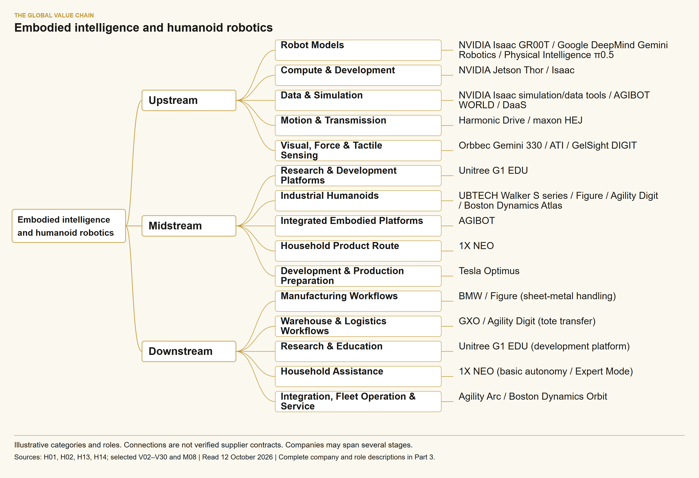
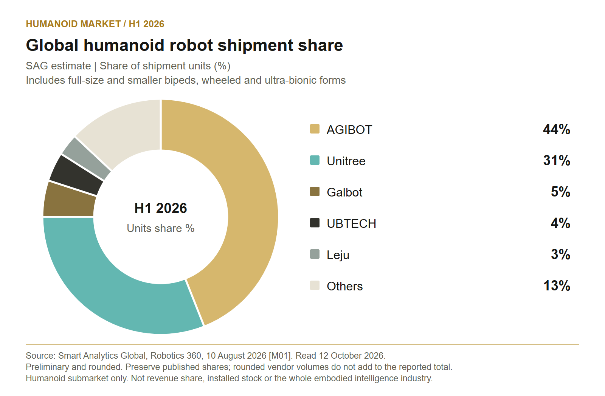
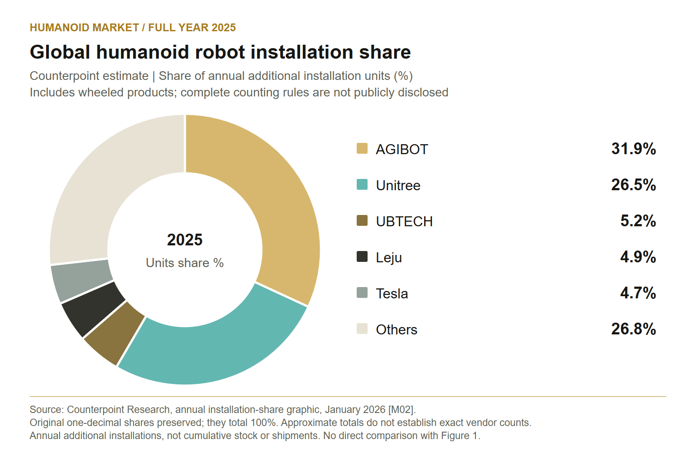
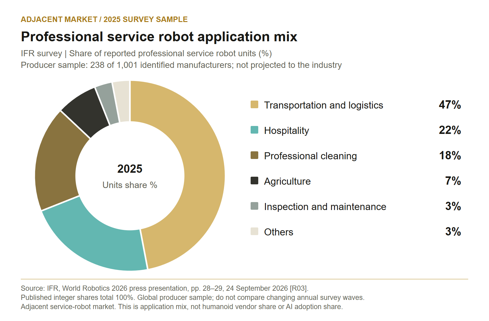

Report v2 · Evidence cutoff 12 October 2026.

Unitree G1 humanoid robot and Go2 quadruped on an exhibition stage at Japan Mobility Show 2025, Tokyo Big Sight, October 31, 2025. The photograph illustrates robot hardware and does not establish industrial autonomy. Photo: RuinDig / Yuki Uchida, via Wikimedia Commons. CC BY 4.0. Original photograph; reproduced without pixel changes.

Photo by <a href="https://commons.wikimedia.org/wiki/File:Japan-Mobility-Show-2025-RuinDig_0542.jpg" target="_blank" rel="noopener">RuinDig / Yuki Uchida</a>, <a href="https://creativecommons.org/licenses/by/4.0/" target="_blank" rel="noopener">CC BY 4.0</a>, via Wikimedia Commons. Reproduced without pixel changes.

For web display, the photograph has been proportionally resized and compressed; the downloadable original is unchanged.

Sources current to 12 October 2026. This report covers the global embodied intelligence ecosystem, with humanoid commercialization as a focus. Our central assessment is that defined tasks now have early commercial evidence, while dependable generalization, operating cost and application safety still determine the path to scale. Three separate charts retain their own market definitions, periods and metrics. None establishes company shares across the whole embodied intelligence industry.

Part 1 Industry Story • Part 2 Industry History • Part 3 Market Landscape including the value chain • Part 4 Industry Challenges • Separate Appendix Supporting Evidence

<a href="cover.jpg" download>Original cover photograph (3840 × 2160)</a>

<a href="report_en.txt" download>Complete English report</a> · <a href="supporting_evidence_en.txt" download>Supporting Evidence</a> · <a href="report_bilingual_v2.docx" download>Editable report (English and Chinese)</a>

<section data-report-field="history_en">

## Part 1 Industry Story {#part-1}

In February 2026, BMW published an operating record from a humanoid robot pilot at its Spartanburg plant in the United States. During ten months in 2025, Figure 02 supported production of more than 30,000 BMW X3 vehicles. Its assignment was to remove and position sheet-metal parts for welding. BMW reported more than 90,000 components moved and approximately 1,250 operating hours. These are figures for participation in a production process, rather than a claim that the robot independently built complete vehicles. They are customer-reported results, with fleet size and independently audited economics undisclosed. <a class="evidence-cite" href="#evidence-H01" aria-label="Evidence H01">[H01]</a>

The release did not disclose intervention or interruption rates, or a full cost breakdown. Its record supports accumulated work on a specific production task; it does not establish general autonomy or an audited return on investment. <a class="evidence-cite" href="#evidence-H01" aria-label="Evidence H01">[H01]</a>

Our interpretation is that this bounded assignment makes the case useful. A production task gives developers a place to measure whether perception, movement and handling work together repeatedly. It also gives the customer a clear unit of useful output. A robot reaching a component once and a robot reliably completing an assigned operation across a production program are different evaluation milestones. The published record supports discussion of the latter within this particular pilot, while leaving several commercial questions open.

Another route into commercial operation appeared in logistics. On 27 June 2024, GXO and Agility Robotics announced a multiyear Robots-as-a-Service agreement for Digit at a SPANX fulfillment facility, following a late-2023 pilot. The described work involved moving totes from collaborative robots onto conveyors, coordinated through Agility Arc. The companies characterized the agreement as an industry first; this report treats that superlative as their claim. The announcement supplied neither the contract value nor a fleet count. <a class="evidence-cite" href="#evidence-H02" aria-label="Evidence H02">[H02]</a>

The analytical significance of the RaaS arrangement is that it ties a robot to an ongoing operating service. For a customer considering such an arrangement, the relevant comparison is the cost and reliability of completing the assigned work over time. Equipment, software and support need to be considered together. The agreement establishes a commercial structure; it does not, by itself, establish a favorable cost comparison with every other way of handling the same totes.

The BMW story also continued. On 25 June 2026, the automaker announced a Figure 03 project for logistics sequencing: picking components from containers, arranging them in a trolley, and handing onward transport to established automation. The release described the next application in forward-looking terms. It did not publish a completed operating record equivalent to the earlier Figure 02 pilot. <a class="evidence-cite" href="#evidence-H03" aria-label="Evidence H03">[H03]</a>

Taken together, these cases suggest the organizing question for this report: which physical tasks can an intelligent robot perform dependably, under what operating conditions, and at what total cost? Embodied intelligence concerns systems that connect perception and decision-making to physical action; a humanoid is one possible physical form. Keeping those scopes distinct allows us to examine the broader model and component ecosystem while testing humanoid business claims against specific customer applications. The industry&#x27;s progress should be assessed through the relationship between technical capability and useful work, with demonstrations, pilots, commercial agreements and completed deployments identified separately.

## Part 2 Industry History {#part-2}

The history has two connected strands: the development of machines with humanlike movement and the development of intelligence that acts through a physical system. The stages below are this report&#x27;s analytical framework. They organize verified milestones without implying that every company followed the same path, or that one architecture inevitably replaced another. Their practical purpose is to explain why today&#x27;s competition includes mechanics, control, data, models and integration at the same time.

### Research humanoids established the mechanical problem {#history-research-humanoids-established-the-mechanical-problem}

Waseda University completed WABOT-1 in 1973. In its institutional history, the university describes it as widely regarded as the first full-scale humanoid robot. The system could walk on two legs, grasp objects and conduct simple communication in Japanese. Waseda&#x27;s WABOT-2, introduced in 1984, brought perception and coordinated movement to a specialized musical task. The qualification “full-scale” matters: it defines the historical claim rather than establishing an unrestricted first in all robotics. <a class="evidence-cite" href="#evidence-H04" aria-label="Evidence H04">[H04]</a>

Honda began its humanoid robotics research in 1986, presented P2 in 1996 and P3 in 1997, and announced ASIMO on 20 November 2000. Its original release emphasized a smaller body and smoother walking through i-WALK control. The launch specifications listed a height of 1.2 meters and a mass of 43 kilograms, with workstation and handheld-controller operation. These were engineering achievements in a particular generation of platform. <a class="evidence-cite" href="#evidence-H05" aria-label="Evidence H05">[H05]</a>

### Embodied intelligence also developed through a different research route {#history-embodied-intelligence-also-developed-through-a-different-research-route}

In his 1991 paper, “Intelligence without representation,” Rodney Brooks argued for building complete systems incrementally and testing them through real sensing and action. His behavior-based approach connected parallel activity layers directly to the environment; the paper described mobile robots operating in laboratory and office settings. It is one influential research route into embodied intelligence, rather than proof that Brooks invented the entire field or its terminology. <a class="evidence-cite" href="#evidence-H18" aria-label="Evidence H18">[H18]</a>

The methodological link is evaluation of a complete acting system under real constraints. Contemporary foundation models have different architectures; this report therefore compares tested capabilities across physical forms.

### The DARPA challenge put hardware and autonomy into demanding tasks {#history-the-darpa-challenge-put-hardware-and-autonomy-into-demanding-tasks}

DARPA&#x27;s July 2013 Atlas announcement introduced a humanoid platform for teams advancing from the Virtual Robotics Challenge. The platform combined hydraulic joints with sensing hardware; team-developed software and human operators guided its operation. The program connected simulated preparation to physical disaster-response tasks. <a class="evidence-cite" href="#evidence-H06" aria-label="Evidence H06">[H06]</a> The 2015 finals took place in Pomona, California, on 5–6 June. DARPA&#x27;s post-event account identifies KAIST&#x27;s DRC-Hubo as the top finisher and describes the winning teams&#x27; work. <a class="evidence-cite" href="#evidence-H07" aria-label="Evidence H07">[H07]</a>

In our reading, the challenge illustrated the importance of system integration. Teams using Atlas could pair a shared platform with different software, operator interfaces and strategies. The prerelease emphasized falls, battery management and partial autonomy under degraded communications. <a class="evidence-cite" href="#evidence-H06" aria-label="Evidence H06">[H06]</a><a class="evidence-cite" href="#evidence-H07" aria-label="Evidence H07">[H07]</a> Competition results should be assessed within their tasks and rules; commercial operation also requires evidence on reliability, maintenance, integration and economics.

### In 2023, foundation-model research expanded the learning question {#history-in-2023-foundation-model-research-expanded-the-learning-question}

PaLM-E, published in March 2023, embedded images and state observations into a language model to support embodied reasoning. Its output remained text: decisions or plans that a separate low-level policy or planner translated into physical actions. <a class="evidence-cite" href="#evidence-H08" aria-label="Evidence H08">[H08]</a> RT-2, published in July, took a more direct action-generation route by encoding robot actions as output tokens when adapting vision-language models. Its authors explicitly cautioned that web-scale pretraining improved semantic and visual generalization without creating new physical motions beyond the robot training data&#x27;s skill distribution. <a class="evidence-cite" href="#evidence-H09" aria-label="Evidence H09">[H09]</a>

Open X-Embodiment, first published in October 2023, investigated learning across robot platforms. The version read for this report, dated May 2025, describes data from 22 robotic embodiments contributed by 21 institutions. It studies positive transfer in manipulation and explains that robotics interaction data remains limited in breadth compared with vision and language datasets. These counts describe a research dataset, rather than shipments or customer deployments. <a class="evidence-cite" href="#evidence-H10" aria-label="Evidence H10">[H10]</a>

Our interpretation is that these projects changed how to formulate the learning problem. A developer could investigate whether knowledge learned elsewhere helped a robot interpret a situation, plan a task or reuse skills. The three examples address different links in that chain: grounded reasoning, action generation and cross-platform experience. Their differences matter commercially. Strong language understanding does not establish movement coverage; shared data does not guarantee transfer to every body; and a successful benchmark does not establish continuous operating performance. The model&#x27;s role and the evidence for its particular capability must remain explicit.

### Policy began addressing a complete industrial ecosystem {#history-policy-began-addressing-a-complete-industrial-ecosystem}

China&#x27;s Ministry of Industry and Information Technology published humanoid robotics development guidance on 2 November 2023; the underlying document was dated 20 October. It set goals for 2025 and 2027 spanning models, motion control, components, production, application demonstrations and governance. The ministry&#x27;s explanation also identified weaknesses in parts, operating systems, complete products and the industrial ecosystem. These are policy goals and diagnoses, rather than measured proof that the targets were achieved. <a class="evidence-cite" href="#evidence-H19" aria-label="Evidence H19">[H19]</a>

### From 2024, commercial trials supplied a different kind of evidence {#history-from-2024-commercial-trials-supplied-a-different-kind-of-evidence}

Boston Dynamics moved from hydraulic Atlas to an electric platform in April 2024. Its official introduction described a staged application-testing program beginning with Hyundai and emphasized the surrounding requirements of industrial deployment, including workflows and infrastructure. The current page does not display a precise publication day, so this report keeps the event at month-level resolution. <a class="evidence-cite" href="#evidence-H11" aria-label="Evidence H11">[H11]</a>

The GXO–Agility agreement described in Part 1 supplied a contractual example of RaaS. <a class="evidence-cite" href="#evidence-H02" aria-label="Evidence H02">[H02]</a> BMW&#x27;s August 2024 Figure 02 trial supplied customer-side evidence from several weeks of sheet-metal handling tests. At that announcement date, BMW explicitly stated that no Figure robots remained at Spartanburg and that no return timetable had been established. <a class="evidence-cite" href="#evidence-H17" aria-label="Evidence H17">[H17]</a> The later 2025 pilot record belongs to a subsequent stage. <a class="evidence-cite" href="#evidence-H01" aria-label="Evidence H01">[H01]</a>

### In 2025 to 2026 model ecosystems and product programs advanced together {#history-in-2025-to-2026-model-ecosystems-and-product-programs-advanced-together}

DeepMind introduced two complementary models in March 2025: Gemini Robotics, a VLA with physical-action outputs, and Gemini Robotics-ER, which provides spatial reasoning and connects to existing low-level controllers. The announcement described primarily ALOHA 2 bi-arm training for the VLA, adaptation to other platforms and work with Apptronik. <a class="evidence-cite" href="#evidence-H12" aria-label="Evidence H12">[H12]</a> NVIDIA released the customizable GR00T N1 that month, with reasoning/action architecture and post-training for particular robots or tasks. <a class="evidence-cite" href="#evidence-H13" aria-label="Evidence H13">[H13]</a> In September, DeepMind introduced Robotics 1.5 and Robotics-ER 1.5 for action generation and reasoning, and high-level planning and tool use, respectively. At launch, ER had developer API access while the VLA was available to selected partners. <a class="evidence-cite" href="#evidence-H14" aria-label="Evidence H14">[H14]</a>

The hardware programs also developed. Boston Dynamics unveiled the product version of Atlas on 5 January 2026 and announced immediate manufacturing, with 2026 deployments scheduled for Hyundai&#x27;s RMAC and Google DeepMind. Scheduled fleets are prospective commitments in that release. <a class="evidence-cite" href="#evidence-H15" aria-label="Evidence H15">[H15]</a> BMW&#x27;s June Figure 03 project described a next logistics application. <a class="evidence-cite" href="#evidence-H03" aria-label="Evidence H03">[H03]</a> NVIDIA&#x27;s March 2026 release announced GR00T N1.7 and previewed N2 for expected year-end availability; the preview alone cannot establish that N2 had launched by this report&#x27;s cutoff. <a class="evidence-cite" href="#evidence-H16" aria-label="Evidence H16">[H16]</a>

</section>

<section data-report-field="chain_en">

## Part 3 Market Landscape {#part-3}

Embodied intelligence describes a system that perceives, decides and acts through a physical body; a humanoid describes one possible body configuration. The distinction matters commercially. Google DeepMind tests transfer across ALOHA 2, a humanoid and a dual-arm platform, while Physical Intelligence studies mobile manipulation in unfamiliar homes. Neither line of work limits the intelligence layer to a two-legged machine. This report therefore treats robot models, development infrastructure and physical components as an enabling value chain, and distinguishes that broad ecosystem from narrower humanoid shipment statistics. <a class="evidence-cite" href="#evidence-H14" aria-label="Evidence H14">[H14]</a><a class="evidence-cite" href="#evidence-V05" aria-label="Evidence V05">[V05]</a>

The upstream, midstream and downstream divisions below are the report&#x27;s analytical classification. Upstream supplies computation, sensing, motion hardware, models and training resources. Midstream combines them into a robot with a usable control system. Downstream turns that robot into a functioning workflow and maintains it. The industry mindmap follows industry → upstream/midstream/downstream → subsegment → representative company or product. Its lines indicate categories. They do not establish that a component manufacturer supplies every robot company shown elsewhere in the diagram. Several companies occupy more than one category because they develop both hardware and intelligence.

### Models computation and data {#chain-models-computation-and-data}

At the intelligence layer, NVIDIA&#x27;s Isaac GR00T combines customizable robot models with simulation and data-generation tools. Its N1.6 research release includes evaluation across multiple real robot platforms. Google DeepMind separately combines embodied reasoning with a vision-language-action model, while Physical Intelligence develops generalist manipulation policies. These are different technical and distribution approaches rather than interchangeable finished robot products. Model availability also requires precise language: access to an API, downloadable weights and participation in a restricted testing program confer different rights and capabilities. The report does not infer a commercial licensing fee or model-market revenue from a research release. <a class="evidence-cite" href="#evidence-H13" aria-label="Evidence H13">[H13]</a><a class="evidence-cite" href="#evidence-V02" aria-label="Evidence V02">[V02]</a><a class="evidence-cite" href="#evidence-H14" aria-label="Evidence H14">[H14]</a><a class="evidence-cite" href="#evidence-V05" aria-label="Evidence V05">[V05]</a>

Onboard computation is another product layer. NVIDIA announced general availability of Jetson AGX Thor and the T5000 module in August 2025. Its documented stack spans hardware interfaces, real-time control, perception and planning, and higher-level reasoning. This makes the platform relevant to both manufacturers and developers integrating models into machines. Purchasing a computer does not complete the sensing, motor control, power or safety system. The business role is supplying computing hardware and development infrastructure. Responsibilities for the resulting machine and its application still need to be defined. <a class="evidence-cite" href="#evidence-V03" aria-label="Evidence V03">[V03]</a>

Data is also becoming a product and service. AGIBOT&#x27;s official DaaS menu lists customized data, customized collection environments, collection-system rental and thematic subscriptions. Its AGIBOT WORLD 2026 description discusses synchronized multimodal recordings, teleoperated collection and annotated recovery from errors. These materials demonstrate a data-service role alongside the company&#x27;s robot role. They do not reveal that service&#x27;s revenue, customer savings or profitability. Open data should be assessed under its specific license; a public announcement does not automatically authorize unrestricted redistribution. <a class="evidence-cite" href="#evidence-V12" aria-label="Evidence V12">[V12]</a><a class="evidence-cite" href="#evidence-V13" aria-label="Evidence V13">[V13]</a>

### Motion and perception {#chain-motion-and-perception}

The physical chain begins with motion. Motors, transmissions, bearings, encoders, controllers and structural parts have to work as one joint. Harmonic Drive represents precision strain-wave transmission: its mechanism uses a wave generator, flexspline and circular spline. maxon&#x27;s HEJ family represents an integrated quasi-direct-drive approach using planetary gears and torque sensing. These examples illustrate alternative building blocks, rather than one universal joint architecture. A manufacturer can purchase components, buy an integrated actuator or develop its own assembly. The relevant customer value is controllable motion within a mass, thermal and durability budget, with performance maintained through repeated use. <a class="evidence-cite" href="#evidence-V06" aria-label="Evidence V06">[V06]</a><a class="evidence-cite" href="#evidence-V07" aria-label="Evidence V07">[V07]</a>

Perception has several distinct roles. Orbbec&#x27;s Gemini 330 depth cameras and Jetson Thor integration represent visual sensing and its interface with computing. ATI&#x27;s six-axis force/torque products measure forces and moments, while GelSight&#x27;s DIGIT is a tactile research sensor for learning manipulation. These categories support different information: the scene, forces at a mechanical interface, and local contact. DIGIT the sensor should not be confused with Agility&#x27;s Digit robot. Including these firms in the mindmap documents their product categories, not a verified supply contract with the humanoid manufacturers named in this report. <a class="evidence-cite" href="#evidence-V09" aria-label="Evidence V09">[V09]</a><a class="evidence-cite" href="#evidence-V30" aria-label="Evidence V30">[V30]</a><a class="evidence-cite" href="#evidence-V08" aria-label="Evidence V08">[V08]</a>

### Robot manufacturers and applications {#chain-robot-manufacturers-and-applications}

At the complete-machine layer, research equipment and industrial systems need to be separated. Unitree&#x27;s G1 and G1 EDU specifications show different configurations and development access; a basic hardware offer cannot be treated as the price or capability of a fully equipped research platform. AGIBOT combines models with multiple physical configurations, and its June 2026 announcement reports a cumulative production milestone. UBTECH&#x27;s industrial Walker S series focuses on handling, sorting and inspection, with battery management integrated into the system. The three examples show different routes into a developing market; their published product portfolios do not establish comparable end-user productivity. <a class="evidence-cite" href="#evidence-V10" aria-label="Evidence V10">[V10]</a><a class="evidence-cite" href="#evidence-V11" aria-label="Evidence V11">[V11]</a><a class="evidence-cite" href="#evidence-M08" aria-label="Evidence M08">[M08]</a>

Other manufacturers illustrate the importance of application engineering. Figure&#x27;s BMW deployment involves a defined production task. Agility combines Digit and Arc with GXO&#x27;s existing automation. Boston Dynamics&#x27; Atlas materials describe robot, fleet software and enterprise-system integration, alongside an early-customer deployment journey. Selling an industrial humanoid therefore extends beyond delivering a body: the supplier has to translate a customer&#x27;s process into sensing, actions, exception handling and maintenance. Specific stage labels should be preserved—trial, contracted commercial deployment and a wider rollout are different claims. <a class="evidence-cite" href="#evidence-V16" aria-label="Evidence V16">[V16]</a><a class="evidence-cite" href="#evidence-H02" aria-label="Evidence H02">[H02]</a><a class="evidence-cite" href="#evidence-V19" aria-label="Evidence V19">[V19]</a>

The household route introduces another operating model. 1X&#x27;s NEO launch describes basic initial autonomy supplemented by expert guidance for unfamiliar tasks. Tesla&#x27;s second-quarter 2026 filing, meanwhile, describes continued Optimus development and preparations and investments for large-scale production. Both are participants at the integrated-machine layer, but these disclosures are different forms of evidence. A preorder offer demonstrates an intended customer proposition; production preparation demonstrates investment in future capability. Neither should be converted into an independently verified installed base or profitable autonomous labor service. <a class="evidence-cite" href="#evidence-V20" aria-label="Evidence V20">[V20]</a><a class="evidence-cite" href="#evidence-V22" aria-label="Evidence V22">[V22]</a>

### Delivery and business models {#chain-delivery-and-business-models}

Downstream is where these technologies acquire an economic purpose. Manufacturers need reliable loading, handling, sorting and inspection. Logistics operators need dependable transfer between equipment already in place. Research and education customers need development access and repeatable experiments. Household buyers need useful assistance in variable spaces. These are distinct customer jobs, rather than a single interchangeable market. An integrator, fleet operator or service team connects the robot to the actual work: defining the task, arranging interfaces, accepting the installation, managing exceptions and supporting operation. The value created must be demonstrated for each application.

Three business-model categories help organize the evidence. Equipment sales transfer a machine and associated obligations under a specified package. The GXO–Agility agreement illustrates Robots-as-a-Service; AGIBOT offers data services. These categories do not imply identical risk allocation: buyers still need to examine who pays for integration, downtime, remote assistance and replacement parts. An appealing subscription price can coexist with substantial implementation work, just as a low hardware price can coexist with an expensive development project. <a class="evidence-cite" href="#evidence-H02" aria-label="Evidence H02">[H02]</a><a class="evidence-cite" href="#evidence-V13" aria-label="Evidence V13">[V13]</a>

The report&#x27;s analytical conclusion is that competition occurs at several levels simultaneously. Component firms compete on controllable performance and supply quality; infrastructure firms on development and deployment capability; robot makers on a usable machine; and application providers on an accepted outcome. A manufacturer&#x27;s role, a robot&#x27;s body shape and its operating maturity should therefore be shown separately. For downstream purchasing, the most informative comparison is the cost and quality of a completed job under the same conditions. A catalog specification, a cumulative production count and a successful demonstration each provide useful evidence, but answer different questions.

</section>



Industry → upstream midstream downstream → segments → representative companies or products. The map is an analytical classification, not a list of verified supply contracts. Several firms appear in multiple roles; early product programs remain identified as such in the text.

View the static figure and editable files
<figure class="research-photo"><figcaption>Industry → upstream midstream downstream → segments → representative companies or products. The map is an analytical classification, not a list of verified supply contracts. Several firms appear in multiple roles; early product programs remain identified as such in the text.</figcaption></figure>
<a href="value_chain.png">Full-size PNG</a> · <a href="value_chain.svg">Editable SVG</a> · <a href="charts_data_and_methods.json" download>Figure data and methods</a>

Read the detailed company and product outline
<section data-report-field="map-outline_en">

Embodied intelligence and humanoid robotics   Upstream     Robot Models       NVIDIA Isaac GR00T       Google DeepMind Gemini Robotics       Physical Intelligence π0.5     Compute &amp; Development       NVIDIA Jetson Thor / Isaac     Data &amp; Simulation       NVIDIA Isaac simulation/data tools       AGIBOT WORLD / DaaS     Motion &amp; Transmission       Harmonic Drive: strain-wave gears       maxon HEJ: integrated joints     Visual, Force &amp; Tactile Sensing       Orbbec Gemini 330: depth cameras       ATI: force/torque sensors       GelSight DIGIT: tactile sensor   Midstream     Research &amp; Development Platforms       Unitree G1 EDU     Industrial Humanoids       UBTECH Walker S series       Figure       Agility Digit       Boston Dynamics Atlas     Integrated Embodied Platforms       AGIBOT     Household Product Route       1X NEO     Development &amp; Production Preparation       Tesla Optimus   Downstream     Manufacturing Workflows       BMW / Figure (sheet-metal handling)     Warehouse &amp; Logistics Workflows       GXO / Agility Digit (tote transfer)     Research &amp; Education       Unitree G1 EDU (development platform)     Household Assistance       1X NEO (basic autonomy / Expert Mode)     Integration, Fleet Operation &amp; Service       Agility Arc / Boston Dynamics Orbit

</section>

<section data-report-field="market_en">

### What the market boundaries allow the numbers to say {#market-what-the-market-boundaries-allow-the-numbers-to-say}

Embodied intelligence spans models, data, computing, physical machines and operating services. Humanoid robotics is one product category within that broader activity. The public materials actually read for this report do not establish a unified global denominator for company shares across the whole industry. We therefore use two separate windows into humanoid hardware: additional installations during 2025, and shipments during the first half of 2026. Each retains its publisher&#x27;s definition and period. The charts cannot establish a company&#x27;s share gain or loss between those windows, or represent the whole embodied-intelligence industry.<a class="evidence-cite" href="#evidence-M01" aria-label="Evidence M01">[M01]</a><a class="evidence-cite" href="#evidence-M02" aria-label="Evidence M02">[M02]</a>

Counterpoint estimates approximately 16,000 additional humanoid installations worldwide in 2025. Its original graphic assigns AGIBOT 31.9%, Unitree 26.5%, UBTECH 5.2%, Leju 4.9%, Tesla 4.7% and other vendors 26.8%. These measure annual additional installations, rather than cumulative installed stock or external sales revenue. The article discusses AGIBOT&#x27;s X2 and G2, so wheeled products are present; a complete installation-counting methodology is not disclosed. The published one-decimal shares total 100%. The approximate overall volume must not be converted into exact vendor unit counts.<a class="evidence-cite" href="#evidence-M02" aria-label="Evidence M02">[M02]</a>

SAG&#x27;s preliminary estimate for global humanoid shipments in H1 2026 is approximately 19,100 units. Its same-source graphic assigns AGIBOT 44%, Unitree 31%, Galbot 5%, UBTECH 4%, Leju 3% and others 13%, totaling 100%. Its definition covers full-size bipeds, smaller bipeds, wheeled robots and ultra-bionic robots; Leju includes KUAVO but excludes Aelos and Roban. All figures are rounded and preliminary. Displayed vendor volumes total 19,000, leaving a 100-unit difference from the published total. That does not authorize changing the published percentages.<a class="evidence-cite" href="#evidence-M01" aria-label="Evidence M01">[M01]</a>

A separately read Counterpoint article places H1 2026 shipments above 22,000. That differs from SAG&#x27;s approximately 19,100, and the public articles do not disclose enough methodological detail to explain the entire difference. This report attributes each estimate separately, preserves its denominator and does not average or splice them. Early-market statistics are sensitive to product boundaries and counting methods. Year-over-year measures are interpretable only within a research provider&#x27;s consistent series.<a class="evidence-cite" href="#evidence-M03" aria-label="Evidence M03">[M03]</a>

### Customers and geography behind the rankings {#market-customers-and-geography-behind-the-rankings}

Hardware rankings can conceal what a supplier actually sells and to whom. A research platform, a performance-rental robot, a data-collection machine and a robot moving materials in a factory may all appear in a provider&#x27;s humanoid count. Their revenue structures, operating difficulty and customer acceptance requirements differ. Our analytical conclusion is that unit share helps describe manufacturing and channel scale; it cannot by itself measure industrial-automation capability or establish customer investment returns.

For the same H1 period, SAG estimates that Chinese vendors supplied more than 97% of global shipments and China accounted for more than 85% of demand. Vendor origin and demand location are distinct measures.<a class="evidence-cite" href="#evidence-M01" aria-label="Evidence M01">[M01]</a> A global assessment should therefore examine both China&#x27;s manufacturing scale and how customers abroad procure robots. Demonstrating a product in many countries and generating recurring, verifiable overseas order revenue are different levels of evidence. A geographic label should describe the relevant measure rather than stand in for an entire competitive narrative.

Application categories also change the interpretation. Counterpoint&#x27;s H1 2026 estimate leaves entertainment and performance, together with data production and research, above 60% of shipments. Intelligent manufacturing and warehousing and logistics account for approximately 13% and 5%, respectively. These describe Counterpoint&#x27;s categories and cannot replace another provider&#x27;s application assumptions.<a class="evidence-cite" href="#evidence-M03" aria-label="Evidence M03">[M03]</a> In our assessment, early research and performance orders can provide income, developer relationships and production utilization. Whether they become repeat industrial purchases must be examined through renewals, unattended operating time and the cost of supporting customer sites. A growing installed population can be commercially useful without yet proving generalized labor substitution.

### Shipping, acceptance and profit are different stages {#market-shipping-acceptance-and-profit-are-different-stages}

In January 2026, Unitree&#x27;s official clarification described more than 5,500 pure humanoids in 2025 as actually sold and delivered to end customers, and reported production exceeding 6,500; it expressly excluded dual-arm wheeled products.<a class="evidence-cite" href="#evidence-M05" aria-label="Evidence M05">[M05]</a> Its later prospectus records production of 5,716, shipments of 5,511 and recognized sales of 5,215. It explains that some products had shipped under contracts but had not completed receipt, acceptance or other revenue-recognition procedures by year-end.<a class="evidence-cite" href="#evidence-M07" aria-label="Evidence M07">[M07]</a> The public materials do not fully reconcile the January production figure or the “sold and delivered” wording with the later table. Each disclosure should retain its own date and definition. Factory output, shipment, recognized sales and orders are distinct stages and cannot be added together to measure market size.

That prospectus reports RMB867.8319 million of humanoid main-business revenue in 2025, accounting for 51.78% of main-business revenue. The average humanoid selling price was RMB166,400, down 36.10%. This reflects the company&#x27;s recognized sales and model mix; it is not a uniform global robot price.<a class="evidence-cite" href="#evidence-M07" aria-label="Evidence M07">[M07]</a> Company-wide revenue was RMB1,699.2693 million, consolidated gross margin 60.44%, and profit attributable to the parent after excluding nonrecurring items RMB590.7528 million.<a class="evidence-cite" href="#evidence-M06" aria-label="Evidence M06">[M06]</a> Quadrupeds and components also contribute to the business. Group profitability does not establish the same net margin for humanoids. The 51.78% denominator is main-business revenue and must not be applied directly to total company revenue.

UBTECH offers a different operating example. Its 2025 group revenue was RMB2,000.999 million. Full-size embodied-intelligent humanoid products and services generated RMB820.557 million, or 41.1%, with 1,079 relevant unit sales. Group gross margin was 37.7%, and group net loss RMB789.823 million.<a class="evidence-cite" href="#evidence-M08" aria-label="Evidence M08">[M08]</a> These figures do not calculate a loss per humanoid. Other robots and hardware sit within the group, the category includes services, and research and selling expenditure cannot simply be divided by those 1,079 units. Comparing companies requires matching products, accounting perimeter and the level at which profit is reported.

The latest readable interim announcement available by the research cutoff reports unaudited H1 2026 group revenue of RMB1,269.130 million, up 104.2%. Full-size embodied-humanoid products and services generated RMB590.299 million, or 46.5%, with 921 unit sales. Group gross margin rose to 44.7%, while group net loss remained RMB338.827 million. The disclosure also changed business categories and included newly acquired activities.<a class="evidence-cite" href="#evidence-M09" aria-label="Evidence M09">[M09]</a> Assessing improvement requires considering revenue, gross profit, operating expenditure and changes to the company perimeter together. H1 unit sales cannot be compared directly with the previous full year to calculate annual growth; a company&#x27;s internal revenue proportion is not market share.

### Funding scale and commercial revenue belong on separate lines {#market-funding-scale-and-commercial-revenue-belong-on-separate-lines}

In September 2025, Figure announced more than USD1 billion of committed Series C capital at a USD39 billion post-money valuation, with manufacturing, training infrastructure and real-world data collection among the intended uses.<a class="evidence-cite" href="#evidence-M10" aria-label="Evidence M10">[M10]</a> In February 2026, Apptronik announced a USD520 million Series A-X extension. Together with the earlier USD415 million Series A, its Series A exceeded USD935 million, bringing total capital raised close to USD1 billion. Its announcement names Mercedes-Benz, GXO, Jabil and Google DeepMind as partners.<a class="evidence-cite" href="#evidence-M11" aria-label="Evidence M11">[M11]</a> These disclosures establish access to expansion resources. They do not establish operating revenue, customer spending or successful utilization of manufacturing capacity.

An accumulated round total must not be added again to an extension already included in that total. Likewise, valuation incorporates investors&#x27; expectations about future scale, intellectual property and execution; it does not promise a multiple of current profits. Our assessment is that competition unfolds simultaneously through manufacturing cost, model development and customer delivery. Capital can extend the period available for validation, but it cannot replace validation at operating sites. Regional comparisons should distinguish completed sales, contracts, pilots, capacity targets and financing rather than using one category as a proxy for another.

A useful commercial assessment consequently asks what the financing enables and what still needs to happen before it becomes revenue. Factory investment needs products that customers will accept. Training investment needs capabilities that work within customer constraints. Data collection needs rights, quality control and a path into improved performance. These are analytical questions, not claims that every funded project will succeed or fail. Applying the same questions to all companies makes the comparison more informative than ranking fundraising totals alone.

### Customer sites are defining what can be charged for {#market-customer-sites-are-defining-what-can-be-charged-for}

The customer-confirmed GXO agreement described in P1 gives a concrete RaaS example. Published terms leave price, fleet size, service levels and payback undisclosed.<a class="evidence-cite" href="#evidence-H02" aria-label="Evidence H02">[H02]</a> The announcement establishes a contract and a defined workflow. Replicating it across facilities still depends on local conditions, integration work and sustained support. An operating agreement is stronger evidence than a demonstration, while remaining short of a published industry-wide return on investment.

BMW confirmed in June 2026 that Figure 02 supported the production of more than 30,000 BMW X3 vehicles over ten months in 2025, inserting sheet-metal parts within a welding process. A follow-on Figure 03 project moves to component sequencing in logistics, connecting with other transport automation.<a class="evidence-cite" href="#evidence-H03" aria-label="Evidence H03">[H03]</a> Supporting vehicle production does not mean independently manufacturing whole cars. The case is valuable because it identifies a work step, interfaces and a subsequent task; vehicle throughput must not become a substitute for robot sales. Customers buy a workable contribution to their process, rather than an abstract claim of generality.

Our assessment is that the commercial product may be an operating workflow: hardware, task software, maintenance, remote support and interfaces with customer systems. An equipment sale centers on delivery and acceptance; RaaS centers on continuing availability and operating cost. These structures allocate responsibilities differently. A low purchase price alone does not show that the customer receives a low-cost service, and a subscription alone does not establish that the supplier has attractive recurring margins. The relevant evidence includes who owns the equipment, who responds to faults and what constitutes accepted performance.

For a customer, choosing a humanoid, a wheeled dual-arm machine or specialized automation requires comparing safety, throughput, space, maintenance and total cost for the same task. Human-like appearance does not perform that comparison. Existing automation may remain part of the process even when a humanoid is introduced. Industry competition should therefore be judged increasingly by reliably delivered, billable work under stated conditions. This framework leaves room for different physical forms and business models without pretending that every promising prototype has reached the same commercial stage.

This report excludes Omdia&#x27;s January 2026 version of its 2025 vendor-share graphic. The associated shipment table has an internal 50-unit discrepancy, and later first-party Unitree disclosures exceed its earlier estimate. The original report and graphic were actually checked; the exclusion is documented in Supporting Evidence.<a class="evidence-cite" href="#evidence-M04" aria-label="Evidence M04">[M04]</a><a class="evidence-cite" href="#evidence-M05" aria-label="Evidence M05">[M05]</a>

</section>

<section data-report-field="context_en">

### Adjacent markets and different robot definitions {#context-adjacent-markets-and-different-robot-definitions}

Established automation provides an alternative against which humanoid systems must be assessed. IFR reports around five million industrial robots in operation in 2025 and more than 600,000 new installations that year. These are industrial-robot stock and flow, with no measurement of embodied AI adoption. <a class="evidence-cite" href="#evidence-R01" aria-label="Evidence R01">[R01]</a>

IFR separately reports about 7,000 full-size humanoids above 140 cm sold worldwide in 2025 for commercial and professional use beyond research and entertainment. That narrower boundary cannot be reconciled by subtraction with the broader humanoid estimates above. <a class="evidence-cite" href="#evidence-R02" aria-label="Evidence R02">[R02]</a>

Figure 3 describes professional service robot applications within IFR’s producer sample. Its purpose is to show established task markets where new systems face existing alternatives. The sample is not projected to the industry and changes annually; the chart neither counts humanoids alone nor classifies AI adoption. <a class="evidence-cite" href="#evidence-R03" aria-label="Evidence R03">[R03]</a>

</section>

### Figure 1 Global humanoid shipment share in H1 2026 {#figure_1_shipments_2026H1}



Worldwide humanoid shipment units under SAG’s four-form definition. The preliminary, rounded estimate includes wheeled robots. Each published share is preserved. <a class="evidence-cite" href="#evidence-M01" aria-label="Evidence M01">[M01]</a>

Published shares total 100%. Listed vendor volumes sum to 19.0K while the total is 19.1K. This chart does not measure productive autonomous workers or total embodied intelligence. Do not compare its shares directly with Figure 2.

View published unit volumes

<table><caption>Global humanoid robot shipment share · H1 2026 · Global, under SAG definition</caption><thead><tr><th scope="col">Company or application</th><th scope="col">Share</th><th scope="col">Published unit volume</th></tr></thead><tbody><tr><th scope="row">AGIBOT</th><td>44%</td><td>8.4K rounded</td></tr><tr><th scope="row">Unitree</th><td>31%</td><td>5.9K rounded</td></tr><tr><th scope="row">Galbot</th><td>5%</td><td>0.9K rounded</td></tr><tr><th scope="row">UBTECH</th><td>4%</td><td>0.7K rounded</td></tr><tr><th scope="row">Leju</th><td>3%</td><td>0.6K rounded</td></tr><tr><th scope="row">Others</th><td>13%</td><td>2.5K rounded</td></tr></tbody></table>

View the static figure and editable files
<figure class="research-photo"><figcaption>Worldwide humanoid shipment units under SAG’s four-form definition. The preliminary, rounded estimate includes wheeled robots. Each published share is preserved. <a class="evidence-cite" href="#evidence-M01" aria-label="Evidence M01">[M01]</a></figcaption></figure>
<a href="figure_1_shipments_2026H1.png">Full-size PNG</a> · <a href="figure_1_shipments_2026H1.svg">Editable SVG</a> · <a href="figure_1_shipments_2026H1.csv" download>Data CSV</a> · <a href="charts_data_and_methods.json" download>Figure data and methods</a>

### Figure 2 Global humanoid installation share in 2025 {#figure_2_installations_2025}



Counterpoint’s estimate of worldwide annual additional humanoid installations. Wheeled products are present; the complete counting methodology is undisclosed. The original one-decimal shares are retained. <a class="evidence-cite" href="#evidence-M02" aria-label="Evidence M02">[M02]</a>

Shares total 100%. This is neither cumulative installed stock nor recognized sales. Its period, source and metric differ from Figure 1. The publication is dated January 2026; its body contains an apparent 2025 dateline typo, recorded in the appendix.

View the static figure and editable files
<figure class="research-photo"><figcaption>Counterpoint’s estimate of worldwide annual additional humanoid installations. Wheeled products are present; the complete counting methodology is undisclosed. The original one-decimal shares are retained. <a class="evidence-cite" href="#evidence-M02" aria-label="Evidence M02">[M02]</a></figcaption></figure>
<a href="figure_2_installations_2025.png">Full-size PNG</a> · <a href="figure_2_installations_2025.svg">Editable SVG</a> · <a href="figure_2_installations_2025.csv" download>Data CSV</a> · <a href="charts_data_and_methods.json" download>Figure data and methods</a>

### Figure 3 Professional service robot application mix in the 2025 IFR sample {#figure_3_service_applications_2025}



Adjacent-market context. IFR’s survey covers 238 of 1,001 identified producers across the reported service-robot statistics and is not extrapolated to the whole industry. This chart shows the professional-use application mix within that survey. <a class="evidence-cite" href="#evidence-R03" aria-label="Evidence R03">[R03]</a>

The six published rounded shares total 100%; the listed units total 249,568. Sample composition changes annually. These categories do not measure embodied AI adoption or humanoid demand. Original values are retained rather than normalized.

View published unit volumes

<table><caption>Professional service robot application mix · 2025 · Worldwide producer survey sample</caption><thead><tr><th scope="col">Company or application</th><th scope="col">Share</th><th scope="col">Published unit volume</th></tr></thead><tbody><tr><th scope="row">Transportation and logistics</th><td>47%</td><td>117488</td></tr><tr><th scope="row">Hospitality</th><td>22%</td><td>55941</td></tr><tr><th scope="row">Professional cleaning</th><td>18%</td><td>44644</td></tr><tr><th scope="row">Agriculture</th><td>7%</td><td>17141</td></tr><tr><th scope="row">Inspection and maintenance</th><td>3%</td><td>6467</td></tr><tr><th scope="row">Others</th><td>3%</td><td>7887</td></tr></tbody></table>

View the static figure and editable files
<figure class="research-photo"><figcaption>Adjacent-market context. IFR’s survey covers 238 of 1,001 identified producers across the reported service-robot statistics and is not extrapolated to the whole industry. This chart shows the professional-use application mix within that survey. <a class="evidence-cite" href="#evidence-R03" aria-label="Evidence R03">[R03]</a></figcaption></figure>
<a href="figure_3_service_applications_2025.png">Full-size PNG</a> · <a href="figure_3_service_applications_2025.svg">Editable SVG</a> · <a href="figure_3_service_applications_2025.csv" download>Data CSV</a> · <a href="charts_data_and_methods.json" download>Figure data and methods</a>

<section data-report-field="challenges_en">

## Part 4: Industry Challenges {#part-4}

The difficult transition is from a successful action to a dependable service. For this report, commercial maturity is assessed through a chain of practical questions: can the robot perform the required job, recover when it fails, maintain that performance over a working schedule, operate safely in its actual surroundings, and produce an economic benefit after all associated costs? The analysis below combines documented capabilities and limitations with proposed evaluation criteria; it does not place every company at the same stage. Progress on one measure should not automatically be treated as progress on all the others.

### Generalization and training data {#challenges-generalization-and-training-data}

Generalization remains an engineering boundary. Physical Intelligence&#x27;s π0.5 paper reports manipulation in homes outside its training environments, but identifies persistent difficulties with unfamiliar handles, physical opening resistance, occlusion, distracted subtask selection and limited context. These are research results with stated limits. The practical implication is that a buyer should define which variation the system has actually been tested against. A useful evaluation changes objects, their placement, lighting, access and task order, then records completed jobs and assistance. This report does not equate an unfamiliar test environment with open-ended competence in every home. <a class="evidence-cite" href="#evidence-V05" aria-label="Evidence V05">[V05]</a>

Data volume needs to be judged by what it represents. NVIDIA&#x27;s N1 announcement reports generating 780,000 synthetic trajectories in an internal experiment; that demonstrates a scaling tool rather than proof that every relevant physical situation has been modeled. AGIBOT&#x27;s dataset description retains error-recovery trajectories, illustrating that failures and corrective actions can form part of the learning record. Deployment decisions should examine scenario coverage, calibration, rare failures and real-machine validation alongside hours or episodes. Simulation provides a way to expand testing and training; its value must ultimately be checked against the task on physical hardware. <a class="evidence-cite" href="#evidence-H13" aria-label="Evidence H13">[H13]</a><a class="evidence-cite" href="#evidence-V12" aria-label="Evidence V12">[V12]</a>

### Reliability power and useful output {#challenges-reliability-power-and-useful-output}

Mechanical reliability can constrain otherwise capable software. Figure identifies the forearm as its leading hardware failure point at BMW and discusses compact packaging, dexterity and thermal constraints. It also defines cycle time, placement accuracy and intervention count as operational KPIs. Its published accuracy and intervention goals must remain goals unless achieved results are separately disclosed. The implication for procurement is to request distributions over normal shifts, not just a best run: repeated failures, repair time and performance drift can matter more than a demonstration&#x27;s peak speed. <a class="evidence-cite" href="#evidence-V16" aria-label="Evidence V16">[V16]</a>

Payload and endurance require conditions. Unitree explicitly notes that arm load varies with extension posture and that specifications vary with configuration and scenario. Atlas distinguishes an instantaneous 50 kg capacity from a sustained 30 kg capacity and publishes a four-hour battery figure. Those measures cannot be pooled into a single ranking of industrial productivity. A useful acceptance test specifies reach, object geometry, gripping method, movement, duration and required accuracy. It also separates powered hours from productive hours, because replenishment, maintenance and interventions interrupt output. <a class="evidence-cite" href="#evidence-V10" aria-label="Evidence V10">[V10]</a><a class="evidence-cite" href="#evidence-V19" aria-label="Evidence V19">[V19]</a>

Battery exchange addresses one interruption, with its own infrastructure. UBTECH advertises autonomous Walker S2 battery exchange within three minutes using a dual-battery system and charging stations. That is a product capability claim, not a published audit of uninterrupted round-the-clock availability. Similarly, more computing power has an energy cost: NVIDIA lists a 40–130 W range for the T5000 module, which is only one part of a robot&#x27;s power budget. A customer&#x27;s assessment should include stations, spare batteries, charging capacity and the energy consumed by motors and computation under the actual workload. <a class="evidence-cite" href="#evidence-V15" aria-label="Evidence V15">[V15]</a><a class="evidence-cite" href="#evidence-V03" aria-label="Evidence V03">[V03]</a>

### Safety throughout the operating lifecycle {#challenges-safety-throughout-the-operating-lifecycle}

Safety has to match the application. ISO 10218-1:2025 addresses industrial robot design; Part 2 addresses applications and integration. Their public scope excludes publicly accessible service and household uses and does not cover specified mobility hazards associated with mobile platforms. ISO 13482 addresses defined personal-care robot categories and excludes industrial and medical-device robots, among others. These are scope boundaries, not a reason to say humanoids have no relevant standards. A robot&#x27;s humanlike shape does not by itself identify the correct safety framework or establish conformity. <a class="evidence-cite" href="#evidence-V23" aria-label="Evidence V23">[V23]</a><a class="evidence-cite" href="#evidence-V24" aria-label="Evidence V24">[V24]</a><a class="evidence-cite" href="#evidence-V25" aria-label="Evidence V25">[V25]</a>

Mobility and dynamic balance add concerns beyond a stationary arm. A3&#x27;s October 2026 standards update discusses bystanders, stopping distance, protective and emergency stops, energy control, and continued safe operation after deployment. It describes dynamically stable humanoids within the industrial-mobile-robot landscape. A site assessment should consider the complete machine, its payload, its route and nearby people together. A new hand, a heavier object, a changed floor layout or a software update may change the conditions on which an earlier assessment relied. Safety is consequently a lifecycle responsibility. <a class="evidence-cite" href="#evidence-V26" aria-label="Evidence V26">[V26]</a>

Semantic safety and a dependable protective layer also have different functions. DeepMind describes both high-level safety reasoning and lower-level robot safeguards. Agility and FORT&#x27;s October 2026 announcement describes a planned Digit 5 architecture spanning a pendant, onboard communication and offboard interfaces. The latter remains a memorandum and forward-looking development disclosure. These sources support the need to distinguish reasoning about a safe action from an implemented protective function; they do not establish that a foundation model or an announced partnership provides universal certification for nearby human work. <a class="evidence-cite" href="#evidence-H14" aria-label="Evidence H14">[H14]</a><a class="evidence-cite" href="#evidence-V27" aria-label="Evidence V27">[V27]</a>

### Remote assistance and governance {#challenges-remote-assistance-and-governance}

Remote assistance is a service and cost boundary. NEO&#x27;s order page explicitly describes basic autonomy and scheduled Expert Mode for tasks it does not know, alongside remote-control options. Its ownership and subscription offers are different packages, not interchangeable estimates of total operating cost. The buyer needs a clear definition of autonomous completion, remote supervision and direct intervention. This report recommends measuring assistance minutes per accepted task and asking what happens when connectivity or a remote operator is unavailable. For a household or a confidential factory, the same arrangement also raises concrete questions about access to live views, data retention, permission and auditability. <a class="evidence-cite" href="#evidence-V21" aria-label="Evidence V21">[V21]</a>

Policy should be discussed with equivalent care. The European Commission&#x27;s explanation of product-related high-risk AI sets cumulative conditions involving a covered product or safety component and a required third-party conformity assessment. It does not classify every robot as high-risk merely because it uses AI. A practical assessment starts by documenting intended use and responsibility for the robot, AI functions and installation together; obligations may differ across industrial, consumer and other applications. Exact legal requirements must be checked against the applicable jurisdiction and product. <a class="evidence-cite" href="#evidence-V28" aria-label="Evidence V28">[V28]</a>

### Market access and product regulation {#challenges-market-access-and-product-regulation}

Market access now affects the global comparison. On 28 July 2026, the FCC added foreign-produced advanced robotic devices to its Covered List, subject to a DoW conditional-approval exception. The public notice prevents covered equipment from receiving FCC equipment authorization. The official FAQ says the production test is country-neutral; company nationality alone does not determine coverage. It also distinguishes new models from previously authorized ones: the July addition itself does not prohibit continued importing or selling of authorized models, or lawful consumer use. The report therefore does not describe an indiscriminate ban on existing foreign humanoids. <a class="evidence-cite" href="#evidence-V33" aria-label="Evidence V33">[V33]</a><a class="evidence-cite" href="#evidence-V34" aria-label="Evidence V34">[V34]</a>

Coverage depends on device characteristics and manufacturing status. The FCC&#x27;s FAQ describes qualifying ground-mobile machines, including humanoids and quadrupeds, with weight, environmental sensing, connectivity and controlling-software conditions; it excludes fixed, stationary industrial arms. A supplier&#x27;s body shape or headquarters is therefore insufficient for a compliance conclusion. Conditional exceptions also exist in practice: on 18 September, the FCC exempted ANSCER&#x27;s AR250, AR650 and AR1250 platforms, subject to continued compliance with an onshoring plan and updated vetting. For purchasers, model authorization and applicable exception status become part of procurement evidence. <a class="evidence-cite" href="#evidence-V34" aria-label="Evidence V34">[V34]</a><a class="evidence-cite" href="#evidence-V35" aria-label="Evidence V35">[V35]</a>

The EU timetable also requires version control. In its 27 July 2026 announcement, the European Commission states that AI Omnibus entered into force that day and that rules for high-risk AI embedded in Annex I physical products apply from 2 August 2028; the Annex III timetable is 2 December 2027. These dates are attributed to the Commission&#x27;s policy explanation. The report did not independently read the amended EUR-Lex legal text and does not treat every humanoid as high-risk. The cumulative classification conditions in the Commission&#x27;s Article 6(1) guidance remain the starting point for product-specific assessment. <a class="evidence-cite" href="#evidence-V36" aria-label="Evidence V36">[V36]</a><a class="evidence-cite" href="#evidence-V28" aria-label="Evidence V28">[V28]</a>

### Unit economics and purchasing evidence {#challenges-unit-economics-and-purchasing-evidence}

The economic test is total cost per accepted output. The report proposes an accounting framework that includes equipment or service payments, integration, site preparation, training and data, batteries and energy, maintenance and spares, software, supervision and insurance where relevant. Costs should be assigned without double-counting items already included in a service package. Accepted output should use the same quality standard as the alternative process. This is an author-developed assessment framework, not a disclosed company cost model or a forecast of industry margins.

A simple decision calculation is annual verified benefit minus annual recurring robot-related cost; a payback calculation is meaningful only if that net benefit is positive and the initial investment is defined. Benefit may include avoided paid work, additional saleable output or reduced rejects, but the same gain should not be counted twice. Availability, useful utilization, task quality and assistance affect the result. The comparison should include the available alternatives—a fixed arm, a mobile manipulator, existing automation, a redesigned process or human work—under the same required workload. No numerical payback or universal labor-substitution ratio is inferred here.

A cumulative shipment, factory rollout or operating-hours announcement does not provide all of those inputs. The report consequently recommends stage-specific evidence. For an early system, request repeatable task and recovery trials. For a pilot, request representative shifts, exception logs and measured integration effort. For a commercial service, request accepted output, actual assistance, downtime, full cost and contractual remedies. These measures connect the industry&#x27;s advances to an inspectable customer result while preserving what remains undisclosed.

</section>

## Appendix Supporting Evidence {#supporting-evidence}

<section data-report-field="evidence_en">

### Story and history sources {#evidence-group-story-and-history-sources}

<section class="research-evidence" id="evidence-H01" aria-labelledby="evidence-title-H01"><h3 id="evidence-title-H01">[H01] BMW Group to deploy humanoid robots in production in Germany for the first time</h3>

Source: <a href="https://www.press.bmwgroup.com/united-kingdom/article/detail/T0455870EN_GB/bmw-group-to-deploy-humanoid-robots-in-production-in-germany-for-the-first-time" target="_blank" rel="noopener">BMW Group to deploy humanoid robots in production in Germany for the first time</a>. Institution/author: BMW Group.

Published: 2026-02-27. Event/statistical period: 2025 pilot; ten months; exact start and end not disclosed. Accessed: 2026-10-12.

Support and limits: Supports a customer-reported pilot. Fleet size, interventions, prices and audited economics are undisclosed; vehicle totals describe production support.

</section>

<section class="research-evidence" id="evidence-H02" aria-labelledby="evidence-title-H02"><h3 id="evidence-title-H02">[H02] GXO signs industry-first multi-year agreement with Agility Robotics</h3>

Source: <a href="https://gxo.com/news_article/gxo-signs-industry-first-multi-year-agreement-with-agility-robotics/" target="_blank" rel="noopener">GXO signs industry-first multi-year agreement with Agility Robotics</a>. Institution/author: GXO Logistics / Agility Robotics.

Published: 2024-06-27. Event/statistical period: Agreement announced 2024-06-27; preceding pilot in late 2023. Accessed: 2026-10-12.

Support and limits: Supports an announced commercial RaaS agreement and described tote task. First-of-industry status is the companies&#x27; claim; contract value, fleet size and profitability are undisclosed.

</section>

<section class="research-evidence" id="evidence-H03" aria-labelledby="evidence-title-H03"><h3 id="evidence-title-H03">[H03] BMW Group advances the use of Physical AI in production with Figure 03 project in Spartanburg</h3>

Source: <a href="https://www.press.bmwgroup.com/global/article/detail/T0458778EN/bmw-group-advances-the-use-of-physical-ai-in-production-with-figure-03-project-in-spartanburg" target="_blank" rel="noopener">BMW Group advances the use of Physical AI in production with Figure 03 project in Spartanburg</a>. Institution/author: BMW Group.

Published: 2026-06-25. Event/statistical period: 2026 project announcement; retrospective references the 2025 Figure 02 pilot. Accessed: 2026-10-12.

Support and limits: Supports the next sequencing application and planned features. Forward-looking wording does not establish completed, stable Figure 03 operation. Ten-month production support differs from the supplier&#x27;s eleven-month deployment description.

</section>

<section class="research-evidence" id="evidence-H04" aria-labelledby="evidence-title-H04"><h3 id="evidence-title-H04">[H04] The Robots of Waseda: A 50-Year Journey in Humanoid Innovation</h3>

Source: <a href="https://www.waseda.jp/top/en/news/88080" target="_blank" rel="noopener">The Robots of Waseda: A 50-Year Journey in Humanoid Innovation</a>. Institution/author: Waseda University.

Published: 2026-05-08. Event/statistical period: Historical milestones: WABOT-1, 1973; WABOT-2, 1984. Accessed: 2026-10-12.

Support and limits: Supports institutional dates and capabilities. The first claim is qualified as widely regarded and full-scale; research milestones do not establish commercial readiness.

</section>

<section class="research-evidence" id="evidence-H05" aria-labelledby="evidence-title-H05"><h3 id="evidence-title-H05">[H05] Honda Announces the ASIMO Humanoid Robot</h3>

Source: <a href="https://global.honda/jp/news/2000/c001120b.html" target="_blank" rel="noopener">Honda announces the humanoid robot ASIMO</a>. Institution/author: Honda Motor Co.

Published: 2000-11-20. Event/statistical period: R&amp;D began 1986; P2 1996; P3 1997; ASIMO announcement 2000-11-20. Accessed: 2026-10-12.

Support and limits: Supports original chronology, launch specifications and controller-based operation. Later autonomous or language-model capabilities must not be projected onto the launch-era machine.

</section>

<section class="research-evidence" id="evidence-H06" aria-labelledby="evidence-title-H06"><h3 id="evidence-title-H06">[H06] DARPA’s ATLAS Robot Unveiled</h3>

Source: <a href="https://www.darpa.mil/news/2013/atlas-robot-unveiled" target="_blank" rel="noopener">DARPA&#x27;s ATLAS Robot Unveiled</a>. Institution/author: DARPA.

Published: 2013-07-11. Event/statistical period: Team introduction 2013-07-08; platform for the 2013 trials. Accessed: 2026-10-12.

Support and limits: Supports hardware and human-supervised research context. The release&#x27;s anticipated 2014 final was later changed; use H07 for the actual 2015 event.

</section>

<section class="research-evidence" id="evidence-H07" aria-labelledby="evidence-title-H07"><h3 id="evidence-title-H07">[H07] Robotics Challenge Workshop: From Better Robots to Better Futures</h3>

Source: <a href="https://www.darpa.mil/news/2015/robotics-challenge-workshop" target="_blank" rel="noopener">Robotics Challenge Workshop: From Better Robots to Better Futures</a>. Institution/author: DARPA.

Published: 2015-06-08. Event/statistical period: Finals 2015-06-05 to 2015-06-06; post-event workshop. Accessed: 2026-10-12.

Support and limits: Supports the completed event and KAIST&#x27;s top finish. Companion prerelease supports dates and task context; planned team count must not be presented as actual participation.

<a href="https://www.darpa.mil/news/2015/robotics-challenge-finals" target="_blank" rel="noopener">Companion: Twenty-five Teams From around the World to Participate in DARPA Robotics Challenge Finals; DARPA; 2015-03-05.</a> Accessed: 2026-10-12.

</section>

<section class="research-evidence" id="evidence-H08" aria-labelledby="evidence-title-H08"><h3 id="evidence-title-H08">[H08] PaLM-E: An Embodied Multimodal Language Model</h3>

Source: <a href="https://arxiv.org/html/2303.03378v1" target="_blank" rel="noopener">PaLM-E: An Embodied Multimodal Language Model</a>. Institution/author: Danny Driess and coauthors.

Published: 2023-03-06, arXiv v1. Event/statistical period: 2023 research publication; full-text Section 3 and conclusion read. Accessed: 2026-10-12.

Support and limits: Supports multimodal reasoning and textual planning. Execution assumes a separate low-level policy or planner; research performance does not establish production reliability.

</section>

<section class="research-evidence" id="evidence-H09" aria-labelledby="evidence-title-H09"><h3 id="evidence-title-H09">[H09] RT-2: Vision-Language-Action Models Transfer Web Knowledge to Robotic Control</h3>

Source: <a href="https://arxiv.org/html/2307.15818v1" target="_blank" rel="noopener">RT-2: Vision-Language-Action Models Transfer Web Knowledge to Robotic Control</a>. Institution/author: Anthony Brohan and coauthors, Google DeepMind.

Published: 2023-07-28, arXiv v1. Event/statistical period: 2023 experiments; full-text Sections 3.2 and 5 read. Accessed: 2026-10-12.

Support and limits: Supports action-token generation and semantic generalization. Authors explicitly limit physical skills to robot-data coverage; web knowledge does not alone confer new motions.

</section>

<section class="research-evidence" id="evidence-H10" aria-labelledby="evidence-title-H10"><h3 id="evidence-title-H10">[H10] Open X-Embodiment: Robotic Learning Datasets and RT-X Models</h3>

Source: <a href="https://arxiv.org/pdf/2310.08864v9" target="_blank" rel="noopener">Open X-Embodiment: Robotic Learning Datasets and RT-X Models</a>. Institution/author: Open X-Embodiment Collaboration.

Published: First version 2023-10-13; version read 2025-05-14, v9. Event/statistical period: Dataset as described in v9; PDF pages 1–2 read. Accessed: 2026-10-12.

Support and limits: Supports 22 embodiments, 21 data-contributing institutions and manipulation-transfer research. These counts are not shipments; author affiliations and contributing institutions have different denominators.

</section>

<section class="research-evidence" id="evidence-H11" aria-labelledby="evidence-title-H11"><h3 id="evidence-title-H11">[H11] An Electric New Era for Atlas</h3>

Source: <a href="https://bostondynamics.com/blog/electric-new-era-for-atlas" target="_blank" rel="noopener">An Electric New Era for Atlas</a>. Institution/author: Boston Dynamics.

Published: April 2024; precise day absent from the rendered original page. Event/statistical period: April 2024 electric-platform transition; original body read; month corroborated by the institutional retrospective. Accessed: 2026-10-12.

Support and limits: Supports the electric transition and staged Hyundai testing plans. Exact original publication day is unresolved; testing plans do not establish volume deployment or audited returns.

<a href="https://bostondynamics.com/blog/atlas-evolution-from-research-robot-to-industrial-humanoid/" target="_blank" rel="noopener">Companion: Atlas&#x27; Evolution From Research Robot to Industrial Humanoid; Boston Dynamics; current page has no exposed publication date.</a> Accessed: 2026-10-12.

</section>

<section class="research-evidence" id="evidence-H12" aria-labelledby="evidence-title-H12"><h3 id="evidence-title-H12">[H12] Gemini Robotics brings AI into the physical world</h3>

Source: <a href="https://deepmind.google/blog/gemini-robotics-brings-ai-into-the-physical-world/" target="_blank" rel="noopener">Gemini Robotics brings AI into the physical world</a>. Institution/author: Google DeepMind, Carolina Parada.

Published: 2025-03-12. Event/statistical period: Model and partnership announcement; primarily bi-arm training described. Accessed: 2026-10-12.

Support and limits: Supports announced VLA/ER roles and platform research. Demonstrations and partnerships do not establish independent industrial acceptance or general full-body autonomy.

</section>

<section class="research-evidence" id="evidence-H13" aria-labelledby="evidence-title-H13"><h3 id="evidence-title-H13">[H13] NVIDIA Announces Isaac GR00T N1 — the World’s First Open Humanoid Robot Foundation Model — and Simulation Frameworks to Speed Robot Development</h3>

Source: <a href="https://nvidianews.nvidia.com/news/nvidia-isaac-gr00t-n1-open-humanoid-robot-foundation-model-simulation-frameworks" target="_blank" rel="noopener">NVIDIA Announces Isaac GR00T N1 — the World&#x27;s First Open Humanoid Robot Foundation Model — and Simulation Frameworks to Speed Robot Development</a>. Institution/author: NVIDIA.

Published: 2025-03-18. Event/statistical period: Model and tools announcement. Accessed: 2026-10-12.

Support and limits: Supports customizable reasoning/action models and post-training. The title&#x27;s first claim is vendor language; openness requires license-specific qualification. Demonstrations do not establish deployed profitability.

</section>

<section class="research-evidence" id="evidence-H14" aria-labelledby="evidence-title-H14"><h3 id="evidence-title-H14">[H14] Gemini Robotics 1.5 brings AI agents into the physical world</h3>

Source: <a href="https://deepmind.google/blog/gemini-robotics-15-brings-ai-agents-into-the-physical-world/" target="_blank" rel="noopener">Gemini Robotics 1.5 brings AI agents into the physical world</a>. Institution/author: Google DeepMind, Carolina Parada.

Published: 2025-09-25. Event/statistical period: Launch-time capabilities and access arrangements. Accessed: 2026-10-12.

Support and limits: Supports planning, tool use and tested cross-platform transfer. Access descriptions are launch-time; selected-platform research does not prove universal transfer, factory readiness or market-share leadership.

</section>

<section class="research-evidence" id="evidence-H15" aria-labelledby="evidence-title-H15"><h3 id="evidence-title-H15">[H15] Boston Dynamics Unveils New Atlas Robot to Revolutionize Industry</h3>

Source: <a href="https://bostondynamics.com/blog/boston-dynamics-unveils-new-atlas-robot-to-revolutionize-industry/" target="_blank" rel="noopener">Boston Dynamics Unveils New Atlas Robot to Revolutionize Industry</a>. Institution/author: Boston Dynamics.

Published: 2026-01-05. Event/statistical period: CES unveiling; manufacturing announcement; 2026 shipment/deployment plans. Accessed: 2026-10-12.

Support and limits: Supports the product unveiling and announced manufacturing/deployment program. Allocated or scheduled fleets do not establish completed deliveries, disclosed unit volumes, revenue or independently verified performance.

</section>

<section class="research-evidence" id="evidence-H16" aria-labelledby="evidence-title-H16"><h3 id="evidence-title-H16">[H16] NVIDIA Expands Open Model Families to Power the Next Wave of Agentic, Physical and Healthcare AI</h3>

Source: <a href="https://nvidianews.nvidia.com/news/nvidia-expands-open-model-families-to-power-the-next-wave-of-agentic-physical-and-healthcare-ai" target="_blank" rel="noopener">NVIDIA Expands Open Model Families to Power the Next Wave of Agentic, Physical and Healthcare AI</a>. Institution/author: NVIDIA.

Published: 2026-03-16. Event/statistical period: N1.7 announcement; N2 preview with expected end-2026 availability. Accessed: 2026-10-12.

Support and limits: Supports the announced roadmap. Vendor viability and benchmark statements are not independently verified ROI; the N2 preview alone does not establish release before the cutoff.

</section>

<section class="research-evidence" id="evidence-H17" aria-labelledby="evidence-title-H17"><h3 id="evidence-title-H17">[H17] Successful test of humanoid robots at BMW Group Plant Spartanburg</h3>

Source: <a href="https://www.press.bmwgroup.com/usa/article/detail/T0444268EN_US/successful-test-of-humanoid-robots-at-bmw-group-plant-spartanburg?showMedia=photo" target="_blank" rel="noopener">Successful test of humanoid robots at BMW Group Plant Spartanburg</a>. Institution/author: BMW Group.

Published: 2024-08-06. Event/statistical period: Several-week trial before publication; exact trial dates undisclosed. Accessed: 2026-10-12.

Support and limits: Supports the initial trial and release-date status. No return timetable was established then; later pilot status uses H01. Supplier capability statements remain attributed.

</section>

<section class="research-evidence" id="evidence-H18" aria-labelledby="evidence-title-H18"><h3 id="evidence-title-H18">[H18] Intelligence without representation</h3>

Source: <a href="https://people.csail.mit.edu/brooks/papers/representation.pdf" target="_blank" rel="noopener">Intelligence without representation</a>. Institution/author: Rodney A. Brooks, MIT Artificial Intelligence Laboratory.

Published: 1991 journal publication; manuscript received September 1987. Event/statistical period: Historical research; Artificial Intelligence 47, pages 139–159; introduction and methods read. Accessed: 2026-10-12.

Support and limits: Supports behavior-based, real-world sensing/action methodology. It establishes neither invention of all embodied intelligence nor architectural identity with contemporary foundation models.

</section>

<section class="research-evidence" id="evidence-H19" aria-labelledby="evidence-title-H19"><h3 id="evidence-title-H19">[H19] Interpretation of the Guiding Opinions on the Innovative Development of Humanoid Robots</h3>

Source: <a href="https://www.miit.gov.cn/zwgk/zcjd/art/2023/art_e3f5686c2f0d49f9968b7ae011d558e1.html" target="_blank" rel="noopener">Official interpretation of the Guiding Opinions on the Innovative Development of Humanoid Robots</a>. Institution/author: China&#x27;s Ministry of Industry and Information Technology.

Published: 2023-11-02; underlying document dated 2023-10-20. Event/statistical period: Policy targets for 2025 and 2027; document number MIIT Science [2023] 193. Accessed: 2026-10-12.

Support and limits: Supports stated priorities, diagnosed gaps and policy targets. Targets are not achieved results, shipments, orders or proof of leadership across all performance measures.

<a href="https://www.miit.gov.cn/jgsj/kjs/wjfb/art/2023/art_50316f76a9b1454b898c7bb2a5846b79.html" target="_blank" rel="noopener">Underlying notice: MIIT; public release 2023-11-02; document dated 2023-10-20.</a> Accessed: 2026-10-12.

</section>

### Market and company economics {#evidence-group-market-and-company-economics}

<section class="research-evidence" id="evidence-M01" aria-labelledby="evidence-title-M01"><h3 id="evidence-title-M01">[M01] SAG: Global Humanoid Robot Shipments Surged 272% YoY to 19.1K Units in 1H 2026; AGIBOT Overtook Unitree for No. 1 Position</h3>

Publisher/author: Smart Analytics Global; Linda Sui. Published: 2026-08-10. Event/statistical period: H1 2026; H1 2025 comparator. Accessed: 2026-10-12.

Original: <a href="https://smartanalyticsglobal.com/global-humanoid-robot-shipments-2026-agibot-unitree/" target="_blank" rel="noopener">SAG: Global Humanoid Robot Shipments Surged 272% YoY to 19.1K Units in 1H 2026; AGIBOT Overtook Unitree for No. 1 Position</a>. Location: Exhibit 1: Global Humanoid Robot Shipments and Vendor Share: 1H 2025 vs. 1H 2026; definition footnote and associated vendor paragraphs.

Support and limits: Supports a global humanoid shipment-share chart under SAG&#x27;s four-form definition. The original chart was inspected again on October 12, 2026. Published H1 2026 shares sum to 100%; displayed rounded vendor volumes sum to 19,000 against the printed total of 19,100. Estimates are preliminary and include wheeled robots. This is neither whole-industry embodied-intelligence share nor productive-worker stock.

</section>

<section class="research-evidence" id="evidence-M04" aria-labelledby="evidence-title-M04"><h3 id="evidence-title-M04">[M04] Omdia Market Radar: General-purpose Embodied Intelligent Robots, 2026</h3>

Publisher/author: Omdia; Lian Jye Su. Published: 2026-01-08, PDF version. Event/statistical period: Calendar 2024 and 2025; 2024–2035 forecast. Accessed: 2026-10-12.

Original: <a href="https://www.agibot.com.cn/public/uploads/file/Omdia%20Market%20Radar%20-%20General-purpose%20Embodied%20Intelligent%20Robot%20-%202026.pdf" target="_blank" rel="noopener">Omdia Market Radar: General-purpose Embodied Intelligent Robots, 2026</a>. Location: PDF page 7, Table 1: Robotics shipments by vendor, 2024 and 2025.

Support and limits: Excluded chart source. Full public PDF read and pages 7–8 visually checked. Vendor table has a 50-unit internal discrepancy; later Unitree disclosures exceed its estimate. Wheeled torso-and-arm robots qualify. The publisher says the report was updated; current subscription-only body was not accessed.

</section>

<section class="research-evidence" id="evidence-M02" aria-labelledby="evidence-title-M02"><h3 id="evidence-title-M02">[M02] Global Humanoid Robot Installations Reach 16,000 Units in 2025 as Mass Production Picks Up Pace</h3>

Publisher/author: Counterpoint Research; Team Counterpoint. Published: 2026-01-14. Event/statistical period: Calendar 2025 additional installations. Accessed: 2026-10-12.

Original: <a href="https://counterpointresearch.com/en/insights/Global-Humanoid-Robot-Installations-Reach-16%2C000-Units-in-2025-as-Mass-Production-Picks-Pace%20" target="_blank" rel="noopener">Global Humanoid Robot Installations Reach 16,000 Units in 2025 as Mass Production Picks Up Pace</a>. Location: Original public article and graphic where specified.

Support and limits: Supports annual additional humanoid-installation share, with original one-decimal graphic inspected. Wheeled products are present; complete counting rules are undisclosed. Approximate units cannot produce exact vendor counts. Keep the installation metric and note the body’s apparent 2025 dateline typo; page metadata dates publication to 2026.

</section>

<section class="research-evidence" id="evidence-M03" aria-labelledby="evidence-title-M03"><h3 id="evidence-title-M03">[M03] Global Humanoid Robot Shipments Soar Nearly 300% YoY in H1 2026, Driven by Commercial Deployments</h3>

Publisher/author: Counterpoint Research; Ethan Qi and Shaochen Wang. Published: 2026-08-20. Event/statistical period: H1 2026; full-year 2026 forecast. Accessed: 2026-10-12.

Original: <a href="https://counterpointresearch.com/en/insights/global-humanoid-robot-shipments-soar-nearly-300-percent-yoy-in-h1-2026" target="_blank" rel="noopener">Global Humanoid Robot Shipments Soar Nearly 300% YoY in H1 2026, Driven by Commercial Deployments</a>. Location: Original public article and graphic where specified.

Support and limits: Supports separately attributed H1 2026 shipments and application categories. The full free article was read from public page HTML, and the original vendor-share graphic was inspected on October 12, 2026. It shows AGIBOT 43.1%, Unitree 31.1%, Galbot 5.0%, UBTECH 4.4%, Leju 2.9% and others 13.4%, totaling 99.9% with a rounding note. This estimate exceeds 22,000 shipments and differs from SAG&#x27;s approximately 19,100; estimates and denominators must remain separate. Wheeled robots are included. Full-year 2026 figures are forecasts. The graphic is retained as an audit comparison and is not selected as a third final share chart.

</section>

<section class="research-evidence" id="evidence-M05" aria-labelledby="evidence-title-M05"><h3 id="evidence-title-M05">[M05] Unitree Ranks No.1 Globally in Humanoid Robot Shipments, Exceeding 5,500 Units in 2025</h3>

Publisher/author: Unitree Robotics; distributed by PRNewswire. Published: 2026-01-29; statement dated 2026-01-22. Event/statistical period: Calendar 2025 shipments and production. Accessed: 2026-10-12.

Original: <a href="https://www.prnewswire.com/news-releases/unitree-ranks-no1-globally-in-humanoid-robot-shipments-exceeding-5-500-units-in-2025--302674729.html" target="_blank" rel="noopener">Unitree Ranks No.1 Globally in Humanoid Robot Shipments, Exceeding 5,500 Units in 2025</a>. Location: Full statement numbered points 2-4.

Support and limits: Supports Unitree’s self-reported pure-humanoid shipments and production distinction, excluding dual-arm wheeled products. The announcement does not supply a comparable global denominator or independently prove its ranking. Do not substitute its unit count into an older analyst table and recalculate all shares.

The January company statement reports production above 6,500, while the May prospectus lists 5,716 produced humanoids for 2025. The public sources read here do not explain the entire difference; do not silently harmonize them. The prospectus separately distinguishes 5,511 shipments and 5,215 recognized sales.

</section>

<section class="research-evidence" id="evidence-M06" aria-labelledby="evidence-title-M06"><h3 id="evidence-title-M06">[M06] Unitree Response to the Exchange Review Center Letter on IPO Application Documents</h3>

Publisher/author: Unitree; Shanghai Stock Exchange public filing. Published: 2026-05-25. Event/statistical period: Calendar 2025; reviewed Q1 2026. Accessed: 2026-10-12.

Original: <a href="https://static.sse.com.cn/stock/disclosure/announcement/c/202605/002178_20260525_V4H0.pdf" target="_blank" rel="noopener">Unitree Response to the Exchange Review Follow-up Letter (translated title)</a>. Location: PDF pages 3 and8 (printed8-1-3-2,8-1-3-7).

Support and limits: Supports consolidated revenue, distinct gross-margin measures and profit excluding nonrecurring items. Group business includes quadrupeds and components. Adjusted profit is not GAAP net profit or humanoid-segment profit. The short discussion’s humanoid proportion needs the full prospectus’s main-business-revenue denominator.

</section>

<section class="research-evidence" id="evidence-M07" aria-labelledby="evidence-title-M07"><h3 id="evidence-title-M07">[M07] Unitree Prospectus 25 May 2026 Version</h3>

Publisher/author: Unitree; public prospectus hosted by CNINFO. Published: 2026-05-25. Event/statistical period: Calendar 2025; 2024 comparators. Accessed: 2026-10-12.

Original: <a href="https://dataclouds.cninfo.com.cn/sjother2/documents/2026/2026-05-25/3d7fc0538abe281340a95c9c77a90525.pdf" target="_blank" rel="noopener">Unitree IPO Prospectus (25 May 2026 version; translated title)</a>. Location: Printed1-1-138;1-1-198 to200;1-1-206 to207.

Support and limits: Supports exact shipment-versus-recognized-sales counts, humanoid main-business revenue and average selling price. Acceptance timing explains part of the count difference. The revenue proportion uses main-business revenue, not consolidated revenue. Selling price reflects this company’s recognized product mix rather than a global quotation.

The January company statement reports production above 6,500, while the May prospectus lists 5,716 produced humanoids for 2025. The public sources read here do not explain the entire difference; do not silently harmonize them. The prospectus separately distinguishes 5,511 shipments and 5,215 recognized sales.

</section>

<section class="research-evidence" id="evidence-M08" aria-labelledby="evidence-title-M08"><h3 id="evidence-title-M08">[M08] ANNUAL RESULTS ANNOUNCEMENT FOR THE YEAR ENDED DECEMBER31,2025</h3>

Publisher/author: UBTECH; Hong Kong Exchanges and Clearing. Published: 2026-03-31. Event/statistical period: Calendar 2025. Accessed: 2026-10-12.

Original: <a href="https://www.hkexnews.hk/listedco/listconews/sehk/2026/0331/2026033102607.pdf" target="_blank" rel="noopener">Annual Results Announcement for the Year Ended December 31, 2025</a>. Location: PDF10(sales);24to28(financial review);29(non-GAAP reconciliation).

Support and limits: Supports group revenue and losses alongside full-size embodied-humanoid products-and-services revenue and unit sales. The segment includes services; the group has other businesses. Do not turn group margin or loss into standalone humanoid profitability, or divide group loss by robot unit sales.

</section>

<section class="research-evidence" id="evidence-M09" aria-labelledby="evidence-title-M09"><h3 id="evidence-title-M09">[M09] INTERIM RESULTS ANNOUNCEMENT FOR THE SIX MONTHS ENDED JUNE30,2026</h3>

Publisher/author: UBTECH; Hong Kong Exchanges and Clearing. Published: 2026-08-28. Event/statistical period: H1 2026; H1 2025 comparators. Accessed: 2026-10-12.

Original: <a href="https://www1.hkexnews.hk/listedco/listconews/sehk/2026/0828/2026082801691.pdf" target="_blank" rel="noopener">Interim Results Announcement for the Six Months Ended June 30, 2026</a>. Location: PDF pages 1–4: financial summary and revenue mix; page 12: unit sales; page 24: non-GAAP reconciliation; page 34: statutory net loss. PDF page 2 also contains loss for the period.

Support and limits: Supports unaudited interim economics and a closed company revenue mix. The segment includes wheeled and bipedal forms, while acquisitions changed the group perimeter and disclosure categories. Unit sales are not analyst shipments. Internal revenue composition is not market share; half-year figures are not full-year results.

</section>

<section class="research-evidence" id="evidence-M10" aria-labelledby="evidence-title-M10"><h3 id="evidence-title-M10">[M10] Figure Exceeds$1B in SeriesC Funding at$39B Post-Money Valuation</h3>

Publisher/author: Figure AI. Published: 2025-09-16. Event/statistical period: Financing announcement as of 2025-09-16. Accessed: 2026-10-12.

Original: <a href="https://www.figure.ai/news/series-c" target="_blank" rel="noopener">Figure Exceeds $1B in Series C Funding at $39B Post-Money Valuation</a>. Location: Main funding announcement and use of proceeds bullets.

Support and limits: Supports committed financing and announced private valuation, plus intended manufacturing, compute and data uses. These are not revenue, guaranteed robot orders or operating profitability. Capital commitments should not automatically be described as cash already received; investor participation does not establish supply or customer contracts.

</section>

<section class="research-evidence" id="evidence-M11" aria-labelledby="evidence-title-M11"><h3 id="evidence-title-M11">[M11] Apptronik Closes Over$935Million SeriesA with New$520Million ExtensionRound</h3>

Publisher/author: Apptronik. Published: 2026-02-11. Event/statistical period: Financing announcement as of 2026-02-11. Accessed: 2026-10-12.

Original: <a href="https://apptronik.com/news-collection/apptronik-closes-over-935-million-series-a" target="_blank" rel="noopener">Apptronik Closes Over $935 Million Series A with New $520 Million Extension Round</a>. Location: Funding and commercial partnerships paragraphs.

Support and limits: Supports the extension and combined Series A total, plus named company partnerships. Do not double-count the extension inside the accumulated round total. Partners and pilots do not establish unit shipments, contract revenue or capacity utilization. The release does not disclose an absolute company valuation.

</section>

### Models components and operating constraints {#evidence-group-models-components-and-operating-constraints}

<section class="research-evidence" id="evidence-V02" aria-labelledby="evidence-title-V02"><h3 id="evidence-title-V02">[V02] GR00T N1.6: An Improved Open Foundation Model for Generalist Humanoid Robots</h3>

Institution: NVIDIA Research. Published: 2025-12-15. Event/period: N1.6 research release. Read: 2026-10-12.

<a href="https://research.nvidia.com/labs/gear/gr00t-n1_6/" target="_blank" rel="noopener">GR00T N1.6: An Improved Open Foundation Model for Generalist Humanoid Robots</a>

Support/limits: N1.6 combines additional training data with evaluation on several real robot platforms. Research results and accelerated videos do not demonstrate production reliability or deployment without adaptation.

</section>

<section class="research-evidence" id="evidence-V03" aria-labelledby="evidence-title-V03"><h3 id="evidence-title-V03">[V03] Introducing NVIDIA Jetson Thor, the Ultimate Platform for Physical AI</h3>

Institution: NVIDIA Developer Blog. Published: 2025-08-25. Event/period: General availability 2025-08-25; vendor benchmarks. Read: 2026-10-12.

<a href="https://developer.nvidia.com/blog/introducing-nvidia-jetson-thor-the-ultimate-platform-for-physical-ai/" target="_blank" rel="noopener">Introducing NVIDIA Jetson Thor, the Ultimate Platform for Physical AI</a>

Support/limits: Thor supplies computing and development infrastructure. Module power and sparse FP4 throughput are specified measures, not total robot consumption, battery life or installed-system cost. Main text and tables were read, excluding the AI-generated summary.

</section>

<section class="research-evidence" id="evidence-V05" aria-labelledby="evidence-title-V05"><h3 id="evidence-title-V05">[V05] π0.5: a Vision-Language-Action Model with Open-World Generalization</h3>

Institution: Physical Intelligence; Kevin Black et al.. Published: 2025-04-22. Event/period: Research experiments reported in v1. Read: 2026-10-12.

<a href="https://arxiv.org/html/2504.16054v1" target="_blank" rel="noopener">π0.5: a Vision-Language-Action Model with Open-World Generalization</a>

Support/limits: Research demonstrates manipulation in unseen homes while reporting handle, occlusion, context and subtask-selection limitations. A research system is not a shipped consumer service; some cancelled evaluation episodes were removed.

</section>

<section class="research-evidence" id="evidence-V06" aria-labelledby="evidence-title-V06"><h3 id="evidence-title-V06">[V06] Harmonic Drive Strain Wave Gear Technology</h3>

Institution: Harmonic Drive LLC. Published: not disclosed; official page observed on cutoff. Event/period: Official product/technology page observed on 2026-10-12. Read: 2026-10-12.

<a href="https://www.harmonicdrive.net/technology/harmonicdrive" target="_blank" rel="noopener">Harmonic Drive Strain Wave Gear Technology</a>

Support/limits: Supports classification of strain-wave transmission and its three principal components. The manufacturer page does not identify supply contracts with the humanoid OEMs in this report or establish complete-robot accuracy.

</section>

<section class="research-evidence" id="evidence-V07" aria-labelledby="evidence-title-V07"><h3 id="evidence-title-V07">[V07] High Efficiency Robotic Joints</h3>

Institution: maxon. Published: not disclosed; official page observed on cutoff. Event/period: Official product page observed on 2026-10-12. Read: 2026-10-12.

<a href="https://global.maxongroup.com/high-efficiency-joints" target="_blank" rel="noopener">High Efficiency Robotic Joints</a>

Support/limits: Supports integrated quasi-direct-drive joints, separate peak/continuous ratings, and humanoid/mobile-manipulation applications. Functional safety is described as under development. Inclusion as a representative supplier does not establish an OEM contract.

</section>

<section class="research-evidence" id="evidence-V08" aria-labelledby="evidence-title-V08"><h3 id="evidence-title-V08">[V08] DIGIT Tactile Sensor</h3>

Institution: GelSight. Published: not disclosed; official page observed on cutoff. Event/period: Official product page observed on 2026-10-12. Read: 2026-10-12.

<a href="https://www.gelsight.com/product/digit-tactile-sensor/" target="_blank" rel="noopener">DIGIT Tactile Sensor</a>

Support/limits: Supports tactile research-sensor classification and model-training use. GelSight DIGIT is distinct from Agility Digit. No humanoid OEM supply relationship or complete-robot safety claim is established.

</section>

<section class="research-evidence" id="evidence-V09" aria-labelledby="evidence-title-V09"><h3 id="evidence-title-V09">[V09] Humanoid Robots See Smarter: Orbbec 3D Cameras Are Integrated with NVIDIA Jetson Thor</h3>

Institution: Orbbec. Published: 2025-08-28. Event/period: Compatibility integration announcement. Read: 2026-10-12.

<a href="https://www.orbbec.com/news/humanoid-robots-see-smarter-orbbec-3d-cameras-are-integrated-with-nvidia-jetson-thor/" target="_blank" rel="noopener">Humanoid Robots See Smarter: Orbbec 3D Cameras Are Integrated with NVIDIA Jetson Thor</a>

Support/limits: Documents Gemini 330 depth-camera integration with Jetson Thor, illustrating visual sensing and computing interfaces. Compatibility does not establish supply contracts with all humanoid manufacturers or quantify their deployment performance.

</section>

<section class="research-evidence" id="evidence-V10" aria-labelledby="evidence-title-V10"><h3 id="evidence-title-V10">[V10] Unitree G1</h3>

Institution: Unitree Robotics. Published: not disclosed; official page observed on cutoff. Event/period: Official specifications and prices observed on 2026-10-12. Read: 2026-10-12.

<a href="https://www.unitree.com/g1/" target="_blank" rel="noopener">Unitree G1</a>

Support/limits: Supports G1/G1 EDU configuration and development-access distinctions; arm load depends on posture. Specifications are vendor-rated and scenario-dependent. The undated page&#x27;s current price is not used to reconstruct historical pricing.

</section>

<section class="research-evidence" id="evidence-V11" aria-labelledby="evidence-title-V11"><h3 id="evidence-title-V11">[V11] AGIBOT’s 15,000th Robot Rolls Off the Production Line, Marking a New Milestone in Embodied AI Deployment</h3>

Institution: AGIBOT. Published: 2026-06-28. Event/period: Cumulative production milestone through 2026-06-28. Read: 2026-10-12.

<a href="https://agibot.com/article/231/detail/82.html" target="_blank" rel="noopener">AGIBOT’s 15,000th Robot Rolls Off the Production Line, Marking a New Milestone in Embodied AI Deployment</a>

Support/limits: Documents a cumulative production milestone and an integrated model/hardware business. Production roll-off is not annual sales, customer acceptance or an installed working fleet; the announcement covers a mixed product portfolio.

</section>

<section class="research-evidence" id="evidence-V12" aria-labelledby="evidence-title-V12"><h3 id="evidence-title-V12">[V12] AGIBOT Open-Sources ‘AGIBOT WORLD 2026’ Dataset to Accelerate Embodied AI Development</h3>

Institution: AGIBOT. Published: not disclosed; official page observed on cutoff. Event/period: AGIBOT WORLD 2026 release; observed on cutoff. Read: 2026-10-12.

<a href="https://www.agibot.com/article/231/detail/54.html" target="_blank" rel="noopener">AGIBOT Open-Sources ‘AGIBOT WORLD 2026’ Dataset to Accelerate Embodied AI Development</a>

Support/limits: Describes synchronized multimodal and teleoperated collection with annotated error recovery. Official publication date is absent. The description is not an independent data-quality audit, and dataset redistribution requires separate license verification.

</section>

<section class="research-evidence" id="evidence-V13" aria-labelledby="evidence-title-V13"><h3 id="evidence-title-V13">[V13] AGIBOT Data Service / DaaS</h3>

Institution: AGIBOT. Published: not disclosed; official page observed on cutoff. Event/period: Commercial service menu observed on 2026-10-12. Read: 2026-10-12.

<a href="https://www.agibot.com/products/AIDEA/Daas" target="_blank" rel="noopener">AGIBOT Data Service / DaaS</a>

Support/limits: Lists customized data, collection environments, system rental and thematic subscriptions. This supports a data-service business role, not disclosed revenue, pricing, savings or profitability. The live official page has no publication date.

</section>

<section class="research-evidence" id="evidence-V15" aria-labelledby="evidence-title-V15"><h3 id="evidence-title-V15">[V15] UBTECH Industrial Humanoid Robot Walker S2</h3>

Institution: UBTECH Robotics. Published: not disclosed; official page observed on cutoff. Event/period: Official product page observed on 2026-10-12. Read: 2026-10-12.

<a href="https://www.ubtrobot.com/en/humanoid/products/walker-s2" target="_blank" rel="noopener">UBTECH Industrial Humanoid Robot Walker S2</a>

Support/limits: Vendor advertises autonomous battery exchange within three minutes with a dual-battery system and stations. A replenishment capability is not audited 24/7 availability and does not disclose maintenance downtime or full lifecycle cost.

</section>

<section class="research-evidence" id="evidence-V16" aria-labelledby="evidence-title-V16"><h3 id="evidence-title-V16">[V16] F.02 Contributed to the Production of 30,000 Cars at BMW</h3>

Institution: Figure AI. Published: 2025-11-19. Event/period: Eleven-month deployment; daily operating period within it. Read: 2026-10-12.

<a href="https://www.figure.ai/news/production-at-bmw" target="_blank" rel="noopener">F.02 Contributed to the Production of 30,000 Cars at BMW</a>

Support/limits: Identifies forearm reliability and thermal constraints and defines operational KPIs. Stated accuracy and intervention targets remain targets.

</section>

<section class="research-evidence" id="evidence-V19" aria-labelledby="evidence-title-V19"><h3 id="evidence-title-V19">[V19] Atlas Humanoid Robot</h3>

Institution: Boston Dynamics. Published: not disclosed; official page observed on cutoff. Event/period: Official product roadmap/specifications observed on 2026-10-12. Read: 2026-10-12.

<a href="https://bostondynamics.com/products/atlas/" target="_blank" rel="noopener">Atlas Humanoid Robot</a>

Support/limits: Distinguishes instantaneous and sustained payload, rated battery life, enterprise interfaces and an early-customer journey. Product specifications are not average achieved customer productivity; price, installation scale and ROI are not disclosed here.

</section>

<section class="research-evidence" id="evidence-V20" aria-labelledby="evidence-title-V20"><h3 id="evidence-title-V20">[V20] NEO Home Robot | Order Today</h3>

Institution: 1X Technologies. Published: 2025-10-28. Event/period: Consumer preorders and planned 2026 initial deliveries. Read: 2026-10-12.

<a href="https://www.1x.tech/discover/neo-home-robot" target="_blank" rel="noopener">NEO Home Robot | Order Today</a>

Support/limits: Documents the NEO preorder proposition, basic initial autonomy and expert guidance. Intended consumer delivery and advertised capabilities are not independently verified delivered units, unrestricted household competence or profitable autonomous labor.

</section>

<section class="research-evidence" id="evidence-V21" aria-labelledby="evidence-title-V21"><h3 id="evidence-title-V21">[V21] Order NEO</h3>

Institution: 1X Technologies. Published: not disclosed; official page observed on cutoff. Event/period: Official current order terms/specifications observed on 2026-10-12. Read: 2026-10-12.

<a href="https://www.1x.tech/order" target="_blank" rel="noopener">Order NEO</a>

Support/limits: Describes basic autonomy, scheduled Expert Mode and remote-control options, with different ownership/subscription packages. The offering does not disclose the intervention share or full operating cost; battery runtime is a vendor rating.

</section>

<section class="research-evidence" id="evidence-V22" aria-labelledby="evidence-title-V22"><h3 id="evidence-title-V22">[V22] Tesla Form 10-Q for quarter ended June 30, 2026</h3>

Institution: Tesla / U.S. SEC. Published: 2026-07-23. Event/period: H1 and Q2 2026. Read: 2026-10-12.

<a href="https://www.sec.gov/Archives/edgar/data/1318605/000162828026049270/tsla-20260630.htm" target="_blank" rel="noopener">Tesla Form 10-Q for quarter ended June 30, 2026</a>

Support/limits: Describes Optimus development and large-scale production preparation. This filing does not disclose standalone robot sales, revenue or profit. EDGAR confirms filing date July 23, 2026; the report covers June 30, 2026.

</section>

<section class="research-evidence" id="evidence-V23" aria-labelledby="evidence-title-V23"><h3 id="evidence-title-V23">[V23] ISO 10218-1:2025 — Robotics — Safety requirements — Part 1: Industrial robots</h3>

Institution: ISO. Published: 2025-02-05. Event/period: Third edition industrial robot design standard. Read: 2026-10-12.

<a href="https://www.iso.org/standard/73933.html" target="_blank" rel="noopener">ISO 10218-1:2025 — Robotics — Safety requirements — Part 1: Industrial robots</a>

Support/limits: Public scope covers industrial-robot design with specified exclusions, including household/public service and mobility hazards. The paid complete standard was not read; no company&#x27;s certification is inferred.

</section>

<section class="research-evidence" id="evidence-V24" aria-labelledby="evidence-title-V24"><h3 id="evidence-title-V24">[V24] ISO 10218-2:2025 — Robotics — Safety requirements — Part 2: Industrial robot applications and robot cells</h3>

Institution: ISO. Published: 2025-02-05. Event/period: Second edition application/integration standard. Read: 2026-10-12.

<a href="https://www.iso.org/standard/73934.html" target="_blank" rel="noopener">ISO 10218-2:2025 — Robotics — Safety requirements — Part 2: Industrial robot applications and robot cells</a>

Support/limits: Public scope covers industrial applications and integration rather than only the robot body. Its use exclusions remain material. The paid complete standard was not read, and conformity is not independently assessed.

</section>

<section class="research-evidence" id="evidence-V25" aria-labelledby="evidence-title-V25"><h3 id="evidence-title-V25">[V25] ISO 13482:2014 — Robots and robotic devices — Safety requirements for personal care robots</h3>

Institution: ISO. Published: 2014-02. Event/period: Personal care robot standard; confirmed 2020; live page says to be revised. Read: 2026-10-12.

<a href="https://www.iso.org/standard/53820.html" target="_blank" rel="noopener">ISO 13482:2014 — Robots and robotic devices — Safety requirements for personal care robots</a>

Support/limits: Public abstract covers defined personal-care categories with exclusions, including industrial and medical-device robots. It is not a universal humanoid standard. The complete paid text was not read; dated collision-data cautions are not generalized to 2026.

</section>

<section class="research-evidence" id="evidence-V26" aria-labelledby="evidence-title-V26"><h3 id="evidence-title-V26">[V26] New Developments in Mobile Robot Safety and Interoperability</h3>

Institution: Association for Advancing Automation (A3). Published: 2026-10-09. Event/period: 2026 standards update webinar; R15.08 Part 3 June 2026. Read: 2026-10-12.

<a href="https://www.automate.org/robotics/blogs/new-developments-mobile-robot-safety-interoperability" target="_blank" rel="noopener">New Developments in Mobile Robot Safety and Interoperability</a>

Support/limits: A3&#x27;s account of its standards work covers dynamically stable mobile robots, bystanders and lifecycle risk assessment. It supports safety considerations and standard-development status, not certification of a specific robot or the absence of applicable standards.

</section>

<section class="research-evidence" id="evidence-V27" aria-labelledby="evidence-title-V27"><h3 id="evidence-title-V27">[V27] Agility and FORT Robotics Announce Strategic Partnership to Advance Humanoid Robot Safety</h3>

Institution: Agility Robotics / FORT Robotics. Published: 2026-10-01. Event/period: MOU for Digit5; prior versions &gt;65,000 operating hours. Read: 2026-10-12.

<a href="https://www.agilityrobotics.com/content/agility-and-fort-robotics-announce-strategic-partnership-to-advance-humanoid-robot-safety" target="_blank" rel="noopener">Agility and FORT Robotics Announce Strategic Partnership to Advance Humanoid Robot Safety</a>

Support/limits: The MOU describes planned Digit 5 safety interfaces and safeguards. Planned cooperation and anticipated functionality are not a deployed certification; predecessor operating hours must not be assigned to Digit 5.

</section>

<section class="research-evidence" id="evidence-V28" aria-labelledby="evidence-title-V28"><h3 id="evidence-title-V28">[V28] High-risk AI in regulated products</h3>

Institution: European Commission AI Act Service Desk. Published: not disclosed; official page observed on cutoff. Event/period: Article6(1) explanatory page observed on cutoff. Read: 2026-10-12.

<a href="https://ai-act-service-desk.ec.europa.eu/en/high-risk-ai-regulated-products" target="_blank" rel="noopener">High-risk AI in regulated products</a>

Support/limits: Explains cumulative product-related high-risk AI conditions involving Annex I coverage and third-party assessment. It does not classify every AI robot alike. The undated official guidance is used for conditions, without asserting amended implementation dates.

</section>

<section class="research-evidence" id="evidence-V30" aria-labelledby="evidence-title-V30"><h3 id="evidence-title-V30">[V30] Multi-Axis Force / Torque Sensors</h3>

Institution: ATI Industrial Automation. Published: not disclosed; official page observed on cutoff. Event/period: Official product category observed on cutoff. Read: 2026-10-12.

<a href="https://www.ati-ia.com/Products/ft/sensors.aspx" target="_blank" rel="noopener">Multi-Axis Force / Torque Sensors</a>

Support/limits: Supports six-axis force/torque sensing and industrial/research uses. It is a product-category source, not evidence of supply to the named humanoid OEMs, tactile-array equivalence or conformity of a completed machine.

</section>

### Adjacent market statistics {#evidence-group-adjacent-market-statistics}

<section class="research-evidence" id="evidence-R01" aria-labelledby="evidence-title-R01"><h3 id="evidence-title-R01">[R01] Five Million Robots now Operate in Factories Globally</h3>

Source: <a href="https://ifr.org/ifr-press-releases/news/five-million-robots-now-operate-in-factories-globally" target="_blank" rel="noopener">Five Million Robots now Operate in Factories Globally</a>. International Federation of Robotics. Published 2026-09-24; statistical period 2025; read 2026-10-12. Location: opening paragraph.

Support and limits: Worldwide industrial-robot units; stock and annual installations remain separate. Neither measures humanoids or embodied AI adoption.

</section>

<section class="research-evidence" id="evidence-R02" aria-labelledby="evidence-title-R02"><h3 id="evidence-title-R02">[R02] Global Sales of Professional Service Robots Surge 24%</h3>

Source: <a href="https://ifr.org/ifr-press-releases/news/global-sales-of-professional-service-robots-surge-24-percent" target="_blank" rel="noopener">Global Sales of Professional Service Robots Surge 24%</a>. International Federation of Robotics. Published 2026-09-30; statistical period 2025; read 2026-10-12. Location: Humanoid Robots section.

Support and limits: Sales of full-size humanoids above 140 cm for commercial/professional uses beyond research and entertainment. Its narrow scope cannot be mixed with wider humanoid counts.

</section>

<section class="research-evidence" id="evidence-R03" aria-labelledby="evidence-title-R03"><h3 id="evidence-title-R03">[R03] Market Presentation World Robotics Press Conference 2026</h3>

Source: <a href="https://ifr.org/downloads/press_docs/Market_Presentation_WR_Press_Conference_2026.pdf" target="_blank" rel="noopener">Market Presentation World Robotics Press Conference 2026</a>. International Federation of Robotics. Published 2026-09-24; statistical period 2025; read 2026-10-12. Location: printed pages 28–29, sample note and application pie.

Support and limits: Producer survey; not extrapolated and not comparable across changing survey waves. Figure 3 preserves six rounded shares totaling 100%; reported units total 249,568. No normalization or inferred precision.

</section>

### Market access and regulation {#evidence-group-market-access-and-regulation}

<section class="research-evidence" id="evidence-V33" aria-labelledby="evidence-title-V33"><h3 id="evidence-title-V33">[V33] FCC’s Public Safety and Homeland Security Bureau Announces Addition of Foreign-Produced Power Inverters and Advanced Robotic Devices to FCC Covered List</h3>

FCC’s Public Safety and Homeland Security Bureau Announces Addition of Foreign-Produced Power Inverters and Advanced Robotic Devices to FCC Covered List

Federal Communications Commission | Published 2026-07-28 | Read 2026-10-12

<a href="https://docs.fcc.gov/public/attachments/DA-26-786A1.pdf" target="_blank" rel="noopener">Original source</a>

Adds foreign-produced advanced robotic devices, with DoW conditional approvals excepted; covered equipment cannot receive FCC equipment authorizations. The notice classifies equipment by production rather than by named entity. Appendix C is scanned and its content was not extracted/read. Detailed device-definition conditions are supported by V34, the official FAQ. Do not describe this as a universal prohibition on all existing foreign robots or a China-only measure.

Locator: Main notice printed pages 2–4; Appendix A listing

</section>

<section class="research-evidence" id="evidence-V34" aria-labelledby="evidence-title-V34"><h3 id="evidence-title-V34">[V34] FAQs on Recent Updates to FCC Covered List Regarding Foreign-Produced Advanced Robotic Devices and Power Inverters</h3>

FAQs on Recent Updates to FCC Covered List Regarding Foreign-Produced Advanced Robotic Devices and Power Inverters

Federal Communications Commission | Published not disclosed | Read 2026-10-12

<a href="https://www.fcc.gov/covered-list-faqs-robots-inverters" target="_blank" rel="noopener">Original source</a>

Explains device-definition criteria, exclusions, country-neutral production test, and distinction between new authorization restrictions and previously authorized models. Existing-model importing/marketing/selling and lawful consumer use are not prohibited by the July addition itself. Undated official live page observed at cutoff; not an individualized compliance determination. Several FAQ paragraphs contain apparent copy/paste or formatting errors, including a router reference in a robotics exemption answer. Use the clear corresponding primary public notices for approvals.

Locator: Restrictions; practical impact; advanced robotic device definition; foreign-produced definition; entity nationality; country targeting

</section>

<section class="research-evidence" id="evidence-V35" aria-labelledby="evidence-title-V35"><h3 id="evidence-title-V35">[V35] FCC’s Public Safety and Homeland Security Bureau Announces Conditional Approval and Exemption of Certain Advanced Robotic Devices from FCC Covered List</h3>

FCC’s Public Safety and Homeland Security Bureau Announces Conditional Approval and Exemption of Certain Advanced Robotic Devices from FCC Covered List

Federal Communications Commission | Published 2026-09-18 | Read 2026-10-12

<a href="https://docs.fcc.gov/public/attachments/DA-26-996A1.pdf" target="_blank" rel="noopener">Original source</a>

Announces conditional exemption for ANSCER Robotics AR250, AR650 and AR1250; ongoing compliance with the stated onshoring plan and updated product vetting is required. Model-specific conditional approval, not exemption for all ANSCER products, all AMRs, or all humanoids. No other robot maker’s approval is inferred.

Locator: Main notice printed pages 1–2, Conditional Approvals

</section>

<section class="research-evidence" id="evidence-V36" aria-labelledby="evidence-title-V36"><h3 id="evidence-title-V36">[V36] AI Omnibus enters into force</h3>

AI Omnibus enters into force

European Commission DG CONNECT | Published 2026-07-27 | Read 2026-10-12

<a href="https://digital-strategy.ec.europa.eu/en/news/ai-omnibus-enters-force" target="_blank" rel="noopener">Original source</a>

The Commission states that AI Omnibus entered into force on 27 July 2026, with Annex III high-risk rules applying from 2 December 2027 and Annex I product-embedded high-risk rules from 2 August 2028. EUR-Lex Regulation (EU) 2026/1744 remained bot-blocked; this record supports an attributed Commission explanation only. It does not independently verify the complete amended legal text or classify a particular robot.

Locator: Opening paragraph; Extended timelines

</section>

</section>

<section data-report-field="image-evidence_en">

### Cover photograph C01 {#image-evidence-cover-photograph-c01}

Unitree G1 humanoid robot and Go2 quadruped on an exhibition stage at Japan Mobility Show 2025, Tokyo Big Sight, October 31, 2025. The photograph illustrates robot hardware and does not establish industrial autonomy.

Photo by <a href="https://commons.wikimedia.org/wiki/File:Japan-Mobility-Show-2025-RuinDig_0542.jpg" target="_blank" rel="noopener">RuinDig / Yuki Uchida</a>, <a href="https://creativecommons.org/licenses/by/4.0/" target="_blank" rel="noopener">CC BY 4.0</a>, via Wikimedia Commons. Reproduced without pixel changes.

Original image: <a href="https://upload.wikimedia.org/wikipedia/commons/5/5a/Japan-Mobility-Show-2025-RuinDig_0542.jpg" target="_blank" rel="noopener">https://upload.wikimedia.org/wikipedia/commons/5/5a/Japan-Mobility-Show-2025-RuinDig_0542.jpg</a>

Photographed 2025-10-31; uploaded 2025-11-28; read 2026-10-12. Original resolution 3840 × 2160 pixels. Version v2 uses the unmodified original photograph, proportionally scaled in the document. English alternative text: A silver and black Unitree G1 humanoid in side profile, with a Go2 quadruped to its right, on a lit exhibition stage in Tokyo.

The photograph documents exhibition hardware, not autonomous factory performance. Optional body photographs were omitted; data charts and the value-chain map are separately authored from the recorded evidence.

</section>

For this web page, the original JPEG is retained. Responsive copies use proportional resizing and standard image compression.

