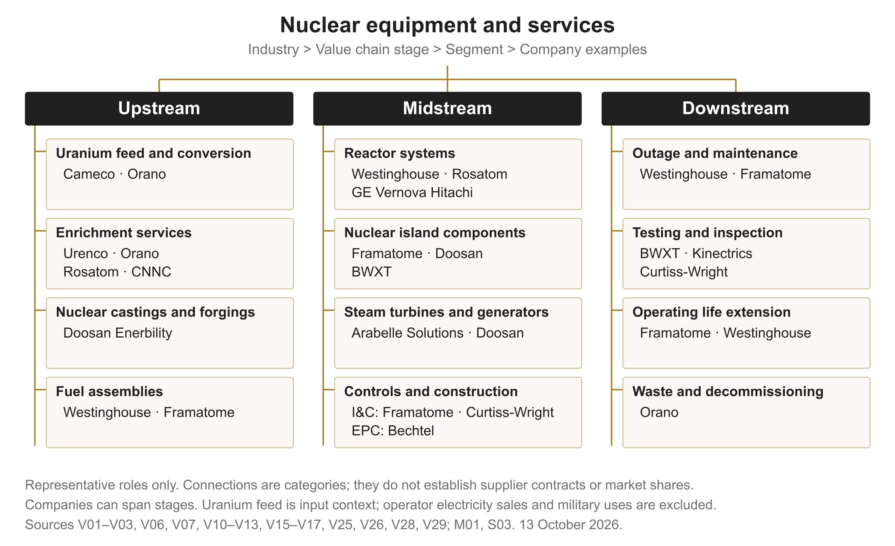
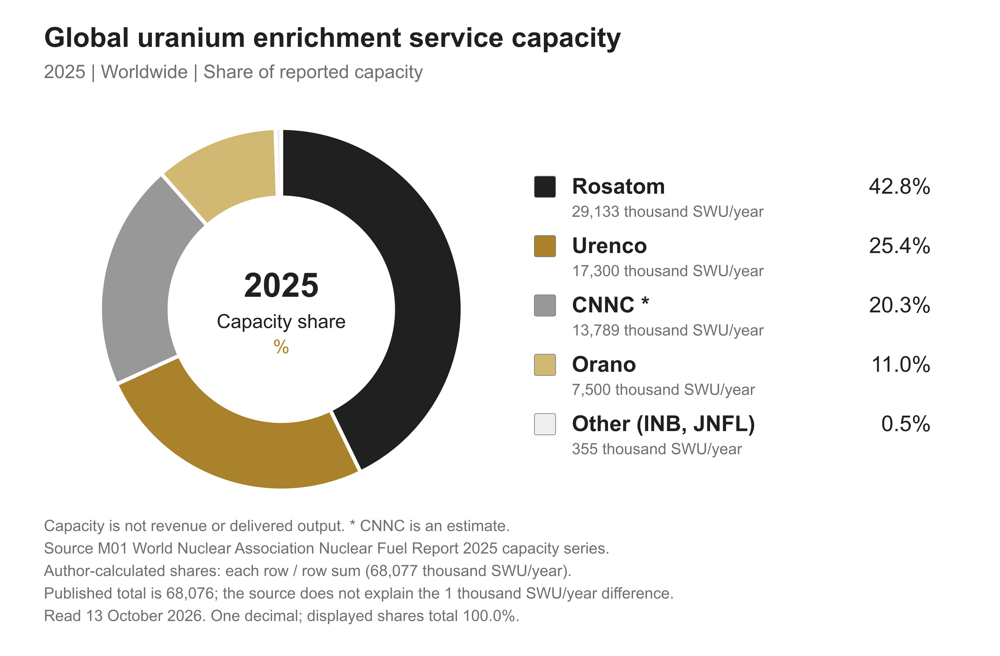

+++
title = "Global Nuclear Equipment and Services Industry Brief"
description = "Industry history, the value chain, global markets and the constraints on equipment delivery and long term services"
date = 2026-10-13T18:17:09+08:00
lastmod = 2026-10-13
draft = false
nuclearreview = true
type = "post"
image = "cover.jpg"
comments = false
toc = true
readingTime = true
imageAlt = "Real photograph inside the reactor hall at the existing Dukovany Nuclear Power Plant in 2012, showing service platforms, an overhead crane, industrial equipment and a worker in yellow clothing."
layout = "single"
reportversion = "1.0"
evidencecutoff = "2026-10-13"
categories = ["Industry Report"]
tags = ["Nuclear Power", "Nuclear Equipment", "Nuclear Services", "Global", "Industry Research"]
+++

Industry report · Version 1.0 · Global scope · Public information cutoff 13 October 2026.

Reactor hall at the existing Dukovany Nuclear Power Plant, Czech Republic, 6 November 2012. Photo: Petr Pavlicek / IAEA, IAEA Imagebank, CC BY-SA 2.0. Used unchanged as an industry illustration; it does not show the later Dukovany new-build project. <a class="nuclear-cite" href="#source-I01" aria-label="Source I01">[I01]</a>

This report examines the global suppliers of equipment, engineering, fuel-cycle processing and technical services used by civilian nuclear-power plants. It covers construction, operation, life extension and the back end. Uranium feed appears as supply-chain context; electricity sales, uranium mining revenue, military uses and medical-isotope revenue are outside the market boundary.

The commercial opportunity depends on both new projects and the existing fleet. The report follows how qualified equipment becomes an operating plant and how long-term fuel, inspection and maintenance contracts create service demand. Announced projects, orders, revenue and cash flow represent different stages. The analysis uses original disclosures and preserves their reporting periods and business boundaries.

Sources were reviewed on 13 October 2026, with a public-information cutoff of that date. No unified global equipment-and-services revenue total is asserted. The share figure is explicitly limited to 2025 uranium-enrichment service capacity. Future production dates remain company plans. This is version 1.0.

<a href="report_en_v1.txt" download>Full English manuscript</a><a href="supporting_evidence_en_v1.txt" download>Supporting Evidence</a><a href="enrichment_capacity_2025.csv" download>Capacity data CSV</a>

## Part 1 Industry Story {#part-1}

### One reactor enters service, an entire supply chain comes into view {#part-1-section-1}

On 29 April 2024, Georgia Power announced that Unit 4 at Plant Vogtle in Georgia, United States, had entered commercial operation. Unit 3 had entered service on 31 July 2023. A same-day securities filing confirmed Unit 4&#x27;s placement in service. The milestone marked the transition from construction, commissioning and acceptance to electricity supplied commercially.<a class="nuclear-cite" href="#source-S01" aria-label="Source S01">[S01]</a><a class="nuclear-cite" href="#source-S02" aria-label="Source S02">[S02]</a>

The participants performed different jobs. Georgia Power is a co-owner, Southern Nuclear operates the plant, and Bechtel was brought in during 2017 to help complete the engineering, procurement and construction of Units 3 and 4. Bechtel reported a peak project workforce exceeding 9,000. Commercial operation depended on coordinated delivery by owners, operators, contractors and construction workers.<a class="nuclear-cite" href="#source-S01" aria-label="Source S01">[S01]</a><a class="nuclear-cite" href="#source-S03" aria-label="Source S03">[S03]</a>

Vogtle offers a concrete way to understand this industry. Equipment becomes useful through installation, system integration, commissioning and regulatory acceptance; services continue during operation. The author&#x27;s interpretation is that nuclear equipment and services form a group of businesses spanning the plant lifecycle. Competitiveness therefore includes technology, delivery quality, verifiable operating performance and long-term maintenance capability.<a class="nuclear-cite" href="#source-S14" aria-label="Source S14">[S14]</a>

Milestones also need precise interpretation. When EDF announced Flamanville 3&#x27;s first grid connection on 21 December 2024, it said further tests, connections and disconnections would follow as output increased towards full power. First grid connection, commercial operation and sustained operation provide different evidence. Supplier achievements should be assessed against the stage actually completed, alongside subsequent engineering and financial disclosures.<a class="nuclear-cite" href="#source-S13" aria-label="Source S13">[S13]</a>

## Part 2 Industry History {#part-2}

### From electricity experiments to a lifecycle industry {#part-2-section-1}

The starting point depends on the definition. DOE records that EBR-I first produced usable fission electricity on 20 December 1951, initially lighting four 200-watt bulbs. IAEA identifies Obninsk&#x27;s supply to a national grid in June 1954 as another milestone. Calder Hall opened in 1956 as an important full-scale commercialization example. Experimental electricity, grid supply and full-scale commercial facilities represent distinct stages; an unqualified claim of the world&#x27;s first would obscure them.<a class="nuclear-cite" href="#source-S04" aria-label="Source S04">[S04]</a><a class="nuclear-cite" href="#source-S05" aria-label="Source S05">[S05]</a><a class="nuclear-cite" href="#source-S24" aria-label="Source S24">[S24]</a>

During the 1960s and 1970s, nuclear moved from demonstration towards large orders. David Fischer&#x27;s IAEA-published history describes demonstration reactors operating in leading industrial countries by the early 1960s and greater interest after the 1973 oil crisis. Orders were already declining by the mid-1970s, before Three Mile Island, while optimistic capacity forecasts later proved excessive. The author&#x27;s reading is that energy-security needs encourage procurement, but demand, construction costs and economic conditions can change investment decisions; development does not follow a continuously accelerating curve.<a class="nuclear-cite" href="#source-S07" aria-label="Source S07">[S07]</a>

Accidents reshaped equipment and service requirements. On 28 March 1979, equipment failures, a malfunctioning valve, misleading indications and operator actions contributed to a partial core meltdown at Three Mile Island Unit 2. DOE describes subsequent improvements in operator training and the establishment of INPO in 1979 to improve plant management, training and operation. Reliability therefore requires attention to equipment, instrument information and people&#x27;s understanding of the entire system.<a class="nuclear-cite" href="#source-S08" aria-label="Source S08">[S08]</a>

Chernobyl Unit 4&#x27;s accident occurred on 26 April 1986. INSAG-7 examined design deficiencies, regulatory arrangements and safety culture. The Convention on Nuclear Safety, adopted on 17 June 1994 and effective from 24 October 1996, covers regulation, technical safety, resources, quality assurance and emergency preparedness, supported by reporting and peer review. Equipment and engineering services supplied across borders consequently need to accommodate national regulation and international safety cooperation.<a class="nuclear-cite" href="#source-S09" aria-label="Source S09">[S09]</a><a class="nuclear-cite" href="#source-S11" aria-label="Source S11">[S11]</a>

Fukushima Daiichi&#x27;s accident on 11 March 2011 reinforced attention to extreme external events. IAEA&#x27;s technical assessment describes earthquake and tsunami impacts on cooling and containment, with multiple units, sites and surrounding infrastructure potentially affected together. The author&#x27;s interpretation is that power, cooling, instrumentation and emergency measures must be assessed as an integrated system. Additional components provide meaningful improvements when accompanied by analysis of common-cause failures, independence and accident response arrangements.<a class="nuclear-cite" href="#source-S10" aria-label="Source S10">[S10]</a>

Mature plants created another development path. IEA&#x27;s 2019 analysis highlighted ageing reactors built during the 1970s and 1980s in advanced economies. On 12 December 2025, NRC announced renewed licences for Browns Ferry&#x27;s three units permitting operation up to 80 years, following safety and environmental reviews. This illustrates continuing opportunities for equipment upgrades and engineering services; actual operating periods remain dependent on plant conditions and regulatory decisions.<a class="nuclear-cite" href="#source-S19" aria-label="Source S19">[S19]</a><a class="nuclear-cite" href="#source-S15" aria-label="Source S15">[S15]</a>

Decommissioning also became long-term business. Calder Hall stopped generating in 2003, started defuelling in 2011 and announced completion of fuel removal in 2019, with further decommissioning still ahead. The author&#x27;s interpretation is that ending electricity sales does not end engineering responsibilities. Historic plants create work across successive stages, while owners need to plan the associated funding, facilities and execution capability.<a class="nuclear-cite" href="#source-S06" aria-label="Source S06">[S06]</a>

The next commercialization wave includes large reactors, SMRs and other advanced reactors. IAEA defines SMRs as units of up to 300 MWe and highlights factory assembly and modular installation. Its 2023 article records Akademik Lomonosov entering commercial operation in May 2020 with two 35 MWe reactors. On 23 April 2026, Bechtel announced field execution at TerraPower&#x27;s Natrium Kemmerer Unit 1 as EPC partner. That is a construction milestone for another advanced-reactor route; it does not establish commercial operation or competitive costs.<a class="nuclear-cite" href="#source-S16" aria-label="Source S16">[S16]</a><a class="nuclear-cite" href="#source-S22" aria-label="Source S22">[S22]</a>

These developments explain two sources of demand: existing plants require maintenance, upgrades, lifetime extension and decommissioning, while new projects require design, manufacturing, construction and commissioning. Procurement timing, risks and competitive advantages differ. The author&#x27;s framework examines them within one lifecycle value chain and distinguishes individual markets, keeping claims about each technology or service tied to the evidence available.

## Part 3 Market Landscape {#part-3}

### Market boundaries: different deliveries behind one plant {#part-3-section-1}

This report defines the industry as specialist equipment, engineering, fuel-cycle processing and technical services purchased throughout the life of civilian nuclear-power plants. The nuclear island includes vessels, steam generators and reactor pumps; the conventional island includes turbines and their services. Operations require fuel, instrumentation and control, inspections and upgrades, while the back end includes packages, dismantling and waste-related services. Electricity sales, uranium mining itself, military work and medical-isotope revenue fall outside this research boundary. <a class="nuclear-cite" href="#source-M06" aria-label="Source M06">[M06]</a><a class="nuclear-cite" href="#source-M09" aria-label="Source M09">[M09]</a><a class="nuclear-cite" href="#source-M11" aria-label="Source M11">[M11]</a>

Each activity has its own suppliers, approvals and contracts. A diversified company can cooperate with another supplier in one activity and compete in another. Supplier nationality, reactors served and consolidated revenue therefore provide different information. This report uses a value-chain matrix and reserves quantitative shares for one clearly defined service segment. <a class="nuclear-cite" href="#source-M09" aria-label="Source M09">[M09]</a><a class="nuclear-cite" href="#source-M11" aria-label="Source M11">[M11]</a>

### The value chain: new construction and operating services {#part-3-section-2}

Customers for nuclear equipment and services are chiefly plant owners, project organisations and operating utilities. This report treats nuclear-grade materials and the fuel chain as supporting upstream activities, while focusing on reactor technology, nuclear-island and turbine-island equipment, I&amp;C, construction, maintenance, life extension and decommissioning. Electricity sales and supplier revenue have different economic meanings and cannot be added to estimate this equipment-and-services market.

Value-chain analysis must follow both new projects and the operating fleet. New construction creates demand for design, long-lead equipment and site work; operating plants require fuel, outages, replacement components and modernisation. Product catalogues and disclosed contracts suggest that suppliers can serve both demand streams, but responsibilities, pricing and revenue recognition remain contract-specific. This is an analytical inference.<a class="nuclear-cite" href="#source-V02" aria-label="Source V02">[V02]</a><a class="nuclear-cite" href="#source-V12" aria-label="Source V12">[V12]</a><a class="nuclear-cite" href="#source-V14" aria-label="Source V14">[V14]</a>

### Upstream: heavy forgings and fuel processing address different constraints {#part-3-section-3}

Upstream supply includes heavy castings and forgings, special materials, heat treatment and precision machining. Doosan lists forgings for reactors and steam generators. JSW&#x27;s 2024 integrated report describes pressure-vessel and steam-generator components and turbine/generator shafts. These examples show that upstream value lies in producing components for specific equipment requirements, rather than simply supplying steel by weight.<a class="nuclear-cite" href="#source-V13" aria-label="Source V13">[V13]</a><a class="nuclear-cite" href="#source-V21" aria-label="Source V21">[V21]</a>

The supporting fuel chain is distinct. Cameco participates in uranium production, conversion and some fuel manufacturing; Urenco supplies enrichment; Orano&#x27;s Front End includes chemistry and enrichment; Westinghouse, Framatome and GE Vernova-led Global Nuclear Fuel participate in fabrication or fuel services. Mine output, conversion kgU, enrichment SWU and assembly counts measure different stages and cannot form one capacity indicator.<a class="nuclear-cite" href="#source-V01" aria-label="Source V01">[V01]</a><a class="nuclear-cite" href="#source-V02" aria-label="Source V02">[V02]</a><a class="nuclear-cite" href="#source-V04" aria-label="Source V04">[V04]</a><a class="nuclear-cite" href="#source-V06" aria-label="Source V06">[V06]</a><a class="nuclear-cite" href="#source-V15" aria-label="Source V15">[V15]</a>

At year-end 2025, Cameco disclosed about 83 million kgU of UF6 conversion commitments, while Urenco&#x27;s order book was EUR 21.3 billion, extending into the 2040s. These are multi-year supply arrangements, not 2025 revenue. Fuel security helps explain why technology vendors discuss reactor deployment and subsequent fuel services together, although actual commitments depend on each contract.<a class="nuclear-cite" href="#source-V01" aria-label="Source V01">[V01]</a><a class="nuclear-cite" href="#source-V04" aria-label="Source V04">[V04]</a>

### Midstream: reactor technology, nuclear-island equipment and I&C {#part-3-section-4}

Reactor-technology vendors provide design systems and technical services, while manufacturers build particular components; these roles can overlap. Westinghouse combines reactor technology with operating-plant equipment and fuel. Former GE Hitachi is named GE Vernova Hitachi Nuclear Energy (GVH) in current official material and supplies reactor technology, fuel and services, including BWRX-300 deployment support. Rosatom spans fuel, construction, generation and back-end management, making business boundaries essential.<a class="nuclear-cite" href="#source-V02" aria-label="Source V02">[V02]</a><a class="nuclear-cite" href="#source-V15" aria-label="Source V15">[V15]</a><a class="nuclear-cite" href="#source-V16" aria-label="Source V16">[V16]</a>

Nuclear-island equipment includes reactor vessels and internals, steam generators, coolant pumps, pressurisers and handling equipment, with configurations varying by reactor type. Framatome, Doosan and BWXT each cover parts of this scope. Curtiss-Wright supplies AP1000 coolant-pump technology; Dongfang lists nuclear- and turbine-island supply capabilities; Shanghai Electric&#x27;s 2025 sustainability report records coolant pumps and nuclear/turbine-island supplies for Zhangzhou unit 1. This does not establish direct competition across every reactor design.<a class="nuclear-cite" href="#source-V03" aria-label="Source V03">[V03]</a><a class="nuclear-cite" href="#source-V07" aria-label="Source V07">[V07]</a><a class="nuclear-cite" href="#source-V10" aria-label="Source V10">[V10]</a><a class="nuclear-cite" href="#source-V12" aria-label="Source V12">[V12]</a><a class="nuclear-cite" href="#source-V18" aria-label="Source V18">[V18]</a><a class="nuclear-cite" href="#source-V22" aria-label="Source V22">[V22]</a>

I&amp;C covers monitoring, control and protection. Doosan&#x27;s MMIS includes emergency safety functions; Framatome reports new-build and modernisation work in safety I&amp;C; Curtiss-Wright&#x27;s portfolio includes I&amp;C and nuclear qualification support. A useful analytical comparison examines compatibility, nuclear qualification and continuing support before comparing prices or order values.<a class="nuclear-cite" href="#source-V03" aria-label="Source V03">[V03]</a><a class="nuclear-cite" href="#source-V10" aria-label="Source V10">[V10]</a><a class="nuclear-cite" href="#source-V12" aria-label="Source V12">[V12]</a><a class="nuclear-cite" href="#source-V27" aria-label="Source V27">[V27]</a>

### Turbine islands and construction: responsibilities follow the project {#part-3-section-5}

The turbine island converts steam energy into electricity through turbines, generators and associated water-steam systems. Arabelle Solutions supplies turbine-island technology and services. In January 2026 it announced selection by Bechtel and Westinghouse for three turbine-generator sets and related equipment at Poland&#x27;s first nuclear plant. Reactor technology, construction and turbine equipment represent different responsibilities; selection does not mean the plant has been completed.<a class="nuclear-cite" href="#source-V25" aria-label="Source V25">[V25]</a>

Korean project arrangements also show this division of labour. KHNP signed the final two-unit Dukovany contract in June 2025. KEPCO E&amp;C subsequently disclosed an architect-engineering contract with KHNP covering auxiliary procurement and licensing support. In February 2026, Doosan announced a contract of about KRW 320 billion with Czech subsidiary Doosan Skoda Power for two turbine/control-system sets, linking Korean project organisation with Czech equipment capabilities.<a class="nuclear-cite" href="#source-V11" aria-label="Source V11">[V11]</a><a class="nuclear-cite" href="#source-V23" aria-label="Source V23">[V23]</a><a class="nuclear-cite" href="#source-V24" aria-label="Source V24">[V24]</a>

These examples suggest that EPC and other delivery organisations manage equipment interfaces as well as engineering, procurement and construction responsibilities. Similar contract labels do not establish identical schedule or cost exposure. The value-chain diagram should place construction firms such as Bechtel separately from I&amp;C manufacturers, and intra-group equipment contracts must not be counted twice as industry sales. This is an inference from the disclosed scopes.<a class="nuclear-cite" href="#source-V11" aria-label="Source V11">[V11]</a><a class="nuclear-cite" href="#source-V24" aria-label="Source V24">[V24]</a><a class="nuclear-cite" href="#source-V25" aria-label="Source V25">[V25]</a>

### Downstream: operating plants extend equipment relationships into services {#part-3-section-6}

After delivery, utilities continue buying outage maintenance, parts, inspections and upgrades. Most recurring Westinghouse Operating Plants business is arranged through contracts lasting three to more than ten years. Doosan lists maintenance, replacement, engineering and I&amp;C updates; Arabelle provides turbine/generator overhauls and serves legacy equipment made by other manufacturers. Service opportunities can therefore involve both a vendor&#x27;s own equipment and other installed brands.<a class="nuclear-cite" href="#source-V02" aria-label="Source V02">[V02]</a><a class="nuclear-cite" href="#source-V14" aria-label="Source V14">[V14]</a><a class="nuclear-cite" href="#source-V17" aria-label="Source V17">[V17]</a>

Major-component replacement reconnects manufacturing with field engineering. Framatome reported such work in North America and South Africa in 2025 and began replacing four Flamanville 2 steam generators in November. BWXT supplies commercial nuclear equipment, fuel and engineering/maintenance and acquired Kinectrics in 2025. Kinectrics adds materials testing, operating inspections, lifecycle management and licensing support, illustrating the need for evidence on equipment fitness as well as field execution.<a class="nuclear-cite" href="#source-V03" aria-label="Source V03">[V03]</a><a class="nuclear-cite" href="#source-V07" aria-label="Source V07">[V07]</a><a class="nuclear-cite" href="#source-V26" aria-label="Source V26">[V26]</a>

Spare parts also face declining OEM support. Framatome&#x27;s Nuclear Parts Center describes quality records, compatibility, qualification and acceptance requirements for safety-related items while some original manufacturers reduce support or exit. The analytical implication is that suppliers must establish suitability and preserve auditable evidence, not merely locate replacements. Supplier analysis and life-extension support must also be distinguished from an actual licensing decision.<a class="nuclear-cite" href="#source-V27" aria-label="Source V27">[V27]</a>

Life-extension support also includes licensing analyses. Westinghouse lists integrated plant assessment, time-limited aging analysis and environmental-report support; Framatome covers licence renewal, aging and asset management and modernisation. These services help utilities prepare for continued operation, while actual extension depends on regulatory approval and plant-specific conditions.<a class="nuclear-cite" href="#source-V28" aria-label="Source V28">[V28]</a><a class="nuclear-cite" href="#source-V29" aria-label="Source V29">[V29]</a>

### Decommissioning and waste services continue the equipment lifecycle {#part-3-section-7}

Decommissioning involves dismantling, decontamination, packaging, transport arrangements and radioactive-waste management. Orano&#x27;s Back End combines recycling, nuclear packages and services, dismantling/services and engineering; its 2025 revenue was EUR 2.352 billion. This is a portfolio of end-of-lifecycle activities rather than a pure decommissioning-market figure, and it does not imply identical spent-fuel pathways in every country.<a class="nuclear-cite" href="#source-V06" aria-label="Source V06">[V06]</a>

Rosatom&#x27;s 2025 operating results include spent-fuel and radioactive-waste management, while Kinectrics also provides waste-related capabilities. Such overlapping roles show that upstream, midstream and downstream are analytical categories rather than exclusive company classifications. Project scope, material categories and long-term responsibilities help explain back-end business models better than a single group-revenue figure.<a class="nuclear-cite" href="#source-V16" aria-label="Source V16">[V16]</a><a class="nuclear-cite" href="#source-V26" aria-label="Source V26">[V26]</a>

Contracts and estimate revisions can also affect back-end performance. Orano identified a one-off Japanese-utility contribution in the 2024 comparison base and end-of-lifecycle estimate revisions affecting 2025 adjusted earnings; its H1 2026 disclosure also reported disruption in Mining and Front End. These factors must be separated before attributing group earnings changes to decommissioning demand.<a class="nuclear-cite" href="#source-V05" aria-label="Source V05">[V05]</a><a class="nuclear-cite" href="#source-V19" aria-label="Source V19">[V19]</a>

### Financial evidence: reporting boundaries matter more than simple rankings {#part-3-section-8}

Financial disclosures validate activity without automatically defining a global market. Framatome reported 2025 revenue of EUR 5.399 billion and new orders of EUR 5.924 billion. BWXT Commercial Operations revenue was USD 853.070 million but also included medical activities. The segment reported USD 586.158 million in H1 2026 revenue and USD 1,600.454 million in June-end backlog. Backlog is remaining contractual work rather than current sales, and half-year revenue should not simply be doubled.<a class="nuclear-cite" href="#source-V03" aria-label="Source V03">[V03]</a><a class="nuclear-cite" href="#source-V07" aria-label="Source V07">[V07]</a><a class="nuclear-cite" href="#source-V08" aria-label="Source V08">[V08]</a>

Curtiss-Wright&#x27;s 2025 group sales of USD 3,498.372 million and Naval &amp; Power sales of USD 1,503.002 million both include activities outside commercial nuclear power. Urenco enrichment revenue and Orano fuel-chain revenue also refer to different stages. Operator sales, supplier group sales, nuclear-segment revenue and contract values must remain distinct. This report describes competitive roles and bounded disclosures rather than adding incompatible figures or ranking global equipment-and-service companies from them.<a class="nuclear-cite" href="#source-V04" aria-label="Source V04">[V04]</a><a class="nuclear-cite" href="#source-V06" aria-label="Source V06">[V06]</a><a class="nuclear-cite" href="#source-V09" aria-label="Source V09">[V09]</a>

Contract structures also govern reported revenue, cash and risk. BWXT describes fixed-price and time-and-materials commercial contracts, with large custom-component and service revenue generally recognised over time and most contracts paid at milestones. New orders, revenue recognition and cash collection can therefore fall in different periods. Assessing suppliers requires connecting contract execution, cost estimates, payment terms and cash flow.<a class="nuclear-cite" href="#source-V07" aria-label="Source V07">[V07]</a>

<section id="figure-1" class="nuclear-native-figure">



Static figure and editable files
<figure class="nuclear-figure"><figcaption>Figure 1 Nuclear equipment and services value chain</figcaption>
<a href="nuclear_value_chain_en.svg" download>Download SVG</a><a href="nuclear_value_chain.en.json" download>Download data</a>
</figure>
</section>
Representative roles only. Category links do not establish contracts, customer relationships or market shares. Companies can span stages. Uranium feed is input context; electricity sales, mining revenue and military uses remain outside the equipment-and-services market boundary.

### Global demand: the operating fleet and new construction {#part-3-section-9}

WNA’s 8 October 2026 table lists 442 operable reactors with 405,227 MWe net capacity and 80 under construction with 87,031 MWe gross capacity. Operable means grid-connected; construction includes suspended projects. Net and gross capacity cannot be added directly. These are demand indicators, not supplier orders or revenue. <a class="nuclear-cite" href="#source-M02" aria-label="Source M02">[M02]</a>

### Regional differences: different weights of services and construction {#part-3-section-10}

The same table lists 94 operable reactors in the USA and 57 in France. Construction includes 38 in China, eight in India, seven in Russia and four each in South Korea, Turkey and Egypt. The mix suggests different entry points: replacement equipment, maintenance and fuel for established fleets, and manufacturing and engineering where construction is stronger. This is an inference from reactor status, not national supplier shares; individual procurement arrangements still matter. <a class="nuclear-cite" href="#source-M02" aria-label="Source M02">[M02]</a>

### Competition: technology platforms overlap with equipment and services {#part-3-section-11}

Framatome spans nuclear steam-supply systems, heavy components, instrumentation and control, fuel and maintenance; EDF reports work on more than 380 reactors. GE Vernova’s Nuclear Power unit covers boiling-water-reactor technology, fuel, support services and SMRs developed with Hitachi, while some nuclear-turbine services sit in Steam Power. Technology ownership, equipment manufacture and recurring services are therefore not exclusive categories, and reactor-service footprints can overlap. <a class="nuclear-cite" href="#source-M09" aria-label="Source M09">[M09]</a><a class="nuclear-cite" href="#source-M11" aria-label="Source M11">[M11]</a>

### A comparable segment: global enrichment-service capacity {#part-3-section-12}

The chart uses one WNA 2025 capacity table, in thousand SWU/year: Rosatom 29,133; Urenco 17,300; CNNC 13,789; Orano 7,500; INB and JNFL together 355. Author-calculated shares are 42.8%, 25.4%, 20.3%, 11.0% and 0.5%. They describe enrichment capacity, not revenue or deliveries; CNNC is estimated and some capacity primarily serves domestic demand. <a class="nuclear-cite" href="#source-M01" aria-label="Source M01">[M01]</a>

The rows sum to 68,077, versus the published total of 68,076 thousand SWU/year: a roughly 0.0015% discrepancy that the source does not explain. Shares use the row sum; all source rows are preserved. <a class="nuclear-cite" href="#source-M01" aria-label="Source M01">[M01]</a>

### Orders and capacity: demand signals need a delivery timetable {#part-3-section-13}

Urenco disclosed a €27.3bn order book at June 2026, up from €21.3bn at December 2025, with contracts extending into the 2040s. H1 revenue fell from €830.4m to €645.4m; the company mainly cited delivery timing. Long-term commitments and one half-year’s revenue therefore measure different things, and a multi-year backlog is not annual market size. <a class="nuclear-cite" href="#source-M03" aria-label="Source M03">[M03]</a><a class="nuclear-cite" href="#source-M04" aria-label="Source M04">[M04]</a>

Expansion also takes time. Orano’s 7.5-million-SWU/year Georges Besse II plant is adding a planned 2.5 million SWU/year, with first production scheduled for 2028 and full commissioning for 2030. Planned capacity belongs in the pipeline until commissioned, rather than in the current-capacity share chart. Orders, investment approval, construction and production are separate stages. <a class="nuclear-cite" href="#source-M05" aria-label="Source M05">[M05]</a>

### Company finances: useful signals with different reporting boundaries {#part-3-section-14}

Framatome disclosed 2025 revenue of €5,399m and new orders of €5,924m; EDF reported H1 2026 order intake of about €2.7bn. GE Vernova’s 2025 Nuclear Power revenue was US$1,018m, but nuclear-related turbine services also appear in Steam Power alongside coal activities. Such figures describe specific businesses; they do not provide comparable whole-industry share numerators. <a class="nuclear-cite" href="#source-M08" aria-label="Source M08">[M08]</a><a class="nuclear-cite" href="#source-M09" aria-label="Source M09">[M09]</a><a class="nuclear-cite" href="#source-M12" aria-label="Source M12">[M12]</a>

BWXT Commercial Operations reported US$853.070m in 2025, including medical activities and US$231.0m contributed by its Kinectrics acquisition. Orano’s €2,696m H1 2026 group revenue includes mining, front-end and back-end activities. Acquisitions, currencies, business boundaries and supply-chain transactions require adjustment. Our primary-source review found no common-period, common-perimeter global revenue total that avoids double counting. We therefore omit an unverified total; this is a limitation of the evidence reviewed, not a claim that the market has no size. <a class="nuclear-cite" href="#source-M06" aria-label="Source M06">[M06]</a><a class="nuclear-cite" href="#source-M10" aria-label="Source M10">[M10]</a>

<section id="figure-2" class="nuclear-native-figure">



Static figure and editable files
<figure class="nuclear-figure"><figcaption>Figure 2 Global uranium enrichment service capacity in 2025</figcaption>
<a href="enrichment_capacity_2025_en.svg" download>Download SVG</a><a href="enrichment_capacity_2025.csv" download>Download data</a>
</figure>
</section>
<table class="nuclear-data-table"><caption>Worldwide 2025 capacity in thousand SWU/year</caption><thead><tr><th scope="col">Operator</th><th scope="col">Capacity</th><th scope="col">Author-calculated share</th></tr></thead><tbody><tr><th scope="row">Rosatom</th><td>29,133</td><td>42.8%</td></tr><tr><th scope="row">Urenco</th><td>17,300</td><td>25.4%</td></tr><tr><th scope="row">CNNC *</th><td>13,789</td><td>20.3%</td></tr><tr><th scope="row">Orano</th><td>7,500</td><td>11.0%</td></tr><tr><th scope="row">Other (INB, JNFL)</th><td>355</td><td>0.5%</td></tr></tbody></table>

Capacity is not revenue or actual deliveries. * CNNC is estimated. Source rows sum to 68,077 thousand SWU/year, compared with the published total of 68,076; the source does not explain the difference. Author-calculated share = each source row / row sum × 100. Shares are displayed to one decimal and total 100.0%. All disclosed capacities are preserved. <a class="nuclear-cite" href="#source-M01" aria-label="Source M01">[M01]</a>

## Part 4 Industry Challenges {#part-4}

### Turning demand into deliverable, profitable projects {#part-4-section-1}

Engineering delivery. Quality problems can change schedules and funding needs. On 16 December 2022, EDF raised Flamanville 3&#x27;s estimated completion cost from EUR 12.7 billion to EUR 13.2 billion, in 2015 euros excluding construction-period interest. It principally linked the schedule adjustment to studies of stress-relief heat treatment for repaired welds; pass-through weld repair required over twelve months of studies and qualification. The author&#x27;s interpretation is that designs, processes and interfaces should mature together. Earlier validation can reduce rework, but cannot guarantee timely delivery. This was a dated estimate, not a final outturn cost.<a class="nuclear-cite" href="#source-S12" aria-label="Source S12">[S12]</a>

Financing and risk allocation. IEA&#x27;s 2025 report identifies capital intensity, long construction and complexity as financing challenges; repeated designs and clearer revenues can help. Sizewell C&#x27;s UK investment decision on 22 July 2025 specified an approximately GBP 38 billion construction target in 2024 prices, with RAB arrangements sharing costs among consumers, taxpayers and investors. The author&#x27;s interpretation is that financing reallocates risks and cash-flow timing; cost control remains necessary. Targets, electricity-price commitments and realised returns require separate assessment.<a class="nuclear-cite" href="#source-S20" aria-label="Source S20">[S20]</a><a class="nuclear-cite" href="#source-S18" aria-label="Source S18">[S18]</a>

People and execution. Vogtle illustrates the scale of specialized staffing, while retaining experience requires continuing projects and training. On 6 October 2026, Bechtel and the University of South Carolina announced a nuclear workforce fund connecting universities, technical colleges and training partners across engineering, project management and skilled trades. The announcement establishes a programme, not demonstrated graduates, resolved shortages or measured productivity gains. The author&#x27;s interpretation is that suppliers expanding orders should also assess qualified personnel, site management and training times.<a class="nuclear-cite" href="#source-S03" aria-label="Source S03">[S03]</a><a class="nuclear-cite" href="#source-S21" aria-label="Source S21">[S21]</a>

Fuel and diversification. IEA&#x27;s 2025 report attributes over 99% of uranium-enrichment capacity to four suppliers: a specific capacity measure, not nuclear-equipment revenue share. Some advanced reactors requiring HALEU also need downstream processing. DOE awarded six deconversion frameworks on 8 October 2024 for subsequent tasks. The author&#x27;s interpretation is that procurement supports demand visibility, while supply requires facilities, approvals and delivery. Ceilings are not revenue; 2024 supply conditions are not treated as current.<a class="nuclear-cite" href="#source-S20" aria-label="Source S20">[S20]</a><a class="nuclear-cite" href="#source-S17" aria-label="Source S17">[S17]</a>

SMR economics. IAEA&#x27;s 2023 explanation says lower upfront capital per unit still requires deployed evidence of economic competitiveness. The author&#x27;s interpretation is that factory assembly must be supported by repeat orders, transportation, installation, site infrastructure and approvals. Target prices are promises or forecasts; learning effects require observed hours, costs and performance across repeated deliveries. Comparisons with large reactors need consistent price years, financing assumptions, cost boundaries and electricity-output measures.<a class="nuclear-cite" href="#source-S16" aria-label="Source S16">[S16]</a>

Lifetime extension. IAEA SSG-48 recommends managing physical ageing and obsolescence, re-evaluating embrittlement and cumulative fatigue, and retaining auditable, retrievable evidence. The author&#x27;s interpretation is that services create value by turning inspections, equipment records and safety analyses into a reviewable case for continued operation. Regulatory permission allows continued operation; economic viability also depends on upgrade costs, outage plans and subsequent performance. Browns Ferry&#x27;s 80-year permissions cannot establish the same potential for every plant.<a class="nuclear-cite" href="#source-S14" aria-label="Source S14">[S14]</a><a class="nuclear-cite" href="#source-S15" aria-label="Source S15">[S15]</a>

Safety, decommissioning and public acceptance. Fukushima underlines the need to review extreme external hazards and protective arrangements. DOE&#x27;s 2024 explanation addresses spent-fuel transport, storage and disposal planning, including community participation in interim-storage siting. Calder Hall&#x27;s lengthy defuelling illustrates post-generation requirements. The author&#x27;s interpretation is that facilities, transport, permissions, funding and continuing responsibilities belong within the project boundary. Progress on storage does not establish completion of final disposal.<a class="nuclear-cite" href="#source-S10" aria-label="Source S10">[S10]</a><a class="nuclear-cite" href="#source-S23" aria-label="Source S23">[S23]</a><a class="nuclear-cite" href="#source-S06" aria-label="Source S06">[S06]</a>

The quality of order conversion depends on these issues. The author&#x27;s assessment framework asks what stage permits cover, whether financing is in place, whether key processes are qualified, whether equipment is accepted and whether operational results match announced milestones. Framework agreements, construction progress and commercial operation represent different stages; supplier revenue and profit require contract execution and financial evidence. This framework does not predict any company&#x27;s profits or a definitive future market size.

## Appendix Supporting Evidence {#supporting-evidence}

This appendix is independent of Parts 1–4. All 66 evidence records are retained; the records use 63 different URLs, which does not by itself establish 63 independent publications. Citation IDs match the report. Originals remain with the publishers.

66 source records<button type="button" id="nuclear-expand-evidence">Expand all</button><button type="button" id="nuclear-collapse-evidence">Collapse all</button>

S01Vogtle Unit 4 enters commercial operation

<dl class="nuclear-source-fields">
<dt>Publisher</dt><dd>Georgia Power</dd>

<dt>Material type</dt><dd>primary-company</dd>

<dt>Published</dt><dd>2024-04-29</dd>

<dt>Event date</dt><dd>2024-04-29</dd>

<dt>Statistical period</dt><dd>Unit 3: 2023-07-31; Unit 4: 2024-04-29</dd>

<dt>Location</dt><dd>main announcement paragraphs 1-3; forward-looking note</dd>

<dt>Geography</dt><dd>Georgia, United States</dd>

<dt>Units</dt><dd>dates; years</dd>

<dt>Read</dt><dd>2026-10-13</dd>
</dl>
Confirms operating dates and operator identity. Expected service life is forward-looking; achieved lifetime and returns are not established.

<a href="https://www.georgiapower.com/news-hub/press-releases/vogtle-unit-4-enters-commercial-operation.html" target="_blank" rel="noopener noreferrer">Read publisher original</a>

S02Form 8-K, Item 8.01 Other Events, Southern Company and Georgia Power

<dl class="nuclear-source-fields">
<dt>Publisher</dt><dd>Southern Company / Georgia Power, filed with SEC</dd>

<dt>Material type</dt><dd>primary-regulatory-filing</dd>

<dt>Published</dt><dd>2024-04-29</dd>

<dt>Event date</dt><dd>2024-04-29</dd>

<dt>Statistical period</dt><dd>2024-04-29</dd>

<dt>Location</dt><dd>Item 8.01; signatures</dd>

<dt>Geography</dt><dd>Georgia, United States</dd>

<dt>Units</dt><dd>date</dd>

<dt>Read</dt><dd>2026-10-13</dd>
</dl>
Same-day securities filing corroborates Unit 4 entering service. It does not establish costs, profit or future performance.

<a href="https://www.sec.gov/Archives/edgar/data/92122/000009212224000039/so-20240429.htm" target="_blank" rel="noopener noreferrer">Read publisher original</a>

S03Plant Vogtle Unit 4 Achieves Commercial Operation

<dl class="nuclear-source-fields">
<dt>Publisher</dt><dd>Bechtel</dd>

<dt>Material type</dt><dd>primary-company</dd>

<dt>Published</dt><dd>2024-04-29</dd>

<dt>Event date</dt><dd>2017 and 2024-04-29</dd>

<dt>Statistical period</dt><dd>Vogtle construction through 2024</dd>

<dt>Location</dt><dd>announcement; Background</dd>

<dt>Geography</dt><dd>United States</dd>

<dt>Units</dt><dd>workers; dates</dd>

<dt>Read</dt><dd>2026-10-13</dd>
</dl>
Supports Bechtel&#x27;s 2017 appointment and project staffing. Project figures and supplier assessments cannot establish global industry outcomes.

<a href="https://www.bechtel.com/press-releases/plant-vogtle-unit-4-achieves-commercial-operation/" target="_blank" rel="noopener noreferrer">Read publisher original</a>

S049 Notable Facts About the World’s First Nuclear Power Plant - EBR-I

<dl class="nuclear-source-fields">
<dt>Publisher</dt><dd>US Department of Energy, Office of Nuclear Energy</dd>

<dt>Material type</dt><dd>primary-official-history</dd>

<dt>Published</dt><dd>2019-06-18</dd>

<dt>Event date</dt><dd>1951-12-20; 1954</dd>

<dt>Statistical period</dt><dd>historical milestones</dd>

<dt>Location</dt><dd>facts 1-3</dd>

<dt>Geography</dt><dd>United States and former USSR</dd>

<dt>Units</dt><dd>watts; megawatts; dates</dd>

<dt>Read</dt><dd>2026-10-13</dd>
</dl>
Supports EBR-I&#x27;s 1951 usable-electricity milestone. This definition differs from national-grid supply and full-scale commercial generation.

<a href="https://www.energy.gov/ne/articles/9-notable-facts-about-worlds-first-nuclear-power-plant-ebr-i" target="_blank" rel="noopener noreferrer">Read publisher original</a>

S05International Conference on Fifty Years of Nuclear Power - the Next Fifty Years, IAEA-CN-114, Announcement and Call for Papers

<dl class="nuclear-source-fields">
<dt>Publisher</dt><dd>IAEA</dd>

<dt>Material type</dt><dd>primary-official-conference</dd>

<dt>Published</dt><dd>undisclosed; conference held 2004-06-27 to 2004-07-02</dd>

<dt>Event date</dt><dd>1954-06</dd>

<dt>Statistical period</dt><dd>1954 milestone</dd>

<dt>Location</dt><dd>PDF page 1, Background</dd>

<dt>Geography</dt><dd>Obninsk, former USSR</dd>

<dt>Units</dt><dd>year and month</dd>

<dt>Read</dt><dd>2026-10-13</dd>
</dl>
Undated announcement for a 2004 conference supports the June 1954 grid milestone. It does not establish a specific day.

<a href="https://www-pub.iaea.org/Mtcd/Meetings/PDFplus/2004/cn114ann.pdf" target="_blank" rel="noopener noreferrer">Read publisher original</a>

S06History made as final fuel leaves iconic nuclear plant

<dl class="nuclear-source-fields">
<dt>Publisher</dt><dd>Sellafield Ltd / UK Nuclear Decommissioning Authority</dd>

<dt>Material type</dt><dd>primary-operator-government</dd>

<dt>Published</dt><dd>2019-09-03</dd>

<dt>Event date</dt><dd>1956; 2003; 2011; 2019-09</dd>

<dt>Statistical period</dt><dd>1956-2019 operating and defuelling lifecycle</dd>

<dt>Location</dt><dd>announcement paragraphs; decommissioning details</dd>

<dt>Geography</dt><dd>United Kingdom</dd>

<dt>Units</dt><dd>years; fuel rods; dates</dd>

<dt>Read</dt><dd>2026-10-13</dd>
</dl>
Documents Calder Hall&#x27;s generation, defuelling and subsequent stages. Completed fuel removal does not establish completed decommissioning.

<a href="https://www.gov.uk/government/news/history-made-as-final-fuel-leaves-iconic-nuclear-plant" target="_blank" rel="noopener noreferrer">Read publisher original</a>

S07History of the International Atomic Energy Agency: The First Forty Years

<dl class="nuclear-source-fields">
<dt>Publisher</dt><dd>David Fischer, published by IAEA</dd>

<dt>Material type</dt><dd>institution-published-historical-research</dd>

<dt>Published</dt><dd>1997-09</dd>

<dt>Event date</dt><dd>1960s-1995</dd>

<dt>Statistical period</dt><dd>historical retrospective through 1997</dd>

<dt>Location</dt><dd>printed pages 146-147 and 158; PDF pages 158-159 and 170; copyright PDF page 8</dd>

<dt>Geography</dt><dd>global, with advanced-economy examples</dd>

<dt>Units</dt><dd>years; qualitative history</dd>

<dt>Read</dt><dd>2026-10-13</dd>
</dl>
Historical research supports commercialization and order cycles. The author does not represent IAEA; old forecasts are not current data.

<a href="https://www-pub.iaea.org/MTCD/Publications/PDF/Pub1032_web.pdf" target="_blank" rel="noopener noreferrer">Read publisher original</a>

S085 Facts to Know About Three Mile Island

<dl class="nuclear-source-fields">
<dt>Publisher</dt><dd>US Department of Energy, Office of Nuclear Energy</dd>

<dt>Material type</dt><dd>primary-official-history</dd>

<dt>Published</dt><dd>2022-05-04</dd>

<dt>Event date</dt><dd>1979-03-28</dd>

<dt>Statistical period</dt><dd>1979 accident and aftermath</dd>

<dt>Location</dt><dd>facts 2 and 4</dd>

<dt>Geography</dt><dd>United States</dd>

<dt>Units</dt><dd>date</dd>

<dt>Read</dt><dd>2026-10-13</dd>
</dl>
DOE&#x27;s retrospective supports accident mechanisms and training changes. The inaccessible NRC page and additional health conclusions are excluded.

<a href="https://www.energy.gov/ne/articles/5-facts-know-about-three-mile-island" target="_blank" rel="noopener noreferrer">Read publisher original</a>

S09The Chernobyl Accident: Updating of INSAG-1, Safety Series 75-INSAG-7

<dl class="nuclear-source-fields">
<dt>Publisher</dt><dd>International Nuclear Safety Advisory Group / IAEA</dd>

<dt>Material type</dt><dd>primary-expert-accident-review</dd>

<dt>Published</dt><dd>1992-11</dd>

<dt>Event date</dt><dd>1986-04-26</dd>

<dt>Statistical period</dt><dd>1986 accident reviewed by 1992</dd>

<dt>Location</dt><dd>Introduction; conclusions; Annex I printed pp. 85-88 (PDF pp. 95-98); copyright PDF p.4</dd>

<dt>Geography</dt><dd>former USSR / Ukraine</dd>

<dt>Units</dt><dd>date; qualitative safety assessment</dd>

<dt>Read</dt><dd>2026-10-13</dd>
</dl>
INSAG-7 supports design, regulation and safety-culture findings. The accident investigation does not characterize every reactor design.

<a href="https://pub.iaea.org/MTCD/publications/PDF/Pub913e_web.pdf" target="_blank" rel="noopener noreferrer">Read publisher original</a>

S10The Fukushima Daiichi Accident, Technical Volume 2: Safety Assessment

<dl class="nuclear-source-fields">
<dt>Publisher</dt><dd>IAEA</dd>

<dt>Material type</dt><dd>primary-expert-accident-review</dd>

<dt>Published</dt><dd>2015-08</dd>

<dt>Event date</dt><dd>2011-03-11</dd>

<dt>Statistical period</dt><dd>2011 accident; investigation through 2015</dd>

<dt>Location</dt><dd>Introduction pp.1-2; sections 2.1.7-2.1.8 and 2.2.14; PDF pp.12-13, 57-61, 92</dd>

<dt>Geography</dt><dd>Japan; lessons relevant globally</dd>

<dt>Units</dt><dd>date; qualitative safety functions</dd>

<dt>Read</dt><dd>2026-10-13</dd>
</dl>
The 2015 technical volume supports external-event and defence findings. It provides neither present accident probabilities nor legal blame allocation.

<a href="https://www-pub.iaea.org/MTCD/Publications/PDF/AdditionalVolumes/P1710/Pub1710-TV2-Web.pdf" target="_blank" rel="noopener noreferrer">Read publisher original</a>

S11Convention on Nuclear Safety: Introduction to the CNS and Its Associated Rules of Procedure and Guidelines

<dl class="nuclear-source-fields">
<dt>Publisher</dt><dd>IAEA</dd>

<dt>Material type</dt><dd>primary-official-treaty-guide</dd>

<dt>Published</dt><dd>2017-01</dd>

<dt>Event date</dt><dd>1994-06-17; 1996-10-24</dd>

<dt>Statistical period</dt><dd>historical treaty adoption and entry into force</dd>

<dt>Location</dt><dd>CNS Brochure Introduction, printed page 2; cover January 2017</dd>

<dt>Geography</dt><dd>contracting parties globally</dd>

<dt>Units</dt><dd>dates</dd>

<dt>Read</dt><dd>2026-10-13</dd>
</dl>
The 2017 brochure supports treaty dates and obligation scope. Historical party counts are not presented as current.

<a href="https://www.iaea.org/sites/default/files/19/09/19-00679e_web_cns.pdf" target="_blank" rel="noopener noreferrer">Read publisher original</a>

S12Update on the Flamanville EPR

<dl class="nuclear-source-fields">
<dt>Publisher</dt><dd>EDF</dd>

<dt>Material type</dt><dd>primary-company</dd>

<dt>Published</dt><dd>2022-12-16</dd>

<dt>Event date</dt><dd>2022-12-16 schedule/cost update</dd>

<dt>Statistical period</dt><dd>project forecast at 2022-12-16</dd>

<dt>Location</dt><dd>opening paragraphs; industrial milestones; footnote 2</dd>

<dt>Geography</dt><dd>France</dd>

<dt>Units</dt><dd>billion EUR, 2015 prices, excluding interim interest</dd>

<dt>Read</dt><dd>2026-10-13</dd>
</dl>
Supports the 2022 estimate and weld-process issue. EUR 13.2 billion uses 2015 prices, excluding construction-period interest; final costs are unproven.

<a href="https://www.edf.fr/groupe-edf/espaces-dedies/journalistes/tous-les-communiques-de-presse/point-dactualite-sur-lepr-de-flamanville" target="_blank" rel="noopener noreferrer">Read publisher original</a>

S13Update on the Flamanville EPR: the reactor produces its first electrons on the national electricity grid

<dl class="nuclear-source-fields">
<dt>Publisher</dt><dd>EDF</dd>

<dt>Material type</dt><dd>primary-company</dd>

<dt>Published</dt><dd>2024-12-21</dd>

<dt>Event date</dt><dd>2024-12-21</dd>

<dt>Statistical period</dt><dd>first nuclear reaction 2024-09-03; first grid connection 2024-12-21</dd>

<dt>Location</dt><dd>announcement paragraphs 1-4</dd>

<dt>Geography</dt><dd>France</dd>

<dt>Units</dt><dd>MW; dates; local time</dd>

<dt>Read</dt><dd>2026-10-13</dd>
</dl>
Supports first grid connection and further testing in December 2024. It does not establish full-power or sustained performance.

<a href="https://www.edf.fr/en/the-edf-group/dedicated-sections/journalists/all-press-releases/update-on-the-flamanville-epr-the-reactor-produces-its-first-electrons-on-the-national-electricity-grid" target="_blank" rel="noopener noreferrer">Read publisher original</a>

S14Ageing Management and Development of a Programme for Long Term Operation of Nuclear Power Plants, SSG-48

<dl class="nuclear-source-fields">
<dt>Publisher</dt><dd>IAEA</dd>

<dt>Material type</dt><dd>primary-official-safety-guide</dd>

<dt>Published</dt><dd>2018-11</dd>

<dt>Event date</dt><dd>not applicable</dd>

<dt>Statistical period</dt><dd>technical safety guide</dd>

<dt>Location</dt><dd>Original PDF printed pp. 1-3, 47, 55-61; paras 1.2, 5.67, 7.13-7.39. Both PDF and IAEA online edition were actually read.</dd>

<dt>Geography</dt><dd>global technical guidance</dd>

<dt>Units</dt><dd>neutron fluence; fatigue criteria; no market units</dd>

<dt>Read</dt><dd>2026-10-13</dd>
</dl>
Supports ageing assessments and auditable documentation. Technical guidance does not substitute for plant-specific regulatory permission.

<a href="https://www-pub.iaea.org/MTCD/Publications/PDF/P1814_web.pdf" target="_blank" rel="noopener noreferrer">Read publisher original</a>

S15NRC Renews Browns Ferry Operating License, No. 25-065

<dl class="nuclear-source-fields">
<dt>Publisher</dt><dd>US Nuclear Regulatory Commission</dd>

<dt>Material type</dt><dd>primary-regulator</dd>

<dt>Published</dt><dd>2025-12-12</dd>

<dt>Event date</dt><dd>2025-12-12</dd>

<dt>Statistical period</dt><dd>licence renewal review safety July 2025, environment August 2025</dd>

<dt>Location</dt><dd>one-page announcement</dd>

<dt>Geography</dt><dd>United States</dd>

<dt>Units</dt><dd>operating years; dates</dd>

<dt>Read</dt><dd>2026-10-13</dd>
</dl>
Supports Browns Ferry&#x27;s 2025 permissions and reviews. Plant-specific permission cannot establish 80-year operation for all reactors.

<a href="https://ww2.nrc.gov/sites/default/files/cdn/doc-collection-news/2025/25-065.pdf" target="_blank" rel="noopener noreferrer">Read publisher original</a>

S16What are Small Modular Reactors (SMRs)?

<dl class="nuclear-source-fields">
<dt>Publisher</dt><dd>Joanne Liou, IAEA</dd>

<dt>Material type</dt><dd>primary-official-explanation</dd>

<dt>Published</dt><dd>2023-09-13</dd>

<dt>Event date</dt><dd>2020-05 commercial operation example</dd>

<dt>Statistical period</dt><dd>status as of 2023 article</dd>

<dt>Location</dt><dd>definition; Advantages; What is the status of SMRs?</dd>

<dt>Geography</dt><dd>global</dd>

<dt>Units</dt><dd>MW(e) per unit</dd>

<dt>Read</dt><dd>2026-10-13</dd>
</dl>
The 2023 article supports SMR definition, examples and economic uncertainty. Historic design counts are not current totals.

<a href="https://www.iaea.org/newscenter/news/what-are-small-modular-reactors-smrs" target="_blank" rel="noopener noreferrer">Read publisher original</a>

S17Biden-Harris Administration Announces 6 Contracts to Spur America’s Domestic HALEU Supply Chain as Part of Investing in America Agenda

<dl class="nuclear-source-fields">
<dt>Publisher</dt><dd>US Department of Energy, Office of Nuclear Energy</dd>

<dt>Material type</dt><dd>primary-government-procurement</dd>

<dt>Published</dt><dd>2024-10-08</dd>

<dt>Event date</dt><dd>2024-10-08</dd>

<dt>Statistical period</dt><dd>framework awards announced 2024</dd>

<dt>Location</dt><dd>announcement paragraphs; six awardees; contract terms</dd>

<dt>Geography</dt><dd>United States</dd>

<dt>Units</dt><dd>USD; contract years</dd>

<dt>Read</dt><dd>2026-10-13</dd>
</dl>
Supports six 2024 deconversion frameworks. Contract ceilings and eligibility establish neither material delivery nor realised revenue.

<a href="https://www.energy.gov/ne/articles/biden-harris-administration-announces-6-contracts-spur-americas-domestic-haleu-supply" target="_blank" rel="noopener noreferrer">Read publisher original</a>

S18Sizewell C gets green light with final investment decision

<dl class="nuclear-source-fields">
<dt>Publisher</dt><dd>UK Department for Energy Security and Net Zero</dd>

<dt>Material type</dt><dd>primary-government-project</dd>

<dt>Published</dt><dd>2025-07-22</dd>

<dt>Event date</dt><dd>2025-07-22</dd>

<dt>Statistical period</dt><dd>FID July 2025; estimated construction cost at 2024 prices</dd>

<dt>Location</dt><dd>financing explanation; Notes to editors</dd>

<dt>Geography</dt><dd>United Kingdom</dd>

<dt>Units</dt><dd>billion GBP, 2024 prices</dd>

<dt>Read</dt><dd>2026-10-13</dd>
</dl>
Supports Sizewell C&#x27;s decision, financing and target. Costs in 2024 prices and projected benefits are not realised results.

<a href="https://www.gov.uk/government/news/sizewell-c-gets-green-light-with-final-investment-decision" target="_blank" rel="noopener noreferrer">Read publisher original</a>

S19Nuclear Power in a Clean Energy System

<dl class="nuclear-source-fields">
<dt>Publisher</dt><dd>IEA</dd>

<dt>Material type</dt><dd>primary-institutional-analysis</dd>

<dt>Published</dt><dd>2019-05</dd>

<dt>Event date</dt><dd>not applicable</dd>

<dt>Statistical period</dt><dd>IEA 2019 report using fleet status circa 2018</dd>

<dt>Location</dt><dd>Policy and regulatory decisions; ageing reactors; security</dd>

<dt>Geography</dt><dd>global advanced economies</dd>

<dt>Units</dt><dd>years; GW; qualitative assessment</dd>

<dt>Read</dt><dd>2026-10-13</dd>
</dl>
The 2019 report informs ageing-fleet history. Its capacity and average-age figures are not treated as current.

<a href="https://www.iea.org/reports/nuclear-power-in-a-clean-energy-system" target="_blank" rel="noopener noreferrer">Read publisher original</a>

S20The Path to a New Era for Nuclear Energy, Executive Summary

<dl class="nuclear-source-fields">
<dt>Publisher</dt><dd>IEA</dd>

<dt>Material type</dt><dd>primary-institutional-analysis</dd>

<dt>Published</dt><dd>2025-01-16</dd>

<dt>Event date</dt><dd>not applicable</dd>

<dt>Statistical period</dt><dd>2025 report; 2017-2024 starts; forecast scenarios to 2050</dd>

<dt>Location</dt><dd>Diversifying supply chains; financing; cash-flow visibility</dd>

<dt>Geography</dt><dd>global</dd>

<dt>Units</dt><dd>GW; USD; years; percentages</dd>

<dt>Read</dt><dd>2026-10-13</dd>
</dl>
Supports financing and enrichment concentration in 2025. Capacity, revenue and future scenarios measure different things.

<a href="https://www.iea.org/reports/the-path-to-a-new-era-for-nuclear-energy/executive-summary" target="_blank" rel="noopener noreferrer">Read publisher original</a>

S21Bechtel and USC Partner to Build South Carolina’s Nuclear Workforce

<dl class="nuclear-source-fields">
<dt>Publisher</dt><dd>Bechtel / University of South Carolina partnership announcement</dd>

<dt>Material type</dt><dd>primary-company-programme</dd>

<dt>Published</dt><dd>2026-10-06</dd>

<dt>Event date</dt><dd>2026-10-06</dd>

<dt>Statistical period</dt><dd>programme announcement as of cutoff</dd>

<dt>Location</dt><dd>announcement and fund objectives</dd>

<dt>Geography</dt><dd>South Carolina, United States</dd>

<dt>Units</dt><dd>programme; date</dd>

<dt>Read</dt><dd>2026-10-13</dd>
</dl>
Supports the October 2026 workforce programme. Graduate numbers, resolved shortages and productivity gains are not demonstrated.

<a href="https://www.bechtel.com/press-releases/bechtel-and-usc-partner-to-build-south-carolinas-nuclear-workforce/" target="_blank" rel="noopener noreferrer">Read publisher original</a>

S22Bechtel and TerraPower Begin Construction at Natrium Kemmerer Unit 1

<dl class="nuclear-source-fields">
<dt>Publisher</dt><dd>Bechtel</dd>

<dt>Material type</dt><dd>primary-company</dd>

<dt>Published</dt><dd>2026-04-23</dd>

<dt>Event date</dt><dd>2026-04-23</dd>

<dt>Statistical period</dt><dd>project milestone April 2026</dd>

<dt>Location</dt><dd>opening announcement; early works and field execution</dd>

<dt>Geography</dt><dd>Wyoming, United States</dd>

<dt>Units</dt><dd>date; construction stage</dd>

<dt>Read</dt><dd>2026-10-13</dd>
</dl>
Supports April 2026 construction progress and EPC role. Commercial operation, competitive cost and regulatory firsts are not established.

<a href="https://www.bechtel.com/press-releases/bechtel-and-terrapower-begin-construction-at-natrium-kemmerer-unit-1/" target="_blank" rel="noopener noreferrer">Read publisher original</a>

S23Advantages and Challenges of Nuclear Energy

<dl class="nuclear-source-fields">
<dt>Publisher</dt><dd>US Department of Energy, Office of Nuclear Energy</dd>

<dt>Material type</dt><dd>primary-government-explanation</dd>

<dt>Published</dt><dd>2024-06-11</dd>

<dt>Event date</dt><dd>not applicable</dd>

<dt>Statistical period</dt><dd>2024 explanatory snapshot</dd>

<dt>Location</dt><dd>Used Fuel Transportation, Storage and Disposal</dd>

<dt>Geography</dt><dd>United States</dd>

<dt>Units</dt><dd>qualitative policy and project planning</dd>

<dt>Read</dt><dd>2026-10-13</dd>
</dl>
The 2024 US explanation supports spent-fuel planning and community involvement. Global policy uniformity and completed disposal are unproven.

<a href="https://www.energy.gov/ne/articles/advantages-and-challenges-nuclear-energy" target="_blank" rel="noopener noreferrer">Read publisher original</a>

S2460 years since the day that changed the nuclear industry

<dl class="nuclear-source-fields">
<dt>Publisher</dt><dd>Sellafield Ltd, published on GOV.UK</dd>

<dt>Material type</dt><dd>primary-operator-government-history</dd>

<dt>Published</dt><dd>2016-10-17</dd>

<dt>Event date</dt><dd>1956-10-17</dd>

<dt>Statistical period</dt><dd>1956 opening milestone</dd>

<dt>Location</dt><dd>opening paragraph and dated milestone</dd>

<dt>Geography</dt><dd>United Kingdom</dd>

<dt>Units</dt><dd>dates</dd>

<dt>Read</dt><dd>2026-10-13</dd>
</dl>
Supports Calder Hall&#x27;s 1956 opening. The article&#x27;s conflicting, unqualified first-grid claim is excluded.

<a href="https://www.gov.uk/government/news/60-years-since-the-day-that-changed-the-nuclear-industry" target="_blank" rel="noopener noreferrer">Read publisher original</a>

V012025 Annual Report

<dl class="nuclear-source-fields">
<dt>Publisher</dt><dd>Cameco</dd>

<dt>Material type</dt><dd>company_annual_report</dd>

<dt>Published</dt><dd>Not stated</dd>

<dt>Event date</dt><dd>2025-12-31</dd>

<dt>Statistical period</dt><dd>FY2025 and year-end commitments</dd>

<dt>Location</dt><dd>Operational and marketing performance; Fuel services; Contracting</dd>

<dt>Geography</dt><dd>Global / Canadian operations</dd>

<dt>Units</dt><dd>million kgU of UF6</dd>

<dt>Read</dt><dd>2026-10-13</dd>
</dl>
Year-end conversion-service commitments totalled about 83 million kgU of UF6; Westinghouse participates as a subcontractor in the KHNP-led Dukovany project and has fuel-fabrication responsibilities for a specified period. Limit: Conversion kgU differs from enrichment SWU; the page does not state its publication date; Cameco&#x27;s ownership-share figures are not Westinghouse&#x27;s 100% revenue.

<a href="https://www.cameco.com/invest/financial-information/annual-reports/2025" target="_blank" rel="noopener noreferrer">Read publisher original</a>

V02Management discussion and analysis for the quarter ended June 30, 2026

<dl class="nuclear-source-fields">
<dt>Publisher</dt><dd>Cameco / SEC filing</dd>

<dt>Material type</dt><dd>company_interim_report</dd>

<dt>Published</dt><dd>Not stated</dd>

<dt>Event date</dt><dd>2026-07-30</dd>

<dt>Statistical period</dt><dd>Q2 and H1 2026; information as of July 30, 2026</dd>

<dt>Location</dt><dd>pp.31-33; Westinghouse 2026 Q2 updates; Operating Plants Business</dd>

<dt>Geography</dt><dd>Global</dd>

<dt>Units</dt><dd>years; customer reactor coverage</dd>

<dt>Read</dt><dd>2026-10-13</dd>
</dl>
Westinghouse Operating Plants includes engineered equipment, reactor services and fuel products and services; Most recurring business is secured in advance under contracts lasting three to more than ten years; Cameco Fuel Services includes UO2, UF6 and heavy-water-reactor fuel bundles. Limit: Management&#x27;s recurring-business description does not guarantee quarterly growth; customer coverage is not exclusive market share; illustrative economics in this section are not forecasts or guidance; publication date not independently verified.

<a href="https://www.sec.gov/Archives/edgar/data/1009001/000119312526326768/d125942dex992.htm" target="_blank" rel="noopener noreferrer">Read publisher original</a>

V03Framatome reports 2025 financial results

<dl class="nuclear-source-fields">
<dt>Publisher</dt><dd>Framatome</dd>

<dt>Material type</dt><dd>company_results_release</dd>

<dt>Published</dt><dd>2026-03-04</dd>

<dt>Event date</dt><dd>2025-12-31</dd>

<dt>Statistical period</dt><dd>FY2025</dd>

<dt>Location</dt><dd>Financial results table and commentary; Installed Base; I&amp;C; footnote</dd>

<dt>Geography</dt><dd>Global</dd>

<dt>Units</dt><dd>EUR million</dd>

<dt>Read</dt><dd>2026-10-13</dd>
</dl>
2025 revenue was EUR 5,399 million, new orders EUR 5,924 million and EBITDA EUR 665 million; Growth involved EPR projects, fuel, I&amp;C and installed-base services; Major-component work included North America and South Africa; replacement of four steam generators at Flamanville 2 began in November 2025. Limit: Use Framatome&#x27;s own reporting perimeter; its footnote identifies EUR 641 million under EDF reporting, which must not be mixed with EUR 665 million; avoid the potentially stale ownership boilerplate.

<a href="https://www.framatome.com/medias/framatome-reports-2025-financial-results/" target="_blank" rel="noopener noreferrer">Read publisher original</a>

V04Full year 2025 audited financial results

<dl class="nuclear-source-fields">
<dt>Publisher</dt><dd>Urenco</dd>

<dt>Material type</dt><dd>company_results_release</dd>

<dt>Published</dt><dd>2026-03-12</dd>

<dt>Event date</dt><dd>2025-12-31</dd>

<dt>Statistical period</dt><dd>FY2025 and 2025 year-end</dd>

<dt>Location</dt><dd>Financial highlights and Outlook and Order Book</dd>

<dt>Geography</dt><dd>Global; facilities in four countries</dd>

<dt>Units</dt><dd>EUR million / EUR billion</dd>

<dt>Read</dt><dd>2026-10-13</dd>
</dl>
2025 revenue was EUR 2,096.2 million and the year-end order book EUR 21.3 billion; Contracted orders extend into the 2040s. Limit: The order book spans multiple years rather than current revenue; exchange rates affect its euro value; it is not reactor-equipment revenue or global equipment market share.

<a href="https://www.urenco.com/news/global/2026/full-year-2025-audited-results" target="_blank" rel="noopener noreferrer">Read publisher original</a>

V052025 annual results

<dl class="nuclear-source-fields">
<dt>Publisher</dt><dd>Orano</dd>

<dt>Material type</dt><dd>company_results_release</dd>

<dt>Published</dt><dd>2026-02-20</dd>

<dt>Event date</dt><dd>2025-12-31</dd>

<dt>Statistical period</dt><dd>FY2025</dd>

<dt>Location</dt><dd>Annual results financial highlights</dd>

<dt>Geography</dt><dd>Global</dd>

<dt>Units</dt><dd>EUR million</dd>

<dt>Read</dt><dd>2026-10-13</dd>
</dl>
2025 group revenue was EUR 5,138 million; A one-off Japanese-utility back-end contract contribution raised the 2024 comparison base; Revised end-of-lifecycle estimates affected 2025 adjusted earnings. Limit: The group includes mining and other activities; group revenue and its annual change do not measure the reactor-maintenance market.

<a href="https://www.orano.group/en/news/news-group/2026/february/annual-results-2025" target="_blank" rel="noopener noreferrer">Read publisher original</a>

V06Annual Activity Report 2025, review of key figures by business segment

<dl class="nuclear-source-fields">
<dt>Publisher</dt><dd>Orano</dd>

<dt>Material type</dt><dd>company_annual_report</dd>

<dt>Published</dt><dd>Not stated</dd>

<dt>Event date</dt><dd>2025-12-31</dd>

<dt>Statistical period</dt><dd>FY2025</dd>

<dt>Location</dt><dd>Printed p.56; section 2.5.2.5; online page 56</dd>

<dt>Geography</dt><dd>Global</dd>

<dt>Units</dt><dd>EUR million</dd>

<dt>Read</dt><dd>2026-10-13</dd>
</dl>
Segments comprise Mining, Front End (Chemistry and Enrichment), and Back End (Recycling, Nuclear Packages and Services, Dismantling and Services, Engineering); Back End revenue was EUR 2,352 million in 2025. Limit: Back End includes recycling, packages and engineering and is not pure decommissioning revenue; publication date is not displayed.

<a href="https://www.orano.group/finance-raa/2025/en/56/" target="_blank" rel="noopener noreferrer">Read publisher original</a>

V07BWX Technologies 2025 Form 10-K

<dl class="nuclear-source-fields">
<dt>Publisher</dt><dd>BWX Technologies / SEC</dd>

<dt>Material type</dt><dd>regulatory_filing</dd>

<dt>Published</dt><dd>2026-02-23</dd>

<dt>Event date</dt><dd>2025-12-31</dd>

<dt>Statistical period</dt><dd>FY2025; year-end backlog</dd>

<dt>Location</dt><dd>pp.2-4, 36-37, 64-65 and 90-91; Business; Backlog; Note 3; Segment reporting; signed February 23, 2026</dd>

<dt>Geography</dt><dd>Global; commercial utility exposure primarily Canada</dd>

<dt>Units</dt><dd>USD million</dd>

<dt>Read</dt><dd>2026-10-13</dd>
</dl>
Commercial Operations revenue was USD 853.070 million in 2025, with approximately USD 1,720 million in year-end backlog; The segment supplies heavy nuclear components, fuel, engineering and maintenance and also includes medical isotope and pharmaceutical-related activities; Kinectrics acquisition closed on May 20, 2025 and entered Commercial Operations; Commercial contracts include fixed-price and time-and-materials arrangements, with large custom-component and service revenue generally recognised over time. Limit: Commercial Operations is not pure civilian nuclear-power revenue; acquisitions affect growth; government and naval nuclear work is separate; backlog methodology need not match peers; date is the report signature date.

<a href="https://www.sec.gov/Archives/edgar/data/1486957/000148695726000007/bwxt-20251231.htm" target="_blank" rel="noopener noreferrer">Read publisher original</a>

V08BWX Technologies Reports Second Quarter 2026 Results

<dl class="nuclear-source-fields">
<dt>Publisher</dt><dd>BWX Technologies</dd>

<dt>Material type</dt><dd>company_results_release</dd>

<dt>Published</dt><dd>2026-08-03</dd>

<dt>Event date</dt><dd>2026-06-30</dd>

<dt>Statistical period</dt><dd>Q2 and H1 2026; June 30 backlog</dd>

<dt>Location</dt><dd>Exhibit 4, segment revenues and backlog; revenue commentary</dd>

<dt>Geography</dt><dd>Global; commercial nuclear and nuclear medicine</dd>

<dt>Units</dt><dd>USD million</dd>

<dt>Read</dt><dd>2026-10-13</dd>
</dl>
Commercial Operations revenue was USD 586.158 million in H1 2026; The segment&#x27;s June 30 backlog was USD 1,600.454 million; Q2 growth included nuclear components, field services, fuel handling, medical activities and Kinectrics. Limit: Interim results are unaudited, include medical activities and acquisition effects, and should not be annualised by simple doubling.

<a href="https://investors.bwxt.com/news-releases/news-release-details/bwx-technologies-reports-second-quarter-2026-results" target="_blank" rel="noopener noreferrer">Read publisher original</a>

V09Curtiss-Wright Reports Fourth Quarter and Full-Year 2025 Financial Results

<dl class="nuclear-source-fields">
<dt>Publisher</dt><dd>Curtiss-Wright</dd>

<dt>Material type</dt><dd>company_results_release</dd>

<dt>Published</dt><dd>2026-02-11</dd>

<dt>Event date</dt><dd>2025-12-31</dd>

<dt>Statistical period</dt><dd>FY2025</dd>

<dt>Location</dt><dd>Condensed consolidated statements; Naval &amp; Power and end-market commentary</dd>

<dt>Geography</dt><dd>Global</dd>

<dt>Units</dt><dd>USD million</dd>

<dt>Read</dt><dd>2026-10-13</dd>
</dl>
2025 group sales were USD 3,498.372 million; Naval &amp; Power sales were USD 1,503.002 million; Commercial nuclear solutions grew, while the segment also includes naval and process-industry activities. Limit: Neither figure is pure nuclear-power equipment-and-service revenue; total orders and backlog also include aerospace, defence and other business.

<a href="https://curtisswright.com/news/press-releases/news-release-details/2026/Curtiss-Wright-reports-fourth-quarter-and-fullyear-2025-financial-results-fullyear-2026-outlook-reflects-higher-sales-operating-margin-expansion-doubledigit-eps-growth-and-strong-free-cash-flow" target="_blank" rel="noopener noreferrer">Read publisher original</a>

V10Naval &amp; Power

<dl class="nuclear-source-fields">
<dt>Publisher</dt><dd>Curtiss-Wright</dd>

<dt>Material type</dt><dd>company_business_page</dd>

<dt>Published</dt><dd>Not stated</dd>

<dt>Event date</dt><dd>Not separately stated</dd>

<dt>Statistical period</dt><dd>Current business description viewed 2026-10-13</dd>

<dt>Location</dt><dd>Commercial nuclear discussion</dd>

<dt>Geography</dt><dd>Global</dd>

<dt>Units</dt><dd>Products; no comparable market-share denominator</dd>

<dt>Read</dt><dd>2026-10-13</dd>
</dl>
Supplies reactor-coolant-pump technology for AP1000; Provides nuclear products, parts, I&amp;C, testing, field and obsolescence support, alongside defence nuclear business. Limit: Installed-product coverage and self-described leadership do not establish exclusive revenue market share; no publication date is shown.

<a href="https://curtisswright.com/organization/naval-power" target="_blank" rel="noopener noreferrer">Read publisher original</a>

V11Doosan Enerbility Signs Steam Turbine Contract with Doosan Skoda Power for Czech Nuclear Power Plant

<dl class="nuclear-source-fields">
<dt>Publisher</dt><dd>Doosan Enerbility</dd>

<dt>Material type</dt><dd>company_contract_announcement</dd>

<dt>Published</dt><dd>2026-02-19</dd>

<dt>Event date</dt><dd>2026-02-16</dd>

<dt>Statistical period</dt><dd>Contract for Dukovany units 5 and 6</dd>

<dt>Location</dt><dd>News, paragraphs 1-4</dd>

<dt>Geography</dt><dd>Czech Republic; South Korea</dd>

<dt>Units</dt><dd>KRW billion; two sets</dd>

<dt>Read</dt><dd>2026-10-13</dd>
</dl>
A contract of about KRW 320 billion covers two steam-turbine and turbine-control-system sets for Dukovany 5 and 6; The counterparty is Czech subsidiary Doosan Skoda Power; ceremony held February 16, 2026; KHNP signed the principal project contract in June 2025. Limit: An intra-group contract cannot simply be added as sales of both companies; contract value is not current-year revenue or proof of commissioning.

<a href="https://www.doosanenerbility.com/en/about/news_board_view?id=21000799&amp;page=0&amp;pageSize=9" target="_blank" rel="noopener noreferrer">Read publisher original</a>

V12Large-Scale Nuclear Components / MMIS

<dl class="nuclear-source-fields">
<dt>Publisher</dt><dd>Doosan Enerbility</dd>

<dt>Material type</dt><dd>company_business_page</dd>

<dt>Published</dt><dd>Not stated</dd>

<dt>Event date</dt><dd>Not separately stated</dd>

<dt>Statistical period</dt><dd>Business catalogue viewed 2026-10-13</dd>

<dt>Location</dt><dd>Large-Scale Nuclear Components and MMIS</dd>

<dt>Geography</dt><dd>Global</dd>

<dt>Units</dt><dd>Product categories</dd>

<dt>Read</dt><dd>2026-10-13</dd>
</dl>
Products include reactor and internals, steam generators, coolant pumps, pressurisers and fuel-handling equipment; MMIS covers control, monitoring, instrumentation and emergency safety functions. Limit: Do not use the company&#x27;s unqualified &#x27;largest supplier&#x27; claim as a ranking; equipment configurations differ by reactor type.

<a href="https://www.doosanenerbility.com/en/business/nuclear_large" target="_blank" rel="noopener noreferrer">Read publisher original</a>

V13Castings &amp; Forgings

<dl class="nuclear-source-fields">
<dt>Publisher</dt><dd>Doosan Enerbility</dd>

<dt>Material type</dt><dd>company_business_page</dd>

<dt>Published</dt><dd>Not stated</dd>

<dt>Event date</dt><dd>Not separately stated</dd>

<dt>Statistical period</dt><dd>Business description viewed 2026-10-13</dd>

<dt>Location</dt><dd>Power Plant Components</dd>

<dt>Geography</dt><dd>Global; manufacturing in South Korea</dd>

<dt>Units</dt><dd>Product categories</dd>

<dt>Read</dt><dd>2026-10-13</dd>
</dl>
Supplies large castings and forgings for nuclear reactors and steam generators as well as turbine and generator components. Limit: The business also serves other generation technologies and industrial users; no pure nuclear revenue or share is established.

<a href="https://www.doosanenerbility.com/en/business/gasting_forging" target="_blank" rel="noopener noreferrer">Read publisher original</a>

V14Services for Operational Power Plants

<dl class="nuclear-source-fields">
<dt>Publisher</dt><dd>Doosan Enerbility</dd>

<dt>Material type</dt><dd>company_business_page</dd>

<dt>Published</dt><dd>Not stated</dd>

<dt>Event date</dt><dd>Not separately stated</dd>

<dt>Statistical period</dt><dd>Business description viewed 2026-10-13</dd>

<dt>Location</dt><dd>Service Offerings</dd>

<dt>Geography</dt><dd>Global</dd>

<dt>Units</dt><dd>Service categories</dd>

<dt>Read</dt><dd>2026-10-13</dd>
</dl>
Provides component replacement, repair/refurbishment, routine and outage maintenance, upgrades, engineering and I&amp;C replacement. Limit: A service menu identifies capabilities rather than revenue or a specific current contract for every offering.

<a href="https://www.doosanenerbility.com/en/business/nuclear_power_plant" target="_blank" rel="noopener noreferrer">Read publisher original</a>

V15About GE Vernova Hitachi Nuclear Energy

<dl class="nuclear-source-fields">
<dt>Publisher</dt><dd>GE Vernova Hitachi</dd>

<dt>Material type</dt><dd>company_business_page</dd>

<dt>Published</dt><dd>Not stated</dd>

<dt>Event date</dt><dd>Not separately stated</dd>

<dt>Statistical period</dt><dd>Company description viewed 2026-10-13</dd>

<dt>Location</dt><dd>What is GVH? and GNF</dd>

<dt>Geography</dt><dd>Global; United States/Japan/Canada</dd>

<dt>Units</dt><dd>Business roles</dd>

<dt>Read</dt><dd>2026-10-13</dd>
</dl>
The current name is GE Vernova Hitachi Nuclear Energy (GVH); Provides reactor technology, fuel and nuclear services; GE Vernova-led GNF operates fuel plants; Canadian activities support BWRX-300 deployment. Limit: GE Vernova group revenue must not be treated as nuclear-business revenue; the page has no publication date.

<a href="https://www.gevernova.com/nuclear/about" target="_blank" rel="noopener noreferrer">Read publisher original</a>

V16Key Operating Results of State Atomic Energy Corporation ROSATOM 2025

<dl class="nuclear-source-fields">
<dt>Publisher</dt><dd>Rosatom</dd>

<dt>Material type</dt><dd>company_annual_operating_results</dd>

<dt>Published</dt><dd>Not stated</dd>

<dt>Event date</dt><dd>2025-12-31</dd>

<dt>Statistical period</dt><dd>FY2025</dd>

<dt>Location</dt><dd>Printed pp.2-5 and 18-19; PDF pp.3-4 and 11; ROSATOM TODAY / SAFE ENERGY / RAW and SNF management</dd>

<dt>Geography</dt><dd>Russia and international projects</dd>

<dt>Units</dt><dd>Business activities; kWh only contextual</dd>

<dt>Read</dt><dd>2026-10-13</dd>
</dl>
Activities span uranium production, enrichment, fabrication, domestic and international nuclear construction, generation and spent-fuel/radioactive-waste management. Limit: Self-reported rankings are not independent market-share evidence; generation and non-nuclear businesses broaden the group perimeter; total revenue is not an equipment-service market estimate; publication date is not stated.

<a href="https://report.rosatom.ru/go_eng/go_rosatom_eng_2025/rosatom_key_2025_eng.pdf" target="_blank" rel="noopener noreferrer">Read publisher original</a>

V17Our services

<dl class="nuclear-source-fields">
<dt>Publisher</dt><dd>Arabelle Solutions</dd>

<dt>Material type</dt><dd>company_business_page</dd>

<dt>Published</dt><dd>Not stated</dd>

<dt>Event date</dt><dd>Not separately stated</dd>

<dt>Statistical period</dt><dd>Business description viewed 2026-10-13</dd>

<dt>Location</dt><dd>Service &amp; retrofit expertise; Overhaul planning; Multi-year agreements</dd>

<dt>Geography</dt><dd>Global</dd>

<dt>Units</dt><dd>Service categories</dd>

<dt>Read</dt><dd>2026-10-13</dd>
</dl>
Maintains turbines, generators and other turbine-island equipment and supports upgrades and life extension; Services legacy equipment from other manufacturers and offers multi-year agreements. Limit: Supplier support is not regulatory authority to grant life extension; customer or installed-base coverage is not exclusive share.

<a href="https://www.arabellesolutions.com/en/our-services" target="_blank" rel="noopener noreferrer">Read publisher original</a>

V18Nuclear Power Capabilities

<dl class="nuclear-source-fields">
<dt>Publisher</dt><dd>Dongfang Electric Corporation</dd>

<dt>Material type</dt><dd>company_business_page</dd>

<dt>Published</dt><dd>Not stated</dd>

<dt>Event date</dt><dd>Not separately stated</dd>

<dt>Statistical period</dt><dd>Business description viewed 2026-10-13</dd>

<dt>Location</dt><dd>Nuclear power section</dd>

<dt>Geography</dt><dd>China; equipment technologies used in several reactor designs</dd>

<dt>Units</dt><dd>Business capabilities</dd>

<dt>Read</dt><dd>2026-10-13</dd>
</dl>
Has serial-supply capabilities for nuclear-island main equipment and turbine-generator sets for the conventional island. Limit: Group capabilities differ from listed-company financial scope; unqualified leadership/share language is not used; no publication date is shown.

<a href="https://www.dongfang.com/ywbt/cygj/ldbj.htm" target="_blank" rel="noopener noreferrer">Read publisher original</a>

V192026 half-year results

<dl class="nuclear-source-fields">
<dt>Publisher</dt><dd>Orano</dd>

<dt>Material type</dt><dd>company_results_release</dd>

<dt>Published</dt><dd>2026-07-31</dd>

<dt>Event date</dt><dd>2026-06-30</dd>

<dt>Statistical period</dt><dd>H1 2026</dd>

<dt>Location</dt><dd>Financial highlights and production stoppages</dd>

<dt>Geography</dt><dd>Global</dd>

<dt>Units</dt><dd>EUR million</dd>

<dt>Read</dt><dd>2026-10-13</dd>
</dl>
H1 2026 revenue was EUR 2,696 million and EBITDA EUR 595 million; The company attributed Mining and Front End disruption to exceptional weather. Limit: Group results span multiple activities; do not extrapolate the half-year result; operational attribution is management&#x27;s explanation.

<a href="https://www.orano.group/en/news/news-group/2026/july/2026-half-year-results" target="_blank" rel="noopener noreferrer">Read publisher original</a>

V202025 annual results management report

<dl class="nuclear-source-fields">
<dt>Publisher</dt><dd>EDF</dd>

<dt>Material type</dt><dd>company_annual_results_management_report</dd>

<dt>Published</dt><dd>2026-02-20</dd>

<dt>Event date</dt><dd>2025-12-31</dd>

<dt>Statistical period</dt><dd>FY2025</dd>

<dt>Location</dt><dd>p.10, Industry and services; sales by Framatome alone</dd>

<dt>Geography</dt><dd>Global</dd>

<dt>Units</dt><dd>EUR million</dd>

<dt>Read</dt><dd>2026-10-13</dd>
</dl>
EDF reports Framatome sales of EUR 5,372 million and Arabelle Solutions sales of EUR 990 million. Limit: Different from Framatome&#x27;s own EUR 5,399 million disclosure; this source does not separately explain the EUR 27 million sales difference, so no specific cause is inferred; EDF electricity sales are not equipment-service revenue.

<a href="https://www.edf.fr/sites/groupe/files/2026-02/edf-annual-results-2025-management-report.pdf" target="_blank" rel="noopener noreferrer">Read publisher original</a>

V21Integrated Report 2024, Strategy by Business: Material and Engineering Business

<dl class="nuclear-source-fields">
<dt>Publisher</dt><dd>The Japan Steel Works</dd>

<dt>Material type</dt><dd>company_integrated_report</dd>

<dt>Published</dt><dd>Not stated</dd>

<dt>Event date</dt><dd>Not separately stated</dd>

<dt>Statistical period</dt><dd>2024 integrated report; historical capabilities</dd>

<dt>Location</dt><dd>Printed pp.34-35 / excerpt PDF p.17; downloaded and read with pypdf on 2026-10-13</dd>

<dt>Geography</dt><dd>Japan and international supply</dd>

<dt>Units</dt><dd>Product categories</dd>

<dt>Read</dt><dd>2026-10-13</dd>
</dl>
Manufactures reactor-pressure-vessel and steam-generator components and turbine/generator shafts; Highlights steelmaking, forging, heat treatment and large machining, and notes standardisation limits in build-to-order production. Limit: Used for manufacturing processes and business types rather than 2026 capacity; unqualified market-leadership claims are excluded.

<a href="https://www.jsw.co.jp/pdf/en/ir/library/integrated/IntegratedReport2024_story.pdf" target="_blank" rel="noopener noreferrer">Read publisher original</a>

V22Shanghai Electric Group Sustainability Report 2025

<dl class="nuclear-source-fields">
<dt>Publisher</dt><dd>Shanghai Electric</dd>

<dt>Material type</dt><dd>company_sustainability_report</dd>

<dt>Published</dt><dd>2026-03-30</dd>

<dt>Event date</dt><dd>2025-12-31</dd>

<dt>Statistical period</dt><dd>FY2025</dd>

<dt>Location</dt><dd>Printed p. 60 / PDF p. 61; Core clean technologies table</dd>

<dt>Geography</dt><dd>China</dd>

<dt>Units</dt><dd>Product/project participation</dd>

<dt>Read</dt><dd>2026-10-13</dd>
</dl>
The report lists Guohe-series reactor-coolant pumps and nuclear-island/conventional-island equipment supplied to Zhangzhou unit 1. Limit: Used as company evidence of equipment roles; total group revenue is not nuclear revenue, and no ranking without a comparable denominator is adopted.

<a href="https://www.hkexnews.hk/listedco/listconews/sehk/2026/0330/2026033001419_c.pdf" target="_blank" rel="noopener noreferrer">Read publisher original</a>

V23Plants: overseas nuclear projects

<dl class="nuclear-source-fields">
<dt>Publisher</dt><dd>KHNP</dd>

<dt>Material type</dt><dd>company_project_page</dd>

<dt>Published</dt><dd>Not stated</dd>

<dt>Event date</dt><dd>2025-06</dd>

<dt>Statistical period</dt><dd>Historical agreements and project status viewed 2026-10-13</dd>

<dt>Location</dt><dd>Barakah and Czech sections</dd>

<dt>Geography</dt><dd>UAE, Czech Republic, Egypt</dd>

<dt>Units</dt><dd>Business roles; agreements</dd>

<dt>Read</dt><dd>2026-10-13</dd>
</dl>
KHNP signed the final two-unit Dukovany contract in June 2025; Its Barakah role includes joint project management and operating-support/long-term-maintenance agreements; Its El-Dabaa scope covers turbine-island construction for four VVER-1200 units. Limit: Contract scope differs by project; operator total revenue does not identify equipment/service revenue; no publication date is displayed.

<a href="https://www.khnp.co.kr/eng/contents.do?key=4591" target="_blank" rel="noopener noreferrer">Read publisher original</a>

V24Contract Signed on A/E Services for Dukovany Units 5&amp;6 in the Czech Republic

<dl class="nuclear-source-fields">
<dt>Publisher</dt><dd>KEPCO Engineering &amp; Construction</dd>

<dt>Material type</dt><dd>company_contract_announcement</dd>

<dt>Published</dt><dd>2025-12-29</dd>

<dt>Event date</dt><dd>2025-12-12</dd>

<dt>Statistical period</dt><dd>Dukovany 5 and 6 A/E contract</dd>

<dt>Location</dt><dd>News</dd>

<dt>Geography</dt><dd>Czech Republic; South Korea</dd>

<dt>Units</dt><dd>EUR million</dd>

<dt>Read</dt><dd>2026-10-13</dd>
</dl>
Signed the Dukovany 5/6 A/E-services contract with KHNP on December 12, 2025; Scope includes auxiliary-equipment procurement and licensing support. Limit: This subcontracted engineering scope is neither total project investment nor fully recognised 2025 revenue.

<a href="https://www.kepco-enc.com/board.es?act=view&amp;bid=0039&amp;list_no=44544&amp;mid=a20501000000&amp;tag=" target="_blank" rel="noopener noreferrer">Read publisher original</a>

V25Arabelle Solutions to supply Steam Turbine Island equipment for AP1000 at Poland&#x27;s First Nuclear Power Plant

<dl class="nuclear-source-fields">
<dt>Publisher</dt><dd>Arabelle Solutions</dd>

<dt>Material type</dt><dd>company_supplier_selection_release</dd>

<dt>Published</dt><dd>2026-01-13</dd>

<dt>Event date</dt><dd>2026-01-13</dd>

<dt>Statistical period</dt><dd>Supplier selection for Poland project</dd>

<dt>Location</dt><dd>PDF pp.1-2; selection and equipment scope</dd>

<dt>Geography</dt><dd>Poland; international supply chain</dd>

<dt>Units</dt><dd>Three turbine-generator sets</dd>

<dt>Read</dt><dd>2026-10-13</dd>
</dl>
Bechtel and Westinghouse selected Arabelle to supply three turbine-generator sets and related turbine-island equipment for Poland; Arabelle is an EDF Group subsidiary. Limit: Selection does not establish full financing, construction start or commercial operation; no contract value is stated; do not compare its ranking with nuclear-island suppliers.

<a href="https://www.arabellesolutions.com/sites/simba/files/2026-01/Press%20Release%20-%20Arabelle%20Solutions%20to%20supply%20Steam%20Turbine%20Island%20equipment%20for%20AP1000%20in%20Poland%20_0.pdf" target="_blank" rel="noopener noreferrer">Read publisher original</a>

V26Nuclear Energy

<dl class="nuclear-source-fields">
<dt>Publisher</dt><dd>Kinectrics</dd>

<dt>Material type</dt><dd>company_business_page</dd>

<dt>Published</dt><dd>Not stated</dd>

<dt>Event date</dt><dd>Not separately stated</dd>

<dt>Statistical period</dt><dd>Business description viewed 2026-10-13</dd>

<dt>Location</dt><dd>Nuclear Energy Overview</dd>

<dt>Geography</dt><dd>Global</dd>

<dt>Units</dt><dd>Service categories</dd>

<dt>Read</dt><dd>2026-10-13</dd>
</dl>
Provides materials/component testing, safety and licensing support, outage inspections, lifecycle and waste management. Limit: The service catalogue is not revenue segmentation; parent-company relationship is evidenced by V07.

<a href="https://www.kinectrics.com/solutions/energy-infrastructure/nuclear-energy" target="_blank" rel="noopener noreferrer">Read publisher original</a>

V27Commercial Grade Dedication

<dl class="nuclear-source-fields">
<dt>Publisher</dt><dd>Framatome Nuclear Parts Center</dd>

<dt>Material type</dt><dd>company_business_page</dd>

<dt>Published</dt><dd>Not stated</dd>

<dt>Event date</dt><dd>Not separately stated</dd>

<dt>Statistical period</dt><dd>Business description viewed 2026-10-13</dd>

<dt>Location</dt><dd>Challenge and Solution</dd>

<dt>Geography</dt><dd>Global</dd>

<dt>Units</dt><dd>Service categories</dd>

<dt>Read</dt><dd>2026-10-13</dd>
</dl>
Safety-related parts require quality records, design compatibility and acceptance criteria; some OEMs reduce support or exit; Commercial-grade dedication, inspections and witnessed tests support qualification for nuclear use. Limit: Company guidance is not the governing regulation and does not imply unconditional acceptance of every commercial item in safety-related equipment.

<a href="https://npc.framatome.com/services/commercialgradededication" target="_blank" rel="noopener noreferrer">Read publisher original</a>

V28License Renewal

<dl class="nuclear-source-fields">
<dt>Publisher</dt><dd>Westinghouse</dd>

<dt>Material type</dt><dd>company_business_page</dd>

<dt>Published</dt><dd>Not stated</dd>

<dt>Event date</dt><dd>Not separately stated</dd>

<dt>Statistical period</dt><dd>Service description viewed 2026-10-13</dd>

<dt>Location</dt><dd>License Renewal main text</dd>

<dt>Geography</dt><dd>Global</dd>

<dt>Units</dt><dd>Service categories</dd>

<dt>Read</dt><dd>2026-10-13</dd>
</dl>
Supports integrated plant assessment, time-limited aging analyses and environmental reporting; Licence extension requires regulatory approval. Limit: Supplier technical support does not replace regulatory approval; jurisdiction-specific rules require separate verification.

<a href="https://westinghousenuclear.com/operating-plants/engineered-solutions/license-renewal" target="_blank" rel="noopener noreferrer">Read publisher original</a>

V29Long-term operations

<dl class="nuclear-source-fields">
<dt>Publisher</dt><dd>Framatome</dd>

<dt>Material type</dt><dd>company_business_page</dd>

<dt>Published</dt><dd>2025-10-05</dd>

<dt>Event date</dt><dd>Not separately stated</dd>

<dt>Statistical period</dt><dd>Service description viewed 2026-10-13</dd>

<dt>Location</dt><dd>Official HTML introduction and product list; retrieved directly after web-tool failure; metadata modified 2026-03-13</dd>

<dt>Geography</dt><dd>Global</dd>

<dt>Units</dt><dd>Service categories</dd>

<dt>Read</dt><dd>2026-10-13</dd>
</dl>
Long-term-operation services cover licence renewal, aging and asset management, modernisation and upgrades. Limit: The page describes capabilities rather than approval of a particular plant extension; publication date comes from structured page metadata.

<a href="https://www.framatome.com/solutions-portfolio/portfolio/solutions/plant-in-operation/long-term-operation" target="_blank" rel="noopener noreferrer">Read publisher original</a>

M01Uranium Enrichment

<dl class="nuclear-source-fields">
<dt>Publisher</dt><dd>World Nuclear Association</dd>

<dt>Material type</dt><dd>industry-association statistical table</dd>

<dt>Published</dt><dd>2026-09-29 (page updated)</dd>

<dt>Event date</dt><dd>Not separately stated</dd>

<dt>Statistical period</dt><dd>2025 capacity column, sourced to Nuclear Fuel Report 2025</dd>

<dt>Location</dt><dd>Enrichment capacity; World enrichment capacity table</dd>

<dt>Geography</dt><dd>Global</dd>

<dt>Units</dt><dd>thousand SWU/year</dd>

<dt>Read</dt><dd>2026-10-13</dd>
</dl>
WNA, Uranium Enrichment, updated 2026-09-29; 2025 global capacity; thousand SWU/year; capacity table and footnote. Supports enrichment-capacity composition; CNNC is estimated. Rows total 68,077 versus reported 68,076; author calculations use rows. The source does not explain the difference. Capacity is not revenue or deliveries.

<a href="https://world-nuclear.org/information-library/nuclear-fuel-cycle/conversion-enrichment-and-fabrication/uranium-enrichment" target="_blank" rel="noopener noreferrer">Read publisher original</a>

M02World Nuclear Power Reactors &amp; Uranium Requirements

<dl class="nuclear-source-fields">
<dt>Publisher</dt><dd>World Nuclear Association</dd>

<dt>Material type</dt><dd>primary</dd>

<dt>Published</dt><dd>2026-10-08 (page updated)</dd>

<dt>Event date</dt><dd>2026-10-08 snapshot</dd>

<dt>Statistical period</dt><dd>Reactor status as of update; nuclear generation 2025 separately</dd>

<dt>Location</dt><dd>WORLD row; column headers; Notes</dd>

<dt>Geography</dt><dd>Global</dd>

<dt>Units</dt><dd>reactors; MWe (net for operable, gross for construction)</dd>

<dt>Read</dt><dd>2026-10-13</dd>
</dl>
WNA, World Nuclear Power Reactors &amp; Uranium Requirements, updated 2026-10-08; global status snapshot; reactors/MWe; WORLD row and Notes. Supports fleet and construction indicators. Operable means grid-connected; construction includes suspended projects. Operable capacity is net and construction capacity gross; do not sum them.

<a href="https://world-nuclear.org/information-library/facts-and-figures/world-nuclear-power-reactors-and-uranium-requireme" target="_blank" rel="noopener noreferrer">Read publisher original</a>

M03Full year 2025 audited financial results

<dl class="nuclear-source-fields">
<dt>Publisher</dt><dd>Urenco</dd>

<dt>Material type</dt><dd>primary</dd>

<dt>Published</dt><dd>2026-03-12</dd>

<dt>Event date</dt><dd>2025-12-31 financial year end</dd>

<dt>Statistical period</dt><dd>FY2025</dd>

<dt>Location</dt><dd>Financial highlights and Outlook and Order Book</dd>

<dt>Geography</dt><dd>Global</dd>

<dt>Units</dt><dd>EUR million; EUR billion</dd>

<dt>Read</dt><dd>2026-10-13</dd>
</dl>
Urenco, Full year 2025 audited financial results, published 2026-03-12; FY2025/2025-12-31 backlog; global group; EUR; Financial highlights/Outlook. Supports €2,096.2m revenue and €21.3bn backlog. Backlog spans multiple years; group scope and exchange-rate effects prevent treating it as annual segment-market size.

<a href="https://www.urenco.com/news/financial/2026/full-year-2025-audited-results" target="_blank" rel="noopener noreferrer">Read publisher original</a>

M04Half year 2026 unaudited financial results

<dl class="nuclear-source-fields">
<dt>Publisher</dt><dd>Urenco</dd>

<dt>Material type</dt><dd>primary</dd>

<dt>Published</dt><dd>2026-08-13</dd>

<dt>Event date</dt><dd>2026-06-30 interim financial period end</dd>

<dt>Statistical period</dt><dd>H1 2026</dd>

<dt>Location</dt><dd>Summary and Outlook/Order Book</dd>

<dt>Geography</dt><dd>Global</dd>

<dt>Units</dt><dd>EUR million; EUR billion</dd>

<dt>Read</dt><dd>2026-10-13</dd>
</dl>
Urenco, Half year 2026 unaudited financial results, published 2026-08-13; H1 2026/2026-06-30; global group; EUR; Summary/backlog discussion. Supports €27.3bn backlog, €645.4m revenue and the delivery-timing explanation. Unaudited; do not mechanically annualize or infer falling demand from one revenue period.

<a href="https://www.urenco.com/news/global/2026/half-year-2026-unaudited-financial-results" target="_blank" rel="noopener noreferrer">Read publisher original</a>

M05Orano Annual Activity Report 2025

<dl class="nuclear-source-fields">
<dt>Publisher</dt><dd>Orano</dd>

<dt>Material type</dt><dd>primary</dd>

<dt>Published</dt><dd>2026 (exact publication date not displayed in opened PDF)</dd>

<dt>Event date</dt><dd>2025 reporting year; expansion dates separately</dd>

<dt>Statistical period</dt><dd>FY2025; prospective expansion 2028-2030</dd>

<dt>Location</dt><dd>Printed p.39 (PDF page index 40), section 2.3.2 Front End</dd>

<dt>Geography</dt><dd>Global</dd>

<dt>Units</dt><dd>million SWU/year; EUR billion</dd>

<dt>Read</dt><dd>2026-10-13</dd>
</dl>
Orano, Annual Activity Report 2025, issued 2026; exact PDF publication date not displayed; FY2025 and 2028–2030 expansion plans; French facility/global customers; million SWU/year; printed p.39. Supports 7.5 million existing capacity, 2.5 million expansion and its schedule. Expansion is prospective; the approximately 50-million-SWU demand market described in the report cannot replace the WNA capacity denominator.

<a href="https://cdn.orano.group/orano/docs/default-source/orano-doc/finance/publications-financieres-et-reglementees/2025/orano_-annual-activity-report-2025_mel.pdf?sfvrsn=316136e0_24" target="_blank" rel="noopener noreferrer">Read publisher original</a>

M06Orano 2026 Half-year Results

<dl class="nuclear-source-fields">
<dt>Publisher</dt><dd>Orano</dd>

<dt>Material type</dt><dd>primary</dd>

<dt>Published</dt><dd>2026-07-31</dd>

<dt>Event date</dt><dd>2026-06-30</dd>

<dt>Statistical period</dt><dd>H1 2026</dd>

<dt>Location</dt><dd>Printed pp.2-3 (PDF indices 1-2); Appendix 1 pp.9-10</dd>

<dt>Geography</dt><dd>Global</dd>

<dt>Units</dt><dd>EUR million; EUR billion</dd>

<dt>Read</dt><dd>2026-10-13</dd>
</dl>
Orano, 2026 Half-year Results, published 2026-07-31; H1/2026-06-30; global group; EUR; printed pp.2–3 and definitions. Supports €2,696m revenue, €34,393m backlog and €619m Front End revenue. Group figures include mining; Front End combines conversion and enrichment. Neither is a pure enrichment/equipment market total; backlog is a multi-year valuation.

<a href="https://cdn.orano.group/orano/docs/default-source/orano-doc/finance/publications-financieres-et-reglementees/2026/r%C3%A9sultats-semestriels-2026/20260731_orano2026half-year-results.pdf?sfvrsn=3df142da_4" target="_blank" rel="noopener noreferrer">Read publisher original</a>

M07EDF Management Report 2025

<dl class="nuclear-source-fields">
<dt>Publisher</dt><dd>EDF</dd>

<dt>Material type</dt><dd>primary</dd>

<dt>Published</dt><dd>2026-02-20 (2025 annual results release)</dd>

<dt>Event date</dt><dd>2025-12-31</dd>

<dt>Statistical period</dt><dd>FY2025</dd>

<dt>Location</dt><dd>Printed p.10 of 17 (PDF index 9), Industry and services; p.11 (PDF index10) EBITDA</dd>

<dt>Geography</dt><dd>Global</dd>

<dt>Units</dt><dd>EUR million; EUR billion</dd>

<dt>Read</dt><dd>2026-10-13</dd>
</dl>
EDF, Management Report 2025, released with results on 2026-02-20; FY2025; global Framatome/Arabelle; EUR; printed pp.10–11. EDF reports €5,372m Framatome sales versus €5,399m in M12. A complete revenue reconciliation is not provided in the reviewed texts. The narrative consistently uses M12.

<a href="https://www.edf.fr/sites/groupe/files/2026-02/edf-annual-results-2025-management-report.pdf" target="_blank" rel="noopener noreferrer">Read publisher original</a>

M08EDF 2026 half-year results press release

<dl class="nuclear-source-fields">
<dt>Publisher</dt><dd>EDF</dd>

<dt>Material type</dt><dd>primary</dd>

<dt>Published</dt><dd>2026-07-31</dd>

<dt>Event date</dt><dd>2026-06-30</dd>

<dt>Statistical period</dt><dd>H1 2026</dd>

<dt>Location</dt><dd>Printed p.6 (PDF index 5), Industry and services</dd>

<dt>Geography</dt><dd>Global</dd>

<dt>Units</dt><dd>EUR million; EUR billion</dd>

<dt>Read</dt><dd>2026-10-13</dd>
</dl>
EDF, 2026 half-year results, published 2026-07-31; H1 2026; global Framatome; EUR; printed p.6. Supports order intake of about €2.7bn and contributions from Installed Base/Fuel activities and EPR2 component production. Industry and services sales include other businesses and cannot be labelled Framatome sales; EBITDA, revenue and orders are distinct measures.

<a href="https://www.edf.fr/sites/groupe/files/2026-07/2026-07-31-edf-half-year-results-pr.pdf" target="_blank" rel="noopener noreferrer">Read publisher original</a>

M09GE Vernova 2025 Annual Report and Form 10-K

<dl class="nuclear-source-fields">
<dt>Publisher</dt><dd>GE Vernova</dd>

<dt>Material type</dt><dd>primary</dd>

<dt>Published</dt><dd>2026 (January 30 release is listed by official search metadata; exact PDF publication date not displayed)</dd>

<dt>Event date</dt><dd>2025-12-31</dd>

<dt>Statistical period</dt><dd>FY2025</dd>

<dt>Location</dt><dd>Form 10-K printed pp.5,26 (PDF indices 16,37), Power business description and revenue by business unit</dd>

<dt>Geography</dt><dd>Global</dd>

<dt>Units</dt><dd>USD million</dd>

<dt>Read</dt><dd>2026-10-13</dd>
</dl>
GE Vernova, 2025 Annual Report/10-K, issued 2026; FY2025; global; USD; 10-K printed pp.5 and 26. Supports Nuclear Power revenue of US$1,018m and BWR, fuel and SMR scope. Some nuclear-turbine activities sit in Steam Power, which also includes coal; total group/Power revenue is not nuclear revenue.

<a href="https://www.gevernova.com/sites/default/files/gevernova_2025_annual_report.pdf" target="_blank" rel="noopener noreferrer">Read publisher original</a>

M10BWX Technologies Form 10-K, fiscal year 2025

<dl class="nuclear-source-fields">
<dt>Publisher</dt><dd>BWX Technologies; U.S. Securities and Exchange Commission filing</dd>

<dt>Material type</dt><dd>primary</dd>

<dt>Published</dt><dd>2026-02-23 (Form 10-K signature date)</dd>

<dt>Event date</dt><dd>2025-12-31</dd>

<dt>Statistical period</dt><dd>FY2025</dd>

<dt>Location</dt><dd>Item 7, Commercial Operations; Form 10-K printed p.36</dd>

<dt>Geography</dt><dd>Global</dd>

<dt>Units</dt><dd>USD million</dd>

<dt>Read</dt><dd>2026-10-13</dd>
</dl>
BWXT, FY2025 Form 10-K, signed 2026-02-23; FY2025; global group; USD; printed p.36, Commercial Operations. Supports US$853.070m revenue and US$231.0m acquisition contribution. Commercial Operations includes medical activities; group scope includes government/naval nuclear work. Growth is not entirely organic, and these figures cannot establish pure civil nuclear-power shares.

<a href="https://www.sec.gov/Archives/edgar/data/1486957/000148695726000007/bwxt-20251231.htm" target="_blank" rel="noopener noreferrer">Read publisher original</a>

M11EDF Universal Registration Document 2025, Framatome activities

<dl class="nuclear-source-fields">
<dt>Publisher</dt><dd>EDF</dd>

<dt>Material type</dt><dd>primary</dd>

<dt>Published</dt><dd>2026-04-02 (English PDF file date; French document filed 2026-03-31)</dd>

<dt>Event date</dt><dd>2025 operating year</dd>

<dt>Statistical period</dt><dd>FY2025</dd>

<dt>Location</dt><dd>Printed pp.41-43 (PDF indices40-42), section 1.4.1.1.4 Framatome</dd>

<dt>Geography</dt><dd>Global</dd>

<dt>Units</dt><dd>reactors; qualitative product scope</dd>

<dt>Read</dt><dd>2026-10-13</dd>
</dl>
EDF, Universal Registration Document 2025, English PDF dated 2026-04-02; FY2025; global Framatome; product scope/reactors; printed pp.41–43. Supports nuclear steam-supply systems, instrumentation and control, fuel and operating-plant services, and work on more than 380 reactors. Service coverage overlaps and is not exclusive share; company scope also includes defence and healthcare.

<a href="https://www.edf.fr/sites/groupe/files/2026-04/2026-04-02-urd-edf-2025-en.pdf" target="_blank" rel="noopener noreferrer">Read publisher original</a>

M12Framatome reports 2025 financial results

<dl class="nuclear-source-fields">
<dt>Publisher</dt><dd>Framatome</dd>

<dt>Material type</dt><dd>primary company annual-results press release</dd>

<dt>Published</dt><dd>2026-03-04</dd>

<dt>Event date</dt><dd>2025-12-31 financial-year end</dd>

<dt>Statistical period</dt><dd>FY2025</dd>

<dt>Location</dt><dd>Financial table and narrative</dd>

<dt>Geography</dt><dd>Global</dd>

<dt>Units</dt><dd>EUR million</dd>

<dt>Read</dt><dd>2026-10-13</dd>
</dl>
Framatome, Framatome reports 2025 financial results, published 2026-03-04; FY2025; global group; EUR; financial table, commentary and EBITDA footnote. Supports €5,399m revenue, €5,924m orders and €665m EBITDA. The footnote explains adjustments versus EDF&#x27;s €641m EBITDA; it does not separately reconcile the revenue difference. Adjacent businesses prevent treating group revenue as a pure nuclear-power market share.

<a href="https://www.framatome.com/medias/framatome-reports-2025-financial-results/" target="_blank" rel="noopener noreferrer">Read publisher original</a>

I0103210491 Inside the reactor hall at Dukovany Nuclear Power Plant

<dl class="nuclear-source-fields">
<dt>Publisher</dt><dd>IAEA Imagebank</dd>

<dt>Material type</dt><dd>primary_institutional_photograph</dd>

<dt>Published</dt><dd>2013-03-18 uploaded</dd>

<dt>Event date</dt><dd>2012-11-06 photograph taken</dd>

<dt>Statistical period</dt><dd>Photograph of existing plant in 2012</dd>

<dt>Location</dt><dd>IAEA original photo description, date metadata, licensing link and Original size page</dd>

<dt>Geography</dt><dd>Dukovany, Czech Republic</dd>

<dt>Units</dt><dd>3000 × 2000 pixels</dd>

<dt>Read</dt><dd>2026-10-13</dd>
</dl>
IAEA Imagebank photograph 03210491 by Petr Pavlicek / IAEA, taken 2012-11-06 and uploaded 2013-03-18. The original-size page and downloaded JPEG both show 3000 × 2000 pixels. The source page links CC BY-SA 2.0, permitting redistribution with attribution and its licence. The original file is included unchanged and displayed proportionally. It depicts the existing Dukovany plant and cannot prove later new-build progress or supplier relationships. Licence https://creativecommons.org/licenses/by-sa/2.0/ . Original https://live.staticflickr.com/8234/8567099193_0272213db3_o.jpg .

<a href="https://www.flickr.com/photos/iaea_imagebank/8567099193/" target="_blank" rel="noopener noreferrer">Read publisher original</a>

## Figure methodology and photograph record {#methodology}

Figure 1 groups companies by industry role; it is not a ranking or a map of verified supply contracts. The hierarchy is industry → value chain stage → segment → company examples. I&amp;C denotes instrumentation and control; EPC denotes engineering, procurement and construction. Bechtel is shown under EPC.

Figure 2 uses one World Nuclear Association 2025 capacity series from Nuclear Fuel Report 2025. Its denominator is the unmodified source-row sum of 68,077 thousand SWU/year. The published total is 68,076. The difference may reflect rounding, but the source does not confirm the reason. Do not substitute a company year-end measure, demand denominator or future expansion into this table. <a class="nuclear-cite" href="#source-M01" aria-label="Source M01">[M01]</a>

The photograph is the unchanged 3000 × 2000 original JPEG by Petr Pavlicek / IAEA, taken 6 November 2012 and uploaded 18 March 2013. It depicts the existing Dukovany reactor hall and cannot establish later new-build progress or supplier relationships. <a class="nuclear-cite" href="#source-I01" aria-label="Source I01">[I01]</a>

<a href="https://www.flickr.com/photos/iaea_imagebank/8567099193/" target="_blank" rel="noopener noreferrer">IAEA photograph source</a><a href="https://creativecommons.org/licenses/by-sa/2.0/" target="_blank" rel="noopener noreferrer">CC BY-SA 2.0 license</a><a href="cover.jpg" download>Download original photograph</a>

## Downloads {#downloads}

<a href="report_en_v1.txt" download>Full English manuscript</a><a href="supporting_evidence_en_v1.txt" download>Supporting Evidence</a><a href="enrichment_capacity_2025.csv" download>Capacity data CSV</a><a href="nuclear_value_chain.en.json" download>Value chain data JSON</a><a href="nuclear_value_chain_en.svg" download>Value chain SVG</a><a href="enrichment_capacity_2025_en.svg" download>Capacity chart SVG</a><a href="evidence_register.en.json" download>Evidence register JSON</a><a href="image_credits.en.json" download>Photograph credits</a>

