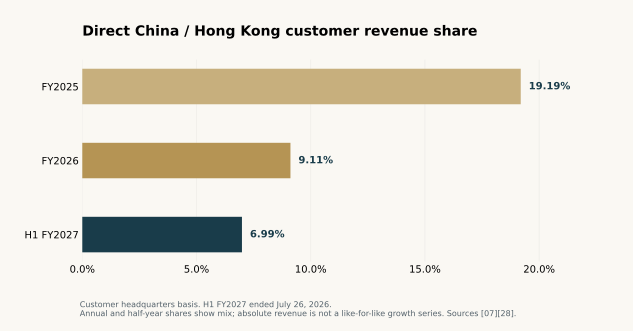
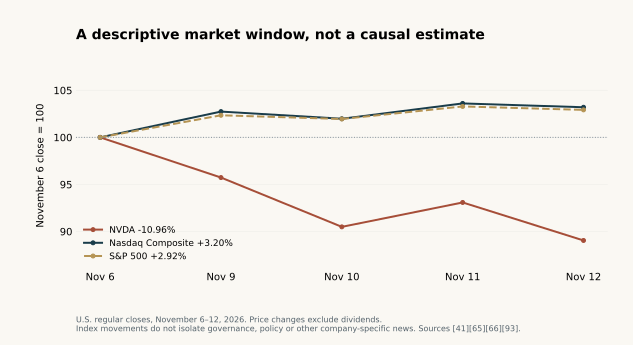

<small>Cover: original DEX Research editorial artwork. The abstract circuit does not depict an alleged transaction.</small>

**DEX Research | Revised in-depth report | Information cutoff: November 13, 2026 (UTC)**

After Jensen Huang acknowledged an extramarital relationship, three questions came to the foreground. Did a personal relationship change corporate decisions? Can companies tell who ultimately uses the computing capacity they supply? And who can decide which markets gain access to American technology? Answering those questions requires reading board filings, regulatory investigations, equipment and money flows, and legislative proposals alongside one another.

**The governance crisis has already had verifiable consequences, and the dispute over export controls is producing concrete political action. The public record remains incomplete on the alleged intelligence role, illicit diversion, and any causal link between the personal relationship and specific transactions.** The difference in the quality of evidence matters. There is a firmer basis for assessing governance, oversight, and financing risk than for drawing conclusions about individual shipments or the findings of ongoing investigations.

The numbered sources at the end identify the underlying documents, public statements, reporting, and the scope of each source. This article examines matters of public policy and corporate conduct. Nationality, surnames, personal relationships, and photographs establish no criminal conduct.

## 1. What changed and what remains unresolved

On November 8, Nvidia published a letter to employees in which Huang acknowledged being unfaithful to his wife. The letter did not identify the other person or acknowledge a disclosure of secrets or an export-control violation. The board issued its preliminary assessment that day. On November 10, independent directors announced they had retained outside counsel for an investigation. Each statement reflects what was available at the time. The investigation must establish its own findings. <a href="#s01" aria-label="Source 1">[01]</a><a href="#s02" aria-label="Source 2">[02]</a><a href="#s03" aria-label="Source 3">[03]</a>

A formal change in corporate leadership followed. An SEC filing records that Nvidia’s board accepted Huang’s resignation as president, chief executive officer, and director on November 11, U.S. local time, effective immediately. The company announced the transition on November 12. Colette Kress took over as interim CEO while retaining her finance role, and Harvey C. Jones became Nvidia’s first board chair. The company disclosed that its board accepted a resignation. The filing included no final findings from the independent investigation. <a href="#s71" aria-label="Source 71">[71]</a><a href="#s72" aria-label="Source 72">[72]</a>

The New York Times, citing people familiar with the matter, linked the relationship to Alice Huang, also known as Huang Le, a former MegaSpeed executive. It also reported allegations by U.S. intelligence officials about her role. Reuters said it could not independently verify the intelligence allegation. On November 12, U.S. Attorney General Todd Blanche confirmed that the FBI was investigating the reports and said the Justice Department had reached no conclusion about whether Alice Huang was a Chinese spy. China’s Ministry of Foreign Affairs had denied the allegation. <a href="#s04" aria-label="Source 4">[04]</a><a href="#s19" aria-label="Source 19">[19]</a><a href="#s75" aria-label="Source 75">[75]</a><a href="#s05" aria-label="Source 5">[05]</a>

<table class="news-data-table">
<thead><tr><th scope="col">Assessment</th><th scope="col">Basis and strength of evidence</th><th scope="col">Limits of the evidence</th></tr></thead>
<tbody>
<tr><th scope="row">Nvidia faces a real governance and succession challenge</th><td>SEC filings establish the resignation and appointments. Confidence is high.</td><td>The resignation establishes a governance outcome. Criminal liability requires separate evidence.</td></tr>
<tr><th scope="row">The case is advancing the political debate over export controls</th><td>Congressional letters expressly call for legislation and oversight. Confidence is high.</td><td>The proposals are at different legislative stages.</td></tr>
<tr><th scope="row">The relationship may have weakened customer approval, recusal, or oversight</th><td>The organizational mechanism can be tested against transaction and decision records.</td><td>The existence of a relationship alone leaves preferential treatment unproven.</td></tr>
<tr><th scope="row">Whether anyone used the relationship to obtain or pass on sensitive information</th><td>News organizations have reported intelligence allegations. The contents of any such information and how it might have been passed on have yet to be made public.</td><td>The public record has yet to establish a chain of actions.</td></tr>
</tbody>
</table>

The governance and policy responses are the most firmly documented parts of the story. The intent of any individual, intervention in particular decisions, and the ultimate destination of specific transactions require stronger evidence. Those gaps matter more than the volume of reporting about the relationship.

## 2. Three timelines converge

Singapore’s investigation into procurement declarations predates the current public controversy. U.S. lawmakers were already debating remote access to computing power. Nvidia’s board made its leadership decision in November. The three developments eventually intersected after advancing on different schedules.

<table class="news-data-table">
<thead><tr><th scope="col">Date</th><th scope="col">Verifiable development</th><th scope="col">Implication for the timeline</th></tr></thead>
<tbody>
<tr><th scope="row">February 2025</th><td>Singapore police and customs began looking into possible false declarations in server procurement.</td><td>Singapore says it opened the investigation independently.</td></tr>
<tr><th scope="row">June 24, 2025</th><td>The U.S. Bureau of Industry and Security, or BIS, conducted a voluntary post-shipment verification. Singapore police separately questioned Alice Huang that day and retained her passport.</td><td>The two agencies were pursuing different questions.</td></tr>
<tr><th scope="row">January 2026</th><td>The United States published a case-by-case licensing policy for H200-class products. The House passed legislation on remote access.</td><td>Both policy decisions preceded the current controversy.</td></tr>
<tr><th scope="row">February 2026</th><td>Singapore reached separate determinations about the evidence involving Alice Huang in the underlying declaration case and her inaccurate statements during the investigation.</td><td>The treatment of an individual leaves the corporate investigation open.</td></tr>
<tr><th scope="row">November 8–10, 2026</th><td>Huang acknowledged his conduct, the board responded, and independent directors brought in external investigators.</td><td>The board’s statements reflect what it was prepared to say on those dates.</td></tr>
<tr><th scope="row">November 11–12</th><td>Nvidia’s board accepted Huang’s resignation, and the company announced its leadership transition.</td><td>The allocation of formal corporate authority changed.</td></tr>
<tr><th scope="row">November 12–13</th><td>Singapore and Malaysia provided updates, the U.S. attorney general spoke publicly, and congressional committees sought further questioning.</td><td>Authorities in different jurisdictions were seeking different kinds of evidence.</td></tr>
</tbody>
</table>

Sources <a href="#s01" aria-label="Source 1">[01]</a><a href="#s03" aria-label="Source 3">[03]</a><a href="#s13" aria-label="Source 13">[13]</a><a href="#s63" aria-label="Source 63">[63]</a><a href="#s71" aria-label="Source 71">[71]</a><a href="#s73" aria-label="Source 73">[73]</a><a href="#s74" aria-label="Source 74">[74]</a><a href="#s75" aria-label="Source 75">[75]</a>.

The public chronology is consistent with several institutions responding to different concerns over time. A theory based wholly on the recent political coverage cannot account for the earlier Singapore investigation or legislative activity. A theory of a single covert operation would have to connect those earlier records to the later enforcement and political decisions through communications, instructions, or meeting records.

## 3. How a personal relationship can become a corporate risk

A chief executive can have influence over customer contact, allocation of scarce resources, and whether concerns reach independent overseers. When personal interests overlap with a chief executive’s duties, decisions that would ordinarily be recorded and reviewed may rely heavily on that executive’s judgment.

One mechanism can be tested. Personal trust could increase access. That access might shape how a customer is evaluated, and the evaluation could then affect supply priority, credit, payment terms, or exceptions to a compliance policy. Investigators would look for a trace in customer onboarding records, meetings, emails, approvals, and reports of problems. Photographs or an admission of a relationship establish only the first part of that sequence.

Three questions follow. Did the customer receive treatment that differed from that of comparable customers? Could employees who raised concerns report directly to independent overseers, beyond the executive responsible for the business? Did management disclose relationships that could affect its judgment? The first two questions test whether controls worked. The third tests whether directors had enough information to do their job.

To identify unusual treatment, investigators need a comparison group. Rapid growth in a customer’s purchases could reflect supply priority, stronger demand, access to financing, or orders placed earlier. Comparing customers of a similar size over the same period means looking at the products ordered, delivery schedules, advance payments, credit terms, and compliance checks. The growth figure alone leaves both the identity of any decision-maker and that person’s motives unresolved.

Directors can act on a loss of confidence, a higher cost of oversight, succession needs, or their judgment about business continuity. A criminal case must establish the elements of a specific offense. Nvidia’s leadership transition and the open status of the government inquiry can therefore coexist. The public disclosures do not identify the directors’ private reasoning.

The appointment of outside counsel gives readers a procedure whose eventual findings can be evaluated. The questions are whether the investigation covers customer approvals and conflict disclosures, whether the relevant people reported to independent directors, which controls failed if any, and who is responsible for remediation. Public filings have yet to answer those questions fully. <a href="#s03" aria-label="Source 3">[03]</a>

## 4. Five records needed to follow an AI chip

A Singapore company can buy a server, the server can operate in Malaysia, and a Chinese customer can rent its computing capacity. Those are compatible commercial facts, each with its own regulatory implications. The billing address, direct customer’s headquarters, place of delivery, operating location, and identity and workload of the ultimate user can all differ.

<table class="news-data-table">
<thead><tr><th scope="col">What to trace</th><th scope="col">Typical records</th><th scope="col">Question the records can answer</th></tr></thead>
<tbody>
<tr><th scope="row">Contracting and billing</th><td>Contracts, invoices, customer account records</td><td>Who buys from the supplier and owes payment?</td></tr>
<tr><th scope="row">Ownership and control</th><td>Corporate filings, voting rights, financing covenants</td><td>Who can direct company decisions? Who holds an investment or lends money?</td></tr>
<tr><th scope="row">Physical movement and installation</th><td>Bills of lading, declarations, serial numbers, rack acceptance records</td><td>Which machine reached which location, and when?</td></tr>
<tr><th scope="row">Computing services and access</th><td>Tenant registration, sublease contracts, workload and access logs</td><td>Who gains access, and can they pass it to someone else?</td></tr>
<tr><th scope="row">Revenue and financing</th><td>Bank transactions, advances, receivables, revenue policies</td><td>Why was money transferred, and when does it become revenue or debt?</td></tr>
</tbody>
</table>

A cloud-services agreement typically establishes who is entitled to service and what they must pay. A shipment requires separate evidence. Customs records can document a particular shipment, while the list of tenants who eventually use the server may be held by a different company. Customer headquarters is a useful business measure with limited visibility into ultimate use.

Nvidia previously reported geographic revenue by billing address. It later switched to direct customers’ headquarters and recast its comparisons. The company also previously said that the vast majority of revenue from controlled data-center computing products billed to Singapore addresses related to orders from U.S.-headquartered customers. That disclosure applies to a specific product scope and reporting method. It leaves the origin of demand for other Singapore-billed sales open. <a href="#s37" aria-label="Source 37">[37]</a><a href="#s38" aria-label="Source 38">[38]</a>

A regulatory assessment of overseas compute rental must take account of the hardware model, timing, customer, workload, license terms, and rules then in force. The January 2026 H200 licensing rule already imposed customer identification and certain remote-use conditions. The remote-access legislation before Congress seeks broader and more explicit authority, extending beyond the narrower controls already present in that licensing rule. <a href="#s63" aria-label="Source 63">[63]</a><a href="#s64" aria-label="Source 64">[64]</a>

Computing rights can pass through several contracts while the hardware stays in one place. Payments can be made years before equipment goes into service. A regulator that sees only the first invoice may have little view of the user it is trying to identify. Effective controls depend on what parties can verify after installation and as tenants change.

## 5. MegaSpeed’s investigations and its financing

### What Singapore and Malaysia have established

On November 12, Singapore’s Ministry of Home Affairs confirmed that its investigation concerned possible false declarations in server procurement. Authorities said there was insufficient evidence to proceed against Alice Huang personally on the underlying declaration issue. Police issued her a stern warning for knowingly providing inaccurate information during the investigation, and she was barred from re-entering Singapore. The investigation into MegaSpeed and six other people remains ongoing. Singapore said it did not investigate her for espionage. The ministry also said the servers that the companies under investigation procured had moved through Singapore to Malaysia without entering the Singapore market. It is seeking to establish where the servers went after leaving Singapore. <a href="#s73" aria-label="Source 73">[73]</a>

The following day, Malaysia’s Ministry of Investment, Trade and Industry, or MITI, said it had never cleared MegaSpeed or Speedmatrix of suspected wrongdoing and that routine site visits carried no such implication. MITI is working with customs to determine whether re-exports occurred and whether they were lawful. The ministry distinguished bringing this type of equipment into Malaysia, for which a license is currently unnecessary, from covered exports, re-exports, transshipments, and transit, which have required a permit since July 2025. <a href="#s74" aria-label="Source 74">[74]</a>

On the same day, Reuters quoted Malaysian Prime Minister Anwar Ibrahim as saying there was then no indication that the chips had been shipped out of Malaysia. Checks were continuing. Malaysia’s authorities are still examining whether re-exports occurred and whether they complied with local permit requirements. <a href="#s94" aria-label="Source 94">[94]</a>

The relevant records would connect individual procurement declarations to actual shipments, later destinations, and permit conditions. The two statements leave many serial numbers and end users undisclosed, and neither provides a final determination. MegaSpeed previously said it cooperated with U.S. verification efforts and arranged for outside counsel to review its inventory and compliance. The company announced the review without publishing its results. <a href="#s09" aria-label="Source 9">[09]</a><a href="#s10" aria-label="Source 10">[10]</a>

### Asset growth needs to be read alongside liabilities

According to Lianhe Zaobao’s review of filed accounts, MegaSpeed recorded $2,975.67 million in assets, $2,985.75 million in liabilities, $294.27 million in revenue, and an after-tax loss of $20.04 million in 2024. The figures imply negative book equity of $10.08 million. The newspaper also reported that the 2022–2024 financial statements received unqualified audit opinions and that audit reports identified no material uncertainty about the company’s ability to continue operating. Those opinions concern the financial statements. Export compliance requires review of products, end users, and applicable licenses. <a href="#s84" aria-label="Source 84">[84]</a>

Did the assets consist mainly of installed equipment, advance payments, lease rights, or related-party balances? How much of the liability figure reflects bank loans, supplier credit, customer advances, or lease obligations? When do payments come due, and are contractual receipts sufficient to cover them? Asset growth alone can answer none of these questions.

Negative equity suggests a limited capital buffer. An assessment of solvency requires the ability to meet obligations as they fall due. Infrastructure businesses may use long-term contracts, customer prepayments, and equipment finance in combination. Their ability to withstand a disruption depends on how contract terms, drawdown and repayment schedules, restrictions on funds, and the value of collateral fit together.

Zaobao also reported from corporate filings that Speedmatrix granted security over specified equipment, intellectual property, and associated rights to Apex in 2024. The ownership chain places Apex within the Alibaba group. The filings as reported establish a particular financing link. They do not allocate the whole asset expansion or every chip or payment to that creditor. A creditor can have rights to protect its loan while having limited ability to direct the borrower’s wider business. <a href="#s85" aria-label="Source 85">[85]</a>

CoreWeave provides a comparison. Its public filings show that infrastructure financing can combine long-term contracts, asset-backed financing, and customer prepayments. Separate disclosures show that Nvidia agreed to purchase certain unsold compute capacity if specified conditions were met. The existence of several commercial roles in one AI infrastructure relationship helps explain how similar structures can arise. The terms and legality of MegaSpeed’s transactions still depend on its own records. <a href="#s86" aria-label="Source 86">[86]</a><a href="#s87" aria-label="Source 87">[87]</a>

## 6. Chinese corporate disclosures show the transactions behind the relationships

Lettall Electronic’s public explanations of its operations and cash flows provide a clearer view of the business than a chart linking individuals. A 2024 response to inquiries disclosed changes in ownership at Century Litong alongside equipment procurement and leasing. The company described domestic procurement and long-term leasing arrangements. Those documented routes matter when evaluating claims about how particular equipment was sourced. <a href="#s81" aria-label="Source 81">[81]</a>

A response published in July 2025 provides a more specific example. The document stated that Singapore-based LETACT CLOUD procured cloud computing services from an unnamed supplier identified as “Company Seven.” Transactions in 2024 amounted to RMB 37.5796 million. Short-term advances to that supplier at period-end were RMB 119.7314 million, and long-term advances were RMB 701.9097 million, adding to RMB 821.6411 million. The transaction figure measures activity during the year, while the other two are balances on a particular date. Adding the three would yield neither equipment spending nor a meaningful measure of service purchases. <a href="#s82" aria-label="Source 82">[82]</a>

The same response said the overseas business operated by leasing computing capacity and subleasing it to others, recognizing the relevant revenue on a net basis. Customers may pay early to secure capacity, and the intermediary may pay upstream providers in advance to reserve supply. The equipment remains with a partner, and charges can be settled by usage or over the contract term. In such an arrangement, funds can move across borders and computing services can be resold without another shipment accompanying the transaction. <a href="#s82" aria-label="Source 82">[82]</a>

Kharon, an independent research firm, compared registration details and identified MegaSpeed as the likely match for Company Seven. The public clues give investigators a lead. The listed company kept the supplier anonymous in the tables reviewed here, so the match remains a third-party identification. <a href="#s83" aria-label="Source 83">[83]</a>

**Service payments can finance hardware capacity.** Advance rent can ease an upstream operator’s financing constraints and make suppliers more willing to schedule production. The durability of demand depends on whether end customers can and must continue paying and under what conditions advances are refundable. Signed contracts alone leave future cash collection uncertain.

**Cash flows, revenue, and margins reflect the role a company plays.** A company that reports equipment leases on a gross basis uses a different revenue denominator from an intermediary that reports its service on a net basis. A higher net margin by itself leaves the underlying competitive advantage unsettled. Contractual obligations, asset risk, earnings per unit of service, and cash collection are more useful comparisons.

**Information is spread across contracting parties.** The tenant knows how much capacity it rents. The equipment provider knows which hardware it supplied. The lender knows the collateral and source of payments. The question for investigators is whether each participant performed the identification, verification, and escalation required of it, and what it did when discrepancies appeared.

The next step in tracing a transaction is to identify a legal entity, contract, payment, group of devices, and period of use. Those records can help distinguish ordinary cross-border leasing, incomplete disclosure, prohibited remote access, and unlawful physical diversion.

## 7. Washington is contesting control over licensing, oversight, and rulemaking

Three authorities meet in this case. The executive branch administers licenses and enforces controls. Congress passes laws and oversees the executive branch and relevant business conduct. Nvidia’s board appoints executives and oversees the company. Each can seek different evidence and make a different decision about the same events.

On November 12, the chairs of three House committees proposed a new schedule. They requested closed-door, transcribed interviews with Huang on December 1 and with Nvidia General Counsel Tim Teter on December 2. They asked Jeffrey Kessler, the Commerce Department official responsible for BIS, to testify at a December 3 hearing. The letters sought replies and raised the possibility of subpoenas if the recipients declined to cooperate. The letters establish the requests and the steps the committees are prepared to take. The proceeding records will show what actually took place. <a href="#s76" aria-label="Source 76">[76]</a><a href="#s77" aria-label="Source 77">[77]</a><a href="#s78" aria-label="Source 78">[78]</a><a href="#s79" aria-label="Source 79">[79]</a>

The chairs explicitly linked the case to four proposals. The AI OVERWATCH Act concerns congressional involvement in export-license oversight. The Chip Security Act addresses verification of chip location. The MATCH Act concerns restrictions by allies on semiconductor manufacturing equipment. The Remote Access Security Act addresses access over networks or cloud services from other locations. Their commercial effects would differ because each changes a different part of the system. The public materials reviewed here do not establish that all four have taken effect as law. <a href="#s31" aria-label="Source 31">[31]</a><a href="#s64" aria-label="Source 64">[64]</a><a href="#s76" aria-label="Source 76">[76]</a>

Congressional sponsors are using the case to advance proposals that were already on the agenda. Their statements document that effort. A claim that someone engineered the events to advance those proposals would require evidence connecting that person to specific actions. A political benefit supplies a reason to look for that connection, and the records would have to establish it.

Support from both parties also limits an explanation based on retaliation by a single party. Conservative lawmakers’ national security concerns, Democratic lawmakers’ interest in executive accountability and conflicts of interest, and the administration’s interest in commercial competitiveness can overlap in some areas and diverge over which controls to apply. The relevant questions are who can alter license conditions, when legislators can move a bill, and who can compel production of records. <a href="#s26" aria-label="Source 26">[26]</a><a href="#s68" aria-label="Source 68">[68]</a><a href="#s90" aria-label="Source 90">[90]</a>

Nvidia’s federal lobbying disclosure for the third quarter of 2026 listed $2.15 million in expenses and identified several policy issues. It documents the company’s lobbying activity in Washington. The aggregate includes multiple matters and cannot be assigned to a specific bill or used to determine why an official made a particular decision. <a href="#s30" aria-label="Source 30">[30]</a>

## 8. Two accounts of the national interest, and who bears the cost

Huang has argued publicly that the United States should attract users to its AI ecosystem worldwide. He has warned that exiting markets helps alternative platforms develop. The industrial logic extends beyond hardware sales. Developers, software tools, interconnect technologies, and experience operating large systems can shape which platforms customers choose over time. Nvidia has a commercial interest in that outcome. <a href="#s29" aria-label="Source 29">[29]</a>

The other argument starts from the strategic value of advanced computing. After equipment or access reaches a user a government sought to restrict, the seller may have limited control over how it is used. Proponents accordingly focus on the capabilities the chips confer, sensitive and military workloads, visibility after subleasing, and the cost of enforcing controls. U.S. suppliers, infrastructure investors in allied countries, and lawful users may all bear part of that cost. <a href="#s12" aria-label="Source 12">[12]</a><a href="#s46" aria-label="Source 46">[46]</a>

Both arguments depend on outcomes that will take time to observe. Does selling more capacity preserve reliance on U.S. platforms, or does it speed the development of competing capabilities? Do restrictions delay access to sensitive capabilities, or do they raise the commercial rewards for building alternatives? A single year of revenue or an allegation about one transaction cannot resolve either question.

Policy evaluation begins with the objective. A policy intended to reduce certain organizations’ access to high-end training would be assessed through their available equipment, cluster performance, substitute capacity, and the cost of enforcement. A strategy to expand the long-term influence of U.S. platforms would be assessed through the global developer base, customer migration, and durable revenue. The two objectives can call for different license conditions.

The policy tools include screening entities and uses, verifying equipment after delivery, imposing obligations on remote access, and restricting a wider set of products. Each can address a particular risk while adding compliance costs or moving activity to less visible channels. Its usefulness depends on what it adds to current controls and what parties can actually verify.

Vendor-provided telemetry also has a defined scope. Nvidia describes Fleet Intelligence as using an agent to collect equipment information. Certain newer architectures support cryptographic attestation. Verifying hardware identity or system integrity and identifying the ultimate tenant and actual workload are different tasks. The public description also leaves open how much of the existing installed GPU base participates continuously in the same system. <a href="#s89" aria-label="Source 89">[89]</a>

## 9. How much business is exposed depends on what the figures measure

Nvidia’s direct revenue dependence on China has changed. Revenue by the headquarters of direct customers captures part of that exposure. It has limited visibility into overseas services ultimately supported by demand from China. The company’s data below use the same reporting period for the numerator and denominator in each row. Its first half of fiscal 2027 ended on July 26, 2026.

<table class="news-data-table">
<thead><tr><th scope="col">Period</th><th scope="col">Global revenue, USD billion</th><th scope="col">Revenue from customers headquartered in China and Hong Kong, USD billion</th><th scope="col">Share, author’s calculation</th></tr></thead>
<tbody>
<tr><th scope="row">Fiscal 2025</th><td>130.497</td><td>25.048</td><td>19.19%</td></tr>
<tr><th scope="row">Fiscal 2026</th><td>215.938</td><td>19.677</td><td>9.11%</td></tr>
<tr><th scope="row">First half of fiscal 2027</th><td>177.837</td><td>12.430</td><td>6.99%</td></tr>
</tbody>
</table>

<figure class="report-chart" aria-labelledby="revenue-chart-caption"><figcaption id="revenue-chart-caption">Chart 1. Customer headquarters revenue mix. The latest period is a half-year. Exact values and calculation scope appear in the adjacent table and text.</figcaption></figure>

Each share is China and Hong Kong revenue divided by worldwide revenue for the same period. Full-year and half-year shares can show how the sales mix changed. Year-on-year comparisons of revenue dollars require corresponding periods. <a href="#s07" aria-label="Source 7">[07]</a><a href="#s28" aria-label="Source 28">[28]</a>

In the second quarter of fiscal 2027, total revenue was $96.221 billion and data-center revenue was $89.023 billion. Nvidia said shipments under the H200 licensing program accounted for less than 1% of data-center revenue. That establishes a quarterly revenue ceiling of less than $890.23 million for those licensed shipments. The amount actually earned was undisclosed. The wider China revenue figure covers other sales. <a href="#s28" aria-label="Source 28">[28]</a><a href="#s39" aria-label="Source 39">[39]</a>

In August, Nvidia guided to next-quarter revenue of $108 billion, plus or minus 2%, with no data-center compute revenue from China in that forecast. The assumption preceded the November governance crisis. Treating that same exclusion as a new loss following the crisis would count it twice. Guidance is forward-looking and the exclusion covers only the specified China data-center compute revenue. <a href="#s39" aria-label="Source 39">[39]</a>

There is a recorded example of a different financial effect. In fiscal 2026, Nvidia recorded a $4.5 billion charge for H20 inventory and purchase obligations. A regulatory change can therefore affect inventory and procurement commitments in addition to sales. That historical charge tells us the channels through which losses can arise. Future losses would depend on the products affected and obligations already in place. <a href="#s07" aria-label="Source 7">[07]</a>

On November 13, Reuters reported that it reviewed more than 150 Chinese documents and identified over RMB 23 billion in projects and equipment agreements involving restricted Nvidia products. The estimate combines projects at different stages and includes some construction and power costs. Reuters did not establish a link between the projects and MegaSpeed. The records document continued demand and investment plans. The reported total cannot establish Nvidia revenue or the value of any unlawfully transferred chips. <a href="#s80" aria-label="Source 80">[80]</a>

A financial assessment should start with affected sales and gross profit, then estimate losses on inventory and procurement, compliance costs, and financing changes. It should also account for capacity that can be redirected and for demand from other customers. Each component needs an independent assumption. The available figures leave too many parameters unobserved to estimate a total loss with a reliable confidence interval.

## 10. Nvidia supplies, finances, and buys within the same computing network

A revenue estimate for China-bound chips captures only one way the departure of a founder might affect Nvidia. The company also allocates capital across its AI infrastructure partnerships. Its relationships can combine equipment sales, equity investments, and commitments to buy capacity on specified terms. Nvidia can be a supplier, shareholder, and customer in the same ecosystem. Each role has separate legal and accounting consequences.

Nvidia’s fiscal 2027 second-quarter filing disclosed $99 billion in ecosystem equity investments and $25 billion in equity-investment commitments as of July 26. It also disclosed $36 billion in commitments to select AI cloud partners under a specific business model. In August, after the quarter ended, Nvidia entered into guarantees involving SB Energy capped at $105 billion and covering specified project obligations subject to conditions. The disclosures cover assets, future commitments, and contingent guarantees. Each has its own timetable and conditions, so adding them gives no measure of funds actually lost. <a href="#s28" aria-label="Source 28">[28]</a>

CoreWeave announced Nvidia’s $2 billion equity investment in January 2026 and described what the companies intended to build together. The investment is a concrete transaction. The future capacity depends on construction, power, customers, and financing. <a href="#s92" aria-label="Source 92">[92]</a>

These relationships can support growth. Financing enables construction, data centers take equipment, equipment produces a service, and service revenue supports further financing. Weak end demand or deteriorating payments can also spread pressure along the same chain. Revenue a company has already recognized from equipment sales offers an incomplete view of whether the wider ecosystem will collect cash. Determining whether any income was recognized improperly requires evidence about contracts, transfer of risk, and accounting. Overlapping roles alone do not settle the question.

The incoming leadership must decide whether to make more commitments of this kind, how to review deals in which Nvidia has several roles, and what return and financial cushion new projects require. Policy changes add a more concrete question. Who bears the cost if computing capacity cannot be delivered or used? The performance of existing agreements and decisions to expand require separate monitoring.

On November 13, the Taipei City Government said Nvidia’s local subsidiary had signed and made the required payments under the agreement for its new headquarters site. The project illustrates how an institutional contract can continue through a founder’s departure. Other projects have their own counterparties and conditions, and their progress can be checked individually. <a href="#s88" aria-label="Source 88">[88]</a>

## 11. What the board and the market are repricing

Nvidia’s 2026 proxy statement put Huang’s beneficial ownership at about 3.58% as of March 23. That figure includes arrangements under which voting or investment power is shared. It shows a material economic interest and a minority ownership position under the stated disclosure rules. Corporate bylaws and directors’ powers govern who can hold executive office, regardless of the influence a founder retains with employees, customers, and shareholders. <a href="#s51" aria-label="Source 51">[51]</a><a href="#s67" aria-label="Source 67">[67]</a>

Nvidia’s transition created a separate board chair while placing the interim CEO and CFO roles with Kress. A separate chair can make independent oversight more visible. Combining the two management roles may help coordinate finances and operations during the transition while concentrating more responsibility in one person. Delegations of authority, committee work, and execution will show how those choices operate in practice.

The technical team, pace of product development, and coordination with key suppliers and customers remain important. A founder’s exit can affect the speed of decisions and appetite for long-term risk. Patents, the software ecosystem, and signed contracts continue under their own terms. Management’s expectation that Nvidia’s roadmap and customer commitments will continue can be tested through delivery, personnel stability, and customer decisions. <a href="#s72" aria-label="Source 72">[72]</a>

U.S. regular-session closing prices offer one window into repricing. From November 6 through November 12, NVDA fell from $186.64 to $166.19, a decline of 10.96%. The Nasdaq Composite gained 3.20% over the same period, and the S&P 500 gained 2.92%. Each change is the closing value at the end of the window divided by its closing value at the start, minus one. <a href="#s41" aria-label="Source 41">[41]</a><a href="#s65" aria-label="Source 65">[65]</a><a href="#s66" aria-label="Source 66">[66]</a><a href="#s93" aria-label="Source 93">[93]</a>

<figure class="report-chart" aria-labelledby="market-chart-caption"><figcaption id="market-chart-caption">Chart 2. A matched market window, November 6 to 12, 2026. It does not estimate causation. <a href="assets/market_data.csv" download>Download the underlying closing values (CSV).</a></figcaption></figure>

Nvidia substantially underperformed the broad indexes in that window. The period also included news about the relationship, the leadership transition, potential regulation, and the wider industry. Those returns leave the contribution of each development unresolved. Equity market value measures what investors will pay for shares and is distinct from company cash outflows or damages assessed by a court. An event study would require a defined event window, model, and controls, with explicit treatment of potential leaks and overlapping news.

Shareholder litigation creates another avenue for accountability. A publicly available complaint alleges disclosure failures and related liability. The complaint records what the plaintiff argues, and the court will determine which claims, if any, are established. A corporate investigation, congressional oversight, enforcement of export rules, and civil litigation can draw on some of the same material while pursuing different questions and applying different standards. <a href="#s55" aria-label="Source 55">[55]</a><a href="#s56" aria-label="Source 56">[56]</a>

## 12. What evidence would change the assessment

The best-supported base case is that Nvidia is already managing succession and changes in governance, while regulators may demand greater visibility into end customers and access to computing resources. Direct business losses and broader financing effects will depend on measures actually implemented and performance under existing agreements. The outcome of the intelligence investigation remains open and could materially change the assessment.

<table class="news-data-table">
<thead><tr><th scope="col">Development</th><th scope="col">Evidence that would distinguish it</th><th scope="col">Business implications</th></tr></thead>
<tbody>
<tr><th scope="row">Risk remains concentrated in individual conduct and governance</th><td>Independent findings explain their scope, customer approvals withstand review, and remediation is verified.</td><td>Succession, oversight costs, and operational stability dominate the outlook.</td></tr>
<tr><th scope="row">Customer or transaction controls show systemic weaknesses</th><td>Unaddressed warnings, approval overrides, unusual terms, and evidence of ultimate destinations corroborate one another.</td><td>Compliance costs, restrictions on clients, and inventory risk increase.</td></tr>
<tr><th scope="row">Specific transactions violated applicable rules</th><td>The parties, timing, product models, licenses, and destinations are established for identified transactions.</td><td>Estimate the exposure and sanctions for those transactions first, then assess whether the problem extends further.</td></tr>
<tr><th scope="row">Congress or the executive branch imposes broader restrictions</th><td>Enacted rules specify conditions, geographies, and transition periods.</td><td>Direct sales, overseas cloud services, and allies’ equipment businesses face different effects.</td></tr>
<tr><th scope="row">More serious intelligence activity or intentional evasion is established</th><td>Verifiable instructions, communications, payments, access or transmission records, or judicial findings.</td><td>Reassess legal liability, the reliability of corporate governance, and the options available to policymakers.</td></tr>
</tbody>
</table>

Contemporaneous decision records are the clearest evidence of whether a relationship altered a transaction. To establish physical diversion, match serial numbers across customs and installation records over time. To identify remote users, examine tenant, sublease, and access records. A claim of political exchange requires a link between licensing decisions and specific meetings or communications.

Upcoming checkpoints include Nvidia’s November 17 earnings release and management discussion, the November 19 deadline requested in House correspondence, and the proposed early December interviews and hearing. Subsequent confirmations and the record of proceedings will establish the final schedule. The earnings disclosure may also update inventory, customers, commitments, and risk factors. <a href="#s72" aria-label="Source 72">[72]</a><a href="#s77" aria-label="Source 77">[77]</a><a href="#s78" aria-label="Source 78">[78]</a><a href="#s79" aria-label="Source 79">[79]</a>

The crisis exposes a tension between expanding the business and keeping its decisions and customers visible to those responsible for oversight. A founder’s influence can coordinate an organization and concentrate judgment. Cross-border financing and cloud services can increase the available supply of computing while making users harder to identify. National security controls can limit access to capabilities and shift the benefits and costs among suppliers, allies, and competing platforms. Each claim can be evaluated through its own records, and new records can change the conclusions.

## Research method and revisions

This report covers public materials located through November 13, 2026 (UTC). Government records are the primary basis for procedural status and regulatory terms. Company statements and SEC filings establish what companies report, their published financial figures, and their formal governance actions. News investigations provide independent reporting and leads. Where the analysis extends beyond established facts, it describes mechanisms and scenarios that can be tested. A government announcement does not authenticate classified material it leaves undisclosed. A company statement carries a different assurance standard from an independent audit, and reports that cite the same underlying work provide only one line of evidence.

This revision updates Nvidia’s formal leadership transition, inquiry statuses in Singapore and Malaysia, and Congress’s proposed timetable. It adds analysis of advance payments for computing services, financing, and accounting. It distinguishes direct China revenue from project values, ecosystem investments, and guarantees, and includes contrary evidence and conditions that would change the assessment. It leaves criminal findings to the authorities and ties financial estimates to figures readers can reproduce.

The sources below use stable reference numbers, some retained from the prior edition. Each listed source is cited in this edition. The notes explain the information each link supports and where its evidentiary limits lie.

## Supporting evidence {#supporting-evidence}

<a href="assets/evidence_register.json" download>Download the source register (JSON).</a> The register contains the same 53 sources listed below, their evidence categories, and scope notes.

<ol class="source-list">
<li id="s01" value="1">
<a href="https://nvidianews.nvidia.com/news/a-message-to-our-company">NVIDIA · A Message to Our Company</a>

<strong>Company statement.</strong> November 8 employee letter. Acknowledges infidelity and does not name the other person.
</li>
<li id="s02" value="2">
<a href="https://nvidianews.nvidia.com/news/statement-from-nvidia-board-of-directors">NVIDIA · Statement From NVIDIA Board of Directors</a>

<strong>Company statement.</strong> November 8 statement announcing the inquiry and the board’s initial position.
</li>
<li id="s03" value="3">
<a href="https://nvidianews.nvidia.com/news/statement-from-the-independent-members-of-the-nvidia-board">NVIDIA · Statement From the Independent Members of the NVIDIA Board</a>

<strong>Company statement.</strong> November 10 appointment of Joon H. Kim and Wachtell by the independent directors.
</li>
<li id="s04" value="4">
<a href="https://gvwire.com/2026/10/29/nvidia-chief-seen-as-target-of-chinese-spy-plot/">The New York Times · October 29 investigation, syndicated by GV Wire</a>

<strong>Investigative reporting.</strong> Intelligence allegations and an equipment-purchase estimate from trade records. The intelligence material is not public.
</li>
<li id="s05" value="5">
<a href="https://www.mfa.gov.cn/web/fyrbt_673021/jzhsl_673025/202611/t20261110_12056801.shtml">中华人民共和国外交部 · 2026 年 11 月 10 日例行记者会</a>

<strong>Government statement.</strong> Chinese Foreign Ministry’s denial in the exchange about NVIDIA.
</li>
<li id="s07" value="7">
<a href="https://www.sec.gov/Archives/edgar/data/1045810/000104581026000021/nvda-20260125.htm">SEC EDGAR · NVIDIA FY2026 Form 10-K</a>

<strong>Primary corporate filing.</strong> Export-control history, H20 charge, H200 licenses and Note 17 geographic revenue.
</li>
<li id="s09" value="9">
<a href="https://www.megaspeed.ai/">MegaSpeed · Official site and November 12 company statement</a>

<strong>Company statement.</strong> Cloud offerings and November 12 company statement on cooperation and an intended GPU census.
</li>
<li id="s10" value="10">
<a href="https://www.reuters.com/world/china/nvidia-customer-megaspeed-says-it-cooperated-with-us-inspections-takes-export-2026-11-12/">Reuters · MegaSpeed responds to U.S. inspections</a>

<strong>News reporting.</strong> November 12 reporting on MegaSpeed’s own compliance and verification statements.
</li>
<li id="s12" value="12">
<a href="https://www.cotton.senate.gov/imo/media/doc/101325lutnickletter.pdf">U.S. Senator Tom Cotton · October 2025 letter to Commerce</a>

<strong>Congressional letter.</strong> Signed October 2025 request to investigate MegaSpeed.
</li>
<li id="s13" value="13">
<a href="https://clerk.house.gov/Votes/202613/">Clerk of the U.S. House · H.R. 2683 vote</a>

<strong>Legislative record.</strong> January 12, 2026 House roll call, 369 to 22.
</li>
<li id="s19" value="19">
<a href="https://www.reuters.com/world/china/nvidia-ceos-affair-aided-75-billion-chip-shipments-china-information-reports-2026-11-10/">Reuters · NVIDIA faces deepening scrutiny</a>

<strong>News reporting.</strong> Reports the allegations and verification limits, and estimates the two-session market-cap move.
</li>
<li id="s26" value="26">
<a href="https://www.banking.senate.gov/newsroom/minority/warren-banks-statement-on-nvidias-continued-export-of-advanced-ai-chips-following-reports-of-foreign-intelligence-operation">U.S. Senate Banking Committee · Warren–Banks joint statement</a>

<strong>Congressional statement.</strong> November 9 joint statement explicitly linking the reports to the push for AI Overwatch in the defense bill.
</li>
<li id="s28" value="28">
<a href="https://www.sec.gov/Archives/edgar/data/1045810/000104581026000075/nvda-20260726.htm">SEC EDGAR · NVIDIA Q2 FY2027 Form 10-Q</a>

<strong>Primary corporate filing.</strong> Geographic revenue, licensed H200 shipments and charges. Quarter ended July 26, 2026.
</li>
<li id="s29" value="29">
<a href="https://www.csis.org/analysis/nvidias-jensen-huang-securing-american-leadership-ai">CSIS · Jensen Huang on American AI leadership</a>

<strong>Public interview / transcript.</strong> Huang’s public argument about global adoption of U.S. technology and AI leadership.
</li>
<li id="s30" value="30">
<a href="https://lda.gov/filings/public/filing/017c32c9-d63b-43f1-bf16-8e1e70da4b7d/print/">U.S. Lobbying Disclosure Act · NVIDIA Q3 2026 LD-2</a>

<strong>Lobbying disclosure.</strong> Aggregate in-house lobbying expenses and disclosed issues, with no per-bill allocation.
</li>
<li id="s31" value="31">
<a href="https://www.govinfo.gov/app/details/BILLS-119hr6875ih">GovInfo · H.R. 6875, AI Overwatch Act</a>

<strong>Bill text.</strong> Introduced text and December 2025 filing date.
</li>
<li id="s37" value="37">
<a href="https://www.sec.gov/Archives/edgar/data/1045810/000104581025000209/R20.htm">SEC EDGAR · NVIDIA Q2 FY2026 geographic revenue note</a>

<strong>Primary corporate filing.</strong> Old billing-address table and the qualifier for controlled compute billed to Singapore.
</li>
<li id="s38" value="38">
<a href="https://www.sec.gov/Archives/edgar/data/1045810/000104581025000230/nvda-20251026.htm">SEC EDGAR · NVIDIA Q3 FY2026 Form 10-Q</a>

<strong>Primary corporate filing.</strong> Change to customer-headquarters reporting and recast comparatives.
</li>
<li id="s39" value="39">
<a href="https://investor.nvidia.com/news/press-release-details/2026/NVIDIA-Announces-Financial-Results-for-Second-Quarter-Fiscal-2027/">NVIDIA · Q2 FY2027 results and Q3 outlook</a>

<strong>Company earnings disclosure.</strong> August Q3 outlook, including its China Data Center compute assumption.
</li>
<li id="s41" value="41">
<a href="https://stockanalysis.com/stocks/nvda/history/">Stock Analysis / S&amp;P Global Market Intelligence · NVDA historical prices</a>

<strong>Market data.</strong> Regular-session closes for November 5–11. Period returns calculated by DEX Research.
</li>
<li id="s46" value="46">
<a href="https://www.bis.gov/media/documents/ai-counter-diversion-industry-guidance-may-13-2025.pdf">U.S. BIS · May 2025 industry guidance on chip diversion</a>

<strong>Regulatory guidance.</strong> Guidance on end users, data centers, and controls for specified restricted uses.
</li>
<li id="s51" value="51">
<a href="https://s201.q4cdn.com/141608511/files/doc_downloads/governance_documents/2024/03/NVIDIA-Amended-and-Restated-Bylaws-March-12-2024.pdf">NVIDIA · Amended and Restated Bylaws, §32</a>

<strong>Corporate governance document.</strong> Director voting authority for removal of an officer.
</li>
<li id="s55" value="55">
<a href="https://dockets.justia.com/docket/california/candce/5:2026cv13448/483368">N.D. California federal court docket, via Justia</a>

<strong>Court-docket mirror.</strong> Case number, parties and November 9 filing date.
</li>
<li id="s56" value="56">
<a href="https://www.dandodiary.com/wp-content/uploads/sites/893/2026/11/Nvidia-Complaint.pdf">Kistenmacher v. NVIDIA et al. · Filed complaint, document mirror</a>

<strong>Party pleading.</strong> File-stamped complaint setting out the plaintiff’s allegations.
</li>
<li id="s63" value="63">
<a href="https://www.govinfo.gov/content/pkg/FR-2026-01-15/pdf/2026-00789.pdf">U.S. Federal Register · H200-class license review rule</a>

<strong>Published regulation.</strong> January 15, 2026 final rule and case-by-case review conditions.
</li>
<li id="s64" value="64">
<a href="https://www.govinfo.gov/app/details/BILLS-119hr2683rfs">GovInfo · H.R. 2683 as referred in the U.S. Senate</a>

<strong>Bill text.</strong> Version received and referred in the Senate on January 13, 2026.
</li>
<li id="s65" value="65">
<a href="https://markets.ft.markitdigital.com/data/indices/tearsheet/historical?s=COMP%3ANAS">Financial Times Markets · NASDAQ Composite daily history</a>

<strong>Market data.</strong> Same-date benchmark for a descriptive comparison with NVDA.
</li>
<li id="s66" value="66">
<a href="https://fred.stlouisfed.org/series/SP500">FRED / S&amp;P Dow Jones Indices · S&amp;P 500</a>

<strong>Market data.</strong> Same-date S&amp;P 500 benchmark.
</li>
<li id="s67" value="67">
<a href="https://www.sec.gov/Archives/edgar/data/1045810/000104581026000036/nvda-20260512.htm">SEC EDGAR · NVIDIA 2026 proxy statement</a>

<strong>Primary corporate filing.</strong> Beneficial ownership, board independence and lead independent director structure.
</li>
<li id="s68" value="68">
<a href="https://democrats-foreignaffairs.house.gov/wp-content/uploads/2026/11/letter-to-commerce-on-ai-chip-export-to-chinafinal.pdf">U.S. House Foreign Affairs Democrats · November 9 letter to Commerce</a>

<strong>Congressional letter.</strong> Request to pause certain exports and provide details about awareness, licenses and enforcement.
</li>
<li id="s71" value="71">
<a href="https://www.sec.gov/Archives/edgar/data/1045810/000104581026000082/nvda-20261111.htm">SEC EDGAR · NVIDIA Form 8-K, Item 5.02</a>

<strong>Primary corporate filing.</strong> November 12 filing: resignation effective November 11; interim CEO and board chair. Does not disclose investigative findings.
</li>
<li id="s72" value="72">
<a href="https://nvidianews.nvidia.com/news/nvidia-announces-ceo-transition/">NVIDIA · CEO transition announcement</a>

<strong>Company statement.</strong> November 12: transition, first board chair and November 17 results schedule. Business-continuity statements are management expectations.
</li>
<li id="s73" value="73">
<a href="https://www.mha.gov.sg/media-room/newsroom/singapore-investigations-into-alice-huang-huang-le-and-megaspeed-international-pte-ltd/">Singapore MHA · Investigations into Alice Huang and Megaspeed</a>

<strong>Government statement.</strong> November 12, paragraphs 2–9: domestic declaration inquiry, individual disposition, continuing company inquiry and unresolved onward route.
</li>
<li id="s74" value="74">
<a href="https://www.miti.gov.my/miti/resources/Speech/MEDIA_STATEMENT_13112026.pdf">Malaysia MITI · Megaspeed / Speedmatrix statement</a>

<strong>Government statement.</strong> November 13, two-page statement: no official clearance; customs inquiry and distinction between imports and controlled onward movements.
</li>
<li id="s75" value="75">
<a href="https://www.reuters.com/world/china/us-justice-department-has-not-concluded-alice-huang-was-chinese-spy-blanche-says-2026-11-12/">Reuters · DOJ has not concluded Alice Huang was a spy</a>

<strong>News reporting.</strong> November 12: reports Attorney General Blanche’s remarks on an FBI inquiry and the absence of a DOJ conclusion.
</li>
<li id="s76" value="76">
<a href="https://foreignaffairs.house.gov/news/press-releases/chairmen-mast-moolenaar-and-crawford-send-second-request-to-jensen-huang-and-nvidia-to-brief-congress-on-the-chinese-intelligence-asset">House Foreign Affairs Committee · Second request to Huang and NVIDIA</a>

<strong>Congressional statement.</strong> November 12: committee requests and explicit support for four legislative proposals. Political allegations in the release are attributed positions.
</li>
<li id="s77" value="77">
<a href="https://foreignaffairs.house.gov/sites/evo-subsites/republicans-foreignaffairs.house.gov/files/evo-media-document/11.12.26-chairmen-letter-to-mr-jensen-huang.pdf">House committee chairs · Letter to Jensen Huang</a>

<strong>Congressional letter.</strong> Signed November 12: proposed December 1 transcribed interview, reply by November 19, conditional subpoena warning.
</li>
<li id="s78" value="78">
<a href="https://foreignaffairs.house.gov/sites/evo-subsites/republicans-foreignaffairs.house.gov/files/evo-media-document/11.12.26-chairmen-letter-to-nvidia-gc.pdf">House committee chairs · Letter to Tim Teter</a>

<strong>Congressional letter.</strong> Signed November 12: proposed December 2 transcribed interview; a request, not an attendance record.
</li>
<li id="s79" value="79">
<a href="https://foreignaffairs.house.gov/sites/evo-subsites/republicans-foreignaffairs.house.gov/files/evo-media-document/11.12.26-invitation-to-u-s-kessler.pdf">House committee chairs · Invitation to Jeffrey Kessler</a>

<strong>Congressional letter.</strong> November 12: invitation for December 3, written confirmation requested by November 19.
</li>
<li id="s80" value="80">
<a href="https://www.reuters.com/world/china/huang-exit-us-scrutiny-imperil-3-billion-chinese-ai-projects-reliant-nvidia-2026-11-13/">Reuters · Chinese AI projects reliant on NVIDIA</a>

<strong>Investigative reporting.</strong> November 13: review of over 150 documents; mixed project and equipment values, not NVIDIA revenue or a MegaSpeed transaction finding.
</li>
<li id="s81" value="81">
<a href="https://static.cninfo.com.cn/finalpage/2024-07-23/1220700361.PDF">Lettall / Tianjian · 2024 financing inquiry response</a>

<strong>Issuer / accountant disclosure.</strong> July 23, 2024; new-business section, printed pages 107–133. Ownership, procurement and leasing disclosures; not proof of every later supply route.
</li>
<li id="s82" value="82">
<a href="https://static.cninfo.com.cn/finalpage/2025-07-05/1224082997.PDF">Lettall · 2025-026 reply to annual-report inquiry</a>

<strong>Issuer disclosure.</strong> July 5, 2025, especially printed pages 8–10, 19–25: service model, anonymous Company Seven, annual transactions and prepaid balances.
</li>
<li id="s83" value="83">
<a href="https://www.kharon.com/brief/alice-huang-nvidia-china-megaspeed">Kharon · Research on Alice Huang and MegaSpeed</a>

<strong>Third-party research.</strong> Third-party matching of anonymous supplier identifiers; treated as a research inference, not issuer confirmation of the name.
</li>
<li id="s84" value="84">
<a href="https://www.zaobao.com.sg/en/finance/singapore/megaspeed-linked-jensen-huangs-alleged-affair-partner-sees-assets-surge-90-fold-year">Lianhe Zaobao · MegaSpeed financial statements</a>

<strong>Registry-based reporting.</strong> November 2026: registry-based financial reporting. Full financial statements were not obtained independently for this report.
</li>
<li id="s85" value="85">
<a href="https://www.zaobao.com.sg/finance/singapore/story20261113-9986149">Lianhe Zaobao · Speedmatrix and Apex financing</a>

<strong>Registry-based reporting.</strong> November 13: registered collateral and creditor ownership chain; does not trace every purchase or establish operational control.
</li>
<li id="s86" value="86">
<a href="https://www.sec.gov/Archives/edgar/data/1769628/000176962826000104/crwv-20251231.htm">SEC EDGAR · CoreWeave 2025 Form 10-K</a>

<strong>Primary corporate filing.</strong> Financing model: long-term contracts, asset financing and customer prepayments. Industry comparator, not evidence of MegaSpeed terms.
</li>
<li id="s87" value="87">
<a href="https://www.sec.gov/Archives/edgar/data/1769628/000176962825000047/crwv-20250909.htm">SEC EDGAR · CoreWeave September 2025 Form 8-K</a>

<strong>Primary corporate filing.</strong> Filed September 15; September 9 order, Item 1.01: conditional residual-capacity arrangement and NVIDIA’s multiple commercial roles.
</li>
<li id="s88" value="88">
<a href="https://www.gov.taipei/News_Content.aspx?n=F0DDAF49B89E9413&amp;s=399C8CF37DD8B114&amp;sms=72544237BBE4C5F6">Taipei City Government · NVIDIA headquarters contract progress</a>

<strong>Government statement.</strong> November 13: one local project’s contracting and payments; does not establish worldwide business continuity.
</li>
<li id="s89" value="89">
<a href="https://developer.nvidia.com/blog/introducing-nvidia-fleet-intelligence-for-real-time-gpu-fleet-visibility-and-optimization/">NVIDIA · Fleet Intelligence technical description</a>

<strong>Company technical disclosure.</strong> May 11, 2026: agent telemetry and supported hardware attestation. Product description, not evidence all historical GPUs are monitored.
</li>
<li id="s90" value="90">
<a href="https://www.reuters.com/business/us-senate-banking-committee-chair-calls-jensen-huang-lutnick-testify-2026-11-13/">Reuters · Senate Banking chair requests testimony</a>

<strong>News reporting.</strong> November 13: Tim Scott’s oversight request; invitations and possible subpoenas are not completed proceedings.
</li>
<li id="s92" value="92">
<a href="https://www.sec.gov/Archives/edgar/data/1769628/000176962826000044/ex991pressrelease_final.htm">SEC exhibit · NVIDIA and CoreWeave expand partnership</a>

<strong>Company announcement filed with SEC.</strong> January 26, 2026: $2 billion investment and expansion target. Target capacity is not installed capacity.
</li>
<li id="s93" value="93">
<a href="https://apnews.com/article/wall-street-stocks-dow-nasdaq-3f3668a937a11535103e3a5c8d82c9fc">Associated Press · U.S. index closes, November 12, 2026</a>

<strong>Market reporting.</strong> Regular-close index values; used with starting values for the November 6–12 window.
</li>
<li id="s94" value="94">
<a href="https://www.reuters.com/world/asia-pacific/malaysia-says-it-is-investigating-if-any-chips-linked-speedmatrix-were-re-2026-11-13/">Reuters · Malaysia probes possible onward chip exports</a>

<strong>News reporting.</strong> November 13 update: Prime Minister Anwar said there was then no indication of linked chips leaving Malaysia. Not a final clearance.
</li>
</ol>
