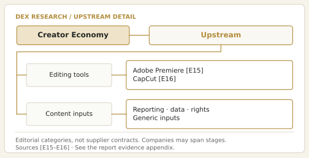
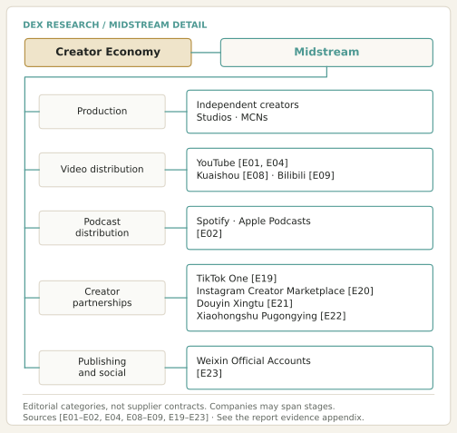
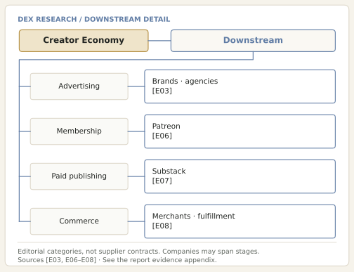
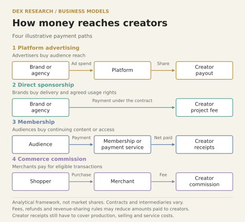
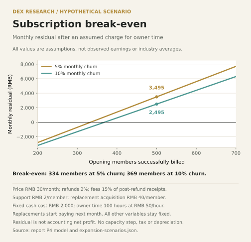

<strong>Website test edition for review.</strong> Version 2.0 · Prepared: 4 November 2026 · Research cutoff: 3 November 2026.

Cover: AI-generated concept illustration of a creator workspace. It is not a photograph or documentary evidence of a particular creator or business.

<a href="assets/report-en.txt" download>English manuscript and evidence appendix</a> · <a href="assets/evidence-en.json" download>Evidence records</a> · <a href="assets/value-chain.svg" download>Value-chain graphic</a>

DEX Research review draft. Research cutoff November 3, 2026. Global value-chain framework with U.S. and China cases. Quantitative observations primarily cover 2025, Q1 2026 and H1 2026; full-year 2026 advertising spending is a forecast. Four body sections are followed by a separate evidence appendix.

Central finding: a sustainable content business depends on repeatable audience value, realized receipts and full operating costs. Platform growth creates commercial opportunities, but creators still need to establish why customers keep paying and whether receipts cover production, selling and maintenance.

## Part 1: Industry Story {#part-1-industry-story}

On September 16, 2025, YouTube announced that it had paid more than US$100 billion to creators, artists and media companies worldwide over the preceding four years. This company disclosure is a multi-year total, not a typical creator’s income, and does not reveal its distribution. <a class="evidence-cite" href="#source-E01" aria-label="Source E01">[E01]</a> The large number leaves a more useful question: what did the payers purchase, through which businesses did the money pass, and how much ultimately supported sustainable creator operations?

A smaller publisher illustrates another route. On August 22, 2023, four journalists who had worked at Motherboard announced 404 Media, a business they would own and operate around reader-supported technology reporting. Its launch statement proposed a mixture of free and paid material. <a class="evidence-cite" href="#source-E51" aria-label="Source E51">[E51]</a> This offers a different perspective from a large platform’s aggregate payouts: an independent team can ask readers directly to purchase an ongoing service.

### From free content to an ongoing service

At the research cutoff, 404 Media’s membership page organized free emails, paid articles and podcast benefits into different tiers. Its Supporter tier was listed at US$10 a month or US$100 a year. <a class="evidence-cite" href="#source-E52" aria-label="Source E52">[E52]</a> The public page establishes the offer and list price, not realized prices, paying membership, revenue or profit. This case is not treated as a representative earnings sample.

Commercially, free work lets prospective readers test topic selection, evidence and clarity. A paid service makes a more demanding promise: the next edition will also merit their return. A news item read once and a service that repeatedly answers questions have different purchase rationales. Readers may pay to save research time, obtain hard-to-replace reporting, or support an editorial mission. Publishers need to distinguish these motives because each implies different renewal reasons and production costs.

A small team is therefore doing more than writing. It must decide what remains public, what benefits are paid, how often it delivers, and how to interpret cancellations. Investigations consume time while subscriptions are commonly billed on a regular cycle. Reducing verification to meet a publishing schedule can increase short-term output while weakening the reason to keep paying. This is our analysis of the model, not a finding about 404 Media’s actual costs or results.

Platform payouts and direct reader payments can coexist. Spotify disclosed more than US$100 million paid to podcast publishers and podcasters worldwide in Q1 2025, encompassing advertising and its partner program. <a class="evidence-cite" href="#source-E18" aria-label="Source E18">[E18]</a> One team may therefore operate under several revenue arrangements. Their periods, recipients and settlement rules differ, so the disclosures cannot simply be added into a creator-market total.

### The boundary of independent media and its products

This report defines independent media as individuals or independent teams producing recurring content under their own editorial direction and reaching audiences commercially through platforms or their own channels. It includes short and long video, live streaming, podcasts, articles, newsletters and specialist research publishing. Appearing on camera, having many followers or using AI is not a determining criterion. The relevant feature is responsibility for content decisions, continuing delivery and commercial outcomes.

The English term creator economy can be broader, extending to artists, entertainment properties, products and services. Here those activities enter the analysis where they connect to a content business. This does not make the entire operations of traditional media, platforms, software companies or retailers part of the measured sector. For businesses spanning several stages, their role must be identified before their revenue is interpreted.

<table class="research-data-table">
<thead><tr>
<th scope="col">Format</th>
<th scope="col">Audience value</th>
<th scope="col">Commercial question</th>
</tr></thead>
<tbody>
<tr>
<th scope="row">Short video</th>
<td>Rapid discovery or an immediate experience</td>
<td>Does reach lead to return viewing and qualified transactions</td>
</tr>
<tr>
<th scope="row">Long video and features</th>
<td>Sustained explanation or entertainment</td>
<td>Can useful life and distribution cover production effort</td>
</tr>
<tr>
<th scope="row">Live streaming</th>
<td>Real-time interaction demonstration and response</td>
<td>Can hosting labor and after-sales work support continuity</td>
</tr>
<tr>
<th scope="row">Podcasts</th>
<td>Companionship continuing discussion and understanding</td>
<td>Can the relationship support ads memberships or paid shows</td>
</tr>
<tr>
<th scope="row">Articles and newsletters</th>
<td>Searchable analysis and regular selection</td>
<td>What creates repeat use and continuing willingness to pay</td>
</tr>
<tr>
<th scope="row">Research and data</th>
<td>Help with work or decision preparation</td>
<td>Can quality updates and licensing meet client needs</td>
</tr>
</tbody>
</table>

The table is an analytical classification, not a market-share partition. A team can introduce a subject through video, carry evidence in an article and maintain contact through a newsletter, but those formats do not represent three independently acquired customers. Reusing research can spread some evidence-gathering costs while adding editing, rewriting, subtitles and channel maintenance. The combination must be evaluated through total effort and audience behavior, rather than the number of publishing outlets.

### How content creates value for the payer

Independent media serves needs that do not always coincide. Audiences seek usefulness, enjoyment or trustworthy information. Commercial customers seek identifiable outcomes such as reaching relevant people, generating qualified leads or licensing material. A widely viewed topic may attract little relevant spending, while a smaller specialist topic may address a recurring work problem. Whether the latter is more profitable still depends on customer numbers, willingness to pay and delivery costs; specialization alone is insufficient.

Following value through a content business requires distinguishing genuine attention, fit with the payer’s needs, completed transactions and receipts sufficient to cover labor. Exposure is only the first step. Advertising shares depend on ad sales and applicable rules; sponsorship requires acceptance and payment; commissions exclude ineligible orders; subscriptions need renewed audience approval. These intervening steps explain why sector growth is not distributed evenly across creators.

### Competition after production becomes easier

Our central judgment is that greater production efficiency makes exclusive information, sound judgment, reliable delivery and customer relationships more important sources of scarcity. Tools can shorten parts of editing or translation without automatically establishing that a topic matters, evidence is credible or users will pay. Greater supply can also give audiences more alternatives. Production costs and selling prices may therefore decline together, requiring a separate assessment of profit.

The following sections examine that question. P2 connects production, distribution and payment. P3 compares how platforms and operators compete for demand. P4 translates profitability, rules and delivery risks into reproducible business models. For a person or team entering the sector, the useful task is to identify the problem being solved, the payer and the conditions under which the work can continue sustainably.

## Part 2: Industry Value Chain {#part-2-industry-value-chain}

### How content becomes a deliverable product

The creator-media value chain has three distinct flows. Information moves from interviews, records, data and assets into a production team and then into a finished work. Attention moves from distribution surfaces to content and potentially to subscriptions, enquiries or purchases. Money moves from advertisers, readers and merchants through platforms, agencies, creators and suppliers. These flows run on different clocks: a view does not establish a completed sale, and a recorded transaction does not establish cash collection. The analysis below explains these mechanisms rather than claiming average industry outcomes.



An explanatory work normally passes through question definition, information gathering, evidence organization, drafting, recording, editing and visualization, factual and rights checks, publication, feedback and updating. Earlier stages determine whether the work contains distinctive information; later stages make it understandable and usable over time. Performance and creativity may dominate entertainment production, samples and testing may dominate reviews, and databases or interview records may dominate research. A single production-cost assumption therefore cannot represent all creator media.

Verified research can support an article, a long video, short clips and a podcast, but each version still needs an appropriate narrative, visuals, title and publishing format. Reusable inputs include licensed assets, evidence and editorial experience, not every hour of production. Automatically distributing one inaccurate draft in several formats also expands the correction burden. Economic analysis should distinguish reusable information assets from adaptation work incurred for each release.

### Upstream tools and the cost of information

Upstream suppliers provide cameras, microphones, lighting, computers, storage and editing software. Adobe Premiere lists editing, audio and caption functions, while CapCut provides editing, templates and AI-assisted tools. <a class="evidence-cite" href="#source-E15" aria-label="Source E15">[E15]</a><a class="evidence-cite" href="#source-E16" aria-label="Source E16">[E16]</a> These services sell production capabilities. Equipment expenditure generally precedes publication, software may create recurring charges, and outsourced editing converts some internal work into a purchased project service. Useful comparisons concern the total time, rework and collaboration required to produce equivalent quality, rather than the number of features.

Reliable information and usable rights form a second input category. An annual report may be free to read, while identifying comparable figures, reconciling periods, contacting interviewees and creating original charts still require work. Asset purchasing also requires checking intended uses, territories, duration and permission for client advertising or redistribution. The cost includes recordkeeping, original-file retention and version management as well as cash payments; the actual license determines the rights available.

A specialist publisher may use inexpensive tools while investing heavily in reporting, verification and editing. Expensive equipment cannot compensate for weak questions or poor information. File naming, asset indexing and source records can reduce repeated work and affect how much a team can reliably deliver. This is a production-management mechanism, not a claim that a particular tool necessarily increases creator income.

<figure class="research-figure">

<figcaption>Figure 1a. Upstream creator-economy activities. Connections indicate business categories rather than verified supply contracts.</figcaption>
</figure>

### Teams and MCNs supply organizational capacity

An independent creator concentrates research, performance, editing and commercial tasks in one person. A studio uses specialization to address bottlenecks. Adding editors can increase editing capacity, but it will not produce proportional growth when reporting, original judgment or client acquisition is the constraint. An effective team size depends on where work queues form and whether another person can take over without compromising quality.

YouTube describes an MCN as a third-party provider serving multiple channels, potentially offering audience development, programming, rights management, monetization and sales. Joining one does not change the creator’s agreed YouTube revenue share. Relevant receipts flow through the MCN’s AdSense account, and the network typically deducts a percentage from the creator’s portion. <a class="evidence-cite" href="#source-E24" aria-label="Source E24">[E24]</a> Its fee therefore buys additional services rather than automatically securing a higher platform revenue share.

An agency arrangement must identify deliverables, the revenue subject to fees, settlement timing and control of accounts or assets after exit. YouTube specifically highlights fees, services, obligations, term and termination. <a class="evidence-cite" href="#source-E24" aria-label="Source E24">[E24]</a> Economically, additional receipts and time saved should justify the fee. Vague promises of traffic support are difficult to evaluate against a deliverable. This platform example does not define every MCN or talent-management contract across jurisdictions.

### Distribution connects work to different audience needs

Recommendation feeds introduce material that a user was not actively seeking. Search responds to an existing question; following surfaces, subscriptions and email support repeat contact; communities allow continuing interaction around a shared interest. These are functional categories, and a platform can contain several of them. They help explain why a short explanatory clip, a searchable tutorial and a regularly updated research newsletter may require different production rhythms and measures of performance.

Podcasting illustrates that hosting and listening destinations can be separate. Apple Podcasts accepts RSS feeds generated and hosted by the publisher or supplied by a hosting provider, subject to file, identifier and metadata requirements. <a class="evidence-cite" href="#source-E25" aria-label="Source E25">[E25]</a> An RSS feed gives applications a standardized catalogue and update location. Producing episodes, storing media and providing a listening interface are therefore separate services. Moving files does not by itself transfer a platform’s recommendations or audience relationships.

Distribution also involves packaging, titles, captions, links, timing and performance review. Additional channels create more entry points but increase maintenance, responses and corrections across versions. A small team needs to understand whether each channel supports discovery, explanation, purchase or renewal, and whether that role justifies its incremental workload.

<figure class="research-figure">

<figcaption>Figure 1b. Midstream creator-economy activities. Connections indicate business categories rather than verified supply contracts.</figcaption>
</figure>

### Platform advertising monetizes eligible attention

In platform advertising, advertisers buy exposure through the platform, which allocates relevant receipts under its rules. Creators supply content and develop audiences; the platform handles advertising transactions, delivery and settlement. Receipts depend on advertising demand, audience composition, eligibility and monetized viewing. A play is not an entitlement to a fixed payment.

YouTube defines CPM as advertiser spending per thousand ad impressions. RPM measures creator receipts after revenue sharing per thousand views and can combine advertising with memberships and other receipts; Shorts uses engaged views as the relevant denominator. <a class="evidence-cite" href="#source-E26" aria-label="Source E26">[E26]</a> Multiplying CPM by total views does not calculate creator earnings, and a blended RPM is not an advertising-only rate. Account-level analysis should separate revenue sources and specify the denominator before comparing receipts with production costs and content life.

### Sponsorship buys creative delivery and usage rights

A brand or agency pays for a defined collaboration. Deliverables can include an integration, full production, publication, revisions and permission to reuse the work in paid advertising. TikTok One’s project workflow includes video requirements, review, feedback, publication and an advertising authorization period. <a class="evidence-cite" href="#source-E19" aria-label="Source E19">[E19]</a> Production, publication on the creator’s account and permission for repeated paid distribution are distinct services or rights rather than one interchangeable sponsorship unit.

Costs include prospecting, proposals, communication, approval and rework, not merely recording time. Analysis can compare contribution after production and selling costs and examine why a client buys again. Follower counts indicate potential reach, while audience fit, delivery reliability and rights scope also affect value. These mechanisms do not justify a universal price card or guaranteed advertising outcome.

### Subscriptions depend on continuing delivery and renewal

A subscription purchases service over a future period. Paid research, exclusive work, searchable resources and member interaction meet different needs. Patreon supplies membership, community and digital-product functions, while Substack supports paid publishing; both distinguish platform charges from payment-processing charges. <a class="evidence-cite" href="#source-E06" aria-label="Source E06">[E06]</a><a class="evidence-cite" href="#source-E07" aria-label="Source E07">[E07]</a> The creator remains responsible for the promised frequency, quality and scope of service.

Subscriptions can turn initial contact into recurring receipts, but analysis must track renewal within the same subscriber cohorts. Rapid acquisition can conceal persistent losses among existing customers. Distributing the same publication differs economically from promising substantial individual assistance to every member, which adds labor as membership grows. Annual billing brings cash forward while leaving future delivery obligations; advance receipts are not already-earned annual profit.

### Commerce commissions depend on eligible completed sales

In affiliate commerce, creators support product discovery and understanding, while merchants or platforms pay for eligible sales. Merchandise value measures the transaction, whereas the creator generally earns only the qualifying commission. The U.S. Amazon Associates policy defines qualifying purchases and revenue, excludes orders with initiated cancellations, returns or refunds, and generally pays approximately 60 days after the month in which commissions were earned. <a class="evidence-cite" href="#source-E27" aria-label="Source E27">[E27]</a> This is a particular program, not a rule for Chinese live commerce or other affiliate schemes.

Clicks, order conversion and merchandise value are intermediate measures. Refunds, eligibility decisions and settlement still separate them from available cash. Creators without inventory can still incur sampling, production and pre-purchase explanation costs. If a creator operates a product brand, procurement, inventory, logistics and after-sales obligations enter the business. Its economics then need to be assessed as a merchandise operation rather than a commission-only service.

### Digital products and licenses create reusable deliverables

Digital products include courses, templates, reports, databases and asset packs. Licensing permits specified uses of works, charts or data. Payment purchases a product or defined rights rather than unlimited access to the creator’s labor. Repeated delivery can spread development costs, while search functionality, updates, support, refunds and customer acquisition may still add expense as usage grows.

Specialist research can support a free overview, paid datasets, scheduled updates and enterprise licenses, differentiated by actual deliverables and permitted use. Buyers may value saved research time, traceability or continuing maintenance rather than length alone. Organizing source material does not automatically confer redistribution rights. A product should distinguish original analysis, data that may lawfully be supplied and links to the original sources.

### Professional services connect expertise to client work

Clients purchase custom research, corporate content, training or consulting for a specific problem and deliverable. Public work helps potential clients assess expertise but does not automatically become a service order. Scope, format, revision limits and acceptance conditions must be defined. The commercial arrangement also has to cover project management, client communication and selling time that cannot be billed directly.

Professional services provide a direct test of willingness to pay for a defined need, while remaining constrained by key personnel. Templates can reduce repeated work, but treating materially different client requirements as a standard product creates rework. Scaling a service requires dividing information gathering, analysis, review and client communication while retaining responsibility for final judgments.

Across all six models, the financial sequence distinguishes agreement or order, delivery, settlement and cash collection. Estimated platform earnings, a sponsor’s contract value, a prepaid annual subscription and merchandise value occupy different stages. Adding them indiscriminately overstates funds available for production. Sound analysis follows the specific contract and compares collected receipts with fulfillment costs and remaining commitments over a consistent period.

<figure class="research-figure">

<figcaption>Figure 1c. Downstream creator-economy activities. Connections indicate business categories rather than verified supply contracts.</figcaption>
</figure>

<figure class="research-figure">

<figcaption>Figure 2. Four payment paths to creators. An analytical framework, not market shares. Contracts, intermediaries and deductions vary. Receipts must still cover production, selling and service costs.</figcaption>
</figure>

Platform advertising: a brand or agency pays the platform, which shares receipts with the creator. Direct sponsorship: a brand or agency pays a project fee under contract. Membership: audiences pay through membership or payment services and the creator receives the net amount. Commerce commission: a shopper pays the merchant, which pays the creator for eligible transactions. Fees, refunds and sharing rules can reduce receipts.

## Part 3: Market Landscape {#part-3-market-landscape}

### Four different money flows define the market

There is no directly interchangeable global measure of creator media. Advertiser spending, platform revenue, merchandise transaction value and creator receipts sit at different stages of a transaction. A brand budget may pass through an agency before reaching a platform and a creator. Adding the parties’ revenues would count the same underlying demand repeatedly. This review did not establish a harmonized series covering every model without duplication, so it analyzes revenue sources, regions and operators separately.

IAB reported approximately US$37 billion of U.S. creator advertising spending for 2025 and forecast approximately US$44 billion for 2026 in its April 2026 release. The rounded figures imply forecast growth of about 18.9%. Its research concerns intentional brand investment in creator partnerships and promotion, rather than every advertisement, membership or merchandise sale surrounding content. The US$44 billion figure remains a forecast in this report. <a class="evidence-cite" href="#source-E03" aria-label="Source E03">[E03]</a><a class="evidence-cite" href="#source-E17" aria-label="Source E17">[E17]</a>

These figures establish a pool of brand demand, not how widely its proceeds are distributed. Estimating receipts available to creators would require the allocation among agency services, media buying, platform charges and production. Estimating a typical creator’s earnings would additionally require individual-level distributions and a consistent population of operating businesses. Dividing market spending by an unrelated estimate of the number of creators would produce an unreliable average.

<table class="research-data-table">
<thead><tr>
<th scope="col">Measure</th>
<th scope="col">Observation</th>
<th scope="col">Interpretation</th>
</tr></thead>
<tbody>
<tr>
<th scope="row">U.S. creator ad spending</th>
<td>Approx. US$37bn in 2025; US$44bn forecast for 2026</td>
<td>Brand demand, not creator net income <a class="evidence-cite" href="#source-E03" aria-label="Source E03">[E03]</a></td>
</tr>
<tr>
<th scope="row">China short-video audience</th>
<td>1.07403bn people; 95.4% of internet users in December 2025</td>
<td>Reach, not paying customers <a class="evidence-cite" href="#source-E10" aria-label="Source E10">[E10]</a></td>
</tr>
<tr>
<th scope="row">Kuaishou group revenue</th>
<td>RMB69.251bn in H1 2026</td>
<td>Marketing, live streaming and other activities <a class="evidence-cite" href="#source-E08" aria-label="Source E08">[E08]</a></td>
</tr>
<tr>
<th scope="row">Bilibili net revenue</th>
<td>RMB15.411958bn in H1 2026</td>
<td>Advertising, value-added services, games and other activities <a class="evidence-cite" href="#source-E09" aria-label="Source E09">[E09]</a></td>
</tr>
<tr>
<th scope="row">Cumulative YouTube payouts</th>
<td>More than US$100bn over four years, disclosed September 2025</td>
<td>Global payments to multiple recipient types, not annual individual-creator income <a class="evidence-cite" href="#source-E01" aria-label="Source E01">[E01]</a></td>
</tr>
</tbody>
</table>

### Demand growth depends on repeat purchasers

Demand comes from different purchasers. Consumers seek entertainment, companionship, learning or help with a problem. Brands seek access to potential customers and effective product communication. Businesses buy specialist information or outsourced production. These buyers apply different criteria. Broad entertainment can attract advertising through reach; a smaller professional publication may serve a specific work task. The latter becomes a business only when customers pay for demonstrated time savings or better decisions.

CNNIC recorded short-video use among 95.4% of Chinese internet users and live-streaming use among 72.3% in December 2025; the audiences overlap. <a class="evidence-cite" href="#source-E10" aria-label="Source E10">[E10]</a> At this level of reach, commercial expansion cannot rely only on people coming online for the first time. Our inference is that competition increasingly concerns time allocation, repeat advertising purchases, conversion and repeat customer value. User growth therefore has no fixed relationship with the earnings growth of an individual creator.

Creator advertising also competes with other uses of a buyer’s budget, including search advertising, direct promotions and an internal production team. A creator offering undifferentiated exposure has a weaker basis for negotiation. Someone who explains a complex product, reaches a particular profession or produces reusable advertising material may sell a combination of audience access and production service. This is a commercial mechanism, not evidence that any category commands a guaranteed premium.

### Recommendations search and recurring relationships create different markets

Recommendation surfaces address what a person may want to watch now, whereas search addresses an expressed query. YouTube describes homepage signals including viewing history and responses from similar viewers; search considers relevance to the query and engagement. TikTok describes For You as personalized through interests and interactions. <a class="evidence-cite" href="#source-E31" aria-label="Source E31">[E31]</a><a class="evidence-cite" href="#source-E33" aria-label="Source E33">[E33]</a> Both mechanisms can coexist within a platform, so a service should not be classified as exclusively recommendation-led or search-led.

This distinction suggests different operating approaches. Timely subjects need a clear presentation while the attention window remains open. Durable tutorials and specialist explanations need discoverability, maintenance and relevance to recurring questions. Timely work may fade quickly, while evergreen work can become obsolete. A useful content library is established by continuing qualified use, manageable update costs and commercial contribution, not simply by keeping old work online.

Following, email subscriptions and memberships create opportunities for repeat contact, but having followers is not the same as having dependable customer access. A platform may control delivery, account status and data export. Email additionally depends on consent, deliverability and unsubscribe management. The economic advantage is not only the reach of one release, but whether suitable people return and can be served again at a reasonable operating cost.

### Case one YouTube combines discovery and monetization

YouTube combines creation tools, distribution and brand partnerships in one ecosystem. <a class="evidence-cite" href="#source-E01" aria-label="Source E01">[E01]</a> Access to commercial features does not give every work the same earning potential. Watch Page advertising and Shorts pool payments use different calculation bases, while participation requires eligibility and policy review. <a class="evidence-cite" href="#source-E04" aria-label="Source E04">[E04]</a><a class="evidence-cite" href="#source-E35" aria-label="Source E35">[E35]</a> Total consumption, monetizable consumption and actual receipts therefore need separate measurement.

The attraction for a creator is that discovery, viewing, advertising sales and settlement can occur within one system. A small team does not need to recruit an advertiser for every release. The tradeoff is limited control over distribution and commercial terms. The platform bears the cost of matching at scale and retains rule-setting authority. Supplying attractive content does not give a creator ownership of the platform’s advertising customers or complete audience data.

More informative operating measures include repeat consumption by topic and format, production hours, actual receipts and contribution from the existing library. Short videos may introduce new audiences and long videos may accommodate complex explanations, but cross-format conversion needs evidence from the particular business. Converting views in one format directly into expected earnings in another confuses audience intent, advertising inventory and settlement rules.

### Case two Kuaishou shows transaction scale alongside platform costs

Kuaishou’s H1 2026 revenue was RMB69.251 billion: marketing contributed RMB40.282 billion, live streaming RMB17.182 billion and other services RMB11.787 billion, approximately 58.2%, 24.8% and 17.0%. Other services include commerce and AI, not just affiliate commissions. <a class="evidence-cite" href="#source-E08" aria-label="Source E08">[E08]</a> Gross margin declined from 55.1% a year earlier to 51.4%, and operating profit declined from RMB9.548 billion to RMB7.352 billion despite revenue growth. <a class="evidence-cite" href="#source-E32" aria-label="Source E32">[E32]</a>

These results show that connecting content, merchants and transactions creates multiple revenue opportunities without ensuring proportional profit growth. Platforms must fund content-related costs, technical infrastructure, customer acquisition and development. For a creator, platform revenue establishes commercial activity within an ecosystem. The creator’s benefit still depends on role, contract, product quality and settlement terms. Group accounts cannot replace a broadcaster’s or studio’s income statement.

The case also illustrates why merchandise value needs careful treatment. Merchant sales, platform service revenue and a creator’s commission are separate items. Content can generate orders while weak merchandise margins, returns or discount-dependent purchasing limit durable profit. Analysis of such an ecosystem should connect marketing demand with fulfillment and repeat purchases. Transaction value alone cannot establish that creators broadly prosper.

### Case three Bilibili demonstrates the importance of revenue mix

Bilibili reported H1 2026 net revenue of RMB15.411958 billion and advertising revenue of RMB5.719547 billion, or approximately 37.1% of the total. Advertising grew about 29% year on year, while total net revenue grew 7.5%. Other businesses include value-added services, mobile games and IP derivatives. Gross margin was 37.2% and net profit approximately RMB541 million. <a class="evidence-cite" href="#source-E09" aria-label="Source E09">[E09]</a> The different growth rates demonstrate why total revenue alone can conceal changes in business mix.

A community with recurring content consumption can sell advertisers access to particular interests and sell users additional services. The reasons for purchase differ: advertisers seek relevant customers and outcomes, while users value content and experience. Advertising that damages the experience can undermine future use. Restricting commercialization, however, requires another way to fund content and technology. Managing that tradeoff is a practical challenge in operating a community.

For a specialist team, the implication is to identify the demand served by its work rather than pursue a platform’s headline growth rate. Detailed explanations may help a brand educate customers or attract readers interested in continued learning. Commercial viability still requires repeat buyers, returning audiences and preserved trust. The platform’s gross margin is not a creator payout ratio or a studio profit margin.

### Case four podcast competition spans audio and video

Edison Research at SSRS reported that, among U.S. weekly podcast consumers aged 13+ in Q1 2026, 37% used YouTube most often, 21% Spotify, 12% Apple Podcasts and 30% other services. This is a consistent distribution of primary-platform preference. It is not global creator revenue share and does not imply that respondents use only one service. <a class="evidence-cite" href="#source-E02" aria-label="Source E02">[E02]</a>



Figure 3. U.S. podcast primary-platform preference, Q1 2026, weekly consumers aged 13+. Shares sum to 100%. Other services at 30% is reported directly by the source. <a class="evidence-cite" href="#source-E02" aria-label="Source E02">[E02]</a>, p. 28.

Spotify disclosed more than US$100 million paid to podcast publishers and podcasters worldwide in Q1 2025, covering advertising and Spotify Partner Program revenue. The program includes Premium video engagement payments in selected markets. <a class="evidence-cite" href="#source-E18" aria-label="Source E18">[E18]</a> Podcast monetization therefore extends beyond a single audio-advertising arrangement. The disclosure does not provide the full earnings distribution, and featured success stories are not representative averages.

Video can create more material for discovery and extracts while adding filming, editing, setting and contributor-permission costs. Our judgment is that a show should compare incremental audience and receipts with the added production burden, including whether established listeners actually value pictures. Independent shows can distribute across services, but adding follower counts does not produce a deduplicated audience.

### Brand marketplaces turn content partnerships into workflows

TikTok One, Instagram Creator Marketplace, Xingtu and Xiaohongshu Pugongying organize brand–creator cooperation, while Weixin provides recurring publishing and communication through Official Accounts and Channels. <a class="evidence-cite" href="#source-E19" aria-label="Source E19">[E19]</a><a class="evidence-cite" href="#source-E20" aria-label="Source E20">[E20]</a><a class="evidence-cite" href="#source-E21" aria-label="Source E21">[E21]</a><a class="evidence-cite" href="#source-E22" aria-label="Source E22">[E22]</a><a class="evidence-cite" href="#source-E23" aria-label="Source E23">[E23]</a> Their functions do not establish market rankings, but help explain demand for searchable creator information, specified deliverables, review and results records.

<table class="research-data-table">
<thead><tr>
<th scope="col">Platform and tool</th>
<th scope="col">Verified role</th>
<th scope="col">Business implication</th>
</tr></thead>
<tbody>
<tr>
<th scope="row">TikTok One</th>
<td>Brand projects, creator sourcing, review, publication and ad authorization <a class="evidence-cite" href="#source-E19" aria-label="Source E19">[E19]</a></td>
<td>Sponsorship requires project and delivery skills</td>
</tr>
<tr>
<th scope="row">Instagram Creator Marketplace</th>
<td>Creator discovery, portfolios, partnership messages and ads <a class="evidence-cite" href="#source-E20" aria-label="Source E20">[E20]</a></td>
<td>Creative work connects to paid advertising</td>
</tr>
<tr>
<th scope="row">Douyin Xingtu</th>
<td>Brand, creator and MCN matching, tasks and campaign measurement <a class="evidence-cite" href="#source-E21" aria-label="Source E21">[E21]</a></td>
<td>Commercial delivery and results both matter</td>
</tr>
<tr>
<th scope="row">Xiaohongshu Pugongying</th>
<td>Branded recommendation posts and live collaborations <a class="evidence-cite" href="#source-E22" aria-label="Source E22">[E22]</a></td>
<td>Content fit and campaign review shape client value</td>
</tr>
<tr>
<th scope="row">Weixin Official Accounts and Channels</th>
<td>Publishing, followers, video distribution and connected services <a class="evidence-cite" href="#source-E23" aria-label="Source E23">[E23]</a></td>
<td>Repeat contact remains governed by the platform</td>
</tr>
</tbody>
</table>

The business implications in the table are our analysis. A marketplace can reduce a brand’s costs of identifying, contacting and managing creators, while making commercial demand easier for creators to access. It also makes offers and performance easier to compare. A small team’s negotiating position depends on audience fit, delivery, rights granted and evidence from prior work, rather than follower totals alone.

### Subscription publishing competes on renewal and portability

Patreon and Substack illustrate direct supporter or reader payment rather than complete dependence on advertising. <a class="evidence-cite" href="#source-E06" aria-label="Source E06">[E06]</a><a class="evidence-cite" href="#source-E07" aria-label="Source E07">[E07]</a> Substack also explicitly supports exporting subscriber email lists as CSV files. <a class="evidence-cite" href="#source-E34" aria-label="Source E34">[E34]</a> Portable contact information creates operating options, but it does not make every interaction, payment arrangement or customer relationship costless to transfer, or remove responsibilities concerning consent and privacy.

Subscription lengthens the competitive cycle. A topical event may attract a trial, but renewal requires repeated value. News, professional information, data updates, practical tools and community carry different delivery obligations. A useful evaluation follows cohorts of paying readers, retention, cancellation reasons and support costs. A large free audience with weak paid retention suggests a gap between popularity and paid utility; it must be tested for the individual product.

### Case five Stratechery packages specialist analysis as a recurring subscription

Stratechery offers free weekly articles and paid updates. Plus lists US$15 monthly or US$150 annually, combining analysis, interviews and podcasts, with team subscriptions available. <a class="evidence-cite" href="#source-E37" aria-label="Source E37">[E37]</a><a class="evidence-cite" href="#source-E38" aria-label="Source E38">[E38]</a> These are one publisher’s terms, not industry averages. Its disclosure identifies Stripe sponsorship from October 2026 and acknowledges a conflict of interest; it should not be presented as a publication entirely independent of brand relationships. <a class="evidence-cite" href="#source-E37" aria-label="Source E37">[E37]</a>

The useful mechanism is product segmentation: free work allows new readers to assess the analysis, while paid products provide continuing coverage and convenience. A research publisher must validate recurring demand for explanation and whether each update adds value. Copying price, frequency or a membership bundle cannot replicate accumulated expertise and reader relationships. Sponsorship also creates a need to distinguish commercial relationships from editorial judgment. We do not infer subscriber numbers, revenue or profit from these product pages.

### China and overseas markets require separate commercial validation

The Chinese cases show combinations of content, advertising, live streaming and transaction services; the U.S. cases illustrate brand partnerships, video revenue sharing, podcasts and subscription publishing. These observations do not establish that a model belongs exclusively to one country or that one region universally favors commerce and another subscriptions. A more useful market unit combines language, geography, audience and purchaser.

Language conversion is only the first task in cross-border publishing. Readers may need different cases, units, background and conclusions. A specialist publisher must also assess whether the target audience already has more convenient information sources and whether a Chinese perspective adds useful evidence. Competing solely through inexpensive production exposes the business to many substitutes. Original material, cross-language verification or difficult-to-obtain industry observations may offer a more distinctive contribution.

The second issue is monetization eligibility and settlement. YouTube requires applicants to live in a country or region where YPP is available and meet account and policy requirements. Mainland China was not listed on the official availability page at the time of review. <a class="evidence-cite" href="#source-E35" aria-label="Source E35">[E35]</a><a class="evidence-cite" href="#source-E36" aria-label="Source E36">[E36]</a> Publishing in English therefore does not establish eligibility for every monetization program. This report does not determine an individual’s account, tax or payment eligibility; business forecasts should use services and contracts available to the actual operator.

### Durable advantages depend on distinctive supply and repeat use

Platforms combine audiences, content, advertising demand and transaction tools at a scale an individual creator cannot replicate. Creator advantages are usually more specific: access to original information, clear explanations of difficult subjects, a credible record or maintained data needed in readers’ work. These capabilities become economic advantages only when they reduce substitution and remain affordable to maintain.

An organization can coordinate tools, production and sales, but size alone is not an advantage. If customers depend on one presenter or research capability resides entirely with a founder, additional staff may not create independent delivery capacity. A more informative question is whether editorial judgment, quality, renewals and cash collection survive the absence of a key person. That test applies to MCNs, research studios and podcast networks alike.

For entrants, we favor opportunities that can be tested concretely: reducing recurring research work for a profession, delivering verifiable content for a type of business, or tracking a fragmented information field with existing purchasing demand. Validation requires knowing the user, budget owner, purchasing frequency and reasons for cancellation. Without that evidence, limited competition may indicate weak demand rather than an overlooked high-profit market.

## Part 4: Industry Problems {#part-4-industry-problems}

### Why revenue growth does not automatically create profit

A creator business continues to incur costs and settlement conditions after publication. Research, reporting, checking, production, sales, revisions and support all consume time. Equipment and software require cash, while the owner’s labor often remains outside the accounts. A supposedly inexpensive business may simply be paying its founder no wage. Its viability should be assessed through settled revenue, cash contribution after external costs, and the residual after charging for the owner’s time. The last measure is an internal decision tool, not accounting net profit.

The following three scenarios are assumptions constructed for this report. All use renminbi, a one-month period and an owner-time opportunity cost of RMB50 per hour. Prices, receipts, refunds, fees, acquisition expenses and hours are neither industry averages nor platform quotations. Full collection is assumed except in the separate payment-timing case; taxes, financing and depreciation are excluded. Effective hourly earnings equal contribution after all listed cash operating costs, before the owner-time charge, divided by total working hours. This provides a consistent comparison of models without replacing actual accounts or contracts.

### How many views cover advertising production costs

Advertising analysis begins with the denominator. YouTube distinguishes advertiser CPM from creator RPM after revenue sharing; RPM can combine several revenue types, and the view denominator differs between long videos and Shorts. <a class="evidence-cite" href="#source-E26" aria-label="Source E26">[E26]</a> The scenario therefore defines its own measure: settled advertising revenue per thousand total long-video views. It includes advertising only, already deducts platform sharing, and must not be multiplied by a revenue-share percentage again or confused with the platform’s combined RPM.

<table class="research-data-table">
<thead><tr>
<th scope="col">Assumed advertising business</th>
<th scope="col">Calculation</th>
<th scope="col">Result</th>
</tr></thead>
<tbody>
<tr>
<th scope="row">Four videos and 300,000 monthly views</th>
<td>300,000 / 1,000 × RMB20</td>
<td>RMB6,000 settled ads</td>
</tr>
<tr>
<th scope="row">Cash production and tool costs</th>
<td>6,000 − 2,400</td>
<td>RMB3,600 cash contribution</td>
</tr>
<tr>
<th scope="row">80 total working hours</th>
<td>3,600 / 80</td>
<td>RMB45 effective hourly earnings</td>
</tr>
<tr>
<th scope="row">Owner-time charge included</th>
<td>3,600 − 80 × 50</td>
<td>RMB−400 economic residual</td>
</tr>
<tr>
<th scope="row">Economic break-even views</th>
<td>(2,400 + 80 × 50) / 20 × 1,000</td>
<td>320,000 views</td>
</tr>
<tr>
<th scope="row">Views fall 25%, costs unchanged</th>
<td>225,000 / 1,000 × 20 − 6,400</td>
<td>RMB−1,900 economic residual</td>
</tr>
</tbody>
</table>

This model explains why higher view counts may still fail to justify expansion. More outsourcing or working hours raise the break-even point. If older work keeps generating views, its original production cost should be assessed by content cohort over a longer window; current production costs should not be arbitrarily paired with all back-catalog income. Changes in advertising yield, audience geography or eligibility require new estimates rather than extrapolation from the best historical month.

### Retention and service costs determine subscription economics

Subscriptions turn a visit into an ongoing delivery commitment. Assume 500 opening paying members are successfully charged RMB30 each, with 2% receiving a full refund during the month. Separately, 5% cancel their next renewal, and 25 replacements are acquired this month to begin paying next month. Refunds and churn are different events. The model assumes combined platform and payment costs of 15% of revenue after refunds. This is illustrative: actual channels may impose fixed transaction charges or retain some fees after refunds.

<table class="research-data-table">
<thead><tr>
<th scope="col">Assumed subscription business</th>
<th scope="col">Calculation</th>
<th scope="col">Result</th>
</tr></thead>
<tbody>
<tr>
<th scope="row">Subscription receipts after refunds</th>
<td>500 × 30 × 98%</td>
<td>RMB14,700</td>
</tr>
<tr>
<th scope="row">Platform and payment fees</th>
<td>14,700 × 15%</td>
<td>RMB2,205</td>
</tr>
<tr>
<th scope="row">Support, replacements and fixed cash costs</th>
<td>500 × 2 + 25 × 40 + 2,000</td>
<td>RMB4,000</td>
</tr>
<tr>
<th scope="row">Cash contribution and total hours</th>
<td>14,700 − 2,205 − 4,000; 100 hours</td>
<td>RMB8,495; RMB84.95/hour</td>
</tr>
<tr>
<th scope="row">Owner-time charge included</th>
<td>8,495 − 100 × 50</td>
<td>RMB3,495 economic residual</td>
</tr>
<tr>
<th scope="row">Contribution per opening paying member</th>
<td>30 × 98% × 85% − 2 − 5% × 40</td>
<td>RMB20.99</td>
</tr>
<tr>
<th scope="row">Economic break-even membership</th>
<td>Round up 7,000 / 20.99</td>
<td>334 members</td>
</tr>
</tbody>
</table>

If monthly churn rises to 10%, replacement acquisition costs become RMB2,000 and the economic residual falls to RMB2,495, holding other inputs fixed. Without replacements, the customer base shrinks. Break-even uses expected churn and acquisition while holding fixed costs and 100 working hours constant; staffing increases require recalculation. Annual plans improve initial collections but create future delivery obligations, so the entire advance is not freely distributable monthly earnings. Patreon and Substack disclose additional payment or channel-related charges with differing conditions. <a class="evidence-cite" href="#source-E06" aria-label="Source E06">[E06]</a><a class="evidence-cite" href="#source-E07" aria-label="Source E07">[E07]</a> A 10% headline platform fee therefore cannot establish that subscriptions are more profitable than advertising.

<figure class="research-figure">

<figcaption>Figure 4. Hypothetical subscription sensitivity to churn. Other inputs are fixed: RMB30 monthly price, 2% refunds, 15% fees on post-refund receipts, RMB2 support per member, RMB40 replacement acquisition, RMB2,000 fixed cash costs and 100 owner hours at RMB50. The curves deduct owner-time cost, not accounting net profit. Taxes, depreciation, financing and capacity steps are excluded.</figcaption>
</figure>

At 5% monthly churn, residual after owner-time cost is 20.99 × opening billed members − RMB7,000: integer break-even is 334 members and the residual at 500 is RMB3,495. At 10% churn the formula is 18.99 × members − RMB7,000: break-even is 369 members and the residual at 500 is RMB2,495. Replacement members start paying the following month.

### Sponsorship and service work are constrained by hours and collections

Assume a team completes two sponsorship or custom-service projects per month at RMB8,000 each. Post-delivery refunds or credits total 5%, and an intermediary takes 10% of the remaining amount. Cash production costs are RMB3,000. The owner spends 120 hours: 60 delivering, 20 revising, 30 selling and 10 administering. Including unsuccessful proposals and communication reveals the actual capacity requirement; counting filming or writing alone overstates profitability.

<table class="research-data-table">
<thead><tr>
<th scope="col">Assumed B2B project business</th>
<th scope="col">Calculation</th>
<th scope="col">Result</th>
</tr></thead>
<tbody>
<tr>
<th scope="row">Receipts after credits and intermediary fee</th>
<td>16,000 × 95% × 90%</td>
<td>RMB13,680</td>
</tr>
<tr>
<th scope="row">Cash contribution after full collection</th>
<td>13,680 − 3,000</td>
<td>RMB10,680</td>
</tr>
<tr>
<th scope="row">Effective hourly earnings</th>
<td>10,680 / 120</td>
<td>RMB89</td>
</tr>
<tr>
<th scope="row">Owner-time charge included</th>
<td>10,680 − 120 × 50</td>
<td>RMB4,680 economic residual</td>
</tr>
<tr>
<th scope="row">Break-even quote per equally priced project</th>
<td>9,000 / 95% / 90% / 2</td>
<td>About RMB5,263.16</td>
</tr>
<tr>
<th scope="row">40% of net receipts upfront, rest after 60 days</th>
<td>13,680 × 40% − 3,000</td>
<td>Only RMB2,472 initial-month cash balance</td>
</tr>
</tbody>
</table>

The last row is a separate collection-timing scenario: final credits are known, the deposit is calculated on net receipts, and all cash production costs are paid upfront. A project can have a positive economic residual yet leave insufficient cash for living costs or the next production. Actual contracts need separate treatment of deposits, acceptance, balances and disputes. Extra revisions, extended advertising usage and category exclusivity can also consume future capacity. Specialist services raise transaction value, but wholly bespoke work still scales closely with hours.

### Platform dependence affects distribution and settlement together

Creators face more than a traffic risk. A platform can affect discovery, monetization eligibility and payment timing. YouTube states that invalid traffic can restrict ad serving, trigger earnings adjustments or offsets, and delay payment by up to 90 days. That differs from an ordinary recommendation fluctuation. <a class="evidence-cite" href="#source-E42" aria-label="Source E42">[E42]</a> Operators should therefore distinguish views, eligibility, estimated earnings, final settlement and cash received rather than watch a single dashboard balance.

Reducing dependence also costs money and time. Multiple platforms require versions, packaging and operations; an owned site needs maintenance and acquisition; direct-contact channels require appropriate permission and data protection. An additional channel should be judged by distinct audiences, net receipts and reusable work rather than account count. Channels can remain highly correlated if they ultimately rely on the same search or recommendation entrance.

### Attributed conversions do not equal incremental demand

Codes and tracking links identify some purchasing paths but cannot alone establish whether customers would have bought without the promotion. Google Ads describes Conversion Lift as an exposed-versus-control experiment and states that it is not available to every account. <a class="evidence-cite" href="#source-E44" aria-label="Source E44">[E44]</a> This illustrates a measurement approach, not an inexpensive capability available to every creator. Small samples, concurrent promotions and cross-device behavior also limit simple before-and-after comparisons.

Brands and creators consequently need an agreed objective. Awareness, qualified leads and direct sales require different evaluation, and orders before returns differ from final valid orders. Small collaborations can report impressions, clicks, inquiries and settled conversions while explaining tracking windows and omissions. They should not present correlation as causation. In our assessment, repeated comparable records are more useful for decisions than an isolated attractive screenshot, although they guarantee no campaign outcome.

### Intermediaries and concentrated clients can transfer risk

An MCN can provide sales, production and management while adding another revenue-sharing and settlement layer. YouTube advises creators to examine services, fees, payments, duration and termination, and explains that joining a network does not change YouTube’s share; a network typically charges from the creator’s portion. <a class="evidence-cite" href="#source-E24" aria-label="Source E24">[E24]</a> This describes YouTube’s system, not a universal rule for Chinese MCN contracts. The relevant comparison is incremental net receipts against fees, exclusivity and collection risk, rather than headline quotes.

Client concentration amplifies the issue. One large customer can improve efficiency while determining revenue, scheduling and topics. Where a sponsor is also a research subject, the publisher needs a boundary between the commercial brief and editorial judgment, including room to reject inaccurate statements. Account permissions, source files, content usage rights and client records also need clear ownership within outsourced teams. A business that cannot continue delivery when personnel change may face substantial interruption costs despite owning few physical assets.

### AI can shorten tasks without removing editorial responsibility

AI-assisted captions, translation, narration and drafting can shorten production, but the commercial gain depends on whether saved time exceeds checking and rework. YouTube clarified in July 2025 that repetitive or mass-produced content is ineligible for monetization; this is not a ban on all AI-assisted creation. <a class="evidence-cite" href="#source-E05" aria-label="Source E05">[E05]</a> In research publishing, wrong dates, units, citations or invented sources become more expensive to correct after entering charts or narration. Source documents, calculations and version relationships should remain traceable.

Labeling has also entered actual enforcement. On April 28, 2026, Chinese cyberspace authorities reported AI-content labeling failures involving Jianying, Maoxiang and Jimeng AI and described measures including interviews, correction orders and warnings against the platforms. <a class="evidence-cite" href="#source-E46" aria-label="Source E46">[E46]</a> The notice does not allocate every measure to each product or establish a general product ban or wrongdoing by all users. For creators, generating a file does not complete publication checks; relevant declarations and labels still need attention when exporting across platforms.

### Disclosure and rights make credibility a recurring cost

China’s internet advertising rules require ads to be identifiable and impose duties such as advertiser verification and at least three years of advertising records on relevant operators and publishers. <a class="evidence-cite" href="#source-E12" aria-label="Source E12">[E12]</a> Self-media governance addresses verification in specified professional fields, sources and MCN affiliation, not one universal creator license. <a class="evidence-cite" href="#source-E11" aria-label="Source E11">[E11]</a> AI-labeling measures distinguish service providers, distribution platforms and users, including user declarations and labeling for applicable synthetic publications. <a class="evidence-cite" href="#source-E13" aria-label="Source E13">[E13]</a> These requirements affect editorial and commercial workflows rather than being resolved by a generic disclaimer.

FTC endorsement guidance stresses clear disclosure of material commercial connections so audiences can understand them when encountering recommendations; the guides explain enforcement views rather than constitute a separate law. <a class="evidence-cite" href="#source-E14" aria-label="Source E14">[E14]</a> Copyright requires a separate assessment. The U.S. Copyright Office explains that no fixed word count or percentage guarantees fair use. <a class="evidence-cite" href="#source-E45" aria-label="Source E45">[E45]</a> Attribution assists verification but does not automatically grant reproduction or commercial rights in images, music or clips. Territory, duration, adaptation and redistribution permissions can therefore affect usable assets and delivery costs.

### Digital distribution does not eliminate capacity constraints

Recurring publication also faces a staffing bottleneck. One owner may edit, sell and support customers, while revenue volatility encourages longer hours and compounds rework and deadline pressure. This is an organizational observation, not an assessment of individual health. Promising more than the available capacity erodes quality and retention. Reusable research, batch production and suitable outsourcing can reduce repetition, but checking and client accountability still need an owner. Higher service promises require pricing that covers response and maintenance time.

### Opportunities require payment and repeatable delivery

The constraints suggest testable opportunities in specialist research subscriptions, business content services, asset and evidence management, and tools for assessing creator campaigns. Each should solve a buyer problem such as retrieval time, rework, rights management or commercial measurement. Positive feedback is insufficient: the relevant observations are payment after trial, repeat purchases and whether another customer still contributes economically. Specialization may raise value while narrowing the audience, so ticket size must be considered alongside selling difficulty.

The outlook is better expressed as conditional scenarios than as personal-earnings promises attached to industry growth. The table is an analytical framework, not a probability forecast; one company may experience different scenarios across its businesses. Comparisons should retain consistent user cohorts, revenue definitions and a sufficient observation period rather than treat one viral item, large contract or annual prepayment as durable improvement.

<table class="research-data-table">
<thead><tr>
<th scope="col">Scenario</th>
<th scope="col">Conditions that must hold together</th>
<th scope="col">Priority observations</th>
</tr></thead>
<tbody>
<tr>
<th scope="row">Base</th>
<td>Demand persists; more content supply offsets some tool efficiency</td>
<td>Cohort retention, contribution per hour, collection cycle</td>
</tr>
<tr>
<th scope="row">Upside</th>
<td>Original value improves renewal and price; delivery is reusable; acquisition cost stays controlled</td>
<td>Revenue retention within the same cohort, repeat buying, revenue versus hours growth</td>
</tr>
<tr>
<th scope="row">Downside</th>
<td>Ad or subscription demand weakens; reach or settlement is restricted; fixed commitments persist</td>
<td>Refunds, churn, client concentration, months of cash coverage</td>
</tr>
</tbody>
</table>

Long-run value depends on combining credible work, sustainable distribution and dependable delivery into something customers will pay for repeatedly. For research publishers, public articles can demonstrate capability, while paid products need additional updating, retrieval, data or customization value. Evidence quality, stable service boundaries and positive unit contribution provide a stronger viability test than output volume alone.

## Appendix: Evidence and Methods {#supporting-evidence}

The report distinguishes documented facts from analytical judgments. All sources were read on November 3, 2026. Undated product and help pages reflect their state when read, not reconstructed historical versions. Company disclosures establish their own activities and payments rather than independent industry rankings.

Figure 3 uses four categories from one source, geography, quarter and audience. 37% + 21% + 12% + 30% = 100%. Other services at 30% is reported directly; no additional residual was estimated. It measures primary-platform preference rather than revenue or listening time.

The IAB growth calculation is (44 / 37 - 1) × 100% = 18.9189%, rounded to 18.9%. Inputs are rounded US$ billion values and do not warrant higher precision. The 2026 value remains a forecast.

Currency conversions use RMB100 million = RMB100m = RMB100,000 thousand; one Chinese unit of 10,000 people equals 10,000 people. Kuaishou revenue of RMB69,251m equals RMB69.251bn; Bilibili revenue of RMB15,411,958 thousand equals RMB15.411958bn. Metrics with different populations, periods or measurement bases are not aggregated.

All P4 unit-economics scenarios are hypothetical and explain revenue denominators, owner-time cost, break-even conditions and sensitivity to receipts. The value-chain diagram maps roles; connections are not verified purchasing or supply contracts. Third-party originals are linked through publishers or identified mirrors and are not redistributed with the review package.

The payment-flow figure is an analytical classification, not a universal contract or market-share chart. The subscription sensitivity figure uses only P4 hypothetical inputs. Monthly churn of 5% and 10% produces contribution before fixed costs of RMB20.99 and RMB18.99 per opening billed member; integer break-even after owner-time cost is 334 and 369 members respectively. Assumptions, formulas and curve data accompany the package.

The body distinguishes platform disclosures, association estimates and forecasts, current product offers and author analysis. When a real case has no disclosed paying-user count or creator profit, neither is inferred from follower counts, list prices or platform revenue.

<a href="assets/expansion-scenarios.json" download>Hypothetical operating assumptions and formulas (JSON)</a> · <a href="assets/subscription-sensitivity.csv" download>Subscription sensitivity data (CSV)</a> · <a href="assets/podcast-platform-share.csv" download>Podcast preference data (CSV)</a>

<section class="research-evidence" id="source-E01" aria-labelledby="heading-E01">
<h3 id="heading-E01">[E01] YouTube / Johanna Voolich</h3>

<a href="https://blog.youtube/news-and-events/made-on-youtube-2025/" target="_blank" rel="noopener">The next 20: Powering the future of entertainment together at Made on YouTube</a>

Publication or update: 2025-09-16. Period or applicability: The preceding four years as described by the announcement. Accessed: 2026-11-03.

Location: Opening paragraphs.

Evidence type: Primary source.

Supports the cumulative payout and platform role. Company disclosure covers creators, artists and media companies; it does not report independent-creator net earnings, their distribution or four specified calendar years.

</section>

<section class="research-evidence" id="source-E02" aria-labelledby="heading-E02">
<h3 id="heading-E02">[E02] Edison Research at SSRS</h3>

<a href="https://ssrs.com/wp-content/uploads/Podcast-Consumer-2026.pdf" target="_blank" rel="noopener">The Podcast Consumer 2026</a>

Publication or update: 2026-06-04. Period or applicability: Q1 2026. Accessed: 2026-11-03.

Location: p. 28 (PDF index 27), Service Used Most Often to Consume Podcasts.

Evidence type: Original research.

U.S. weekly podcast consumers aged 13+: YouTube 37%, Spotify 21%, Apple Podcasts 12%, other services 30%. Primary-platform preference, not revenue, time or whole-industry share. Other is reported directly. No sample size from a different survey within the report is assigned to this chart.

</section>

<section class="research-evidence" id="source-E03" aria-labelledby="heading-E03">
<h3 id="heading-E03">[E03] IAB</h3>

<a href="https://www.iab.com/news/digital-ad-revenue-climbs-to-nearly-300b-as-iab-celebrates-30-year-anniversary/" target="_blank" rel="noopener">Digital Ad Revenue Climbs to Nearly $300B as IAB Celebrates 30 Year Anniversary</a>

Publication or update: 2026-04-16. Period or applicability: 2025 estimate and 2026 forecast. Accessed: 2026-11-03.

Location: Redefining the Market in 2026 AI Creators and Performance.

Evidence type: Trade association estimate.

Supports approximately US$37bn of U.S. creator ad spending in 2025 and a US$44bn 2026 forecast. The latter is not a completed-year result. Overlapping digital-ad categories are not combined into a pie chart.

</section>

<section class="research-evidence" id="source-E04" aria-labelledby="heading-E04">
<h3 id="heading-E04">[E04] YouTube Help</h3>

<a href="https://support.google.com/youtube/answer/72902?hl=en" target="_blank" rel="noopener">YouTube partner earnings overview</a>

Publication or update: Undated live help page. Period or applicability: Terms read 2026-11-03. Accessed: 2026-11-03.

Location: Revenue share rates and How do I earn revenue.

Evidence type: Primary source.

Watch Page share is 55% of relevant net advertising revenue; Shorts share is 45% of the creator’s allocated pool amount. Denominators differ. These terms do not establish fixed earnings per view or platform net profit.

</section>

<section class="research-evidence" id="source-E05" aria-labelledby="heading-E05">
<h3 id="heading-E05">[E05] YouTube Help</h3>

<a href="https://support.google.com/youtube/answer/1311392?hl=en" target="_blank" rel="noopener">YouTube channel monetization policies</a>

Publication or update: Clarification dated 2025-07-15. Period or applicability: Policy clarification and live page read 2026-11-03. Accessed: 2026-11-03.

Location: Opening policy update and Inauthentic content.

Evidence type: Primary source.

Supports the clarification and renaming concerning repetitive or mass-produced content. It does not prohibit all AI-assisted work or all derivative commentary. Future-effective provisions are not treated as operative rules.

</section>

<section class="research-evidence" id="source-E06" aria-labelledby="heading-E06">
<h3 id="heading-E06">[E06] Patreon Help</h3>

<a href="https://support.patreon.com/hc/en-us/articles/36426991446797-A-standard-platform-fee-for-new-creators-effective-after-August-4-2025" target="_blank" rel="noopener">A standard platform fee for new creators — effective after August 4, 2025</a>

Publication or update: Updated 2026-11-02. Period or applicability: Applicable plan rules read 2026-11-03. Accessed: 2026-11-03.

Location: Who does this plan apply to and Payment processing rates.

Evidence type: Primary source.

The 10% standard platform fee applies to pages published after August 4, 2025, with processing charges additional. Earlier pages can retain legacy pricing subject to exceptions such as unpublishing and republishing. It is not a universal fee for every creator.

</section>

<section class="research-evidence" id="source-E07" aria-labelledby="heading-E07">
<h3 id="heading-E07">[E07] Substack Help</h3>

<a href="https://support.substack.com/hc/en-us/articles/360037607131-How-much-does-Substack-cost" target="_blank" rel="noopener">How much does Substack cost?</a>

Publication or update: Updated 2026-10-29. Period or applicability: Fee rules read 2026-11-03. Accessed: 2026-11-03.

Location: Opening paragraph and How much do creators pay.

Evidence type: Primary source.

Free publishing; paid subscriptions incur a 10% platform fee plus payment charges. The remaining 90% is not profit. U.S. card rates are not generalized across countries, and availability for a Chinese business is not established here.

</section>

<section class="research-evidence" id="source-E08" aria-labelledby="heading-E08">
<h3 id="heading-E08">[E08] Kuaishou Technology</h3>

<a href="https://ir.kuaishou.com/static-files/3dd8a357-fa7b-4388-b023-f1105b05e4de" target="_blank" rel="noopener">Results announcement for the three and six months ended June 30 2026</a>

Publication or update: 2026-08-19. Period or applicability: H1 2026. Accessed: 2026-11-03.

Location: p. 31 note 3 Revenue; p. 42 GMV definition.

Evidence type: Primary source.

RMB millions: revenue 69,251; marketing 40,282; live streaming 17,182; other 11,787. Unaudited, reviewed interim figures. Other includes commerce and AI activities, not solely commissions. Group revenue differs from creator receipts and GMV.

</section>

<section class="research-evidence" id="source-E09" aria-labelledby="heading-E09">
<h3 id="heading-E09">[E09] Bilibili Inc. / SEC exhibit 99.2</h3>

<a href="https://www.sec.gov/Archives/edgar/data/1723690/000119312526371261/d434015dex992.htm" target="_blank" rel="noopener">Interim results announcement for the six months ended June 30 2026</a>

Publication or update: 2026-08-27. Period or applicability: H1 2026. Accessed: 2026-11-03.

Location: p. 10 income statement and p. 24 note 5 revenue disaggregation.

Evidence type: Primary source.

Supports H1 2026 net revenue of RMB15,411,958 thousand and advertising of RMB5,719,547 thousand. Advertising share is 5,719,547 / 15,411,958 = 37.1111%; total growth is about 7.5% and ad growth about 29%. Gross margin is 37.2% and net profit RMB541,071 thousand. The group includes value-added services and games; these are not creator receipts or studio margins.

</section>

<section class="research-evidence" id="source-E10" aria-labelledby="heading-E10">
<h3 id="heading-E10">[E10] CNNIC</h3>

<a href="https://www.cnnic.net.cn/n4/2026/0304/c88-11549.html" target="_blank" rel="noopener">第57次中国互联网络发展状况统计报告 The 57th Statistical Report on Internet Development in China</a>

Publication or update: 2026-02-05. Period or applicability: December 2025. Accessed: 2026-11-03.

Location: Printed p. 23 Table 5; PDF index 29.

Evidence type: Original statistical report read through a mirror.

Mainland China survey scope is age 6+. Short video: 1,074.03m users, 95.4%; live streaming: 813.59m, 72.3%. The original CNNIC report was read via an Eastmoney-hosted mirror after the official PDF timed out; the official release page was verified separately. Mirror dates do not replace publication date. Audiences overlap; these are not MAU or creator counts.

Original-report mirror: <a href="https://pdf.dfcfw.com/pdf/H3_AP202603101820433901_1.pdf" target="_blank" rel="noopener">https://pdf.dfcfw.com/pdf/H3_AP202603101820433901_1.pdf</a>

</section>

<section class="research-evidence" id="source-E11" aria-labelledby="heading-E11">
<h3 id="heading-E11">[E11] Cyberspace Administration of China</h3>

<a href="https://www.cac.gov.cn/2023-07/10/c_1690638496047430.htm" target="_blank" rel="noopener">关于加强自媒体管理的通知 Notice on strengthening management of self-media</a>

Publication or update: 2023-07-10 public release; document dated 2023-07-05. Period or applicability: Policy text read 2026-11-03. Accessed: 2026-11-03.

Location: Items 2 3 8 9 and 11.

Evidence type: Primary source.

Supports professional-domain verification, source attribution, affiliation and monetization governance. It does not establish one specified license for every general industry commentator.

</section>

<section class="research-evidence" id="source-E12" aria-labelledby="heading-E12">
<h3 id="heading-E12">[E12] State Administration for Market Regulation</h3>

<a href="https://www.samr.gov.cn/zw/zfxxgk/fdzdgknr/fgs/art/2023/art_d93a579afd45413e8576e4623fab348f.html" target="_blank" rel="noopener">互联网广告管理办法 Measures for the Administration of Internet Advertising</a>

Publication or update: Promulgated 2023-02-25; effective 2023-05-01. Period or applicability: Rules read 2026-11-03. Accessed: 2026-11-03.

Location: Order 72 Articles 2 4 9 14 and 18.

Evidence type: Primary source.

Supports ad recognizability and relevant advertising-operator/publisher duties including advertiser verification and at least three years of advertising records. Absence of a purchase link does not exclude advertising status, and commercial-ad duties are not imposed on all noncommercial articles. The webpage separately shows March 20, 2023.

</section>

<section class="research-evidence" id="source-E13" aria-labelledby="heading-E13">
<h3 id="heading-E13">[E13] CAC and three other authorities</h3>

<a href="https://www.cac.gov.cn/2025-03/14/c_1743654684782215.htm" target="_blank" rel="noopener">人工智能生成合成内容标识办法 Measures for Labeling AI Generated Synthetic Content</a>

Publication or update: Released 2025-03-14; document dated 2025-03-07. Period or applicability: Effective 2025-09-01. Accessed: 2026-11-03.

Location: Articles 2 4 5 6 10 and 14.

Evidence type: Primary source.

Supports explicit and implicit labels and relevant declaration and labeling duties. Scope follows the text; it is not a global rule or an identical obligation for every possible use of AI assistance.

</section>

<section class="research-evidence" id="source-E14" aria-labelledby="heading-E14">
<h3 id="heading-E14">[E14] U.S. Federal Trade Commission</h3>

<a href="https://www.ftc.gov/business-guidance/resources/ftcs-endorsement-guides-what-people-are-asking" target="_blank" rel="noopener">FTC Endorsement Guides What People Are Asking</a>

Publication or update: Live guidance discussing the 2023 revision. Period or applicability: Guidance read 2026-11-03. Accessed: 2026-11-03.

Location: Opening explanation and What is the legal basis for the Guides.

Evidence type: Primary source.

Supports material-connection disclosures and non-misleading endorsements. The guides explain FTC views on Section 5 of the FTC Act and do not themselves have the force of law. Application depends on facts.

</section>

<section class="research-evidence" id="source-E15" aria-labelledby="heading-E15">
<h3 id="heading-E15">[E15] Adobe</h3>

<a href="https://www.adobe.com/products/premiere.html" target="_blank" rel="noopener">Professional video editing software Adobe Premiere</a>

Publication or update: Undated product page. Period or applicability: Read 2026-11-03. Accessed: 2026-11-03.

Location: Editing Audio and Titles.

Evidence type: Primary source.

Supports editing, audio and caption capabilities only. Dynamic prices, rankings and efficiency promises are not adopted.

</section>

<section class="research-evidence" id="source-E16" aria-labelledby="heading-E16">
<h3 id="heading-E16">[E16] CapCut</h3>

<a href="https://www.capcut.com/" target="_blank" rel="noopener">CapCut AI Video Editor</a>

Publication or update: Undated product page. Period or applicability: Read 2026-11-03. Accessed: 2026-11-03.

Location: Products Smart Editor and Generator AI Editing Tools.

Evidence type: Primary source.

Supports editing, template and AI-assisted creation roles. Vendor marketing is not independent evidence of results or market share.

</section>

<section class="research-evidence" id="source-E17" aria-labelledby="heading-E17">
<h3 id="heading-E17">[E17] IAB</h3>

<a href="https://www.iab.com/news/creator-economy-ad-spend-to-reach-37-billion-in-2025-growing-4x-faster-than-total-media-industry-according-to-iab/" target="_blank" rel="noopener">Creator Economy Ad Spend to Reach $37 Billion in 2025, Growing 4x Faster than Total Media Industry, According to IAB</a>

Publication or update: 2025-11-20. Period or applicability: 2021 2024 and 2025 forecast. Accessed: 2026-11-03.

Location: Opening estimate and Methodology.

Evidence type: Trade association methodology.

Defines intentional U.S. brand investment in creator partnerships, promotion and related advertising. This release treated 2025 as a forecast; the body uses E03 for the later 2025 review. Updates from the same institution are not independent corroboration.

</section>

<section class="research-evidence" id="source-E18" aria-labelledby="heading-E18">
<h3 id="heading-E18">[E18] Spotify</h3>

<a href="https://newsroom.spotify.com/2025-04-28/from-audio-to-video-spotifys-100-million-payout-fuels-creator-success-stories/" target="_blank" rel="noopener">From Audio to Video, Spotify’s $100 Million Payout Fuels Creator Success Stories</a>

Publication or update: 2025-04-28. Period or applicability: Q1 2025. Accessed: 2026-11-03.

Location: Opening payout statement and payment description.

Evidence type: Primary source.

Supports quarterly payments exceeding US$100m to podcast publishers and podcasters globally, including ads and partner-program revenue. It is not music royalties or payments from one program alone. Company disclosure does not establish industry share.

</section>

<section class="research-evidence" id="source-E19" aria-labelledby="heading-E19">
<h3 id="heading-E19">[E19] TikTok for Business</h3>

<a href="https://ads.tiktok.com/resources/help/article/how-to-create-a-new-creator-marketing-project-in-tiktok-one" target="_blank" rel="noopener">How to create a new Creator marketing project in TikTok One</a>

Publication or update: Updated March 2026. Period or applicability: Product roles read 2026-11-03. Accessed: 2026-11-03.

Location: Opening explanation; How to invite creators; To publish the video.

Evidence type: Primary source.

Supports brand projects, creator sourcing and invitations, negotiation, review, publication and ad authorization. Regional and eligibility conditions apply; no universal availability, effectiveness or share ranking is established.

</section>

<section class="research-evidence" id="source-E20" aria-labelledby="heading-E20">
<h3 id="heading-E20">[E20] Meta</h3>

<a href="https://about.fb.com/news/2024/02/creator-marketplace-for-brands-and-creators-to-collaborate-on-instagram/" target="_blank" rel="noopener">Making it Easier for Brands and Creators to Collaborate on Instagram</a>

Publication or update: 2024-02-21. Period or applicability: Historical product introduction read 2026-11-03. Accessed: 2026-11-03.

Location: How it works and Partnership ads discussion.

Evidence type: Primary source.

Supports creator discovery, portfolios, partnership messages and advertising roles. A 2024 product introduction is not a 2026 worldwide availability list or independent effectiveness evidence.

</section>

<section class="research-evidence" id="source-E21" aria-labelledby="heading-E21">
<h3 id="heading-E21">[E21] Ocean Engine / Xingtu</h3>

<a href="https://www.xingtu.cn/" target="_blank" rel="noopener">巨量星图 抖音营销 达人变现 星图营销服务平台 Douyin Xingtu creator marketing services</a>

Publication or update: Undated product page. Period or applicability: Read 2026-11-03. Accessed: 2026-11-03.

Location: Brand creator and MCN services; measurement description.

Evidence type: Primary source.

Supports brand, agency, creator and MCN matching, collaboration tasks and campaign measurement. Product marketing does not establish competitive superiority; dynamic rankings are not used.

</section>

<section class="research-evidence" id="source-E22" aria-labelledby="heading-E22">
<h3 id="heading-E22">[E22] Xiaohongshu</h3>

<a href="https://pgy.xiaohongshu.com/" target="_blank" rel="noopener">小红书蒲公英 好产品种草第一站 Xiaohongshu Pugongying creator partnerships</a>

Publication or update: Undated product page. Period or applicability: Read 2026-11-03. Accessed: 2026-11-03.

Location: Official homepage introduction; collaboration and live-streaming modules.

Evidence type: Primary source.

Supports recommendation-content and live collaborations, creator selection, invitations and campaign review. Search extraction was empty; the official page was read directly in a browser. Promotional effectiveness claims and dynamic rankings are not adopted.

</section>

<section class="research-evidence" id="source-E23" aria-labelledby="heading-E23">
<h3 id="heading-E23">[E23] Tencent</h3>

<a href="https://www.tencent.com/zh-cn/products/official-accounts/" target="_blank" rel="noopener">公众号 Official Accounts and 视频号 Channels</a>

Publication or update: Undated product pages. Period or applicability: Read 2026-11-03. Accessed: 2026-11-03.

Location: Product introductions.

Evidence type: Primary source.

Supports Official Accounts publishing and follower communication, routes to websites and commerce, and Channels video creation and connected Weixin services. Overall Weixin users are not assigned to these products, and complete creator control over distribution is not implied.

Additional source: <a href="https://www.tencent.com/zh-cn/products/channels/" target="_blank" rel="noopener">https://www.tencent.com/zh-cn/products/channels/</a>

</section>

<section class="research-evidence" id="source-E24" aria-labelledby="heading-E24">
<h3 id="heading-E24">[E24] YouTube Help</h3>

<a href="https://support.google.com/youtube/answer/2737059?hl=en" target="_blank" rel="noopener">Multi-Channel Network (MCN) overview for YouTube Creators</a>

Publication or update: Undated live help page. Period or applicability: Terms and explanation read 2026-11-03. Accessed: 2026-11-03.

Location: Key aspects of working with MCNs; Signing a contract with an MCN; Revenue &amp; getting paid.

Evidence type: Primary source.

Supports MCN roles, contract considerations, unchanged YouTube revenue share and receipt through the MCN’s AdSense account with potential network deductions. Platform-specific explanation, not a universal description of agency contracts or evidence of higher creator earnings.

</section>

<section class="research-evidence" id="source-E25" aria-labelledby="heading-E25">
<h3 id="heading-E25">[E25] Apple Podcasts for Creators</h3>

<a href="https://podcasters.apple.com/support/823-podcast-requirements" target="_blank" rel="noopener">Podcast RSS feed requirements</a>

Publication or update: Undated live support page. Period or applicability: Requirements read 2026-11-03. Accessed: 2026-11-03.

Location: Opening requirements and Podcast RSS feed technical requirements.

Evidence type: Primary source.

Supports self-generated or hosting-provider RSS feeds and technical requirements for media and metadata. Illustrates separation of hosting and listening interfaces; does not establish transferability of recommendations, all audience relationships or paid entitlements.

</section>

<section class="research-evidence" id="source-E26" aria-labelledby="heading-E26">
<h3 id="heading-E26">[E26] YouTube Help</h3>

<a href="https://support.google.com/youtube/answer/9314357?hl=en" target="_blank" rel="noopener">Understand ad revenue analytics</a>

Publication or update: Undated live help page. Period or applicability: Metric definitions read 2026-11-03. Accessed: 2026-11-03.

Location: RPM; What is the difference between RPM and CPM; CPM.

Evidence type: Primary source.

CPM measures advertiser spending per thousand ad impressions. RPM is after revenue sharing and can combine several sources. Shorts uses engaged views, unlike the long-form view denominator. The report does not treat blended RPM as an advertising rate or multiply CPM by all views to infer earnings.

</section>

<section class="research-evidence" id="source-E27" aria-labelledby="heading-E27">
<h3 id="heading-E27">[E27] Amazon.com Associates Central</h3>

<a href="https://affiliate-program.amazon.com/help/operating/policies" target="_blank" rel="noopener">Associates Program Policies</a>

Publication or update: 2026-04-14. Period or applicability: U.S. program terms read 2026-11-03. Accessed: 2026-11-03.

Location: Associates Program Commission Income Statement sections 1, 2 and 6.

Evidence type: Primary source.

Supports the distinction between qualifying purchases and revenue, exclusion of initiated cancellations, returns or refunds, and payment approximately 60 days after the earning month. Thresholds and detailed conditions apply. U.S. Amazon program example, not a general rule for commerce or average creator earnings.

</section>

<section class="research-evidence" id="source-E31" aria-labelledby="heading-E31">
<h3 id="heading-E31">[E31] YouTube Help</h3>

<a href="https://support.google.com/youtube/answer/141805?hl=en" target="_blank" rel="noopener">YouTube performance FAQ and Troubleshooting</a>

Publication or update: Undated live help page. Period or applicability: Rules described on 2026-11-03. Accessed: 2026-11-03.

Location: Discovery FAQs; How are videos ranked on Home and in Search.

Evidence type: Primary source.

Supports personalized homepage discovery and search relevance. Platform description does not disclose model weights or guarantee reach; it cannot establish revenue per view.

</section>

<section class="research-evidence" id="source-E32" aria-labelledby="heading-E32">
<h3 id="heading-E32">[E32] Kuaishou Technology</h3>

<a href="https://ir.kuaishou.com/news-releases/news-release-details/kuaishou-technology-announces-second-quarter-and-interim-2026" target="_blank" rel="noopener">Kuaishou Technology Announces Second Quarter and Interim 2026 Unaudited Financial Results</a>

Publication or update: 2026-08-19. Period or applicability: H1 2026 and H1 2025 comparison. Accessed: 2026-11-03.

Location: First Half 2026 Key Highlights; Condensed Consolidated Income Statement.

Evidence type: Primary source.

H1 revenue RMB69,251m, gross profit RMB35,577m and operating profit RMB7,352m, versus operating profit RMB9,548m a year earlier. Gross margins 51.4% and 55.1%. Group accounts do not measure creator profits. The original E08 static PDF endpoint returned 403 on this review; the same-date corporate HTML release and linked PDF were read to cross-check total revenue and profits.

Additional source: <a href="https://ir.kuaishou.com/node/11711/pdf" target="_blank" rel="noopener">https://ir.kuaishou.com/node/11711/pdf</a>

</section>

<section class="research-evidence" id="source-E33" aria-labelledby="heading-E33">
<h3 id="heading-E33">[E33] TikTok Help Center</h3>

<a href="https://support.tiktok.com/en/getting-started/for-you/test-for-you" target="_blank" rel="noopener">For You on TikTok</a>

Publication or update: Undated live help page. Period or applicability: Functionality read 2026-11-03. Accessed: 2026-11-03.

Location: What is For You on TikTok; Why do you see certain posts on TikTok.

Evidence type: Primary source.

Supports personalization through interests and interactions. Listed factors are not a complete algorithm disclosure or evidence of fixed reach thresholds or ranking formulas.

</section>

<section class="research-evidence" id="source-E34" aria-labelledby="heading-E34">
<h3 id="heading-E34">[E34] Substack Help</h3>

<a href="https://support.substack.com/hc/en-us/articles/6314498343700-How-do-I-export-my-email-list-on-Substack" target="_blank" rel="noopener">How do I export my email list on Substack</a>

Publication or update: Updated 2026-06-04. Period or applicability: Functionality read 2026-11-03. Accessed: 2026-11-03.

Location: Export instructions and CSV column choices.

Evidence type: Primary source.

Supports CSV export of subscriber email lists. Does not establish complete portability of all data, followers or payment relationships; migration cost and consent implications are analytical observations.

</section>

<section class="research-evidence" id="source-E35" aria-labelledby="heading-E35">
<h3 id="heading-E35">[E35] YouTube Help</h3>

<a href="https://support.google.com/youtube/answer/72851?hl=en" target="_blank" rel="noopener">YouTube Partner Program overview and eligibility</a>

Publication or update: Undated live help page. Period or applicability: Requirements read 2026-11-03. Accessed: 2026-11-03.

Location: What you need to join; How you can become eligible.

Evidence type: Primary source.

Supports availability by residence and account/policy review requirements. The page mentions terms effective February 2027; those future terms are not treated as operative rules. No individual operator’s eligibility is determined.

</section>

<section class="research-evidence" id="source-E36" aria-labelledby="heading-E36">
<h3 id="heading-E36">[E36] YouTube Help</h3>

<a href="https://support.google.com/youtube/answer/7101720?hl=en" target="_blank" rel="noopener">YouTube Partner Program availability</a>

Publication or update: Undated live availability list. Period or applicability: List read 2026-11-03. Accessed: 2026-11-03.

Location: You can sign up in the following areas.

Evidence type: Primary source.

The complete list read did not include mainland China; it included areas such as Hong Kong. Establishes that language alone does not determine availability, not personal tax, account or relocation advice.

</section>

<section class="research-evidence" id="source-E37" aria-labelledby="heading-E37">
<h3 id="heading-E37">[E37] Stratechery / Ben Thompson</h3>

<a href="https://stratechery.com/about/" target="_blank" rel="noopener">About and Ethics Statement</a>

Publication or update: Undated live page; sponsorship disclosure references October 2026. Period or applicability: Product and disclosure status read 2026-11-03. Accessed: 2026-11-03.

Location: About opening; Ethics Statement.

Evidence type: Primary source.

Supports free weekly articles, paid updates, and an October 2026 Stripe sponsorship disclosure acknowledging conflict. Publisher self-description establishes product structure and disclosure, not audited income, profit or a guarantee of objectivity.

</section>

<section class="research-evidence" id="source-E38" aria-labelledby="heading-E38">
<h3 id="heading-E38">[E38] Stratechery</h3>

<a href="https://stratechery.com/stratechery-plus/" target="_blank" rel="noopener">Stratechery Plus</a>

Publication or update: Undated live product page. Period or applicability: Listed offer read 2026-11-03. Accessed: 2026-11-03.

Location: Opening price; product description; team subscription FAQ.

Evidence type: Primary source.

Lists US$15/month or US$150/year for analysis updates, interviews and podcasts, with team subscriptions. A dated observation of one offer, not an industry average or purchase recommendation; no subscriber or revenue estimate is inferred.

</section>

<section class="research-evidence" id="source-E42" aria-labelledby="heading-E42">
<h3 id="heading-E42">[E42] YouTube Help</h3>

<a href="https://support.google.com/youtube/answer/10285842?hl=en" target="_blank" rel="noopener">Invalid traffic on your videos</a>

Publication or update: Undated live help page. Period or applicability: Rules and definitions read 2026-11-03. Accessed: 2026-11-03.

Location: How invalid traffic impacts your earnings.

Evidence type: Primary source.

Supports possible ad restrictions, earnings adjustments or offsets, and payment delays of up to 90 days for invalid traffic. It does not attribute every revenue fluctuation or payment delay to violations or establish enforcement against a particular creator.

</section>

<section class="research-evidence" id="source-E44" aria-labelledby="heading-E44">
<h3 id="heading-E44">[E44] Google Ads Help</h3>

<a href="https://support.google.com/google-ads/answer/12003020?hl=en" target="_blank" rel="noopener">About Conversion Lift</a>

Publication or update: Undated live help page. Period or applicability: Rules and definitions read 2026-11-03. Accessed: 2026-11-03.

Location: Opening eligibility note; How Conversion Lift works.

Evidence type: Primary source.

Supports exposed-versus-control measurement of incremental conversions and limited account availability. This tool explanation does not establish incremental sales from any specific creator campaign. The discussion of measurement limits is methodological analysis.

</section>

<section class="research-evidence" id="source-E45" aria-labelledby="heading-E45">
<h3 id="heading-E45">[E45] U.S. Copyright Office</h3>

<a href="https://www.copyright.gov/help/faq/faq-fairuse.html" target="_blank" rel="noopener">Can I Use Someone Else&#x27;s Work Can Someone Else Use Mine</a>

Publication or update: Undated live FAQ. Period or applicability: Guidance read 2026-11-03. Accessed: 2026-11-03.

Location: Questions How much of someone else's work can I use without getting permission and Could I be sued for using somebody else's work.

Evidence type: Primary source.

The U.S. Copyright Office explains that fair use depends on circumstances and has no universal safe threshold based on words, notes or percentages. This is general U.S. guidance, not a determination for a particular use or another jurisdiction.

</section>

<section class="research-evidence" id="source-E46" aria-labelledby="heading-E46">
<h3 id="heading-E46">[E46] Cyberspace Administration of China</h3>

<a href="https://www.cac.gov.cn/2026-04/28/c_1779119736411711.htm" target="_blank" rel="noopener">网信部门依法查处剪映App等生成合成内容标识违法问题网站平台 AI content labeling enforcement against Jianying and other platforms</a>

Publication or update: 2026-04-28. Period or applicability: Enforcement notice published 2026-04-28. Accessed: 2026-11-03.

Location: First substantive paragraph.

Evidence type: Primary source.

The notice identifies labeling implementation issues involving Jianying, Maoxiang and Jimeng AI and describes measures including interviews, correction orders and warnings. It does not match every measure to each product, state a monetary fine, or establish a general ban or wrongdoing by all users.

</section>

<section class="research-evidence" id="source-E51" aria-labelledby="heading-E51">
<h3 id="heading-E51">[E51] 404 Media / Jason Koebler, Samantha Cole, Emanuel Maiberg and Joseph Cox</h3>

<a href="https://www.404media.co/welcome-to-404-media/" target="_blank" rel="noopener">Welcome to 404 Media</a>

Publication or update: 2023-08-22. Period or applicability: Launch statement in August 2023. Accessed: 2026-11-03.

Location: Opening paragraphs and subscriber offer.

Evidence type: Primary source.

The founders describe ownership by four former Motherboard journalists and a reader-supported mix of free and paid work. This is a launch statement, not evidence of realized profitability or typical creator outcomes.

</section>

<section class="research-evidence" id="source-E52" aria-labelledby="heading-E52">
<h3 id="heading-E52">[E52] 404 Media</h3>

<a href="https://www.404media.co/membership/" target="_blank" rel="noopener">Membership</a>

Publication or update: Undated live offer. Period or applicability: Offer read on 2026-11-03. Accessed: 2026-11-03.

Location: Free and Supporter tiers.

Evidence type: Primary source.

Supports the tier structure and listed Supporter prices of US$10 monthly or US$100 annually. It does not disclose realized prices, membership, revenue or profit. Offers can change.

</section>

### Website presentation references

Presentation references only; not factual evidence about the creator economy.

<ul><li><a href="/post/cybersecurity-industry-report/">Cybersecurity: An Industry Map from Network Defenses to Zero Trust</a></li><li><a href="/post/semiconductor-industry-report/">Semiconductors and Chips: Industry History, Value Chain, Markets and Risks</a></li></ul>
