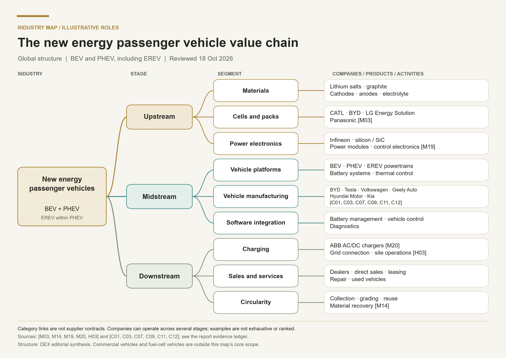
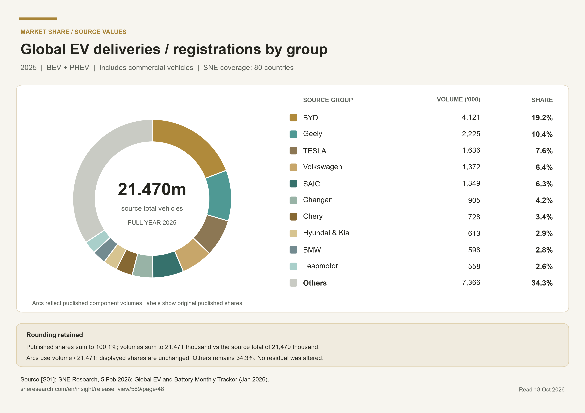

Website test edition · Version 1.0 · Global scope · Public information through 18 October 2026.

EnBW HyperNetz charging hub in Hengersberg, Germany, photographed on 3 June 2025. The photograph shows charging bays beneath a solar-panel canopy; it illustrates one site rather than global infrastructure conditions. Photo: APneunzehn74 / Wikimedia Commons, CC0 1.0. Original photograph, unmodified. <a class="evidence-cite" href="#source-P01" aria-label="Source P01">[P01]</a> <a href="cover.jpg" target="_blank" rel="noopener">View original photograph · 4000 × 2992</a>

<a href="assets/report-en.txt" download>English manuscript</a> · <a href="assets/supporting-evidence-en.json" download>Supporting Evidence records</a> · <a href="assets/web-tables.json" download>Table data</a>

DEX RESEARCH

Passenger vehicles and the electric mobility value chain

18 October 2026  |  English manuscript

Electric mobility has reached substantial scale, but growth, profit and dependable service are different achievements. This report follows a fast-charging launch through industry history, regional markets, the value chain and company economics. Its central assessment is that competitive strength depends on turning technology into repeatable manufacturing, affordable ownership and reliable energy access, with returns evaluated within each business and statistical boundary.

Global research with emphasis on China, Europe and North America. Passenger BEVs and PHEVs, including EREVs where included by the source, form the core. Commercial vehicles and fuel-cell vehicles are separate context. Public information available through 18 October 2026. The SNE group share chart explicitly covers a broader BEV plus PHEV market including commercial vehicles in 80 countries. Complete-year 2025 results and 2026 interim observations remain separate.

Contents  Part 1 Industry Story  ·  Part 2 Industry History  ·  Part 3 Market Landscape  ·  Part 4 Industry Challenges  ·  Supporting Evidence

## Part 1  Industry Story {#part-1}

On 17 March 2025, BYD introduced its Super e-Platform in China with a claim designed to make charging feel familiar: the equipped Han L could add 400 kilometres of range in five minutes. The announcement described a 1,000-volt architecture and peak charging power of 1,000 kilowatts. Han L and Tang L models using the platform entered pre-sales. These were manufacturer specifications and launch claims, rather than measurements of the experience available to every electric-car owner. <a class="evidence-cite" href="#source-H01" aria-label="Source H01">[H01]</a>

The distinction matters. A peak power rating describes a moment in a charging session. Energy delivered depends on the power maintained over time. NREL's road-trip research illustrates how charging power changes with a battery's state of charge; its modelled curves reduce power as the battery becomes fuller. The study does not test BYD's technology, but it explains why the headline power alone cannot determine the duration of an entire charging session. <a class="evidence-cite" href="#source-H02" aria-label="Source H02">[H02]</a>

BYD's announcement does not provide a complete test protocol covering battery temperature, starting and ending charge levels, and the basis for converting the added energy into kilometres. Its five-minute figure should therefore remain attributed to the company. It cannot be read as a promise of the same usable distance in every season, on every road or from every public charger. <a class="evidence-cite" href="#source-H01" aria-label="Source H01">[H01]</a>

The same launch also pointed beyond the car. BYD announced a dedicated charging terminal and plans to build more than 4,000 megawatt flash-charging stations in China. That was a construction ambition, rather than confirmation of an operating network. Official US charging guidance similarly treats a station as a project involving electrical capacity, installation, permitting and ongoing operation, with utilities involved early in planning. <a class="evidence-cite" href="#source-H01" aria-label="Source H01">[H01]</a><a class="evidence-cite" href="#source-H03" aria-label="Source H03">[H03]</a>

The commercial question is how much of an impressive vehicle capability can become a dependable service. For a driver, the useful result is a convenient stop at an accessible, working station. For an operator, the equipment must earn enough over its life to support construction and operating costs. Our analysis therefore follows the complete system: the battery and vehicle, the charging site, the electricity connection and the customer paying for transport. A faster component can improve that system, but measuring the component does not measure the whole service. This relationship has shaped electric mobility for much longer than the current charging race.

## Part 2  Industry History {#part-2}

### 1. Nineteenth century to the 1930s  an early transport option encounters a larger system {#part-2-section-1}

Electric propulsion emerged from a sequence of nineteenth-century advances in batteries and motors. The US Department of Energy's historical account cautions against assigning the electric car to one inventor or country. Gaston Planté's rechargeable lead-acid battery, dated to 1859 by the Science Museum, was one important storage milestone. It was not a ready-made solution to every requirement of road transport. <a class="evidence-cite" href="#source-H04" aria-label="Source H04">[H04]</a><a class="evidence-cite" href="#source-H05" aria-label="Source H05">[H05]</a>

In the United States around the turn of the twentieth century, electric cars appealed to urban users because they were quiet and relatively easy to operate. Their competitors also improved. The DOE account connects the expansion of gasoline cars with lower vehicle prices, electric starting, roads between cities and the availability of fuel. These changes affected the convenience and cost of owning a vehicle, beyond the merits of its motor. This is a US-centred history, rather than evidence that every country followed an identical path. <a class="evidence-cite" href="#source-H04" aria-label="Source H04">[H04]</a>

The lesson for the present industry is a systems question. A vehicle competes within a network of energy supply, maintenance, finance and everyday travel needs. Our interpretation is that adoption becomes harder when improvements in one element depend on complementary investments elsewhere. The early history does not prove that electric cars were inherently unsuitable; it shows why a promising propulsion technology alone could not settle the transport market.

### 2. The 1970s to the 1990s  battery research and air-quality regulation reopen the opportunity {#part-2-section-2}

Oil-supply concerns renewed US interest in alternative propulsion during the 1970s. The 1976 Electric and Hybrid Vehicle Research, Development, and Demonstration Act authorised federal support. This did not immediately establish a broad consumer market. <a class="evidence-cite" href="#source-H04" aria-label="Source H04">[H04]</a>

At the same time, rechargeable-battery research was changing the technical possibilities. The Nobel Prize account traces an important sequence through Stanley Whittingham's lithium-battery research in the 1970s, John Goodenough's higher-voltage oxide cathode work in 1980 and Akira Yoshino's carbon-based anode configuration in 1985. It dates the commercial sale of lithium-ion batteries to 1991. These developments were among the foundations later used in electric vehicles; they did not mean that an affordable, durable automotive battery pack appeared fully formed in 1991. The 2019 chemistry prize recognised the three scientists' contributions without providing a complete inventory of everyone involved. <a class="evidence-cite" href="#source-H06" aria-label="Source H06">[H06]</a>

Regulation created a second route back to the vehicle market. California's regulator dates its zero-emission vehicle regulation to 1990. GM's own retrospective describes the Impact concept in that year and EV1 leasing during the 1990s. The programme offered an operating vehicle to customers, although a limited leasing programme was different from a broadly established retail market. <a class="evidence-cite" href="#source-H07" aria-label="Source H07">[H07]</a><a class="evidence-cite" href="#source-H08" aria-label="Source H08">[H08]</a>

These developments illustrate two separate hurdles: a usable technology and an organisation capable of producing, supporting and selling it. Demonstrations could establish experience and expose problems. They could not, by themselves, establish that manufacturing costs, customer demand and supporting infrastructure would scale together. That distinction remains relevant when assessing new battery or vehicle announcements.

### 3. From 2008 into the 2010s  production cars and industrial policy develop together {#part-2-section-3}

Tesla's Roadster provided a visible commercial milestone. Its production announcement states that regular production began on 17 March 2008, following a prototype unveiled in 2006. The IR archive displays the release one day earlier; this report uses the event date in its dateline. The vehicle showed a route into the market through an electric sports car, without establishing that electric motoring was already affordable for the general population. <a class="evidence-cite" href="#source-H09" aria-label="Source H09">[H09]</a>

An established manufacturer took a different product route. Nissan's February 2011 results statement confirms that LEAF production began at Oppama in October 2010 and deliveries to customers in Japan and the United States began that December. These are production and delivery events, rather than merely an announced future launch. <a class="evidence-cite" href="#source-H10" aria-label="Source H10">[H10]</a>

China was developing an adoption and industrial framework alongside these product programmes. A January 2009 notice established an initial demonstration pilot in 13 cities, concentrating on public-service uses such as buses, taxis, official vehicles, sanitation and postal services. Its historical category included conventional hybrids and fuel-cell vehicles as well as battery-electric vehicles. It must not be treated as an early sales total for this report's narrower plug-in passenger-car market. <a class="evidence-cite" href="#source-H11" aria-label="Source H11">[H11]</a>

The State Council's 2012–2020 plan then selected electric drive as the main strategic direction and prioritised industrialisation of BEVs and PHEVs. It also addressed batteries, motors, electronics, charging, after-sales support and recycling. The document expressed objectives and policy tasks, not proof that every target was achieved. <a class="evidence-cite" href="#source-H12" aria-label="Source H12">[H12]</a>

Taken together, these milestones show several ways of creating a market: a specialist product, an established manufacturer's production system and coordinated public procurement. Their relative contributions cannot be reduced to a single invention or subsidy. In our reading, the emerging competitive task was to connect product development with repeatable manufacturing and an environment in which customers could operate the vehicles.

### 4. From 2020 to 2025  policy meets scale, with different regional outcomes {#part-2-section-4}

Around 2020, policy increasingly affected manufacturers' wider fleets. The European Commission describes tighter fleet-wide CO2 targets applying from 2020 as requiring better efficiency and faster deployment of low- and zero-emission vehicles. This was an average-fleet compliance mechanism, rather than a requirement that every car have identical emissions or an immediate prohibition of gasoline-car sales. <a class="evidence-cite" href="#source-H15" aria-label="Source H15">[H15]</a>

In April 2020, China extended its purchase-support programme through the end of 2022 with scheduled reductions. Its longer-term 2021–2035 industry plan, issued in October and published in November 2020, also emphasised market mechanisms, enterprise choices and integration with electricity and information infrastructure. Charging, swapping, safety, standards and recycling remained part of the policy agenda. A timetable for purchase-subsidy reductions did not mean all industrial and demand-side support would disappear. <a class="evidence-cite" href="#source-H13" aria-label="Source H13">[H13]</a><a class="evidence-cite" href="#source-H14" aria-label="Source H14">[H14]</a>

By 2025 the market had reached substantial scale. The IEA's May 2026 assessment estimates that global BEV and PHEV car sales exceeded 20 million in 2025, increasing 20% and reaching 25% of new-car sales. Penetration was nearly 55% in China, 28% in Europe and just under 10% in the United States. These are shares of new passenger-car sales; they are not shares of all vehicles already on the road, and Europe is not synonymous with the European Union. <a class="evidence-cite" href="#source-H16" aria-label="Source H16">[H16]</a>

The historical result is a large market with distinct regional conditions. Our analysis should therefore test affordability, policy exposure, charging access and manufacturing economics within each market. Global growth is useful context, but it does not establish that every manufacturer, battery chemistry or charging business will earn an adequate return. The next part examines where value is created along that industrial chain.

## Part 3 Market Landscape {#part-3}

### 1 Define the market before comparing its size {#part-3-section-1}

The core market in this report is passenger vehicles that can be charged from the electricity grid: battery electric vehicles (BEVs) and plug-in hybrids (PHEVs). Extended-range electric vehicles (EREVs) sit within the plug-in family where the source includes them; they are not added again to an inclusive PHEV total. Conventional hybrids without external charging are an adjacent competing technology. Fuel-cell vehicles and commercial vehicles are discussed separately. China's regulatory category of new energy vehicles is broader than this passenger-car core. <a class="evidence-cite" href="#source-M01" aria-label="Source M01">[M01]</a><a class="evidence-cite" href="#source-M11" aria-label="Source M11">[M11]</a>

A sale can mean a manufacturer shipment, delivery to an end customer or registration. Each answers a different question. Wholesale indicates the manufacturer's channel flow; domestic retail is closer to local consumer demand; registration is an administrative observation. None is automatically revenue recognised in audited accounts. Likewise, a company's sales growth and the growth of an industry with a different geographical or product boundary cannot be directly combined into a market share.

IEA's 2025 assessment describes a mass market with considerable regional differences. Its electric cars were 25% of new car sales; BEVs represented 65% of electric car sales. The table gives sales estimates within the same framework and retains their published precision. <a class="evidence-cite" href="#source-M01" aria-label="Source M01">[M01]</a>



Source: IEA Global EV Outlook 2026, electric car trends. Figures retain published precision. These rows are not a complete additive regional dataset. <a class="evidence-cite" href="#source-M01" aria-label="Source M01">[M01]</a>

ACEA counted 1,880,370 BEV and 1,015,887 PHEV registrations in the EU in 2025. Their compatible same-source sum is 2,896,257, calculated here. The difference from IEA's European total is not evidence that either source is wrong: EU membership and IEA's European coverage are different boundaries. <a class="evidence-cite" href="#source-M07" aria-label="Source M07">[M07]</a>

### 2 The 2026 market is diverging across regions {#part-3-section-2}

IEA's May 2026 report recorded about 3.9 million electric car sales in the first quarter, down 8% year on year. Its forecast at that time was 23 million for the full year, or 28% of new car sales. The forecast is a dated expectation, not an achieved annual total or an October update. Short-term weakness and a larger annual market are therefore different claims. <a class="evidence-cite" href="#source-M02" aria-label="Source M02">[M02]</a>

China illustrates why penetration and volume should be read together. CADA's passenger-car committee reported 7.758 million domestic NEV passenger-car retail sales in January to September 2026, down 12.8%, while manufacturer wholesale reached 11.448 million, up 9.4%. September retail penetration was 67.0%, yet NEV retail volume declined 16.7% year on year. Wholesale includes channels that domestic retail does not; subtracting the two does not directly measure inventory. <a class="evidence-cite" href="#source-M06" aria-label="Source M06">[M06]</a>

In the EU, January to August 2026 registrations reached 1,641,333 BEVs and 758,082 PHEVs. Their shares of all new cars were 21.7% and 10.0%; conventional hybrids had a separate 36.6% share. Including the latter in plug-in adoption would materially overstate the market being studied. These eight-month results must not be treated as full-year figures. <a class="evidence-cite" href="#source-M08" aria-label="Source M08">[M08]</a>

North America also needs disaggregation. US demand is especially exposed to changes in federal purchase incentives, but Canadian fleet statistics describe a separate market. Statistics Canada recorded 25.3 million light-duty vehicles in use in 2025; BEV plus PHEV vehicles represented 3.5% of that stock. This is not new-sales penetration, and its light-duty category includes pickups and vans. Mexico's importance as a manufacturing location should likewise not be mistaken for the size of its domestic electric passenger-car market. <a class="evidence-cite" href="#source-M09" aria-label="Source M09">[M09]</a><a class="evidence-cite" href="#source-M10" aria-label="Source M10">[M10]</a>

The analytical implication is that there is no single regional timetable. A manufacturer can face rising electric penetration, falling domestic unit demand and growing export shipments simultaneously. Regional capacity plans should be tested against local affordability, financing, electricity access and compliance requirements, rather than against one global growth rate.

### 3 The value chain connects materials to lifetime vehicle service {#part-3-section-3}

Figure 1 maps the passenger-vehicle value chain. Its links show categories, not verified supplier contracts. Companies may operate in several stages: BYD is an example in both batteries and vehicles. Listed companies are illustrative; the map is not a ranking. Company financial boundaries are discussed below. <a class="evidence-cite" href="#source-M03" aria-label="Source M03">[M03]</a><a class="evidence-cite" href="#source-M19" aria-label="Source M19">[M19]</a><a class="evidence-cite" href="#source-M20" aria-label="Source M20">[M20]</a><a class="evidence-cite" href="#source-C01" aria-label="Source C01">[C01]</a><a class="evidence-cite" href="#source-C03" aria-label="Source C03">[C03]</a><a class="evidence-cite" href="#source-C07" aria-label="Source C07">[C07]</a><a class="evidence-cite" href="#source-C09" aria-label="Source C09">[C09]</a><a class="evidence-cite" href="#source-C11" aria-label="Source C11">[C11]</a><a class="evidence-cite" href="#source-C12" aria-label="Source C12">[C12]</a>



View the original report figure
<figure class="research-photo" data-source-block="54"><figcaption>Figure 1: passenger-vehicle value chain. Original figure preserved unchanged from the supplied report. <a href="assets/value-chain-original.png" download>Download original figure · 3740 × 2646</a></figcaption></figure>

Upstream materials include lithium salts, graphite and cathode, anode, electrolyte and separator products. Their customers need repeatable quality as well as available tonnes. For a vehicle programme, an inexpensive material that cannot meet production consistency and qualification requirements is not an interchangeable input. The economic question is therefore how much saleable, qualified material a process can supply at a given cost, rather than how much nominal capacity has been announced.

Cells and packs convert those inputs into a component with energy, power, thermal and lifetime constraints. CATL, BYD, LG Energy Solution and Panasonic illustrate this stage. IEA puts global EV battery deployment at 1.2 TWh in 2025 and LFP's share above 55% by deployed capacity. These are battery-energy measures, not numbers of vehicles. Nameplate battery manufacturing capacity above 4 TWh cannot be divided into deployment to obtain a valid factory utilisation rate: applications, inventories, production and installation timing differ. <a class="evidence-cite" href="#source-M03" aria-label="Source M03">[M03]</a>

Power electronics and control connect the battery to useful motion. The traction inverter controls motor torque and speed; Infineon's portfolio illustrates silicon and silicon-carbide devices and control electronics used in this category. The system choice involves efficiency, cost, thermal design and reliability. A component supplier's claimed performance improvement is not automatically an independently measured benefit in every finished vehicle. <a class="evidence-cite" href="#source-M19" aria-label="Source M19">[M19]</a>

Midstream vehicle companies integrate powertrains, structures, battery management, cooling, software and manufacturing. A dedicated electric platform can create design freedom, but it also requires development and tooling investment. Sharing parts across models can spread that spending; excessive complexity can consume the saving. Established groups must manage electric programmes alongside existing products and factories, while newer firms must build quality control, distribution and service capacity as their fleets expand.

Downstream, selling the car creates a continuing service obligation. Dealers and direct sales organise delivery, financing, repairs and used-car resale in different ways. Leasing shifts attention to residual values and battery condition. A lower new-car price can improve affordability while reducing the resale value of existing vehicles, changing the economics of the same fleet contract.

Charging is a related infrastructure business with several participants: equipment suppliers, site owners, network operators, electricity suppliers and payment or roaming providers. ABB illustrates AC and DC charging equipment supply. These roles should not be collapsed into one charging-market share. An equipment order, an installed connection and an operating charging point are different milestones. <a class="evidence-cite" href="#source-M20" aria-label="Source M20">[M20]</a>

Collection, testing, reuse and material recovery form the circularity stage. A retired pack must be classified before a decision about repair, second use or recycling. The value of recoverable materials must cover collection, transport, processing and compliance costs. Recycling is therefore an operating business whose economics depend on feedstock and recovery quality, rather than simply a consequence of selling more new cars. <a class="evidence-cite" href="#source-M14" aria-label="Source M14">[M14]</a>

### 4 Global production and global ownership tell different stories {#part-3-section-4}

IEA estimates nearly 22 million electric cars were produced in 2025. China accounted for nearly 75% of production and roughly one-quarter of global production was traded internationally. A car made in China may carry a non-Chinese brand and be sold elsewhere. Production location, brand ownership and final customer location must remain separate measures. <a class="evidence-cite" href="#source-M05" aria-label="Source M05">[M05]</a>

Exports can extend a manufacturer's addressable demand and spread platform spending. They also introduce freight, tariffs, local homologation, distribution, working capital and warranty costs. Announcing a factory abroad does not prove local output, and shipping a car overseas does not prove a final customer registration. In this report's analysis, durable international expansion requires evidence that local service, parts supply and customer economics remain viable after the initial shipment.

### 5 Read the group share chart with its own denominator {#part-3-section-5}

Figure 2 uses SNE Research's 2025 BEV plus PHEV group delivery or registration dataset covering 80 countries and including commercial vehicles. It is a broader comparison alongside the passenger-car analysis. It is not labelled a passenger-car share chart. SNE's public table reports a total of 21,470 thousand vehicles and BYD's share of 19.2%, Geely's 10.4% and Tesla's 7.6%. <a class="evidence-cite" href="#source-S01" aria-label="Source S01">[S01]</a>

The published shares sum to 100.1%, and the rounded group volumes sum to 21,471 thousand, 1 thousand above the published total. Labels retain the source values; sector angles use the proportions of the published component volumes. Neither the other category nor a leading group's share is silently adjusted. The public release does not fully describe all group, joint-venture and brand-assignment rules. These figures should therefore be compared within SNE's table, not substituted into company shipment or IEA passenger-car totals. <a class="evidence-cite" href="#source-S01" aria-label="Source S01">[S01]</a>



View the original report figure
<figure class="research-photo" data-source-block="70"><figcaption>Figure 2: 2025 BEV plus PHEV group shares, including commercial vehicles. Original figure preserved unchanged from the supplied report. <a href="assets/market-share-original.png" download>Download original figure · 3740 × 2646</a></figcaption></figure>

### 6 Compare business economics within disclosed boundaries {#part-3-section-6}

The following company analysis uses each company's own financial and operational definitions. It is not a sales ranking. A group with combustion vehicles, financial services or electronics cannot be compared with a pure BEV company by treating every dollar of consolidated revenue as electric passenger-car revenue. The useful comparison is how each model turns sales, manufacturing investment and service obligations into cash and profit.

### Selected 2025 financial disclosures {#part-3-section-7}

These are reporting entities in original currencies and distinct profit measures. They are not a revenue or profitability ranking. Hyundai figures are preliminary and unaudited. CATL is discussed separately as a supplier.



### Competition  volume, profit and the boundary of the firm {#part-3-section-8}

The selected companies illustrate different ways of competing in electric vehicles. BYD combines vehicle manufacturing with substantial internal component capabilities. Tesla combines vehicle production, software and charging with both purchased and internally developed cells. Volkswagen, Geely Auto, Hyundai and Kia face different transitions from existing vehicle businesses. CATL supplies a critical component to multiple manufacturers. Their accounts explain these business models, but do not create a comparable ranking of passenger-EV profitability. Group revenue can include combustion vehicles, financing, electronics, energy storage or services. A company sales bulletin is also a different measure from registrations. The figures below retain the original currencies and periods; no sales denominator is assembled from these disclosures.

### BYD  integration supports execution but does not guarantee profit growth {#part-3-section-9}

BYD reported 4.545 million passenger-vehicle sales in 2025. Its broader automotive-related product category generated RMB648.65 billion of revenue and a 20.49% gross margin. Group attributable net profit fell 18.97% to RMB32.62 billion. These are different accounting boundaries: the product category includes automotive-related and other products, while group profit also includes electronics and other activities. The evidence supports a narrower conclusion than “scale guarantees earnings”: a large vehicle operation can coexist with declining group profit. <a class="evidence-cite" href="#source-C01" aria-label="Source C01">[C01]</a>

The first half of 2026 reinforces the need to inspect several measures together. Automotive-related revenue fell 8.98% to RMB275.34 billion while its gross margin rose to 22.33%; group attributable profit nevertheless fell 20.54%. Revenue, product gross margin and group net profit can move in different directions. The report does not attribute this entire gap to vehicle pricing, so neither does this analysis. <a class="evidence-cite" href="#source-C02" aria-label="Source C02">[C02]</a>

Analytical implication: internal batteries, motors, controls and chips can make design changes and cost coordination easier. They also place more production assets, development work and utilisation risk inside the company. Integration changes where risks are managed; demand still determines how productively those assets operate.

### Tesla  distinguish automotive economics from the wider company {#part-3-section-10}

Tesla’s 2025 automotive revenue was USD69.53 billion, including USD1.99 billion of regulatory credits and vehicle leasing. Automotive gross margin was 17.8%, while consolidated operating income was USD4.36 billion on USD94.83 billion of revenue. The latter implies a calculated group operating margin of about 4.6%, rather than a passenger-vehicle segment margin. Tesla identifies incentives, mix and lower cash deliveries among the pressures on automotive revenue. It also names Panasonic and CATL as cell suppliers alongside its efforts to manufacture cells internally. <a class="evidence-cite" href="#source-C03" aria-label="Source C03">[C03]</a>

In H1 2026, automotive revenue reached USD36.75 billion and automotive gross margin increased to 18.7%, from 16.8% a year earlier. Yet Q2’s corresponding margin fell to 16.9%, from 17.2%. These statements are consistent because one measures six months and the other three. The company also notes the prior-year Model Y factory changeovers affected the comparison base. A rebound should therefore be examined over several periods, rather than extrapolated from a single percentage. <a class="evidence-cite" href="#source-C04" aria-label="Source C04">[C04]</a>

### Volkswagen  electrification takes place within a large existing system {#part-3-section-11}

Volkswagen’s 2025 consolidated revenue was EUR321.91 billion, with operating profit of EUR8.87 billion and a 2.8% operating return on sales. These are whole-group figures, including activities outside electric passenger cars. Its disclosed 983,120 BEV deliveries explicitly include heavy commercial vehicles. That number is useful evidence of electrification within the group, but cannot enter this report’s passenger-car market-share calculation. <a class="evidence-cite" href="#source-C07" aria-label="Source C07">[C07]</a>

H1 2026 revenue was EUR158.10 billion and operating profit EUR5.93 billion, compared with EUR158.36 billion and EUR6.71 billion respectively in H1 2025. <a class="evidence-cite" href="#source-C08" aria-label="Source C08">[C08]</a> The analytical issue for an established group is the allocation of cash and engineering capacity across current products and future platforms. Existing factories, distribution and service networks offer capabilities; adapting them also consumes resources. The consolidated margin alone cannot identify the profitability of its BEV programme.

### Geely Auto  rapid electrification requires a precise corporate boundary {#part-3-section-12}

Geely Auto reported 2025 revenue of RMB345.23 billion and attributable profit of RMB16.85 billion. Its reported NEV sales comprised 1,073,805 BEVs and 613,962 PHEVs. The listed group’s accounts include Lynk &amp; Co, with the relevant comparisons restated; this is not the broader Geely Holding portfolio. <a class="evidence-cite" href="#source-C09" aria-label="Source C09">[C09]</a> In H1 2026 it reported RMB173.60 billion of revenue, RMB9.09 billion of attributable profit and 799,454 NEV sales. <a class="evidence-cite" href="#source-C10" aria-label="Source C10">[C10]</a>

For a multi-brand manufacturer, shared engineering can spread development costs over more products. Brand proliferation also requires clear product positioning: several badges do not automatically create several distinct sources of demand. This is an analytical trade-off, rather than an assertion that the accounts isolate the financial effect of each brand.

### Hyundai and Kia  powertrain flexibility and the cost of transition {#part-3-section-13}

The companies’ separate 2025 results releases reported Hyundai Motor revenue of KRW186.25 trillion and operating profit of KRW11.47 trillion, and Kia revenue of KRW114.1 trillion and operating profit of KRW9.08 trillion. Hyundai’s release identifies its financial figures as preliminary and unaudited. Both companies’ broader electrified-vehicle totals include ordinary hybrids, so those totals cannot represent this report’s BEV/PHEV market. Hyundai Motor Company and Kia also remain separate reporting entities, rather than a consolidated Hyundai Motor Group financial statement. <a class="evidence-cite" href="#source-C11" aria-label="Source C11">[C11]</a><a class="evidence-cite" href="#source-C12" aria-label="Source C12">[C12]</a>

The strategic comparison is therefore between portfolios and operating capabilities, not a contest between headline “electrified” volumes. A hybrid can serve buyers facing charging constraints while generating cash for future vehicles. It also requires production and development resources. Flexibility can help a company adapt to uneven regional demand, but sustaining several technologies increases coordination requirements. Group profitability does not establish which powertrain earns the return.

### CATL  the supplier profit pool must be examined separately {#part-3-section-14}

CATL’s 2025 results announcement, labelled unaudited, reported EV-battery revenue of RMB316.51 billion, with a 23.84% gross margin. Its overall gross margin was higher at 26.27%, reflecting a wider group that also includes storage batteries, materials, recycling and other activities. Battery-system economics therefore cannot be inferred from the group margin alone, and GWh cannot be converted into a vehicle market share without additional vehicle-level evidence. <a class="evidence-cite" href="#source-C05" aria-label="Source C05">[C05]</a>

In H1 2026, EV-battery-system revenue grew 46.02% to RMB192.12 billion, while the product gross margin fell 1.78 percentage points to 20.63%. Growth and margin expansion were not synonymous. <a class="evidence-cite" href="#source-C06" aria-label="Source C06">[C06]</a> A specialist supplier can distribute research and manufacturing costs across several customers, but must still manage pricing, product mix, capacity and customer concentration. These mechanisms explain why purchasing from a specialist can remain rational even for an automaker that designs important systems internally.

### What the comparison means for industry structure {#part-3-section-15}

The central decision is how to organise interfaces between the vehicle, battery, software and manufacturing process. Internal production can improve coordination where system design is tightly connected. External procurement can provide access to specialist capabilities and reduce the amount of capital an automaker must commit to every component. Neither arrangement removes the need for supplier qualification, testing, warranty support or credible production planning.

The same logic applies geographically. A successful product has to work within local charging access, distribution, service and production conditions. Moving assembly closer to customers can improve responsiveness, but a factory adds fixed costs before demand is certain. The relevant question is whether the operating system can support sustained sales at an adequate return. The disclosures above show why vehicle volume, product gross margin, group operating profit and cash generation should be examined together, with their definitions kept visible. They support an analysis of industrial organisation and competitive execution, not an investment recommendation.

## Part 4 Industry Challenges {#part-4}

### 1 Improving affordability without transferring losses elsewhere {#part-4-section-1}

The customer's economic comparison includes purchase price, financing, energy, insurance, maintenance, taxes and resale value. A low electricity tariff alone cannot establish lower total ownership cost. A household able to charge overnight at home and one dependent on public fast charging face different bills and constraints. Similarly, a fleet's high annual mileage may improve the value of energy savings while increasing its exposure to downtime.

Price competition can reduce the entry price and expand access. It can also reduce the residual value of previously sold cars, weaken dealers and squeeze component suppliers. The relevant business test is whether the manufacturer can sustain quality, warranty service and future model investment after discounting. Lower materials prices or a favourable product mix can protect margins temporarily; neither establishes a permanent industry-wide cost advantage. The company disclosures in Part 3 show why group profit, automotive gross margin and battery segment margin must remain separate measures.

### 2 Charging performance is a system outcome {#part-4-section-2}

A charging-power peak is not the average power over a session. The practical stop also includes finding a compatible operating charger, connecting, payment and possible queues. Battery state of charge, temperature, vehicle limits and power sharing can change the result. As an engineering illustration, four vehicles simultaneously drawing 1 MW would require 4 MW before losses; this is arithmetic, not a measured site load or a claim that any named station supplies it.

IEA reports more than 7 million public charging points worldwide at end 2025, following nearly 1.8 million additions. Those counts do not establish station availability or driver experience. Operators need appropriate locations, grid connections, maintenance and utilisation; drivers need dependable access. Adding rated power without enough demand can leave an expensive asset underused, while high-demand locations can still experience queues. <a class="evidence-cite" href="#source-M04" aria-label="Source M04">[M04]</a>

The solution is a mix of home and workplace charging, well-sited public infrastructure, reliable payment and maintenance, and managed charging where drivers can shift demand. Battery swapping can shorten the stop for compatible fleets, but creates requirements for standardisation, spare-battery inventory, asset ownership and battery-health assessment. No one model removes the need to pay for energy and infrastructure.

### 3 Battery tradeoffs and manufacturing execution {#part-4-section-3}

LFP, nickel-based lithium-ion chemistries and emerging alternatives address different requirements. Pack engineering, thermal management and vehicle efficiency can matter as much as a cell's headline energy density. LFP's growing deployment does not establish that every application should use it; a larger or heavier pack can create different vehicle constraints. Conversely, a higher-energy cell does not establish a cheaper or safer finished system. <a class="evidence-cite" href="#source-M03" aria-label="Source M03">[M03]</a>

Manufacturers should be assessed through usable output, production consistency, warranty experience and the intended charging window, rather than through laboratory records alone. Solid-state and other battery announcements should be separated into research results, validated prototypes, pilot output and sustained commercial deliveries. This is an evaluation framework, not a forecast of which company or chemistry will win.

Safety is a lifecycle responsibility involving cells, pack design, software, repair and emergency response. China's mandatory GB 38031 2025 standard took effect on 1 July 2026. The standard's existence and implementation date do not prove a particular fleet's incident rate, and meeting a specified test does not eliminate all real-world risk. Claims comparing fire risk require compatible denominators, vehicle age, exposure and reporting systems. <a class="evidence-cite" href="#source-M12" aria-label="Source M12">[M12]</a>

### 4 Emissions depend on the vehicle and energy pathway {#part-4-section-4}

Zero tailpipe emissions do not mean zero life-cycle emissions. ICCT's 2025 assessment of medium cars sold in the EU estimated BEV emissions of 63 g CO2e/km versus 235 for gasoline cars, a 73% reduction using the study's projected EU electricity mix for 2025 to 2044. The result includes manufacturing and use, but is a model with stated assumptions. It is not a universal percentage for every car and country. <a class="evidence-cite" href="#source-M13" aria-label="Source M13">[M13]</a>

The practical implication is to consider vehicle size, battery production, electricity supply, lifetime mileage and actual energy consumption together. PHEVs also require attention to the fraction of driving actually done on electricity. A plug-in car routinely driven without charging should not be credited as if every kilometre were electric. Cleaner electricity and efficient vehicles can reinforce each other, while oversized vehicles can consume part of the benefit.

### 5 Resource resilience and recycling economics {#part-4-section-5}

Supply risk can arise from concentrated processing and qualified materials even when geological resources are widely distributed. Changing a battery chemistry can reduce dependence on one input without eliminating the need for other materials or manufacturing expertise. New regional factories require qualified equipment, labour, suppliers and customers; a nameplate-capacity announcement does not establish competitive output.

IEA's recycling assessment identifies manufacturing scrap as the dominant current battery feedstock, with end-of-life packs becoming more important as fleets age. A recycler therefore needs to distinguish a future retirement opportunity from today's accessible feedstock. Collection contracts, transport, battery health, recovery quality and commodity prices affect revenue. Reuse may extend an asset's life, but testing, integration and liability also carry costs. <a class="evidence-cite" href="#source-M14" aria-label="Source M14">[M14]</a>

### 6 Policy support can change both demand and production incentives {#part-4-section-6}

China's published purchase-tax framework moved from exemption capped at CNY 30000 per eligible NEV passenger vehicle in 2024 to 2025 to half-tax relief capped at CNY 15000 in 2026 to 2027. This is tax relief subject to eligibility, not a uniform cash payment. In the US, IRS guidance states that the relevant federal vehicle credits are unavailable for vehicles acquired after 30 September 2025; acquisition and subsequent placement in service are distinct conditions. Neither change describes every local incentive or manufacturing credit. <a class="evidence-cite" href="#source-M11" aria-label="Source M11">[M11]</a><a class="evidence-cite" href="#source-M10" aria-label="Source M10">[M10]</a>

The EU adopted flexibility allowing manufacturers' CO2 compliance to be assessed over 2025 to 2027. Separately, a March 2026 Council debate addressed a Commission proposal changing the longer-term 2035 framework. A proposal, an adopted compliance arrangement and a final enforceable rule are different stages. Long-term demand models should not treat every announcement as enacted law. <a class="evidence-cite" href="#source-M16" aria-label="Source M16">[M16]</a><a class="evidence-cite" href="#source-M17" aria-label="Source M17">[M17]</a>

Trade policy also affects where value can be captured. The Commission's January 2026 guidance on Chinese BEV price undertakings addresses import prices, channels, cross-compensation and investment, with offers assessed individually. It is not a general removal of trade remedies for all brands, and BEV treatment cannot automatically be applied to PHEVs. Local production can reduce some cross-border exposure while adding fixed costs and execution risk. <a class="evidence-cite" href="#source-M18" aria-label="Source M18">[M18]</a>

### 7 Software value requires clear responsibility {#part-4-section-7}

Software can improve battery management, diagnostics and product functions, but feature availability is not proof of paid recurring demand. NHTSA's Level 2 definition keeps the driver engaged and attentive while the system assists steering and acceleration or braking. Such assistance should not be described as unrestricted autonomous driving. Commercial assessment should also include validation, cybersecurity, recall support and responsibility when features fail. <a class="evidence-cite" href="#source-M15" aria-label="Source M15">[M15]</a>

### 8 Commercial vehicles and hydrogen need separate operating cases {#part-4-section-8}

IEA reports that electric truck sales exceeded 400000 in 2025 and reached 9% of all truck sales; nearly all were BEVs. This category includes medium and heavy freight trucks, with classification revisions that limit comparisons with older editions. Its economics depend on payload, route length, depot energy, turnaround time and financing, not passenger-car buying preferences. Predictable routes can support coordinated charging or swapping, while long-distance operations impose different constraints. <a class="evidence-cite" href="#source-M22" aria-label="Source M22">[M22]</a>

Fuel-cell vehicles use hydrogen to produce electricity onboard. The hydrogen production pathway affects upstream emissions, as the US Alternative Fuels Data Center explains. A fleet considering hydrogen must assess delivered fuel cost, station coverage, utilisation and reliability, alongside payload and duty cycle. It should not infer zero life-cycle emissions from water at the tailpipe or infer a mass passenger market from a demonstration programme. <a class="evidence-cite" href="#source-M21" aria-label="Source M21">[M21]</a>

### 9 What would demonstrate a stronger industry {#part-4-section-9}

The useful indicators are compatible terminal sales, repeatable manufacturing quality, service capacity, sound cash conversion and infrastructure that drivers can use reliably. For automakers, monitor the relation between deliveries, discounting, warranty costs and working capital. For suppliers, monitor qualified output and customer concentration. For charging operators, monitor actual energy delivered and availability alongside capital and connection costs. For recyclers, monitor accessible feedstock and recovered material quality.

This report's assessment is that electrification has reached substantial scale, while the ability to earn sustainable returns remains uneven. The next stage is best evaluated through these operating measures and regional conditions. Forecast sales, announced capacity, charging demonstrations and software roadmaps should remain separate from realised commercial performance.

## Appendix Supporting Evidence {#supporting-evidence}

Read date 18 October 2026. Publisher links are provided; source reports are not redistributed. Each record states what it supports and its limits.

<section class="research-evidence" id="source-H01" data-source-id="H01"><h3 data-source-block="134">[H01] BYD Unveils Super e-Platform with Megawatt Flash Charging for Electric Vehicles, Matching Refueling Speeds</h3>
BYD | 2025-03-17 | Product launch and future network plan, not a fleet performance survey

Scope and location: China launch; not worldwide charger compatibility or coverage; Opening; Megawatt Flash Charging; Megawatt Flash Charging Terminal; Han L and Tang L pre-sales sections

Supports: BYD announced Super e-Platform, a 1000 V architecture, 1000 kW peak charging and 400 km of range added in five minutes for the equipped Han L; Han L and Tang L entered pre-sales in China; BYD announced its own charging terminal and a plan for over 4000 megawatt flash-charging stations in China

Limits: Manufacturer announcement; not independently measured average or universal real-world charging performance; The text does not disclose a complete protocol specifying ambient/battery temperature, starting and ending state of charge, and the range certification or road-use basis for the headline claim; Station plan is not evidence that all stations were operational; Do not repeat world-first, fastest or world-record promotional comparisons as independently established facts

<a href="https://prod.byd.com/en/news-list/BYD-Unveils-Super-e-Platform-Megawatt-Flash-Charging-Electric-Vehicles-Matching-Refueling-Speeds.html" target="_blank" rel="noopener noreferrer">Publisher source</a>
</section>

<section class="research-evidence" id="source-H02" data-source-id="H02"><h3 data-source-block="140">[H02] Fast Charging Infrastructure for Electrifying Road Trips to and from National Parks in the Western United States</h3>
National Renewable Energy Laboratory; Dong-Yeon Lee, Kaylyn Bopp, Matthew Moniot, Alicen Kandt | 2023-09 | 2023 study; model assumptions for 2020/2025/2030 vehicle cohorts

Scope and location: Western United States; Printed p. 11, PDF page 19, Figure 5 and Section 2.4; printed p. 15, PDF page 23, high-SOC charging discussion

Supports: Charging power varies with battery state of charge, vehicle class and model year; The charging curves used by the study decrease at high state of charge; Road-trip energy use depends on driving conditions as well as vehicle characteristics

Limits: US modelling study, not a test of BYD's platform; The illustrated 80–85% state-of-charge taper is a study generalisation and must not be assigned to every model; Used for the charging-curve principle, not to validate the five-minute claim

<a href="https://afdc.energy.gov/files/u/publication/fast-charging-for-nps-road-trips.pdf" target="_blank" rel="noopener noreferrer">Publisher source</a>
</section>

<section class="research-evidence" id="source-H03" data-source-id="H03"><h3 data-source-block="146">[H03] Procurement and Installation for Electric Vehicle Charging Infrastructure</h3>
U.S. Department of Energy, Alternative Fuels Data Center | Not displayed; available by cutoff | Undated guidance available by the cutoff; accessed 2026-10-18

Scope and location: United States; cited for planning principles only; Cost Considerations; Installation; Compliance, Permitting, and Inspection; Utilities and Other Partners

Supports: Charging-site planning includes equipment, installation, electrical upgrades, permitting and operation/maintenance; Utilities assess power availability and capacity and should be engaged early

Limits: Undated, evolving US guidance; No cost figures from this page used; Does not quantify BYD deployment economics or global charger reliability

<a href="https://afdc.energy.gov/fuels/electricity-infrastructure-development" target="_blank" rel="noopener noreferrer">Publisher source</a>
</section>

<section class="research-evidence" id="source-H04" data-source-id="H04"><h3 data-source-block="152">[H04] The History of the Electric Car</h3>
U.S. Department of Energy; Rebecca Matulka | 2014-09-15 | Historical overview as published in 2014

Scope and location: Primarily United States, with international origins acknowledged; The birth of the electric vehicle; The early rise and fall of the electric car; Gas shortages spark interest in electric vehicles; Environmental concern drives electric vehicles forward

Supports: Electric vehicle development arose from multiple nineteenth-century battery and motor advances, without a single unambiguous inventor; Electric cars attracted urban users; US gasoline-car adoption benefited from cost, electric starters, roads and fuel availability; 1970s oil supply concerns revived US electric-vehicle research interest; 1976 legislation authorised federal R&amp;D and demonstration support; US environmental and energy regulations renewed interest during the 1990s

Limits: Institutional retrospective, not a contemporaneous primary document for nineteenth-century events; US-centred account must not be presented as a complete global chronology; No early global market share, unqualified first invention or current market forecast taken from the page; Its 2014 forecasts and contemporary totals are excluded

<a href="https://www.energy.gov/articles/history-electric-car" target="_blank" rel="noopener noreferrer">Publisher source</a>
</section>

<section class="research-evidence" id="source-H05" data-source-id="H05"><h3 data-source-block="158">[H05] Batteries Not Included</h3>
Science Museum; Kathleen McIlvenna | 2010-10-05 | Historical battery development

Scope and location: Battery technology history; Opening discussion of rechargeable batteries, paragraph naming Gaston Planté

Supports: Gaston Planté developed the lead-acid rechargeable battery in 1859

Limits: Museum historical account, not original 1859 experimental documentation; Used only for the lead-acid milestone; The page's separate lithium-battery introduction date is not used; the Nobel source is used for lithium-ion commercialisation chronology; No claim of a complete, linear replacement of lead-acid by lithium-ion

<a href="https://blog.sciencemuseum.org.uk/batteries-not-included/" target="_blank" rel="noopener noreferrer">Publisher source</a>
</section>

<section class="research-evidence" id="source-H06" data-source-id="H06"><h3 data-source-block="164">[H06] The Nobel Prize in Chemistry 2019: Popular information</h3>
Royal Swedish Academy of Sciences / Nobel Prize Outreach; Ann Fernholm | 2019-10, prize educational material; exact page publication day not displayed in retrieved body | Lithium-ion battery research and commercialisation history

Scope and location: International scientific development; Opening overview; High voltages when lithium ions hide in cobalt oxide; Yoshino builds the first commercially viable lithium-ion battery; The lithium-ion battery – necessary for a fossil fuel-free society

Supports: Whittingham's rechargeable-lithium work in the 1970s, Goodenough's high-voltage oxide cathode work in 1980, Yoshino's carbon-anode configuration in 1985; Commercial lithium-ion battery sales began in 1991 according to the prize account; The 2019 chemistry prize recognised Goodenough, Whittingham and Yoshino for lithium-ion battery development

Limits: Authoritative prize-body synthesis of scientific history; not the original papers or patents; Avoids treating the prize as a complete list of contributors; Does not establish an immediate automotive market breakthrough in 1991 or the safety of all lithium-ion systems

<a href="https://www.nobelprize.org/prizes/chemistry/2019/popular-information/" target="_blank" rel="noopener noreferrer">Publisher source</a>
</section>

<section class="research-evidence" id="source-H07" data-source-id="H07"><h3 data-source-block="170">[H07] History</h3>
California Air Resources Board | Not displayed; available by cutoff | Regulator's own historical account, undated page available by cutoff

Scope and location: California, United States; List of automobile emission-control milestones: Zero-emission vehicle (ZEV) regulation (1990)

Supports: CARB dates adoption of its ZEV regulation to 1990 and describes a requirement for manufacturers to produce an increasing number of ZEVs

Limits: Primary institutional self-history; original rule not relied on for quantitative mandates; Historical adoption is not a claim about the legal status of California's rules in October 2026; No exact percentage mandate or current compliance advice used

<a href="https://ww2.arb.ca.gov/about/history" target="_blank" rel="noopener noreferrer">Publisher source</a>
</section>

<section class="research-evidence" id="source-H08" data-source-id="H08"><h3 data-source-block="176">[H08] Driving the future, then and now: the story of the EV1</h3>
General Motors | 2026-03-11 | Corporate historical account of Impact and EV1

Scope and location: United States; From Impact to EV1; A pioneering program — and a lasting legacy

Supports: GM showed the Impact concept in 1990 and operated EV1 leasing during the 1990s; EV1 was leased rather than sold

Limits: Company retrospective contains promotional first/mass-produced claims, not adopted here; The returned page duplicates portions of its article with differing first-lease dates (1997 and late 1996); the draft deliberately uses only the 1990s and does not rely on either exact date; No claim about one single cause of the programme's end

<a href="https://news.gm.com/home.detail.html/Pages/news/us/en/2026/mar/0311-ev1.html" target="_blank" rel="noopener noreferrer">Publisher source</a>
</section>

<section class="research-evidence" id="source-H09" data-source-id="H09"><h3 data-source-block="182">[H09] Tesla Motors Begins Regular Production of 2008 Tesla Roadster</h3>
Tesla Investor Relations / Tesla Motors | 2008-03-16 displayed on IR archive; release dateline 2008-03-17 | Start of regular Roadster production, not announcement of a mass-market scale

Scope and location: United States; Dateline and first three paragraphs

Supports: Tesla announced that regular Roadster production began 17 March 2008; The prototype had been unveiled in July 2006

Limits: Archive display date and release dateline differ by one day; retained separately; Company release does not prove broad affordability or universal superiority; Promotional only-highway-capable or first claims excluded

<a href="https://ir.tesla.com/press-release/tesla-motors-begins-regular-production-2008-tesla-roadster" target="_blank" rel="noopener noreferrer">Publisher source</a>
</section>

<section class="research-evidence" id="source-H10" data-source-id="H10"><h3 data-source-block="188">[H10] Fiscal Year 2010 Third-quarter Financial Results: Media Conference</h3>
Nissan Motor Co., Ltd.; Joji Tagawa | 2011-02-09 | Quarterly corporate update confirming events in late 2010

Scope and location: Japan and United States for delivery event; Business update, paragraphs on Nissan LEAF

Supports: LEAF production started at Oppama in October 2010; LEAF customer deliveries began in Japan and the United States in December 2010

Limits: Uses a retrospective confirmation rather than a prelaunch delivery schedule; No first-ever electric-car claim or claim that the entire launch was global at the same time

<a href="https://www.nissan-global.com/EN/DOCUMENT/HTML/FINANCIAL/SPEECH/2010/20103rd_speech_185_e.html" target="_blank" rel="noopener noreferrer">Publisher source</a>
</section>

<section class="research-evidence" id="source-H11" data-source-id="H11"><h3 data-source-block="194">[H11] Notice on Energy-saving and New-energy Vehicle Demonstration Pilots (Caijian [2009] No. 6)</h3>
China Ministry of Finance and Ministry of Science and Technology | 2009-01-23 official issue metadata; separate web-publication date not displayed | Initial 13-city public-service demonstration pilot

Scope and location: China; Notice first paragraph; annex Articles 2, 4 and 5

Supports: Initial pilot covered 13 cities and focused on buses, taxis, official vehicles, sanitation and postal services; Central subsidies supported vehicle procurement; local support included complementary infrastructure and maintenance

Limits: Historical programme definition includes conventional hybrids and fuel-cell vehicles, broader than the core plug-in passenger-car market in this report; 13 is the initial notice scope, not a count for all later demonstration cities; Policy design is not evidence of actual sales or programme effectiveness

<a href="https://www.mof.gov.cn/gp/xxgkml/jjjss/200902/t20090210_2499581.htm" target="_blank" rel="noopener noreferrer">Publisher source</a>
</section>

<section class="research-evidence" id="source-H12" data-source-id="H12"><h3 data-source-block="200">[H12] Energy-saving and New-energy Vehicle Industry Development Plan (2012–2020)</h3>
China State Council; official republication by National Energy Administration | 2012-07-10 on NEA; issuing date 2012-06-28 | 2012–2020 planning horizon

Scope and location: China; Section I market definition; Section II principles; Section III.1 technical route; Section IV charging infrastructure

Supports: Selected electric drive as the main strategic direction and prioritised BEV and PHEV industrialisation; Linked vehicle production with batteries, motors, electronics, charging, after-sales and recycling

Limits: Official repost of primary State Council policy; Targets are not achieved production, sales or performance; NEV definition includes fuel-cell vehicles, so cannot be silently substituted for IEA electric-car statistics

<a href="https://www.nea.gov.cn/2012-07/10/c_131705726.htm" target="_blank" rel="noopener noreferrer">Publisher source</a>
</section>

<section class="research-evidence" id="source-H13" data-source-id="H13"><h3 data-source-block="206">[H13] Notice on Improving Fiscal Subsidies for New-energy Vehicle Promotion (Caijian [2020] No. 86)</h3>
China Ministry of Finance, MIIT, Ministry of Science and Technology and NDRC | 2020-04-23 | Historical purchase subsidy extension through 2022

Scope and location: China; Section I extension and step-down; Section III subsidy settlement; effective-date paragraph

Supports: Extended the purchase-support programme through end-2022 with scheduled subsidy reductions

Limits: Historical notice, not a statement of all incentives applicable in 2026; No assertion that every later amendment followed the original schedule unchanged; No claim that ending purchase subsidies ended all NEV policy support

<a href="https://www.mof.gov.cn/zcsjtsgb/gfxwj/202004/t20200423_3583791.htm" target="_blank" rel="noopener noreferrer">Publisher source</a>
</section>

<section class="research-evidence" id="source-H14" data-source-id="H14"><h3 data-source-block="212">[H14] New-energy Vehicle Industry Development Plan (2021–2035)</h3>
General Office of the State Council of China | 2020-11-02 | 2021–2035 planning horizon

Scope and location: China; Chapter II principles; Chapter IV industrial ecosystem; Chapter V integrated development; Chapter VI charging/swap networks

Supports: Emphasised market-led allocation, enterprise technical choices, and integration with energy and information infrastructure; Included charging/swapping, grid planning, standards, safety and battery recycling

Limits: Policy objectives and tasks are not evidence of achieved market outcomes; Its 2025 NEV share target uses all new vehicle sales and must not be directly compared with IEA passenger-car penetration as if definitions were identical

<a href="https://www.gov.cn/zhengce/content/2020-11/02/content_5556716.htm" target="_blank" rel="noopener noreferrer">Publisher source</a>
</section>

<section class="research-evidence" id="source-H15" data-source-id="H15"><h3 data-source-block="218">[H15] Average CO2 emissions from new cars increased in 2019 ahead of stricter 2020 targets</h3>
European Commission, Directorate-General for Climate Action | 2021-06-01 | 2019 registrations and transition to 2020 standards

Scope and location: European Union / reporting area described in source; Paragraph on stricter fleet-wide 95 g CO2/km car and 147 g CO2/km van targets applicable since 2020

Supports: The Commission describes tighter 2020 fleet-wide CO2 targets as requiring improved fleet efficiency and accelerated deployment of low- and zero-emission vehicles

Limits: Historical fleet-average compliance mechanism, not a per-car requirement or immediate ban on combustion-car sales; No current 2035 rule assertion made; Car/van categories remain separate; van figures not used in draft

<a href="https://climate.ec.europa.eu/news-other-reads/news/average-co2-emissions-new-cars-increased-2019-ahead-stricter-2020-targets-2021-06-01_en" target="_blank" rel="noopener noreferrer">Publisher source</a>
</section>

<section class="research-evidence" id="source-H16" data-source-id="H16"><h3 data-source-block="224">[H16] Global EV Outlook 2026: Trends in electric cars; Executive summary</h3>
International Energy Agency | 2026-05-20, verified on report landing page | 2025 historical estimate; 2026 projections excluded from this history

Scope and location: Global; China; Europe; United States; Electric car sales topped 20 million globally in 2025; Across the three major electric car markets; notes defining electric cars; executive-summary opening

Supports: 2025 electric-car sales exceeded 20 million, grew 20%, and represented 25% of new-car sales globally; 2025 sales penetration was nearly 55% in China, 28% in Europe and just under 10% in the United States; The report defines electric cars as BEV and PHEV

Limits: IEA analytical compilation, not a single direct official worldwide registration census; underlying sources include EV Volumes, ACEA, EAFO and country submissions; Sales share is a share of new-car sales, not the vehicle stock, revenues, all road vehicles or fuel-cell market; Europe is not identical to European Union; Publication date verified at https://www.iea.org/reports/global-ev-outlook-2026; 2026 forecasts are not 2026 actuals

<a href="https://www.iea.org/reports/global-ev-outlook-2026/trends-in-electric-cars" target="_blank" rel="noopener noreferrer">Publisher source</a>
</section>

<section class="research-evidence" id="source-M01" data-source-id="M01"><h3 data-source-block="230">[M01] Global EV Outlook 2026 Trends in electric cars</h3>
IEA | 2026-05-20 | 2025; 2026 Q1; 2026 forecast

Scope and location: Global; China; Europe; United States; Electric cars are BEV plus PHEV including EREV; Electric car sales; Across the three major electric car markets

Supports: 2025 electric car sales exceeded 20 million, rose 20% and reached 25% of new cars. BEVs were 65% of electric car sales. China exceeded 13 million and Europe reached 4.2 million; US sales were about 1.5 million.

Limits: IEA estimates, partly based on commercial datasets. Europe is not EU. Rounded totals cannot support precise OEM shares; EREV must not be added again to PHEV.

<a href="https://www.iea.org/reports/global-ev-outlook-2026/trends-in-electric-cars" target="_blank" rel="noopener noreferrer">Publisher source</a>
</section>

<section class="research-evidence" id="source-M02" data-source-id="M02"><h3 data-source-block="236">[M02] Global EV Outlook 2026 Executive summary</h3>
IEA | 2026-05-20 | 2026 Q1; May 2026 forecast for 2026

Scope and location: Global; BEV plus PHEV electric cars; Electric cars are poised to make up a greater share of total car sales in 2026

Supports: Q1 2026 sales around 3.9 million, down 8% year on year. May forecast for 2026: 23 million sales and 28% of new cars.

Limits: A dated forecast, not 2026 actual sales or an October nowcast. Scenario and policy assumptions can change.

<a href="https://www.iea.org/reports/global-ev-outlook-2026/executive-summary" target="_blank" rel="noopener noreferrer">Publisher source</a>
</section>

<section class="research-evidence" id="source-M03" data-source-id="M03"><h3 data-source-block="242">[M03] Global EV Outlook 2026 Electric vehicle batteries</h3>
IEA | 2026-05-20 | 2025

Scope and location: Global; EV battery deployment by capacity; nameplate battery manufacturing capacity separately; Electric vehicle battery deployment; Battery industry trends; Battery manufacturing and trade

Supports: EV battery deployment reached 1.2 TWh. LFP exceeded 55% of deployed EV battery capacity. Battery nameplate capacity exceeded 4 TWh; China held over 80%. CATL, BYD, LG Energy Solution and Panasonic illustrate cell manufacturers.

Limits: GWh shares are not vehicle shares. Nameplate capacity covers different applications and is not usable output; do not divide deployment by nameplate to infer plant utilisation. Pack price averages include stationary storage.

<a href="https://www.iea.org/reports/global-ev-outlook-2026/electric-vehicle-batteries" target="_blank" rel="noopener noreferrer">Publisher source</a>
</section>

<section class="research-evidence" id="source-M04" data-source-id="M04"><h3 data-source-block="248">[M04] Global EV Outlook 2026 Electric vehicle charging</h3>
IEA | 2026-05-20 | End 2025

Scope and location: Global; Public charging points, not stations or private chargers; Public charging infrastructure rollout further accelerated in 2025

Supports: Public charging points exceeded 7 million at end 2025 after nearly 1.8 million additions. Rated capacity, vehicle compatibility and access to private charging matter as well as point counts.

Limits: A point is not a station. Nameplate power is not delivered energy, availability or average charging speed; figures include light-duty vehicles beyond passenger cars where stated.

<a href="https://www.iea.org/reports/global-ev-outlook-2026/electric-vehicle-charging-chap-6-and-10" target="_blank" rel="noopener noreferrer">Publisher source</a>
</section>

<section class="research-evidence" id="source-M05" data-source-id="M05"><h3 data-source-block="254">[M05] Global EV Outlook 2026 Manufacturing and trade</h3>
IEA | 2026-05-20 | 2025

Scope and location: Global; Electric car production, trade and maker headquarters distinguished; Electric car manufacturing and trade

Supports: Nearly 22 million electric cars were produced in 2025; China produced nearly 75%. About one-quarter of production was traded internationally.

Limits: Production location, brand ownership and sale destination are different. Exports need not equal final registrations abroad; production is not sales.

<a href="https://www.iea.org/reports/global-ev-outlook-2026/manufacturing-and-trade" target="_blank" rel="noopener noreferrer">Publisher source</a>
</section>

<section class="research-evidence" id="source-M06" data-source-id="M06"><h3 data-source-block="260">[M06] China passenger car market analysis September 2026</h3>
CADA Passenger Car Market Information Joint Committee | 2026-10-12 | 2026 January to September; September monthly

Scope and location: China; NEV passenger car domestic retail; manufacturer wholesale separately; Section 1 New energy vehicles

Supports: January to September NEV passenger retail 7.758 million, down 12.8%; wholesale 11.448 million, up 9.4%. September retail 1.084 million, down 16.7%, with 67.0% penetration.

Limits: Domestic retail and wholesale have different channels and export coverage. Their difference is not inventory accumulation. Monthly penetration does not describe annual sales growth. Only these specified statistics are used; global-share section is not used due rounded and internally differing percentages.

<a href="https://www.cada.cn/Trends/info_91_10580.html" target="_blank" rel="noopener noreferrer">Publisher source</a>
</section>

<section class="research-evidence" id="source-M07" data-source-id="M07"><h3 data-source-block="266">[M07] New car registrations 2025 battery electric 17.4 percent market share</h3>
ACEA | 2026-01-27 | 2025

Scope and location: European Union; New passenger car registrations by power source; Electric cars

Supports: BEV registrations 1,880,370, share 17.4%; PHEV 1,015,887, share 9.4%. Their sum is 2,896,257 registrations.

Limits: EU is narrower than IEA Europe. HEV is not PHEV. Addition is the author's arithmetic using compatible same-source counts.

<a href="https://www.acea.auto/pc-registrations/new-car-registrations-1-8-in-2025-battery-electric-17-4-market-share/" target="_blank" rel="noopener noreferrer">Publisher source</a>
</section>

<section class="research-evidence" id="source-M08" data-source-id="M08"><h3 data-source-block="272">[M08] New car registrations August 2026 year to date battery electric 21.7 percent market share</h3>
ACEA | 2026-09-24 | 2026 January to August

Scope and location: European Union; New passenger car registrations; Electric cars; official ACEA email web version

Supports: BEV 1,641,333 registrations, 21.7% share; PHEV 758,082, 10.0% share; HEV 36.6% of all new cars.

Limits: An eight-month period, not full year. HEV excluded from electric-car totals. Official email version read because regular article was hard to locate.

<a href="https://www.acea.auto/?action=view&amp;data=WzU0NzA2LCI2YjgzZjQ4NDljY2IiLDEzOTg0LCJ1dTR0MG00MDh6azBjMHM4c2trazhzODQwMDhnd28wdyIsNTQwNTQsMF0&amp;endpoint=view_in_browser&amp;mailpoet_router=" target="_blank" rel="noopener noreferrer">Publisher source</a>
</section>

<section class="research-evidence" id="source-M09" data-source-id="M09"><h3 data-source-block="278">[M09] Vehicle registrations 2025</h3>
Statistics Canada | 2026-09-22 | 2025

Scope and location: Canada; Registered vehicle stock, not new vehicle sales; Highlights; Electric vehicles

Supports: Canada registered 25.3 million light-duty vehicles in 2025. BEV plus PHEV stock was 3.5% of LDVs; broader EV category also includes HEV.

Limits: Stock is not new-sales penetration. LDVs include pickups and vans. The reported 6.5% broader EV stock share must not be called BEV plus PHEV share.

<a href="https://www150.statcan.gc.ca/n1/daily-quotidien/260922/dq260922c-eng.htm" target="_blank" rel="noopener noreferrer">Publisher source</a>
</section>

<section class="research-evidence" id="source-M10" data-source-id="M10"><h3 data-source-block="284">[M10] Clean vehicle tax credits</h3>
US Internal Revenue Service | Undated live official guidance available by read date | Acquisition deadline 2025-09-30

Scope and location: United States federal; Sections 30D 25E and 45W vehicle acquisition credits; Update; Planning to buy a new vehicle

Supports: Credits not available for vehicles acquired after September 30 2025; later placed-in-service cases depend on acquisition by the deadline.

Limits: Not a statement about all state incentives or manufacturing credits. No personalised tax advice; distinguish acquisition and delivery.

<a href="https://www.irs.gov/clean-vehicle-tax-credits" target="_blank" rel="noopener noreferrer">Publisher source</a>
</section>

<section class="research-evidence" id="source-M11" data-source-id="M11"><h3 data-source-block="290">[M11] Announcement on extending and optimising new energy vehicle purchase tax relief</h3>
China Ministry of Finance State Taxation Administration MIIT | 2023-06-19 | 2024 to 2027

Scope and location: China; Eligible NEV passenger vehicle purchase tax relief; Paragraphs 1 and 3

Supports: 2026 to 2027 relief is half of purchase tax, capped at CNY 15000 per NEV passenger vehicle; 2024 to 2025 exemption was capped at CNY 30000.

Limits: Not a cash subsidy for every car; eligible-model and technical requirements apply. Tax relief cannot be added indiscriminately to other support.

<a href="https://fgk.chinatax.gov.cn/zcfgk/c102416/c5207352/content.html" target="_blank" rel="noopener noreferrer">Publisher source</a>
</section>

<section class="research-evidence" id="source-M12" data-source-id="M12"><h3 data-source-block="296">[M12] GB 38031 2025 Electric vehicles traction battery safety requirements</h3>
SAMR national standards platform | 2025-03-28 | Effective 2026-07-01

Scope and location: China; Mandatory traction battery safety standard; Basic information and current status

Supports: Standard published March 28 2025, implemented July 1 2026, replaces GB 38031 2020.

Limits: The registry verifies status and dates only. It does not establish real-world incident rates or prove that passing a test eliminates fires; no unviewed clause is quoted.

<a href="https://std.samr.gov.cn/gb/search/gbDetailed?id=31D72E7FB9BF92EDE06397BE0A0AC2E0" target="_blank" rel="noopener noreferrer">Publisher source</a>
</section>

<section class="research-evidence" id="source-M13" data-source-id="M13"><h3 data-source-block="302">[M13] Life cycle greenhouse gas emissions from passenger cars in the European Union 2025 update</h3>
ICCT; Marta Negri and Georg Bieker | 2025-07-08 | Medium cars sold in 2025; projected EU electricity 2025 to 2044

Scope and location: European Union; Modelled life-cycle greenhouse gas emissions; Life-cycle assessment and methodological assumptions

Supports: Estimated BEV emissions 63 g CO2e/km vs gasoline 235, a 73% reduction under study assumptions.

Limits: Model results for EU medium cars, not measurements for every global model. Grid trajectory, lifetime, vehicle class and real driving affect results. Official Chinese research summary read; English PDF access failed.

<a href="https://www.theicct.org.cn/2025/07/08/欧盟乘用车全生命周期温室气体排放：2025年更新及/" target="_blank" rel="noopener noreferrer">Publisher source</a>
</section>

<section class="research-evidence" id="source-M14" data-source-id="M14"><h3 data-source-block="308">[M14] Recycling of Critical Minerals Executive summary</h3>
IEA | 2024-11-18 | 2024 assessment and 2030 scenarios

Scope and location: Global; Battery recycling feedstock and announced capacity; Manufacturing scrap and end-of-life batteries

Supports: Manufacturing scrap dominates current battery recycling feedstock; retired batteries become more important as fleets age.

Limits: Future feedstock and capacity are scenario-based. A recycling announcement does not prove available feedstock, recovered output or profit.

<a href="https://www.iea.org/reports/recycling-of-critical-minerals/executive-summary" target="_blank" rel="noopener noreferrer">Publisher source</a>
</section>

<section class="research-evidence" id="source-M15" data-source-id="M15"><h3 data-source-block="314">[M15] Driver Assistance Technologies</h3>
NHTSA | Undated official page available by read date | Technology definitions

Scope and location: US framework; Level 2 driver assistance; Level 2 Additional Assistance

Supports: Level 2 can continuously assist steering and acceleration/braking while the driver remains engaged and attentive.

Limits: Use only this definition. Other page wording about commercial availability can be stale and is not used as a worldwide availability claim.

<a href="https://www.nhtsa.gov/vehicle-safety/driver-assistance-technologies" target="_blank" rel="noopener noreferrer">Publisher source</a>
</section>

<section class="research-evidence" id="source-M16" data-source-id="M16"><h3 data-source-block="320">[M16] Council gives final approval to additional flexibility for carmakers</h3>
Council of the European Union | 2025-05-27 | 2025 to 2027

Scope and location: European Union; Car and van fleet CO2 compliance averaging; Main body

Supports: Council adopted compliance flexibility assessing manufacturers over 2025 to 2027 instead of each year separately.

Limits: A compliance-timing change is not abolition of all CO2 targets. Later long-term proposals are separate.

<a href="https://www.consilium.europa.eu/en/press/press-releases/2025/05/27/co2-emissions-in-cars-council-gives-final-approval-to-additional-flexibility-for-carmakers/" target="_blank" rel="noopener noreferrer">Publisher source</a>
</section>

<section class="research-evidence" id="source-M17" data-source-id="M17"><h3 data-source-block="326">[M17] Results of the Environment Council 17 March 2026</h3>
Cyprus Presidency of the Council of the EU | 2026-03-17 | March 2026 policy debate

Scope and location: European Union; Proposed car CO2 amendment; Opening paragraphs

Supports: Council debated Commission proposal to lower the 2035 tailpipe reduction target from 100% to 90% with compensatory credits.

Limits: Evidence of a proposal and debate at that date, not proof of enactment by the report cutoff. Report does not claim a final 2035 rule outcome.

<a href="https://cyprus-presidency.consilium.europa.eu/en/news/results-of-the-environment-council-17-march-2026/" target="_blank" rel="noopener noreferrer">Publisher source</a>
</section>

<section class="research-evidence" id="source-M18" data-source-id="M18"><h3 data-source-block="332">[M18] Guidance on price undertaking offers for BEVs from China</h3>
European Commission DG Trade and Economic Security | 2026-01-12 | January 2026 guidance

Scope and location: China to EU trade; BEV countervailing duties and case-specific price undertakings; Main body and Background

Supports: Guidance covers minimum import prices, sales channels, cross-compensation and EU investments; offers are assessed individually.

Limits: Not removal of duties for all Chinese brands and not evidence of a particular company approval. BEV scope cannot automatically be extended to PHEV.

<a href="https://policy.trade.ec.europa.eu/news/commission-issues-guidance-document-submission-price-undertaking-offers-battery-electric-vehicles-2026-01-12_en" target="_blank" rel="noopener noreferrer">Publisher source</a>
</section>

<section class="research-evidence" id="source-M19" data-source-id="M19"><h3 data-source-block="338">[M19] EV traction inverter</h3>
Infineon Technologies | Undated product page available by read date | Product and technology description

Scope and location: Global products; Traction inverter and silicon/SiC semiconductor offering; Overview; How traction inverters work; Technology choice

Supports: Inverters control motor torque and speed; Infineon offers silicon and silicon-carbide power components and control electronics.

Limits: Vendor description verifies its category participation, not market share, independent performance testing or a supply contract with any named OEM.

<a href="https://www.infineon.com/application/automotive-traction-inverter" target="_blank" rel="noopener noreferrer">Publisher source</a>
</section>

<section class="research-evidence" id="source-M20" data-source-id="M20"><h3 data-source-block="344">[M20] EV Charging Electric Vehicle Chargers</h3>
ABB | Undated product page available by read date | Product portfolio

Scope and location: Global products; AC wallboxes and DC fast chargers; EV charging portfolio

Supports: ABB offers AC wallboxes, DC fast charging and connected charging products.

Limits: Product participation is not a verified network ownership share, uptime measure or profit estimate.

<a href="https://new.abb.com/ev-charging" target="_blank" rel="noopener noreferrer">Publisher source</a>
</section>

<section class="research-evidence" id="source-M21" data-source-id="M21"><h3 data-source-block="350">[M21] Fuel Cell Electric Vehicle Emissions</h3>
US Alternative Fuels Data Center | Undated official page available by read date | Technology and fuel pathways

Scope and location: US analytical context; Tailpipe and well-to-wheels emissions distinguished; Main body

Supports: Hydrogen is an energy carrier from different feedstocks; upstream production affects FCEV greenhouse gas emissions.

Limits: Zero tailpipe carbon does not establish zero life-cycle emissions. Fuel pathway results are not market penetration estimates.

<a href="https://afdc.energy.gov/vehicles/emissions-hydrogen" target="_blank" rel="noopener noreferrer">Publisher source</a>
</section>

<section class="research-evidence" id="source-M22" data-source-id="M22"><h3 data-source-block="356">[M22] Global EV Outlook 2026 Trends in other EV modes</h3>
IEA | 2026-05-20 | 2025

Scope and location: Global; Medium and heavy freight trucks; BEV plus PHEV, separate from passenger cars; Trends in electric truck sales and notes

Supports: Electric truck sales exceeded 400000 and reached 9% of all truck sales in 2025. Nearly all electric truck sales were BEV. Route predictability and depot energy access shape use cases.

Limits: Definitions reclassify vehicles at or above 3.5 tonnes; not comparable to passenger cars or necessarily older IEA editions. Do not add truck shares to passenger-car shares.

<a href="https://www.iea.org/reports/global-ev-outlook-2026/trends-in-other-ev-modes" target="_blank" rel="noopener noreferrer">Publisher source</a>
</section>

<section class="research-evidence" id="source-C01" data-source-id="C01"><h3 data-source-block="362">[C01] BYD Annual Report 2025</h3>
BYD Company Limited / HKEX | 2026-03-27 | 2025-01-01/2025-12-31

Scope and location: Global consolidated group; BYD and consolidated subsidiaries; total revenue includes automotive-related and electronics businesses. Unit sales are company reported production/sales bulletins, not global consumer registrations; Printed pp. 11, 13–14, 16, 29–30; Section III operating review and product revenue/gross-margin table

Supports: 2025 passenger company sales of 4.545m; automotive-related revenue RMB 648.65bn and gross margin 20.49%; group attributable profit RMB 32.62bn, down 18.97%.

Limits: Automotive-related product revenue includes more than passenger-vehicle sales; its gross margin is not an EV-only net margin; Group attributable profit includes non-automotive businesses and non-operating items; Cannot use company sales as numerator against IEA/SNE market denominator; 2025 passenger BEV/PHEV split is in January 2026 sales bulletin, not extracted from this annual-report source; do not invent split here.

<a href="https://www.hkexnews.hk/listedco/listconews/sehk/2026/0327/2026032702970_c.pdf" target="_blank" rel="noopener noreferrer">Publisher source</a>
</section>

<section class="research-evidence" id="source-C02" data-source-id="C02"><h3 data-source-block="368">[C02] BYD Interim Report 2026</h3>
BYD Company Limited / Shenzhen Stock Exchange disclosure | 2026-08-29 | 2026-01-01/2026-06-30

Scope and location: Global consolidated group; Unaudited first-half consolidated financial results; comparisons with H1 2025, not FY2025; Printed pp. 7, 14, 25–26, 150, 193 (PDF pages 6, 13, 24–25, 149, 192)

Supports: H1 automotive-related revenue fell 8.98% while product margin rose to 22.33%; group attributable profit fell 20.54%.

Limits: Unaudited half year; no full-year ranking or automatic annualisation; Neither revenue figure is an EV-only passenger-car revenue measure; Publication date follows the dated SZSE disclosure path; report cover is August 2026; No H1 passenger-unit sales extracted here.

<a href="https://disc.static.szse.cn/disc/disk03/finalpage/2026-08-29/56e933c9-717e-42bd-8c21-3a0a11b8d2d0.PDF" target="_blank" rel="noopener noreferrer">Publisher source</a>
</section>

<section class="research-evidence" id="source-C03" data-source-id="C03"><h3 data-source-block="374">[C03] Tesla Form 10-K for FY2025</h3>
Tesla, Inc. / US SEC | 2026-01-29 | 2025-01-01/2025-12-31

Scope and location: Global consolidated group; US GAAP consolidated financials; total automotive revenue includes sales, regulatory credits and leasing; total group also includes energy and services; Printed pp. 32, 37–39, 50; Results of Operations and Consolidated Statements of Operations. SEC filing index shows filing date 2026-01-29, acceptance 2026-01-28

Supports: Automotive revenue USD 69.53bn includes credits/leasing; automotive margin 17.8%; group operating income USD 4.36bn. Cells purchased from Panasonic/CATL supplement internal development.

Limits: Automotive margin includes regulatory credits and leasing and excludes services and other; cannot compare unqualified with another firm's product gross margin; Group operating margin calculated as 4355/94827=4.59%, rounded 4.6%; not passenger-EV operating margin; 10-K uses rounded deliveries; exact 1,636,129 requires separate operational release and is not represented as extracted from this source; Signed on January 28 and filed January 29; source date uses SEC filing date.

<a href="https://www.sec.gov/Archives/edgar/data/1318605/000162828026003952/tsla-20251231.htm" target="_blank" rel="noopener noreferrer">Publisher source</a>
</section>

<section class="research-evidence" id="source-C04" data-source-id="C04"><h3 data-source-block="380">[C04] Tesla Form 10-Q for H1 2026</h3>
Tesla, Inc. / US SEC | 2026-07-23 | 2026-01-01/2026-06-30

Scope and location: Global consolidated group; Unaudited US GAAP first-half figures; six-month columns distinct from Q2 three-month columns; Printed pp. 4–5, 30–33; six-month income statement, Revenues, Cost of Revenues and Gross Margin. SEC filing index confirms 2026-07-23; signature dated 2026-07-22

Supports: H1 automotive margin rose to 18.7%, but Q2 margin fell to 16.9%; period length and the prior-year factory-changeover base matter.

Limits: H1 improvement should not be presented as Q2 margin improvement: H1 automotive margin rose, Q2 automotive margin fell year on year; No post-2026-10-18 Q3 financial results included; Group H1 operating margin 1339/50623=2.65% is calculated, not an EV-only segment margin.

<a href="https://www.sec.gov/Archives/edgar/data/1318605/000162828026049270/tsla-20260630.htm" target="_blank" rel="noopener noreferrer">Publisher source</a>
</section>

<section class="research-evidence" id="source-C05" data-source-id="C05"><h3 data-source-block="386">[C05] CATL Annual Results 2025</h3>
Contemporary Amperex Technology Co., Limited | 2026-03-09 | 2025-01-01/2025-12-31

Scope and location: Global consolidated group; CATL and consolidated subsidiaries; battery supplier, not automaker. EV battery products serve passenger and commercial vehicles; group includes ESS, materials, recycling, mining and other businesses; Cover dated March 9; printed pp. 7, 9, 12–15, 32–33. Monetary tables in RMB thousand

Supports: EV-battery revenue RMB 316.51bn and gross margin 23.84%; wider-group gross margin 26.27% is a different boundary.

Limits: Annual-results cover calls results unaudited despite containing full annual-report text; describe the document accurately and do not silently upgrade its audit status; Battery sales/GWh are not vehicle deliveries or vehicle market share; Supplier group profits and margins cannot rank passenger-vehicle profitability; Group gross-margin improvement does not imply EV battery gross-margin improvement: EV battery gross margin fell 0.10 percentage point.

<a href="https://www.catl.com/en/uploads/1/file/public/202603/20260310105310_46xjbwckvn.pdf" target="_blank" rel="noopener noreferrer">Publisher source</a>
</section>

<section class="research-evidence" id="source-C06" data-source-id="C06"><h3 data-source-block="392">[C06] CATL Interim Report 2026</h3>
CATL / Shenzhen Stock Exchange disclosure | 2026-07-25 | 2026-01-01/2026-06-30

Scope and location: Global consolidated group; Unaudited H1 consolidated battery-supplier results; product line EV power battery systems includes passenger and commercial uses; Printed pp. 7, 15–17; financial highlights, product revenue/margin table and capacity/production table

Supports: H1 EV-battery revenue grew 46.02% while gross margin declined 1.78pp to 20.63%.

Limits: H1 2026 must compare with H1 2025, not FY2025; Production 498 GWh must not be labelled sales or installed capacity; This battery supplier is shown separately from OEM volume comparisons; Publication follows dated SZSE disclosure path.

<a href="https://disc.static.szse.cn/disc/disk03/finalpage/2026-07-25/8e6750da-b178-4be9-a74a-4b1d8fc42c58.PDF" target="_blank" rel="noopener noreferrer">Publisher source</a>
</section>

<section class="research-evidence" id="source-C07" data-source-id="C07"><h3 data-source-block="398">[C07] Volkswagen Group Annual Report 2025</h3>
Volkswagen Group | 2026-03-10 | 2025-01-01/2025-12-31

Scope and location: Global group; Consolidated Volkswagen Group across passenger/light commercial vehicles, commercial vehicles, financial services and other activities; deliveries include equity-accounted Chinese JVs; Consolidated Income Statement; management-report Deliveries table and paragraph specifying BEVs including heavy commercial vehicles; About This Report confirms publication March 10

Supports: 2025 group revenue EUR 321.91bn, operating result EUR 8.87bn, return 2.8%; disclosed BEV deliveries include heavy commercial vehicles.

Limits: BEV deliveries explicitly include heavy commercial vehicles, so cannot enter passenger-car market share; Volkswagen Group is not Volkswagen Passenger Cars brand or Volkswagen AG standalone; Equity-accounted Chinese JVs are included in volume but their revenue and operating result are not consolidated line by line.

<a href="https://annualreport2025.volkswagen-group.com/consolidated-financial-statements/income-statement.html" target="_blank" rel="noopener noreferrer">Publisher source</a>
</section>

<section class="research-evidence" id="source-C08" data-source-id="C08"><h3 data-source-block="404">[C08] Volkswagen Group Half-Yearly Financial Report 2026</h3>
Volkswagen Group | 2026-07-24 | 2026-01-01/2026-06-30

Scope and location: Global group; IFRS consolidated six-month results, with H1 2025 comparisons; separate automotive and financial-services divisions; Printed pp.19,35 (PDF pp.20,36), Income Statement by Division and consolidated income statement; official Financial Reports index dates publication July 24

Supports: H1 revenue EUR 158.10bn and operating result EUR 5.93bn; same-period 2025 comparatives EUR 158.36bn and EUR 6.71bn.

Limits: Whole group and automotive division each include more than passenger BEVs/PHEVs; Do not combine H12026 with FY2025 into a volume or profit ranking; Dynamic key-figures page was also read; stable dated PDF now anchors these financial figures.

<a href="https://uploads.vw-mms.de/system/production/documents/cws/003/289/file_en/e916f0f9afd06d9586560cfdef53baa14b6aea78/2026-07-24-volkswagen-group-h1-2026-intrim-report-en.pdf" target="_blank" rel="noopener noreferrer">Publisher source</a>
</section>

<section class="research-evidence" id="source-C09" data-source-id="C09"><h3 data-source-block="410">[C09] Geely Auto Annual Report 2025</h3>
Geely Automobile Holdings Limited | Not displayed; available by cutoff | 2025-01-01/2025-12-31

Scope and location: Global sales of listed Geely Auto group; Geely Auto listed company and consolidated subsidiaries, including Geely, Lynk &amp; Co and ZEEKR; not all of Zhejiang Geely Holding. Common-control consolidation comparatives restated; Printed p.14 vehicle sales; p.123 consolidated income statement; p.139 common-control business-combination accounting

Supports: Listed-group revenue RMB 345.23bn, attributable profit RMB 16.85bn, BEV 1,073,805/PHEV 613,962; common-control comparisons restated.

Limits: Do not append Volvo/Polestar volumes from the wider holding-company portfolio; Do not calculate growth from previously reported, un-restated 2024 revenue; No directly comparable operating-profit subtotal extracted; attributable profit is not operating profit; Exact publication day unverified; board-approval date is not substituted.

<a href="https://www.geelyauto.com.hk/wp-content/uploads/2026/04/e00175_2025-annual-report.pdf" target="_blank" rel="noopener noreferrer">Publisher source</a>
</section>

<section class="research-evidence" id="source-C10" data-source-id="C10"><h3 data-source-block="416">[C10] Geely Auto Interim Report 2026</h3>
Geely Automobile Holdings Limited | Not displayed; available by cutoff | 2026-01-01/2026-06-30

Scope and location: Global sales of listed Geely Auto group; Unaudited interim listed-group consolidated results; NEVs explicitly defined as BEV+PHEV; Printed p.5 consolidated income statement; p.69 definition note; p.70 vehicle sales; p.71 non-HKFRS adjustment

Supports: H1 listed-group revenue RMB 173.60bn, attributable profit RMB 9.09bn, NEV 799,454 with BEV/PHEV definition.

Limits: Listed Geely Auto boundary, not entire Geely Holding; No comparable operating-profit subtotal extracted; no invented operating margin; Core attributable profit is non-HKFRS and differs from reported attributable profit; The signature date is not presented as the PDF publication day.

<a href="https://www.geelyauto.com.hk/wp-content/uploads/2026/08/e00175_2026-interim-report.pdf" target="_blank" rel="noopener noreferrer">Publisher source</a>
</section>

<section class="research-evidence" id="source-C11" data-source-id="C11"><h3 data-source-block="422">[C11] Hyundai Motor FY2025 Results</h3>
Hyundai Motor Company | 2026-01-29 | 2025-01-01/2025-12-31

Scope and location: Global Hyundai Motor Company; Preliminary unaudited K-IFRS consolidated company results, separate from Kia; broad electrified-vehicle total includes HEV; Opening annual-results paragraphs; Enhancing Electrification Leadership; FY/Q4 table and notes A–C

Supports: Separate preliminary unaudited company financials: revenue KRW 186.25tn, operating profit KRW 11.47tn; electrified totals include HEV.

Limits: Preliminary unaudited financial release; do not label audited annual-report figures; Not Hyundai Motor Group including Kia; Electrified total includes HEV and cannot represent BEV+PHEV; no PHEV remainder invented; Financials include non-EV businesses.

<a href="https://www.hyundai.com/content/hyundai/worldwide/en/newsroom/detail/0000001116.html.html" target="_blank" rel="noopener noreferrer">Publisher source</a>
</section>

<section class="research-evidence" id="source-C12" data-source-id="C12"><h3 data-source-block="428">[C12] Kia FY2025 Results</h3>
Kia Corporation / Hyundai Motor Group newsroom | 2026-01-28 | 2025-01-01/2025-12-31

Scope and location: Global Kia Corporation; Kia standalone reporting entity consolidated company financial results; broader electrified category includes HEV, PHEV and EV; Article body after SEOUL January 28; annual financial-results paragraphs; Sales of Electrified Vehicles. AI summary panel excluded

Supports: Kia company revenue KRW 114.1tn and operating profit KRW 9.08tn; its electrified total includes HEV.

Limits: Separate from Hyundai Motor Company; not a combined Hyundai Motor Group account; Electrified total includes ordinary HEVs and does not match report BEV+PHEV scope; Rounded electrified numbers do not support an exact residual PHEV calculation; Do not divide consolidated revenue by EV volume to estimate EV selling price.

<a href="https://www.hyundaimotorgroup.com/en/news/kia-announces-2025-annual-and-fourth-quarter-business-results" target="_blank" rel="noopener noreferrer">Publisher source</a>
</section>

<section class="research-evidence" id="source-S01" data-source-id="S01"><h3 data-source-block="434">[S01] Global EV sales in 2025 BEV plus PHEV</h3>
SNE Research | 2026-02-05 | 2025 January to December

Scope and location: 80-country coverage presented as global; BEV plus PHEV including commercial vehicles; customer deliveries or registrations; group table; Second image titled Global EV Sales by Group; footnotes 1 and 2

Supports: Published total 21470 thousand; group shares and volumes as preserved in the accompanying CSV. Scope includes commercial vehicles. Source images were actually opened and inspected.

Limits: Not passenger-car-only. Public group allocation methodology is incomplete. Rounded shares total 100.1%; component volumes total 21471 thousand. Sector angles use component-volume proportions; original labels remain unchanged. Third-party market estimate, not an audited industry census.

<a href="https://sneresearch.com/en/insight/release_view/589/page/48" target="_blank" rel="noopener noreferrer">Publisher source</a>
</section>

<section class="research-evidence" id="source-P01" data-source-id="P01"><h3 data-source-block="440">[P01] EnBW charging hub in Hengersberg, Germany</h3>
APneunzehn74, photographer; Wikimedia Commons, host | 2025-06-03, first file upload | A specific site photographed in June 2025; not a market statistic

Scope and location: Hengersberg, Bavaria, Germany; Original real photograph of a charging hub; 4000 × 2992 pixels; CC0 1.0 public domain dedication; Commons Summary, Licensing, File history and Metadata; downloaded original image visually inspected

Supports: The creator's page identifies the Hengersberg EnBW charging site and a 3 June 2025 photograph date. The image shows chargers, empty bays and a solar-panel canopy. The uploader dedicates the original to CC0 1.0, permitting redistribution and commercial use. The downloaded 4000 × 2992 original matches the published SHA-1 and is supplied unchanged.

Limits: A cover illustration of one German site, not evidence of global coverage, charging speed, utilisation, renewable-electricity supply or uptime. No car is visibly connected to a charger, and the background trucks' powertrains are not identified. Camera timestamps are uploader metadata rather than independently certified event timing. CC0 does not imply endorsement or clear separate trademark rights.

<a href="https://commons.wikimedia.org/wiki/File:EnBW_Schnellladepark_Hengersberg.jpg" target="_blank" rel="noopener noreferrer">Publisher source</a>
</section>
